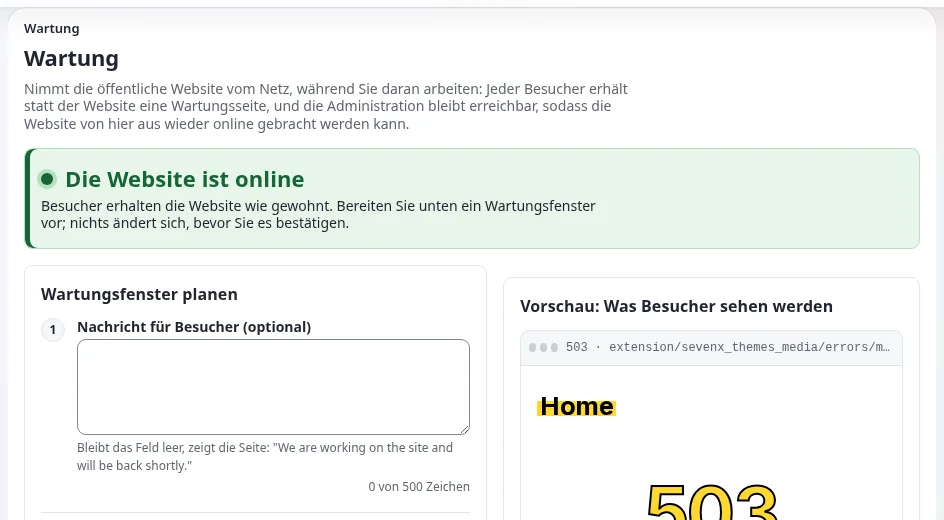

# Warnungen, Verfügbarkeit, Wartungsmodus und statischer Cache

Diese Seite richtet sich an Administratorinnen und Administratoren, Projektverantwortliche und Website-Ersteller eines
Rettungsdienstes oder jeder öffentlichen Stelle, deren Website erreichbar bleiben muss, wenn es am meisten darauf
ankommt. Sie erklärt die Werkzeuge, die Exponential für Last und Ausfälle hat, wie sie mit dem Veröffentlichen einer
dringenden Meldung zusammenwirken und was das Produkt nicht tut. Jedes unten beschriebene Verhalten ist auf den
verlinkten Seiten dokumentiert; testen Sie jedes auf Ihrer eigenen Installation, bevor ein Einsatz es für Sie testet.

> **Warnung**
> **`.htaccess` bremst jede Anfrage.** Sind `.htaccess`-Dateien erlaubt (`AllowOverride` alles außer `None`), geschweige
> denn genutzt, sucht Apache sie bei jeder Anfrage in jedem Verzeichnis des Pfads und liest und wertet sie aus, und
> die Ladezeiten der Seiten steigen drastisch ([gemessen](../../../../anleitungen/setup-dateien-von-der-konsole.md#gemessen-htaccess-gegen-regeln-im-virtuellen-host)). Die einzige wirkliche Abhilfe ist, die
> Funktion für den virtuellen Host abzuschalten: `AllowOverride None` im virtuellen HTTPS-Host, und die Regeln in
> der Konfiguration des virtuellen Hosts selbst als mod_rewrite-Regeln. Das ist in Geschwindigkeitstests im
> Produktivbetrieb weit schneller und die Zeit für die Optimierung einer Produktivkonfiguration unbedingt wert.
> Stellen Sie sofort um: Übernehmen Sie die Regeln des [Beispiels für einen virtuellen HTTPS-Host](../../../../beispiele/webserver/apache-virtueller-host.md) in
> Ihren virtuellen Host (mit dem statischen Cache auch [`staticcache_offload.conf`](../../../../../eng-us/examples/staticcache_offload.conf)), setzen Sie
> `AllowOverride None`, führen Sie `apachectl configtest` aus, laden Sie Apache neu und testen Sie die Website.
> Dieselben Regeln für andere Server: [nginx](../../../../beispiele/webserver/nginx.md), [LiteSpeed](../../../../beispiele/webserver/litespeed.md), [Caddy](../../../../beispiele/webserver/caddy.md), [IIS](../../../../beispiele/webserver/iis.md),
> [Velocity](../../../../beispiele/webserver/velocity.md) (eingebaut); wohin Regeln für virtuelle Hosts in einem Control Panel gehören:
> [Plesk](../../../hosting/control-panels/plesk.md), [cPanel](../../../hosting/control-panels/cpanel.md), [DirectAdmin](../../../hosting/control-panels/directadmin.md), [ISPConfig](../../../hosting/control-panels/ispconfig.md).

## Inhalt

1. [Die Schichten](#die-schichten)
2. [Der statische Cache](#der-statische-cache)
3. [Eine Meldung durch die Caches veröffentlichen](#eine-meldung-durch-die-caches-veröffentlichen)
4. [Wartungsmodus](#wartungsmodus)
5. [Wenn etwas ausfällt](#wenn-etwas-ausfällt)
6. [Was das Produkt nicht tut](#was-das-produkt-nicht-tut)

## Die Schichten

| Schicht | Was sie tut | Geleert oder aufgefrischt durch | Lesen |
|---|---|---|---|
| Ansichts-Cache | speichert dargestellte Inhaltsseiten | Veröffentlichen (das Objekt und verwandte Seiten), **Cache leeren** an einem Knoten | [Caches](../../../../anleitungen/caches.md) |
| Statischer Cache | Seiten als einfache Dateien gespeichert, die der Webserver sendet, ohne Exponential zu starten | Veröffentlichen frischt berührte Seiten auf; **Setup > Cache-Verwaltung**, *Statischer Inhalts-Cache* | [Generator für den statischen Cache](../../../../funktionen/6.0/generator-fuer-den-statischen-cache.md) |
| Antwort-Cache von Velocity | vom Webserver Velocity gehaltene Antworten | `./console exp:velocity cache clear --apply` | [Antwort-Cache von Velocity](../../../../funktionen/6.0/velocity-antwort-cache.md) |
| CDN oder Reverse Proxy | Kopien am Netzrand | das Purge des CDN | [HTTP-Caching und CDNs](../../../ersteller/website-ersteller/http-caching-und-cdns.md) |

## Der statische Cache

1. Erzeugen Sie ihn unter **Setup > Cache-Verwaltung**, *Statischer Inhalts-Cache*: Wählen Sie die Website, eine
   Seitengrenze und eine Linktiefe, drücken Sie *Neu erstellen* und beobachten Sie die gespeicherten Seiten. Oder in
   einer Shell: `php bin/php/makestaticcache.php --site=<siteaccess>`.
2. Liefern Sie ihn aus: Mit Apache und `.htaccess` kopieren Sie `.htaccess_root_static` nach `.htaccess`; mit einem
   virtuellen Host verwenden Sie die Regeln aus `doc/eng-us/examples/staticcache_offload.conf`.
3. Eine Anfrage wird nur dann aus einer Datei beantwortet, wenn sie ein einfaches GET oder HEAD ohne Query-String und
   ohne Sitzung ist; Formulare, Suchen und angemeldete Benutzer erhalten die Live-Seite.
4. Die Einstellungen stehen in `settings/staticcache.ini [CacheSettings]`: `CachedURLArray[]` (was zwischengespeichert
   wird), `AlwaysUpdateArray[]` (bei jedem Veröffentlichen aufgefrischt, standardmäßig `/`), `MaxCacheDepth` (12).

Nehmen Sie die Startseite und den Ordner Incidents in das Zwischengespeicherte und in `AlwaysUpdateArray[]` auf, damit
jede Einsatzmeldung sie auffrischt.

## Eine Meldung durch die Caches veröffentlichen

| Schritt | Wer |
|---|---|
| Die Einsatzmeldung veröffentlichen | die veröffentlichende Person in Bereitschaft |
| Ansichts-Cache des Objekts und verwandter Seiten geleert | automatisch |
| Vom Veröffentlichen berührte statische Seiten und die Seiten aus `AlwaysUpdateArray[]` aufgefrischt | automatisch, während des Veröffentlichens (sofern nicht `CronjobCacheClear=enabled` es auf den Cronjob-Teil `staticcache_cleanup` verschiebt) |
| Antwort-Cache von Velocity | läuft nach seiner Lebensdauer ab, oder leeren Sie ihn: `./console exp:velocity cache clear --apply` |
| CDN | läuft nach seiner Lebensdauer ab, oder Purge |
| Abgemeldet prüfen, auf einem Telefon, mit einem frischen Browser | die veröffentlichende oder eine zweite Person |

Messen Sie in einem Probelauf die gesamte Kette: die Zeit von **Zur Veröffentlichung schicken**, bis die Meldung für
einen anonymen Besucher auf jedem Weg sichtbar ist, den Ihre Besucher nutzen.

## Wartungsmodus

**Setup > Wartung** (oder `php bin/php/maintenance.php on --message="..." --until=2h --allow-admin`) nimmt die
öffentliche Website vom Netz: Seitenanfragen erhalten eine Wartungsseite mit Status 503, `Retry-After` und `no-store`;
Bilder, Stile und Skripte werden weiterhin ausgeliefert; die Administration bleibt mit `--allow-admin` erreichbar. Er
endet nie von selbst ([Wartungsmodus](../../../../anleitungen/wartungsmodus.md)).

| Zusammenspiel | Wirkung |
|---|---|
| Der Antwort-Cache von Velocity | pausiert, solange die Wartung an ist; jede Anfrage erreicht `index.php` |
| Der HTTP-Cache der Anwendung | seine Verzeichnisse werden beim Ein- und Ausschalten der Wartung beiseitegeschoben |
| Der statische Cache | die Auslagerungsregeln in `.htaccess_root_static` und `doc/eng-us/examples/staticcache_offload.conf` enthalten keine Prüfung auf die Wartungsmarkierung, sodass der Webserver statische Dateien während der Wartung weiter ausliefert |
| Ein CDN | speichert die Wartungsseite nicht, kann ältere Kopien behalten; nach dem Fenster purgen, wenn sich Inhalte geändert haben |

Während eines Einsatzes zählen die letzten beiden Zeilen: Wenn Sie das CMS für Reparaturen vom Netz nehmen müssen,
können zwischengespeicherte statische Seiten und CDN-Kopien der Einsatzinformationen weiter an Besucher ausgeliefert
werden. Entscheiden Sie im Voraus, ob Sie das wollen, und vermeiden Sie Wartungsfenster in Zeiten hohen Risikos. Muss die
Wartung eine besondere Seite zeigen, kann ein Theme `errors/maintenance.html` liefern (in sich geschlossen, ohne
Template-Code).

## Wenn etwas ausfällt

| Ausfall | Was weiter funktioniert | Was zu tun ist |
|---|---|---|
| PHP oder die Datenbank fällt aus | vom Webserver ausgelieferte Dateien des statischen Cache; CDN-Kopien | den Dienst wiederherstellen; die statischen Seiten zeigen den Stand der letzten Auffrischung |
| Last weit über dem Test | zwischengespeicherte Seiten; Velocity, falls verwendet | dynamische Seiten reduzieren: Besucher auf die zwischengespeicherte Einsatzseite leiten; den Wartungsmodus nur als letztes Mittel erwägen |
| Die Administration ist nicht erreichbar | die öffentliche Website aus den Caches | Meldungen über Ihre anderen Kanäle verbreiten; veröffentlichen, sobald sie wieder erreichbar ist |
| Der Hostingstandort fällt aus | nichts im Produkt | Ihr Ausfallplan: ein zweiter Standort, DNS, ein CDN, das veraltete Kopien ausliefert |
| Wartung eingeschaltet, und Sie kommen nicht wieder hinein | | `var/maintenance.json` löschen, wie es der Rückweg im Leitfaden zum Wartungsmodus beschreibt |

## Was das Produkt nicht tut

- Kein automatisches Failover zwischen Servern oder Rechenzentren.
- Kein eigenes Warn- oder Rundfunksystem; Einsatzmeldungen sind Inhalte.
- Kein Push auf Telefone; Benachrichtigungen sind E-Mails an Folgende nach dem nächsten Lauf der Benachrichtigungen.
- Keine Überwachung der Erreichbarkeit der öffentlichen Website; verwenden Sie einen externen Monitor.

Diese Punkte abzudecken gehört zu Ihrem Hosting- und Betriebskonzept
([Eine Website betreiben](../../../../anleitungen/betrieb-einer-website.md),
[Hosting-Unternehmen: hier beginnen](../../../hosting/hosting-anbieter-hier-beginnen.md)).

## Verwandte Seiten

- [Rettungsdienste](README.md)
- [Statischer Cache und Velocity](../../../ersteller/website-ersteller/statischer-cache-und-velocity.md)
- [Warnungen in vielen Sprachen und in einfacher Sprache](../oeffentliche-gesundheit/warnungen-mehrsprachig-und-in-einfacher-sprache.md)
- [Freie Dokumentation](../../../freie-dokumentation.md): Diese Seite darf unter der GNU FDL 1.3 frei kopiert, übersetzt und verbessert werden.

<!-- exp-partner-block:start -->
**Werden Sie Exponential-Partner.** Partner teilen ihre Informationen, stellen Mittel bereit, geben Beiträge zurück
und entwickeln die Produkte mit uns, und so wächst Exponential. Eine Partner-Website und ein Dashboard sind für Mitte
2027 geplant: Werden Sie noch heute Partner, damit wir schneller wachsen und neue Funktionen früher liefern. Beginnen
Sie mit [Partner: hier beginnen](../../../partner/partner-hier-beginnen.md) und
[Wie Sie sich bewerben](../../../partner/wie-sie-sich-bewerben.md).
<!-- exp-partner-block:end -->
