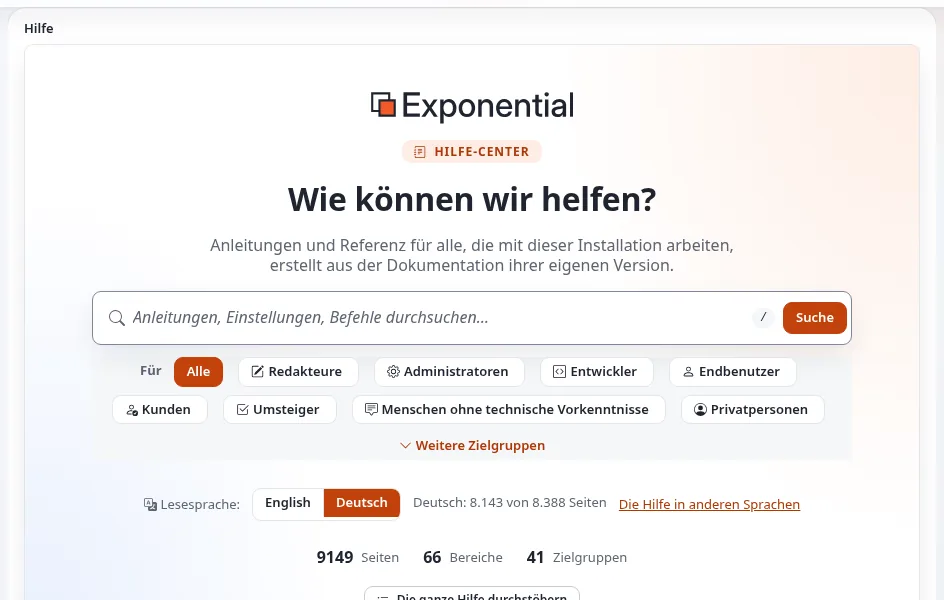
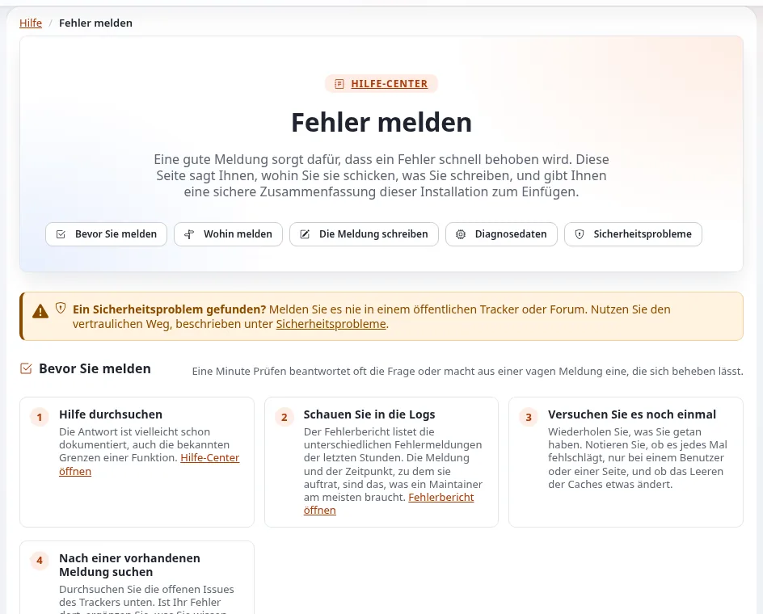

# FAQ: Support

Diese Seite beantwortet die Supportfragen öffentlicher Stellen zu Exponential. Die Antworten stammen aus
[Support erhalten](../../projekt/unterstuetzung-erhalten.md),
[Supportstufen und Reaktionszeiten](../../partner/support-stufen-und-reaktionszeiten.md) und `SECURITY.md`.

## Inhalt

1. [Wer betreut Exponential?](#wer-betreut-exponential)
2. [Gibt es kostenlosen Support?](#gibt-es-kostenlosen-support)
3. [Gibt es ein SLA?](#gibt-es-ein-sla)
4. [Können wir Support bei jemand anderem als 7x einkaufen?](#können-wir-support-bei-jemand-anderem-als-7x-einkaufen)
5. [Wie steht es um Sicherheitsprobleme?](#wie-steht-es-um-sicherheitsprobleme)
6. [Wie bitten wir gut um Hilfe?](#wie-bitten-wir-gut-um-hilfe)
7. [Können wir es selbst betreuen?](#können-wir-es-selbst-betreuen)

## Wer betreut Exponential?

7x, das Unternehmen, das Exponential pflegt, entwickelt, betreut und hostet ([Wer ist 7x?](../../wer-ist-7x.md)), mit der
Exponential Foundation hinter dem Open-Source-Projekt
([Wer ist die Exponential Foundation?](../../wer-ist-die-exponential-foundation.md)), Partnern und der Community.

## Gibt es kostenlosen Support?

Ja, von der Community: die Dokumentation, die Foren auf Share Exponential und Chats auf Telegram, Discord und Slack. Die
Supportseite des Projekts sagt, dass seine Entwickler nicht zu kostenlosem Support verpflichtet sind; dort sagt niemand
eine Antwortzeit zu ([Support erhalten](../../projekt/unterstuetzung-erhalten.md)).

## Gibt es ein SLA?

Nicht vom Projekt. Das Projekt veröffentlicht kein SLA; die einzige Zusage zur Reaktion in seinen Dateien ist die erste
Antwort auf eine vertrauliche Sicherheitsmeldung „within one business day“ (innerhalb eines Werktags)
([SLA-Optionen für das Hosting von Exponential](../../hosting/geschaeft/sla-optionen-fuer-exponential-hosting.md)). Service-Level ergeben sich aus
Ihrem Vertrag mit 7x, einem Partner oder einem Hoster. Partner haben gegenüber dem Projekt Reaktionszeiten nach Stufe
veröffentlicht, auf denen sie aufbauen können
([Supportstufen und Reaktionszeiten](../../partner/support-stufen-und-reaktionszeiten.md)).

## Können wir Support bei jemand anderem als 7x einkaufen?

Ja. Die Software steht unter der GPL, also kann jedes Unternehmen mit den nötigen Kompetenzen sie betreuen. Das
Partnerprogramm listet Implementierungs-, Hosting- und Schulungspartner auf
([Partner: hier beginnen](../../partner/partner-hier-beginnen.md)). Bewerten Sie einen Supportpartner nach seinen
Mitarbeitenden und Abläufen, nicht nur nach seiner Stufe.

## Wie steht es um Sicherheitsprobleme?

Nie öffentlich. Melden Sie Schwachstellen vertraulich an die Adresse in `SECURITY.md`; lassen Sie Passwörter, Geheimnisse
und personenbezogene Daten weg ([Wenn etwas schiefgeht](../../wenn-etwas-schiefgeht.md#sicherheitsprobleme)).
Korrekturen kommen mit dem nächsten Release 6.0.x
([Sicherheitsupdates und Patch-Rhythmus](../beschaffung/lebenszyklus/sicherheitsupdates-und-patch-rhythmus.md)).

## Wie bitten wir gut um Hilfe?

Sagen Sie, was Sie betreiben (Version, PHP, Engine, Datenbank), mit der Zusammenfassung aus **Setup >
Systeminformationen**, die Passwörter und Schlüssel weglässt; sagen Sie, was Sie getan, erwartet und gesehen haben;
veröffentlichen Sie nie Zugangsdaten oder personenbezogene Daten
([Support erhalten](../../projekt/unterstuetzung-erhalten.md#so-fragen-dass-sie-eine-antwort-bekommen)). Fehler gehören in den
Issue-Tracker; die Seite **Fehler melden** der Hilfe bereitet das Issue vor
([Wenn etwas schiefgeht](../../wenn-etwas-schiefgeht.md)).

## Können wir es selbst betreuen?

Ja, mit geschulten Mitarbeitenden: Die Kurse Website-Administration sowie Hosting und Betrieb in dieser Hilfe behandeln
die Routine ([Kurskatalog](../../trainer/kurskatalog.md)). Viele öffentliche Stellen kombinieren einen eigenen
First-Level-Support mit einem Dienstleister für Entwicklung und Notfälle.

## Verwandte Seiten

- [FAQ für Verwaltungen](README.md)
- [Support erhalten](../../projekt/unterstuetzung-erhalten.md)
- [Community-Kanäle](../../projekt/community-kanaele.md)
- [Freie Dokumentation](../../freie-dokumentation.md): Diese Seite darf unter der GNU FDL 1.3 frei kopiert, übersetzt und verbessert werden.

<!-- exp-partner-block:start -->
**Werden Sie Exponential-Partner.** Partner teilen ihre Informationen, stellen Mittel bereit, geben Beiträge zurück
und entwickeln die Produkte mit uns, und so wächst Exponential. Eine Partner-Website und ein Dashboard sind für Mitte
2027 geplant: Werden Sie noch heute Partner, damit wir schneller wachsen und neue Funktionen früher liefern. Beginnen
Sie mit [Partner: hier beginnen](../../partner/partner-hier-beginnen.md) und
[Wie Sie sich bewerben](../../partner/wie-sie-sich-bewerben.md).
<!-- exp-partner-block:end -->
