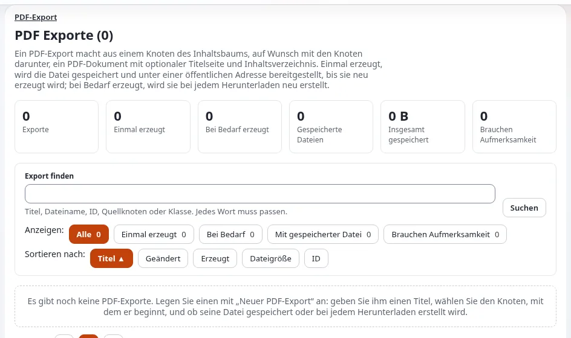

# Der PDF-Export

Diese Seite richtet sich an Administratoren und Zuständige für Schriftgut. **Setup > PDF-Export** (`/pdf/list`,
Richtlinie `pdf/edit`) erzeugt ein PDF-Dokument aus einem **Quellknoten** oder aus einem Baum von Knoten ausgewählter
Klassen ([PDF-Exporte](../../../anleitungen/pdf-exporte.md), [PDF-Export](../../../funktionen/6.0/pdf-export.md)).

## Inhalt

1. [Zwei Arten von Export](#zwei-arten-von-export)
2. [Einen Export anlegen](#einen-export-anlegen)
3. [Öffentlich über die Adresse](#öffentlich-über-die-adresse)
4. [Nutzen und Grenzen für Schriftgut](#nutzen-und-grenzen-für-schriftgut)
5. [Verwandte Seiten](#verwandte-seiten)

## Zwei Arten von Export

| Art | Wann das PDF erzeugt wird | Zeigt | Zugang |
|---|---|---|---|
| Einmal erzeugt | wenn der Export gespeichert wird, und bei **Neu erzeugen** | den Inhalt, wie er damals war | die gespeicherte Datei ist öffentlich unter `var/<site>/storage/pdf/<file name>` |
| Bei Bedarf erzeugt | bei jedem Download | immer aktuell | nur über `/pdf/edit/<id>/generate`, mit `pdf/edit` |

## Einen Export anlegen

1. **Neuer PDF-Export**: ein Titel (nur für die Liste).
2. **Inhalt**: der Quellknoten über **Durchsuchen**; **Knoten** oder **Baum**; bei einem Baum markieren Sie die Klassen,
   einschließlich der Ordner, die sie enthalten (ein Knoten einer nicht markierten Klasse wird mit allem darunter
   ausgelassen).
3. Optional ein Text für die **Startseite** und ein **Fußzeilentext**.
4. **Art des Exports** und **Dateiname** (Buchstaben, Ziffern, `.`, `_`, `-`).
5. **OK**: Fehler werden oben aufgeführt, mit Links zu ihren Feldern.

Für Sprachen außerhalb der lateinischen Schrift muss in `settings/override/pdf.ini.append.php` eine TrueType-Schrift
eingerichtet werden
([PDF-Export: Jede Sprache drucken](../../../funktionen/6.0/pdf-export.md#jede-sprache-drucken-eine-truetype-schrift-verwenden)).

## Öffentlich über die Adresse

Ein gespeichertes PDF wird vom Webserver an jeden ausgeliefert, der seine Adresse kennt, angemeldet oder nicht: Die
mitgelieferte `.htaccess_root` hat eine Regel für `var/<site>/storage/pdf/`. Geben Sie einem Export keinen Dateinamen,
den Sie nicht erraten haben möchten, und verwenden Sie für Inhalte, die nicht für alle bestimmt sind, einen bei Bedarf
erzeugten Export.

## Nutzen und Grenzen für Schriftgut

- Nützlich als datierte, menschenlesbare Momentaufnahme eines Teils der Website, zum Beispiel der Bekanntmachungen
  eines Jahres, einmal erzeugt und mit dem Datum in Ihrem Schriftgutsystem abgelegt.
- Der Export gibt den Namen des Knotens als erste Überschrift aus und danach seine Attribute; er ist keine pixelgenaue
  Kopie der Webseite.
- Das Repository dokumentiert für diesen Export keine Unterstützung für Tags, PDF/UA oder PDF/A: Behandeln Sie seine
  Ausgabe als PDF ohne Tags; wenn Ihr Archiv PDF/A verlangt, konvertieren und validieren Sie mit einem Werkzeug, das
  Ihr Archiv akzeptiert.
- Einmal erzeugte Dateien werden bei **Neu erzeugen** ersetzt: Bewahren Sie die abgelegte Kopie auf, nicht die aktuelle
  Datei.

## Verwandte Seiten

- [PDF-Exporte](../../../anleitungen/pdf-exporte.md)
- [Dateiformate für die Langzeiterhaltung](dateiformate-fuer-die-langzeiterhaltung.md)
- [Inhalte exportieren](inhalte-exportieren.md)
- [Freie Dokumentation](../../freie-dokumentation.md): Diese Seite darf unter der GNU FDL 1.3 frei kopiert, übersetzt und verbessert werden.

<!-- exp-partner-block:start -->
**Werden Sie Exponential-Partner.** Partner teilen ihre Informationen, stellen Mittel bereit, geben Beiträge zurück
und entwickeln die Produkte mit uns, und so wächst Exponential. Eine Partner-Website und ein Dashboard sind für Mitte
2027 geplant: Werden Sie noch heute Partner, damit wir schneller wachsen und neue Funktionen früher liefern. Beginnen
Sie mit [Partner: hier beginnen](../../partner/partner-hier-beginnen.md) und
[Wie Sie sich bewerben](../../partner/wie-sie-sich-bewerben.md).
<!-- exp-partner-block:end -->
