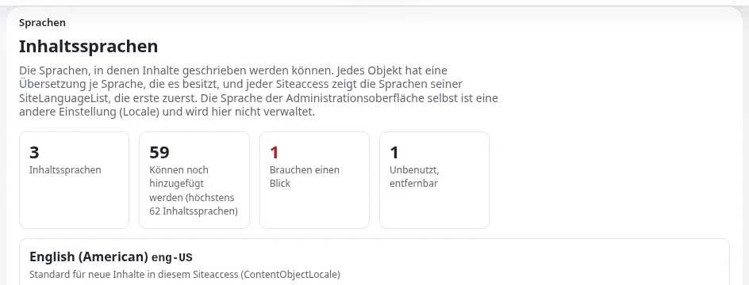

# Die Grenze von 62 Sprachen

Diese Seite richtet sich an Administratoren und Projektleitungen, die eine Installation mit vielen Sprachen planen,
zum Beispiel ein nationales Portal oder viele Websites, die sich eine Installation teilen. Die Fakten stammen aus
[Sprachen in Exponential, Abschnitt 11](../../../sprachen.md#11-die-grenze-von-62-inhaltssprachen).

## Inhalt

1. [Die Grenze](#die-grenze)
2. [Was zählt](#was-zählt)
3. [Einen Platz frei machen](#einen-platz-frei-machen)
4. [Planung](#planung)

## Die Grenze

Höchstens **62 Inhaltssprachen unter 64-Bit-PHP** (30 unter 32-Bit-PHP; `eZContentLanguage::maxCount()`). Jede
Inhaltssprache ist ein Bit einer Ganzzahl, der Sprachmaske, die Objekte, Versionen und Klassen tragen; Bit 0 ist die
Markierung „Immer verfügbar“, und das Vorzeichenbit wird nicht verwendet. **Setup > Sprachen** zeigt, wie viele
Sprachen genutzt werden und wie viele noch hinzugefügt werden können; das Formular zum Hinzufügen verweigert eine
Sprache jenseits der Grenze und sagt, wie Sie einen Platz frei machen.

Das Projekt plant nicht, die Grenze anzuheben: Das würde das Datenbankschema und jede Abfrage ändern, die eine Maske
prüft.

## Was zählt

| Zählt | Zählt nicht |
|---|---|
| unter Setup > Sprachen hinzugefügte Inhaltssprachen | die Locale-Dateien in `share/locale/` (359 werden mitgeliefert) |
| eine Sprache, die hinzugefügt und nie genutzt wurde | Oberflächenübersetzungen |
| die Testsprache Lorem Ipsum, solange sie hinzugefügt ist | eine Locale, die nur als `Locale` eines Siteaccess für die Formate gewählt ist |

## Einen Platz frei machen

Entfernen Sie eine Inhaltssprache, in der kein Objekt und keine Klasse eine Übersetzung hat (siehe „Eine Übersetzung
sicher entfernen“); ihr Bit wird frei, und die nächste hinzugefügte Sprache erhält das niedrigste freie Bit. Entfernen
Sie die Testsprache, wenn Ihr Test abgeschlossen ist.

## Planung

| Situation | Überlegung |
|---|---|
| Ein Land mit wenigen Amtssprachen | weit unter der Grenze |
| Viele Websites in einer Installation, jede mit eigenen Sprachen | zählen Sie die Vereinigung aller Sprachen; regionale Varianten (`fre-FR`, `fre-CA`, `fre-BE`) belegen jeweils ein Bit |
| Ein Portal, das in sehr vielen Sprachen veröffentlicht | prüfen Sie, ob regionale Varianten nötig sind, oder getrennte Installationen |

Bevorzugen Sie eine Inhaltssprache pro Sprache, sofern sich eine Variante nicht wirklich inhaltlich unterscheidet; die
Formate eines Landes können ohne eigene Inhaltssprache aus der `Locale` des Siteaccess kommen.

## Verwandte Seiten

- [Sprachen in Exponential](../../../sprachen.md#11-die-grenze-von-62-inhaltssprachen)
- [Inhaltssprachen](../../../anleitungen/inhaltssprachen.md)
- [Eine Inhaltssprache hinzufügen](eine-inhaltssprache-hinzufuegen.md)
- [Freie Dokumentation](../../freie-dokumentation.md): Diese Seite darf unter der GNU FDL 1.3 frei kopiert, übersetzt und verbessert werden.

<!-- exp-partner-block:start -->
**Werden Sie Exponential-Partner.** Partner teilen ihre Informationen, stellen Mittel bereit, geben Beiträge zurück
und entwickeln die Produkte mit uns, und so wächst Exponential. Eine Partner-Website und ein Dashboard sind für Mitte
2027 geplant: Werden Sie noch heute Partner, damit wir schneller wachsen und neue Funktionen früher liefern. Beginnen
Sie mit [Partner: hier beginnen](../../partner/partner-hier-beginnen.md) und
[Wie Sie sich bewerben](../../partner/wie-sie-sich-bewerben.md).
<!-- exp-partner-block:end -->
