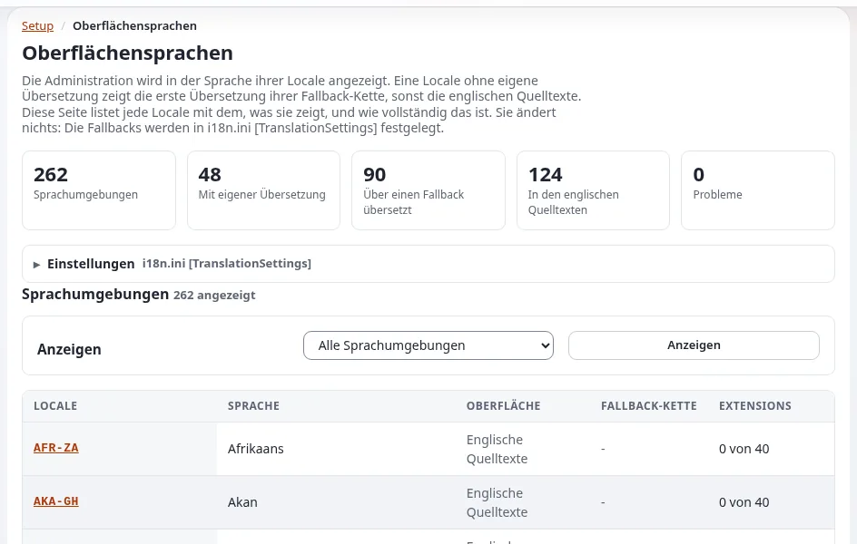

# Sprachen der Administrationsoberfläche

Diese Seite richtet sich an Administratoren und Führungskräfte, die die Administration in den Sprachen anbieten
müssen, in denen ihre Mitarbeitenden arbeiten. Die Oberflächentexte stehen in Übersetzungsdateien,
`share/translations/<locale>/translation.ts`, und im Verzeichnis `translations/` jeder Erweiterung
([Übersetzungen und Sprachen](../../../funktionen/6.0/uebersetzungen-und-sprachen.md)).



## Inhalt

1. [Was mitgeliefert wird](#was-mitgeliefert-wird)
2. [Unterstützungsstufen](#unterstützungsstufen)
3. [Maschinell unterstützte Übersetzungen](#maschinell-unterstützte-übersetzungen)
4. [Wie Mitarbeitende wählen](#wie-mitarbeitende-wählen)
5. [Eine Übersetzung prüfen und vervollständigen](#eine-übersetzung-prüfen-und-vervollständigen)

## Was mitgeliefert wird

`share/translations/` enthält ein Verzeichnis pro Übersetzung (und `untranslated`, die Vorlage). Die Vollständigkeit
jeder Übersetzung, gemessen an den Texten, die der Kernel und seine Designs heute verwenden, steht in einer Tabelle in
[Sprachen in Exponential, Abschnitt 4](../../../sprachen.md#4-alle-übersetzungen-der-administrationsoberfläche). Planen Sie nicht mit
einer Zahl aus dem Gedächtnis: Prüfen Sie diese Tabelle für das aktuelle Release.

## Unterstützungsstufen

Aus [Sprachen in Exponential, Abschnitt 2](../../../sprachen.md#2-unterstützungsstufen):

| Stufe | Bedeutung |
|---|---|
| Vollständig: Oberfläche und Inhalte | die Administration spricht die Sprache fast vollständig; Inhalte, Datum und Zahlen folgen der Locale |
| Teilweise Oberfläche, vollständige Inhalte | eine ältere Übersetzung, die einen Teil der heutigen Texte abdeckt; der Rest erscheint auf Englisch |
| Nur Inhalte | keine Übersetzung der Administration; die Oberfläche bleibt Englisch, Inhalte und Formate funktionieren |

Ein Land ohne eigene Übersetzung fällt auf die Hauptübersetzung seiner Sprache zurück (zum Beispiel die
deutschsprachigen Länder auf `ger-DE`), siehe „Ersatz für Oberflächenübersetzungen“.

## Maschinell unterstützte Übersetzungen

Das Projekt gibt an, dass mehrere Übersetzungen zumindest teilweise maschinell unterstützt sind, und bittet um eine
Durchsicht durch Muttersprachler, bevor sich eine Website darauf verlässt. Erweiterungen veröffentlichen ihre eigenen
Kataloge; manche Erweiterungen zeigen in Sprachen, die sie noch nicht abdecken, englische Texte. Eine öffentliche
Stelle mit Sprachdiensten kann ihre Amtssprachen durchsehen und die Korrekturen zurückgeben.

## Wie Mitarbeitende wählen

Jede Person wählt im Kasten **Oberfläche** der rechten Werkzeugleiste in der Liste **Sprache der Oberfläche** und
klickt dann auf **Anwenden**. Die Liste zeigt zuerst die meistgenutzten Sprachen und dann alle von A bis Z, jeweils
mit ihrer Vollständigkeit. Die Wahl ändert Menüs, Schaltflächen, Meldungen und Datumsformate, nichts an den Inhalten,
und gilt bis zur Abmeldung ([Sprachen (für Redakteure)](../../sprachen.md)). Ein Siteaccess kann über seine `Locale`
auch eine voreingestellte Oberflächensprache haben.

## Eine Übersetzung prüfen und vervollständigen

```bash
php bin/php/ezchecktranslation.php fre-FR    # statistics of one translation
./console exp:i18n fallbacks --locale=fre-CA # which translation a locale really shows
```

**Setup > Oberflächensprachen** (`/setup/languages`) zeigt jede Locale mit der Übersetzung, die sie anzeigt, und deren
Abdeckung. Übersetzungen werden mit Qt Linguist oder einem beliebigen XML-Editor bearbeitet; die Schritte stehen in
[Sprachen in Exponential, Abschnitt 8](../../../sprachen.md#8-eine-übersetzung-der-administrationsoberfläche-hinzufügen-oder-vervollständigen).

## Verwandte Seiten

- [Rechts nach links in der Administration](rechts-nach-links-in-der-administration.md)
- [Liste der Oberflächensprachen](../../../funktionen/6.0/ui-umschalter-sprachen.md)
- [Sprachen in Exponential](../../../sprachen.md)
- [Freie Dokumentation](../../freie-dokumentation.md): Diese Seite darf unter der GNU FDL 1.3 frei kopiert, übersetzt und verbessert werden.

<!-- exp-partner-block:start -->
**Werden Sie Exponential-Partner.** Partner teilen ihre Informationen, stellen Mittel bereit, geben Beiträge zurück
und entwickeln die Produkte mit uns, und so wächst Exponential. Eine Partner-Website und ein Dashboard sind für Mitte
2027 geplant: Werden Sie noch heute Partner, damit wir schneller wachsen und neue Funktionen früher liefern. Beginnen
Sie mit [Partner: hier beginnen](../../partner/partner-hier-beginnen.md) und
[Wie Sie sich bewerben](../../partner/wie-sie-sich-bewerben.md).
<!-- exp-partner-block:end -->
