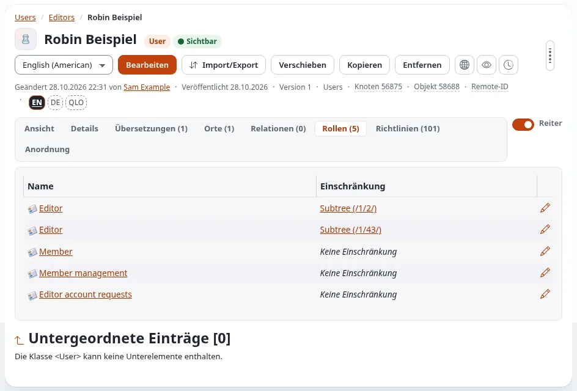

# Was die Redakteursrolle erlaubt

Ein Konto in der Gruppe **Editors** erhält die Rollen dieser Gruppe. Diese Seite sagt in einfachen Worten, was sie
erlauben: So weiß ein Redakteur, was er erwarten kann, und ein Administrator erkennt, ob etwas Fehlendes gewollt ist.
Sie beschreibt die Rollen einer neuen Installation; die Administratoren Ihrer Website können sie geändert haben.

Ihre eigenen Rollen sehen Sie in Ihrem Konto (**Profil bearbeiten** in der linken Spalte des Dashboards oder Ihr Name
im Benutzermenü) im Reiter **Rollen**. **Richtlinien** listet jede einzelne Berechtigung aus allen Rollen zusammen.

## Die vier Rollen der Gruppe Editors

| Rolle | Zugewiesen mit | Wofür sie da ist |
|---|---|---|
| **Editor** | zweimal: auf den Baum Content und auf den Baum Media beschränkt | die tägliche Arbeit: schreiben, bearbeiten, veröffentlichen, Medien |
| **Member** | ohne Einschränkung | das eigene Konto: Passwort, Profil, Benachrichtigungen |
| **Member management** | ohne Einschränkung; jede Berechtigung ist auf die Gruppe Members beschränkt | die Mitglieder der Website verwalten ([Mitglieder verwalten](mitglieder-verwalten.md)) |
| **Editor account requests** | ohne Einschränkung; auf die Gruppe Editors beschränkt | das Konto einer neuen Kollegin beantragen, das ein Administrator freigibt ([Neue Redakteurskonten freigeben](../anleitungen/neue-redakteurskonten-freigeben.md)) |

Weil die Rolle Editor den Bäumen Content und Media zugewiesen ist, wirkt jede der folgenden Berechtigungen, die ein
Element betrifft, nur dort: Objekte der Einrichtung, der Benutzer oder des Designs kann ein Redakteur damit nicht
ändern.

## Die tägliche Arbeit (die Rolle Editor)

| Was ein Redakteur tun kann | Berechtigung |
|---|---|
| Den Editor und das Dashboard öffnen; die eigenen Entwürfe und ausstehenden Elemente sehen | `user/login`, `content/dashboard`, `content/pendinglist` |
| Elemente in den Sektionen Standard, Restricted und Media lesen | `content/read` (auf diese Sektionen beschränkt) |
| Elemente der Inhaltsklassen der Website an den Orten anlegen, an die sie gehören (siehe unten) | `content/create` (nach Klasse und nach der Klasse des übergeordneten Elements beschränkt) |
| Elemente bearbeiten, übersetzen und veröffentlichen | `content/edit`, `content/translate` |
| Elemente verschieben und Orte hinzufügen oder entfernen | `content/manage_locations` |
| Ein Element **verbergen und wieder anzeigen** (Verbergen / Anzeigen in seinem Menü) | `content/hide` |
| Ein Element in den **Papierkorb** verschieben, in den Papierkorb schauen und ein Element daraus **wiederherstellen** | `content/remove`, `content/restore` |
| Sehen, welche Elemente ein Element **verwenden**, bevor man es verschiebt oder entfernt | `content/reverserelatedlist` |
| Versionen vergleichen, alte Versionen lesen, alte Versionen entfernen | `content/diff`, `content/versionread`, `content/versionremove` |
| Lesezeichen, eingebettete Elemente im Rich Text | `content/bookmark`, `content/view_embed` |
| **Viele Dateien auf einmal** in die Medienbibliothek hochladen (Dateien hochladen im Dashboard) | `ezmultiupload/*` |
| Ein Bild im Bearbeitungsformular bearbeiten (**Bild bearbeiten**: zuschneiden, drehen, Filter) | `expimageeditor/edit` |
| Von der Website aus bearbeiten: die **Website-Werkzeugleiste** für die Klassen, die der Redakteur anlegen darf | `websitetoolbar/use` (nach Klasse beschränkt) |
| Der Rich-Text-Editor und seine Dialoge | `ezoe/*` |
| Textdokumente importieren und exportieren (OpenDocument und Word) | `ezodf/*` |
| Die **Sprache der Oberfläche** und das **Administrationsdesign** in der rechten Spalte (Oberfläche) wählen | `uiswitch/language`, `uiswitch/design` |
| Die zweistufige Anmeldung für das eigene Konto einrichten und bei der Anmeldung bestätigen | `user2fa/setup`, `user2fa/verify` |
| Der Schreibassistent im Bearbeitungsformular (Exponential Intelligence) | `expai/write` |
| Die Hilfeseiten lesen | `exphelp/read` |
| Elementen per E-Mail folgen; RSS-Feeds | `notification/use`, `rss/feed` |
| Einer App erlauben, für das eigene Konto zu handeln (Anmelden mit Exponential) | `oauth/authorize` |

### Welche Elemente ein Redakteur anlegen kann

Die Rolle Editor nennt die Inhaltsklassen, die ein Redakteur anlegen darf, und wo. Bei einer neuen Installation sind
das die Inhaltsklassen der Website unter einem Ordner (Artikel, Ordner, Dateien, Bilder, Links, Galerien,
Veranstaltungen und Kalender, Foren, Blogs, Dokumentationsseiten und ähnliche) mit ihren Unterelementen, etwa
Blogbeiträgen unter einem Blog und Bildern unter einer Galerie. Eine Installation mit den Klassen der Media-Site fügt
diese hinzu: Landing pages, NG Articles, NG Blog posts, NG Galleries, News, Categories, Containers, die Komponenten
(Hero, Features, About, Logos, Quote, Lead), Banner, Kontakt- und Feedbackformulare, Stellenangebote, Menüeinträge und
die übrigen Klassen der Media-Site, unter einem Ordner, der Startseite und den Containern der Media-Site. Die
Website-Werkzeugleiste ist für dieselben Klassen erlaubt.

Bietet **Neu erstellen** eine Klasse, die Sie brauchen, nicht oder nur an manchen Orten an, nennt die Rolle sie dort
nicht: Fragen Sie einen Administrator.

## Ihr eigenes Konto (die Rolle Member)

Ihr Passwort ändern (`user/password`), Ihren eigenen Namen, Ihre E-Mail-Adresse und Ihr Bild bearbeiten
(`user/selfedit`), Ihre Benachrichtigungen verwalten (`notification/use`) und die zweistufige Anmeldung einrichten.
Wie auf der öffentlichen Website erlaubt die Rolle außerdem, die Sektion Restricted zu lesen, Kommentare und
Forenbeiträge zu schreiben und die eigenen zu bearbeiten. Siehe [Ihr Konto und die Anmeldung](konten-und-anmeldung.md).

## Das Konto einer neuen Kollegin (Editor account requests)

Diese Rolle erlaubt einem Redakteur, die Gruppe Editors zu öffnen und dort einen **User** anzulegen, sonst nichts. Das
neue Konto wird erst veröffentlicht, wenn ein Administrator es freigibt, und kann sich vorher nicht anmelden
([Neue Redakteurskonten freigeben](../anleitungen/neue-redakteurskonten-freigeben.md)).

## Was bei den Administratoren bleibt

| Nicht für Redakteure | Warum |
|---|---|
| Den Papierkorb für alle leeren (`content/cleantrash`) | er entfernt die Elemente aller endgültig; Redakteure stellen wieder her, Administratoren leeren |
| Die Sprachen der Installation, URL-Aliase und Platzhalter, Inhaltsaufträge | sie ändern die ganze Website, nicht ein Element |
| Einrichtung, Klassen, Rollen, Sektionen, Workflows, Objektzustände | die Verwaltung der Website |
| Konten von Administratoren und anderen Redakteuren | geschützt: Redakteure verwalten nur **Mitglieder** ([Mitglieder verwalten](mitglieder-verwalten.md)) |
| Rollen zuweisen | nur Administratoren |
| Der Layout-Editor und die Objektzustände | im Editor ausgeschaltet; Administratoren verwenden sie in der Administration |
| Der Git-Manager und die Aktualisierungen | die Installation aktualisieren |

Öffnet ein Redakteur eines davon, sieht er *Zugriff verweigert* oder *Die angeforderte Seite konnte nicht angezeigt
werden*. Das ist gewollt; fragen Sie einen Administrator.

## Für Administratoren: die Rolle vollständig halten

Eine neue Installation richtet die Rolle wie beschrieben ein. Auf einer bestehenden Installation listet der Befehl
`php bin/php/addeditorpolicies.php --dry-run`, was der Rolle Editor fehlt (verbergen, wiederherstellen, umgekehrte
Relationen, Mehrfach-Upload, der Bildeditor und die Berechtigungen für das eigene Konto), und warnt vor Berechtigungen,
die eine Redakteursrolle nicht haben sollte; ohne `--dry-run` fügt er das Fehlende hinzu.
`php bin/php/addmembermanagement.php` tut dasselbe für die Rolle *Member management*. Einzelheiten:
[Die alltäglichen Richtlinien der Rolle Editor](../bc/6.0/redakteur-rolle-richtlinien.md) und
[Mitgliederverwaltung](../bc/6.0/mitgliederverwaltung.md).

Um zu ändern, was Redakteure dürfen, bearbeiten Sie die Rollen unter **Einrichtung > Rollen und Richtlinien**
([Rollen und Richtlinien](../anleitungen/rollen-und-richtlinien.md)); verschieben Sie nie einen Redakteur nach
Administrator users, um eine fehlende Berechtigung zu beheben.

## Verwandte Seiten

- [Konten für Redakteure und Administratoren einrichten](konten-fuer-redakteure-und-administratoren-einrichten.md)
- [Mitglieder verwalten](mitglieder-verwalten.md)
- [Wie sehe ich, was ein Benutzer tun darf?](handbuch/wie-sehe-ich-was-ein-benutzer-tun-darf.md)
- [Rollen und Richtlinien](../anleitungen/rollen-und-richtlinien.md)
- [Freie Dokumentation](freie-dokumentation.md): Diese Seite darf unter der GNU FDL 1.3 frei kopiert, übersetzt und verbessert werden.

<!-- exp-partner-block:start -->
**Werden Sie Exponential-Partner.** Partner teilen ihre Informationen, stellen Mittel bereit, geben Beiträge zurück
und entwickeln die Produkte mit uns, und so wächst Exponential. Eine Partner-Website und ein Dashboard sind für Mitte
2027 geplant: Werden Sie noch heute Partner, damit wir schneller wachsen und neue Funktionen früher liefern. Beginnen
Sie mit [Partner: hier beginnen](partner/partner-hier-beginnen.md) und
[Wie Sie sich bewerben](partner/wie-sie-sich-bewerben.md).
<!-- exp-partner-block:end -->
