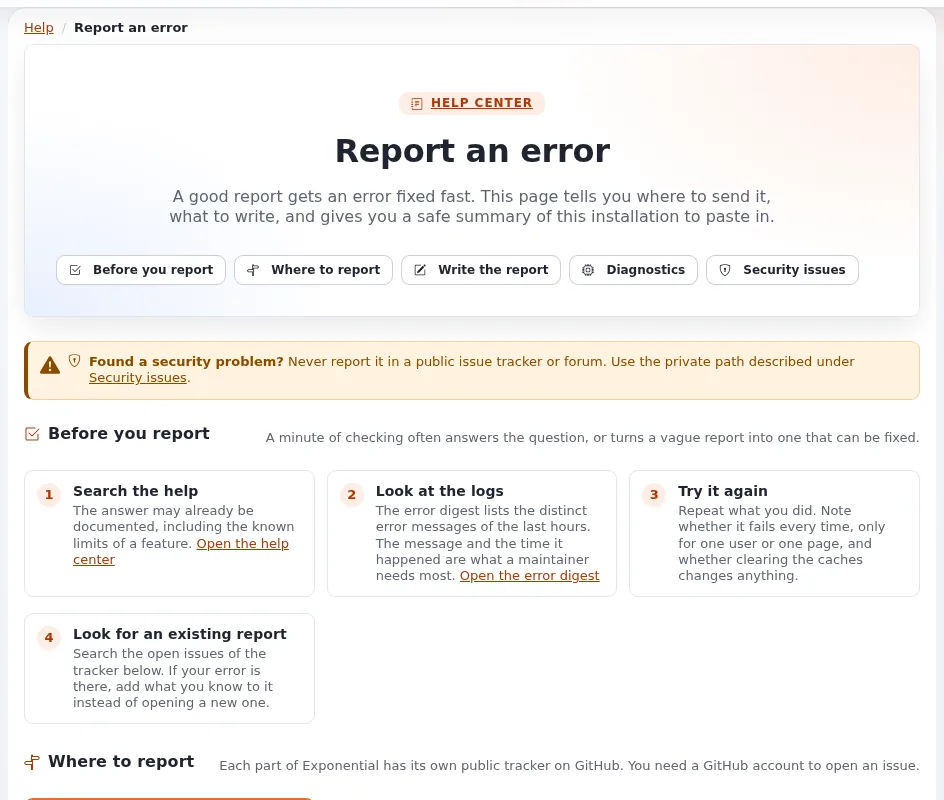

# Wenn etwas schiefgeht

Diese Seite ist für alle, die auf einen Fehler stoßen: Redakteure in der Administration, Besucher der Site oder
Administratoren, die ein Problem weitergeben. Sie erklärt, was die häufigen Fehlerseiten bedeuten, wen Sie
informieren und wie Sie ein Problem so beschreiben, dass es behoben wird.

## Zuerst: Ist es ein Fehler?

Manche Seiten sehen wie Fehler aus, sagen aber nur, dass etwas nicht erlaubt oder nicht vorhanden ist:

| Was die Seite sagt | Was es bedeutet | Was Sie tun können |
|---|---|---|
| *Die angeforderte Seite konnte nicht angezeigt werden. (1)*, *...aufgrund von Sicherheitsbedenken*, *Ihr Benutzerkonto hat nicht die notwendigen Privilegien* | Ihre Rolle darf diese Seite nicht öffnen oder diese Aktion nicht ausführen. | Bitten Sie Ihren Administrator um Zugriff, falls Sie ihn brauchen. |
| *Die angeforderte Seite konnte nicht angezeigt werden. (20)*, *Die angeforderte Adresse oder das Modul konnte nicht gefunden werden* | Die Adresse ist falsch, oder dieser Teil ist auf dieser Site nicht installiert. | Prüfen Sie die Adresse; gehen Sie zurück und verwenden Sie die Menüs. |
| *Möglicher Bearbeitungs-Konflikt* | Jemand (oder Sie selbst) hat bereits einen Entwurf des Objekts. | Siehe [Inhalte erstellen und bearbeiten](inhalte-bearbeiten.md#wenn-jemand-anderes-bearbeitet). |
| Eine Schaltfläche ist ausgegraut | Sie dürfen sie hier oder im Moment nicht verwenden (zum Beispiel während des Bearbeitens). | Zeigen Sie mit dem Mauszeiger darauf, um den Grund zu lesen. |
| Die Seite ist sehr langsam, oder die Site ist im Wartungsmodus | Die Site ist vielleicht ausgelastet oder wird gerade aktualisiert. | Warten Sie einen Moment und versuchen Sie es erneut. |

## Wenn wirklich etwas schiefgegangen ist

Ein Fehler der Site zeigt eine Seite wie **Bei uns ist etwas schiefgegangen**, unten mit einer **Referenz**, zum
Beispiel `ERR-0123456789`. Der Fehler ist bereits protokolliert; mit der Referenz findet ein Administrator genau
diesen Moment in den Protokollen.

1. **Notieren Sie die Referenz**, die Uhrzeit und die Adresse der Seite (kopieren Sie sie aus der Adressleiste des
   Browsers).
2. **Schreiben Sie auf, was Sie getan haben**, Schritt für Schritt, unmittelbar vor dem Fehler: welche Seite, welche
   Schaltfläche, was Sie eingegeben haben.
3. Versuchen Sie es noch einmal. Funktioniert es jetzt, erwähnen Sie, dass es einmal passiert ist.
4. **Informieren Sie Ihren Administrator** (oder die Kontaktperson der Site) und geben Sie die Referenz, die Uhrzeit,
   die Adresse und die Schritte weiter. Administratoren finden die Anfrage anhand der Referenz, siehe
   [Einen Fehler anhand seiner Referenz finden](../anleitungen/fehler-anhand-der-referenz-finden.md).

Ein Bildschirmfoto hilft, solange es keine Passwörter und keine personenbezogenen Daten anderer zeigt.

## Einen Fehler in Exponential melden

Stellt Ihr Administrator (oder Sie als Administrator) fest, dass das Problem in der Software selbst liegt und nicht
in der Einrichtung der Site, melden Sie es öffentlich, damit es für alle behoben werden kann. Die Seite **Fehler
melden** der Hilfe (`exphelp/report` in der Administration) führt Sie durch die Meldung, füllt eine Zusammenfassung
der Installation für Sie aus und öffnet ein neues Issue mit vorbereitetem Titel und Text.

Wählen Sie den richtigen Tracker:

| Tracker | Wofür |
|---|---|
| [Exponential (die Software)](https://github.com/se7enxweb/exponential/issues) | Fehler im Kernel, in der Administration, in den mitgelieferten Erweiterungen und in der Dokumentation. |
| [Exponential Velocity](https://github.com/se7enxweb/exponential-velocity/issues) | Fehler des Anwendungsservers Velocity: Start, Worker, sein Antwort-Cache, HTTPS. |
| Das eigene Repository der Erweiterung | Fehler in einer Erweiterung, die ein eigenes Repository hat; die Seite **Fehler melden** listet sie auf. |
| [Exponential-Projekt und Community](https://github.com/se7enxweb/exponential-community/issues) | Das Projekt, die Website, das Ökosystem und alles, was kein Fehler in einer Software ist. |

Um ein Issue zu eröffnen, brauchen Sie ein kostenloses GitHub-Konto. Durchsuchen Sie zuerst den Tracker: Ist das
Problem bereits bekannt, ergänzen Sie Ihr Wissen in diesem Issue, statt ein neues zu eröffnen.

### Eine gute Fehlerbeschreibung

- **Ein kurzer Titel**, der das Problem benennt: *Upload-Seite: ZIP-Datei mit einem Ordner scheitert mit „temp_dir“*.
- **Was Sie getan haben**, Schritt für Schritt, damit jemand anderes es nachstellen kann.
- **Was Sie erwartet haben** und **was stattdessen geschah**, mit der genauen Meldung.
- **Die Umgebung**: die Exponential-Version, die PHP-Version, der Webserver (Exponential Velocity, Apache oder nginx
  mit PHP-FPM, FrankenPHP), die Datenbank und das Design der Administration. Die Seite **Fehler melden** und
  **Setup** > **Systeminformationen** (**Bericht als Text kopieren**) liefern Ihnen diese Zusammenfassung; beide
  lassen Passwörter, Schlüssel und Serverpfade weg.
- **Protokollzeilen** um den Zeitpunkt herum, wenn ein Administrator sie beschaffen kann; entfernen Sie vorher alles
  Private.

Schreiben Sie niemals Passwörter, Schlüssel, Sitzungs-Cookies, Datenbankadressen oder personenbezogene Daten von
Kunden oder Benutzern in ein öffentliches Issue.

### Noch besser: die Korrektur mitschicken

Haben Sie die Ursache selbst gefunden, können Sie die Korrektur gleich mit der Meldung schicken. Ist der Code als
Git-Klone installiert, ist eine Korrektur nur einen Branch in Ihrem Fork und einen Pull-Request entfernt, und sie
erreicht mit dem nächsten Release jede Site. [Mit Git entwickeln](mit-git-entwickeln.md#eine-änderung-per-pull-request-beitragen)
zeigt Schritt für Schritt, wie es geht. Erwähnen Sie das Issue im Pull-Request (zum Beispiel `Fixes #123`), damit
beide verknüpft sind.

## Sicherheitsprobleme

Finden Sie ein Sicherheitsproblem, etwa eine Möglichkeit, etwas zu sehen oder zu ändern, das Sie nicht sehen oder
ändern sollten, melden Sie es **nicht** in einem öffentlichen Tracker. Schicken Sie es vertraulich an
**security@se7enx.com**, oder verwenden Sie die vertrauliche Meldung von Sicherheitslücken von GitHub im jeweiligen
Repository. Nennen Sie die Version, die Sie betreiben, was ein Angreifer tun könnte und wie es sich nachstellen
lässt. Die vollständige Richtlinie steht in der Datei `SECURITY.md` im Hauptverzeichnis der Installation.

**„Diese Installation ist eine öffentliche Demo“.** Diese Meldung oder ein Hinweisbalken **Demo-Modus** bedeutet, dass die Site absichtlich im Demo-Modus läuft: Administratorpasswörter lassen sich dort weder ändern noch zurücksetzen. Erscheint sie auf einer echten Site, informieren Sie sofort die Betreiber des Servers. [Demo-Modus: häufige Fragen](demomodus-faq.md), [Probleme mit dem Demo-Modus](hosting/runbooks/probleme-mit-dem-demomodus.md).

## Um Hilfe bitten

Für Fragen, die keine Fehler sind („Wie mache ich ...?“), ist die Community die richtige Anlaufstelle: die
[Foren der Exponential-Community](https://share.exponential.earth/forums), der
[Telegram-Community-Chat](https://t.me/exponentialcms), der [Discord-Server](https://discord.gg/zXzGMgfzej) und der
[Slack-Workspace](https://exponentialcms.slack.com/), alle kostenlos. Bevor Sie fragen, sehen Sie in der
[Exponential-Dokumentation](https://exponential.doc.exponential.earth/Exponential), in
[eZpedia](https://ezpedia.exponential.earth/) und in den [Artikeln auf Share Exponential](https://share.exponential.earth/learn)
nach. Vielleicht haben auch die anderen Hilfeseiten schon die Antwort: siehe [Hilfe für Redakteure und Benutzer](README.md).

Kostenlose Hilfe hängt von der Zeit ab, die Menschen geben; niemand verspricht deshalb eine Antwortzeit. Wenn Sie
nicht warten können, empfiehlt die [Support-Seite](https://exponential.earth/support) des Projekts den
kostenpflichtigen Support von 7x, dem Unternehmen, das Exponential pflegt
([se7enx.com/services](https://se7enx.com/services)). Beide Arten von Support erklärt
[Unterstützung erhalten](projekt/unterstuetzung-erhalten.md).

<!-- exp-partner-block:start -->
**Werden Sie Exponential-Partner.** Partner teilen ihre Informationen, stellen Mittel bereit, geben Beiträge zurück
und entwickeln die Produkte mit uns, und so wächst Exponential. Eine Partner-Website und ein Dashboard sind für Mitte
2027 geplant: Werden Sie noch heute Partner, damit wir schneller wachsen und neue Funktionen früher liefern. Beginnen
Sie mit [Partner: hier beginnen](partner/partner-hier-beginnen.md) und
[Wie Sie sich bewerben](partner/wie-sie-sich-bewerben.md).
<!-- exp-partner-block:end -->
