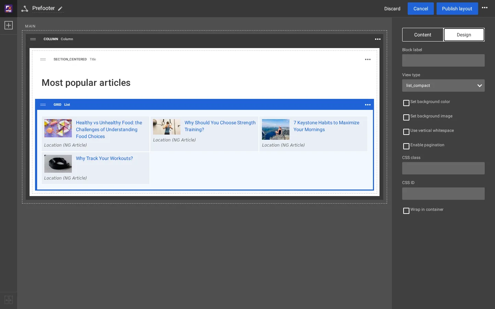
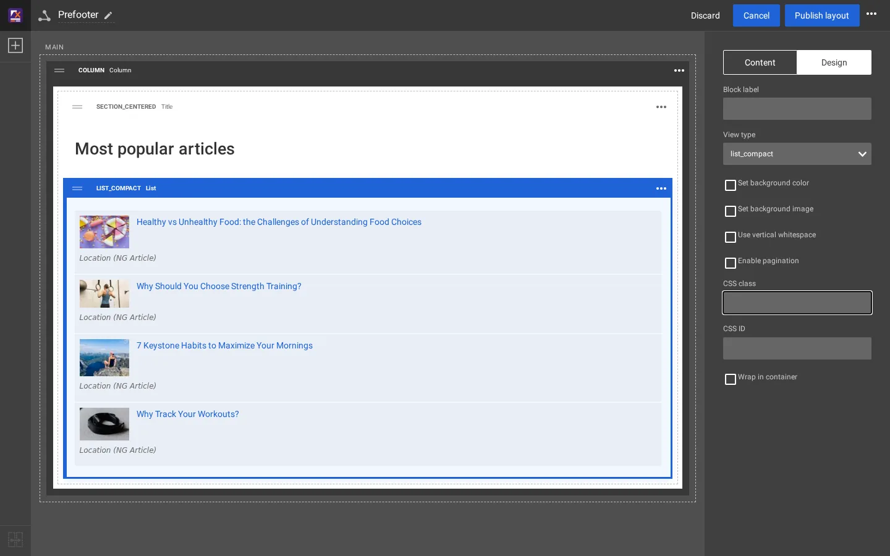
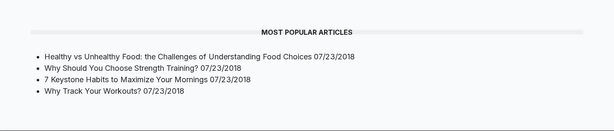

# Einen Ansichtstyp hinzufügen

Ein **Ansichtstyp** ist ein Aussehen eines Blocktyps. Der List-Block bietet `list`, `grid`, `list_numbered`, `list_zigzag`,
`list_accordion` und `grid_featured`. Diese Seite fügt einen siebten hinzu, `list_compact`: eine schlichte Liste von Links mit Datum.

## Inhalt

1. [Deklarieren](#1-deklarieren)
2. [Sein Template schreiben](#2-sein-template-schreiben)
3. [Die Caches leeren](#3-die-caches-leeren)
4. [Im Editor auswählen](#4-im-editor-auswählen)
5. [Das Ergebnis](#5-das-ergebnis)

## 1. Deklarieren

`extension/mysite/settings/explayouts.ini.append.php`:

```ini
<?php /* #?ini charset="utf-8"?

# A new view type for the List block: a compact list of links
[BlockDefinition_list]
ViewTypes[]=list_compact

*/ ?>
```

Ohne Zurücksetz-Zeile (`ViewTypes[]` allein) wird der Wert zu den sechs Ansichtstypen aus
`extension/explayouts/settings/explayouts.ini.append.php` hinzugefügt. Prüfen Sie es:

```text
$ ./console exp:ini where explayouts.ini/BlockDefinition_list/ViewTypes site
...
In effect:
      ViewTypes[]=list_compact
      ViewTypes[]=list
      ViewTypes[]=grid
      ViewTypes[]=list_numbered
      ViewTypes[]=list_zigzag
      ViewTypes[]=list_accordion
      ViewTypes[]=grid_featured
```

## 2. Sein Template schreiben

Das Media-Design stellt einen List-Block mit `explayouts/block/list.tpl` dar, das
`explayouts/block/list/<view type>.tpl` einbindet. Das neue Template ist also
`extension/mysite/design/media/templates/explayouts/block/list/list_compact.tpl`:

```smarty
{if $block.values.items|count|gt( 0 )}
<ul class="list-compact">
{foreach $block.values.items as $lc_item}
    <li class="list-compact-item">
        <a href={$lc_item.url_alias|ezurl}>{$lc_item.name|wash}</a>
        <time datetime="{$lc_item.object.published|datetime( 'custom', '%Y-%m-%d' )}">{$lc_item.object.published|l10n( 'shortdate' )}</time>
    </li>
{/foreach}
</ul>
{/if}
```

`$block.values.items` enthält die Inhaltsknoten der Sammlung des Blocks, manuell oder dynamisch.

## 3. Die Caches leeren

```text
./console exp:cache clear --tag=template,content,ini
```

## 4. Im Editor auswählen

Wählen Sie einen List-Block aus, Reiter **Design**, **Ansichtstyp**: `list_compact` wird angeboten. Wenn Sie ihn wählen,
werden die Optionen ausgeblendet, die zu den anderen Ansichtstypen gehören (Spalten, Ansichtstyp der Elemente).



**Hinweis:** Auf der Testkopie wurde der Block nicht gespeichert, wenn nur der Ansichtstyp geändert wurde; die Änderung
wurde zusammen mit der nächsten Änderung eines anderen Felds gespeichert (hier eine in **CSS class** getippte und wieder
gelöschte Taste). Prüfen Sie den Blockkopf: Er zeigt den gespeicherten Ansichtstyp in Großbuchstaben, hier `LIST_COMPACT`.



## 5. Das Ergebnis

Nach **Layout veröffentlichen** zeigt der Prefooter der Artikelseiten die kompakte Liste:



Gestalten Sie `.list-compact` im Stylesheet Ihres Designs ([Ihre Blöcke gestalten](bloecke-gestalten.md)).

## Verwandte Seiten

- [Wie ein Block seinen Templates zugeordnet wird](zuordnung-block-zu-template.md)
- [Einen Blocktyp hinzufügen](blocktyp-hinzufuegen.md)
- [Ihre eigene Design-Erweiterung](eigene-design-erweiterung.md)
- [Freie Dokumentation](../freie-dokumentation.md): Diese Seite darf unter der GNU FDL 1.3 frei kopiert, übersetzt und verbessert werden.

<!-- exp-partner-block:start -->
**Werden Sie Exponential-Partner.** Partner teilen ihre Informationen, stellen Mittel bereit, geben Beiträge zurück
und entwickeln die Produkte mit uns, und so wächst Exponential. Eine Partner-Website und ein Dashboard sind für Mitte
2027 geplant: Werden Sie noch heute Partner, damit wir schneller wachsen und neue Funktionen früher liefern. Beginnen
Sie mit [Partner: hier beginnen](../partner/partner-hier-beginnen.md) und
[Wie Sie sich bewerben](../partner/wie-sie-sich-bewerben.md).
<!-- exp-partner-block:end -->
