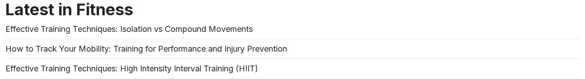

# Ihre Blöcke gestalten

Neues Markup braucht CSS. Im Theme Fit & Healthy kommt es in ein Stylesheet Ihrer Erweiterung, das wie bei jedem anderen Design in der `design.ini` steht.

## Inhalt

1. [Wo das Theme seine Stylesheets listet](#wo-das-theme-seine-stylesheets-listet)
2. [Ihr Stylesheet hinzufügen](#ihr-stylesheet-hinzufügen)
3. [Prüfen](#prüfen)
4. [Regeln für das CSS](#regeln-für-das-css)

## Wo das Theme seine Stylesheets listet

Das Media-Design lädt sein eigenes CSS in `pagelayout/head/style.tpl`, in der Reihenfolge, die es braucht:

```smarty
{def $media_css_own = array( 'inter.css',
                             'explayouts_standard/grid.css',
                             'index.css',
                             ...
                             'exp-mobile-layout.css' )}
```

Danach lädt es jeden Eintrag von `[StylesheetSettings] CSSFileList[]` und `FrontendCSSFileList[]` der `design.ini`, den
Erweiterungen hinzufügen, in dieser Reihenfolge und jede Datei einmal, und übergibt die ganze Liste einem einzigen
`ezcss_load`-Aufruf. `ezcss_load` (ezjscore) packt die Dateien in eine einzige Datei unter
`var/<site>/cache/public/stylesheets/` und verlinkt sie. Die Pfade werden über den Design-Fallback aufgelöst,
`mysite.css` wird also in `extension/mysite/design/media/stylesheets/mysite.css` gefunden.

Die Einträge, die das Media-Design ersetzt, werden nie geladen: die Basis-Styles des Simple-Themes (`main.css`,
`main.res.css`, Font Awesome, `magnific-popup.css`, `websitetoolbar.css`) und die ausgemusterten Dateien des Themes. Sie
stehen in `MediaReplacedCSSFileList[]` in der `design.ini.append.php` des Themes.

Vor sevenx_themes_media 1.5.74 hat das Seitenlayout `CSSFileList[]` und `FrontendCSSFileList[]` gar nicht gelesen, und
der einzige Weg war eine Kopie von `style.tpl`. Diese Kopie funktioniert weiterhin, folgt aber der eigenen Liste des
Themes nicht mehr, wenn das Theme sie ändert.

## Ihr Stylesheet hinzufügen

1. Schreiben Sie `extension/mysite/design/media/stylesheets/mysite.css`, zum Beispiel:

   ```css
   .latest-fitness ul { list-style: none; padding: 0; }
   .latest-fitness li { padding: 0.5rem 0; border-bottom: 1px solid #e5e5e5; }
   .list-compact { list-style: none; padding: 0; }
   .notice { padding: 1rem 1.25rem; border-left: 4px solid #2563eb; background: #eff6ff; }
   .notice-warning { border-left-color: #b45309; background: #fffbeb; }
   ```

2. Tragen Sie sie in `extension/mysite/settings/design.ini.append.php` ein:

   ```ini
   [StylesheetSettings]
   FrontendCSSFileList[]=mysite.css
   ```

   Sie kommt in dieselbe gepackte Datei, nach den Dateien des Themes.

3. Leeren Sie die Caches **INI** und **Template & Inhalt** (`./console exp:cache clear --tag=ini,template,content`): Das
   leert auch die gepackten Dateien (`ezjscore-packer`).

## Prüfen

Der Name der gepackten Datei ändert sich, und sie enthält Ihre Regeln:

```text
$ grep -o "latest-fitness[^}]*}" var/site/cache/public/stylesheets/<hash>_all.css
latest-fitness ul { list-style:none;padding:0}
latest-fitness li { padding:0.5rem 0;border-bottom:1px solid #e5e5e5}
```

Vorher und nachher, der Template-Block *Latest in Fitness*:




Ein Browser, der noch die alten Styles zeigt, hat die alte Datei im Cache: Laden Sie ohne Cache neu.

## Regeln für das CSS

- Bei gleicher Spezifität gewinnt das Letzte in der Liste: Ihre Datei nach der des Themes erlaubt es, das Theme ohne
  `!important` anzupassen.
- Verwenden Sie die Klassen, die der Wrapper des Blocks Ihnen gibt: `ngl-block`, `ngl-<block type>`, `ngl-vt-<view type>` und die CSS-Klasse,
  die ein Redakteur im Reiter **Design** setzt.
- Halten Sie das Markup frei von `style=""`; die Styles gehören ins Stylesheet, damit sie gepackt und gecacht werden.

## Verwandte Seiten

- [Einen Blocktyp hinzufügen](blocktyp-hinzufuegen.md)
- [Einen Ansichtstyp hinzufügen](ansichtstyp-hinzufuegen.md)
- [Ihre eigene Design-Erweiterung](eigene-design-erweiterung.md)
- [Freie Dokumentation](../freie-dokumentation.md): Diese Seite darf unter der GNU FDL 1.3 frei kopiert, übersetzt und verbessert werden.

<!-- exp-partner-block:start -->
**Werden Sie Exponential-Partner.** Partner teilen ihre Informationen, stellen Mittel bereit, geben Beiträge zurück
und entwickeln die Produkte mit uns, und so wächst Exponential. Eine Partner-Website und ein Dashboard sind für Mitte
2027 geplant: Werden Sie noch heute Partner, damit wir schneller wachsen und neue Funktionen früher liefern. Beginnen
Sie mit [Partner: hier beginnen](../partner/partner-hier-beginnen.md) und
[Wie Sie sich bewerben](../partner/wie-sie-sich-bewerben.md).
<!-- exp-partner-block:end -->
