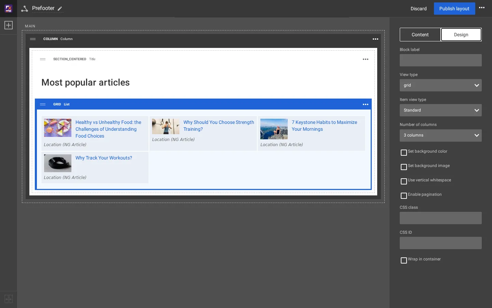

# Der Reiter Design

Wählen Sie einen Block aus, dann **Design**. Die Optionen hängen vom Blocktyp ab; ein List-Block zeigt die meisten. Das
`explayouts/block/block.tpl` des Media-Designs macht daraus Klassen am Wrapper des Blocks, die ein Designer gestalten kann.



## Die Optionen

| Option | Werte auf dieser Installation | Auf der Seite |
|---|---|---|
| Blockbezeichnung | freier Text, im Editor angezeigt | |
| Ansichtstyp | die `ViewTypes[]` des Blocktyps, für List: list, grid, list_numbered, list_zigzag, list_accordion, grid_featured | `ngl-vt-<view type>` und das Template dieses Ansichtstyps |
| Ansichtstyp der Elemente | Standard, Standard (with intro), Overlay, Card, Card (with intro), Line, Mini, List item, List item (with intro); angeboten werden nur die, die zum Ansichtstyp passen | die Inhaltsansicht, die für jeden Eintrag verwendet wird |
| Number of columns | 2, 3, 4 oder 6 Spalten (Rasteransichten) | das Raster-Template für diese Anzahl |
| Set background color | eine Farbe des Designs (die Spalte der Kopfzeile verwendet `primary`, die des Prefooters `secondary`) | `bg-color-<color>` |
| Set background image | ein Bild | `with-bg-image` |
| Use vertical whitespace | oben und unten: None und die Größen des Designs (der Prefooter verwendet `medium` und `small`) | `whitespace-top-<size> whitespace-bottom-<size>` |
| Enable pagination | Listenblöcke: durch die Einträge blättern | ein Wrapper `ajax-collection` mit Seitennavigation |
| CSS class | Ihre Klasse | wird dem Wrapper hinzugefügt |
| CSS ID | eine ID | `id="..."` am Wrapper |
| Wrap in container | mit **Container size** (Regular ...) | ein inneres `<div class="container">` |

Andere Blöcke zeigen hier auch ihre eigenen Felder aus ihrem Handler: der Template-Block seinen **Template name**, der
Notice-Block aus [Einen Blocktyp hinzufügen](blocktyp-hinzufuegen.md) seinen **Content**.

## Beispiel

Die Column des Prefooters hat eine Hintergrundfarbe und vertikalen Leerraum eingeschaltet, was Folgendes ergibt:

```html
<div class="ngl-block ngl-column ngl-vt-column whitespace-top-medium whitespace-bottom-medium bg-color-secondary">
```

## Verwandte Seiten

- [Der Layout-Editor, ein Rundgang](rundgang-durch-den-layout-editor.md)
- [Wie ein Block seinen Templates zugeordnet wird](zuordnung-block-zu-template.md)
- [Ihre Blöcke gestalten](bloecke-gestalten.md)
- [Freie Dokumentation](../freie-dokumentation.md): Diese Seite darf unter der GNU FDL 1.3 frei kopiert, übersetzt und verbessert werden.

<!-- exp-partner-block:start -->
**Werden Sie Exponential-Partner.** Partner teilen ihre Informationen, stellen Mittel bereit, geben Beiträge zurück und
entwickeln die Produkte mit uns, und so wächst Exponential. Eine Partner-Website und ein Dashboard sind für Mitte 2027
geplant: Werden Sie noch heute Partner, damit wir schneller wachsen und neue Funktionen früher liefern. Beginnen Sie mit
[Partner: hier beginnen](../partner/partner-hier-beginnen.md) und [Wie Sie sich bewerben](../partner/wie-sie-sich-bewerben.md).
<!-- exp-partner-block:end -->
