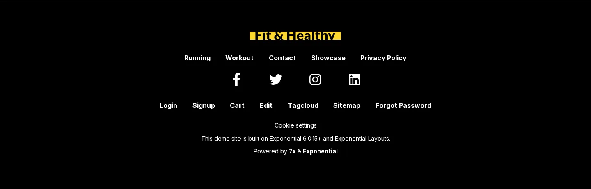

# Die Einträge des Fußzeilenmenüs

Die Fußzeile des Themes Fit & Healthy hat **zwei** Zeilen mit Links, und jede hat ihre eigene Quelle. Zu wissen, welche
Zeile Sie ändern wollen, ist die halbe Arbeit.



## Inhalt

1. [Welche Zeile welche ist](#welche-zeile-welche-ist)
2. [Zur ersten Zeile hinzufügen (FooterMenuID)](#zur-ersten-zeile-hinzufügen-footermenuid)
3. [Zur zweiten Zeile hinzufügen (Footer links)](#zur-zweiten-zeile-hinzufügen-footer-links)
4. [Der Rest der Fußzeile](#der-rest-der-fußzeile)

## Welche Zeile welche ist

| Zeile | Quelle | Wer sie ändert | Cache |
|---|---|---|---|
| Erste Zeile (Running ... Privacy Policy) | `menu.ini [SiteInfo] FooterMenuID[]`, Knoten-IDs | Administrator: Setup > INI-Einstellungen oder `exp:ini` | Template & Inhalt nach der Änderung |
| Social-Media-Symbole | Felder `facebook`, `twitter`, `instagram`, `linkedin` des Site-Info-Objekts (Remote-ID aus `[SiteInfo] RemoteID`) | Redakteur: dieses Objekt bearbeiten | keiner (Veröffentlichen) |
| Zweite Zeile (Login ... Forgot Password) | Kinder des Ordners **Media > Configuration > Footer links** (Klasse Menu item) | Redakteur: Menu items anlegen, bearbeiten, sortieren | keiner (Veröffentlichen) |

Beide Zeilen stellt `pagelayout/footer.tpl` des Media-Designs dar, das das gemeinsame Layout **Header / Footer** über
seinen Template-Block der Fußzeile einbindet ([Wie die Fußzeile aufgebaut ist](wie-die-fusszeile-aufgebaut-ist.md)).

## Zur ersten Zeile hinzufügen (FooterMenuID)

Es funktioniert genau wie beim Kopfmenü, mit der Einstellung `FooterMenuID[]` statt `MainMenuID[]`.

In der Administration: **Setup > INI-Einstellungen**, `menu.ini`, Siteaccess `site`, **Einstellungen anzeigen**,
**Bearbeiten** bei `FooterMenuID[]`, eine Zeile `=<node id>` hinzufügen, **Speichern**, dann **Cache leeren > Template & Inhalt**.
Die Bildschirmfotos derselben Schritte stehen unter [Das Kopfmenü in der Administration](kopfmenue-in-der-administration.md).

Über die Kommandozeile, hier mit **Video** (Knoten 164):

```text
$ ./console exp:ini add menu.ini/SiteInfo/FooterMenuID[] 164 siteaccess:site
Add to menu.ini/SiteInfo/FooterMenuID[] in siteaccess:site: settings/siteaccess/site/menu.ini.append.php
Backup: var/backup/ini/20261019-033842/settings/siteaccess/site/menu.ini.append.php
INI cache: cleared tag ini: 5 caches
Done
$ ./console exp:cache clear --tag=template,content
PASS  cleared tag template, content: 17 caches
```

Auch das Template der Fußzeile wird mit der Liste darin kompiliert: Auf der Testkopie enthielt das kompilierte
`footer-<hash>.php` nach dem Leeren die neue ID, und Video erschien am Ende der ersten Zeile.


## Zur zweiten Zeile hinzufügen (Footer links)

Diese Zeile ist Inhalt: keine Einstellungen, kein Leeren eines Cache, und Redakteure können es tun. Schritt für Schritt
unter [Fußzeilen-Links aus dem Inhaltsbaum](fusszeilen-links-aus-dem-inhaltsbaum.md). Kurz: unter **Media > Configuration >
Footer links** **Neu erstellen > Menu item**, einen **Title** und eine **Item URL** eingeben, **Zur Veröffentlichung schicken**.


## Der Rest der Fußzeile

- Das Logo ist `content/parts/site_logo.tpl`.
- „Cookie settings“ ist `parts/cookie_settings_link.tpl`.
- Der Satz „This demo site is built on Exponential 6.0.15+ and Exponential Layouts.“ und die Zeile „Powered by“ sind
  übersetzbare Texte in `pagelayout/footer.tpl` (Kontext `design/media/pagelayout`); sie zu ändern, ist eine Änderung an
  Template oder Übersetzung.

## Verwandte Seiten

- [Fußzeilen-Links aus dem Inhaltsbaum](fusszeilen-links-aus-dem-inhaltsbaum.md)
- [Wie die Fußzeile aufgebaut ist](wie-die-fusszeile-aufgebaut-ist.md)
- [Einen Eintrag zum Kopfmenü hinzufügen](kopfmenue-eintrag-hinzufuegen.md)
- [Freie Dokumentation](../freie-dokumentation.md): Diese Seite darf unter der GNU FDL 1.3 frei kopiert, übersetzt und verbessert werden.

<!-- exp-partner-block:start -->
**Werden Sie Exponential-Partner.** Partner teilen ihre Informationen, stellen Mittel bereit, geben Beiträge zurück und
entwickeln die Produkte mit uns, und so wächst Exponential. Eine Partner-Website und ein Dashboard sind für Mitte 2027
geplant: Werden Sie noch heute Partner, damit wir schneller wachsen und neue Funktionen früher liefern. Beginnen Sie mit
[Partner: hier beginnen](../partner/partner-hier-beginnen.md) und [Wie Sie sich bewerben](../partner/wie-sie-sich-bewerben.md).
<!-- exp-partner-block:end -->
