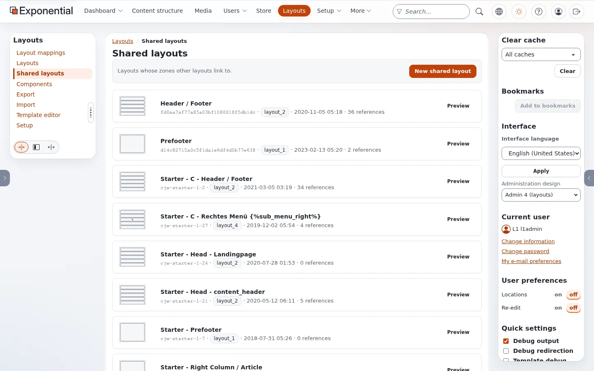

# Gemeinsame Layouts und Zonenverknüpfung

Ein Layout besteht aus **Zonen**, und eine Zone enthält entweder eigene Blöcke oder ist mit einer Zone eines **gemeinsamen
Layouts** **verknüpft**. Eine verknüpfte Zone zeigt die Blöcke der gemeinsamen Zone. Ändern Sie die gemeinsame Zone einmal,
und jede verknüpfte Seite ändert sich.

## Inhalt

1. [Die gemeinsamen Layouts der Site](#die-gemeinsamen-layouts-der-site)
2. [Wer womit verknüpft ist](#wer-womit-verknüpft-ist)
3. [Was die Verknüpfung für das Bearbeiten bedeutet](#was-die-verknüpfung-für-das-bearbeiten-bedeutet)
4. [Die Verknüpfungen sehen](#die-verknüpfungen-sehen)
5. [Häufige Überraschungen](#häufige-überraschungen)

## Die gemeinsamen Layouts der Site

**Layouts > Gemeinsame Layouts** listet die Layouts, mit denen andere Layouts verknüpft sind:



| Gemeinsames Layout | Typ | Zonen und Blöcke |
|---|---|---|
| Header / Footer | `layout_2` | `header`: Template-Blöcke Kopfzeile und Brotkrumenpfad; `footer`: Template-Block Fußzeile; `post_header`, `main`, `pre_footer`: leer |
| Prefooter | `layout_1` | `main`: eine Column (Hintergrund `secondary`) mit einem Title „Most popular articles“ und einer List (Ansicht Grid, 3 Spalten) von drei handverlesenen Artikeln |

Die gemeinsamen Layouts von **Starter** gehören zu einem anderen Theme der Installation.

## Wer womit verknüpft ist

Auf der Site Fit & Healthy (veröffentlichte Layouts, aus der Datenbank):

| Layouts | `header` | `pre_footer` | `footer` |
|---|---|---|---|
| Full / Article, Full / Recipe | Header / Footer: header | Prefooter: main | Header / Footer: footer |
| Default Layout, Full / Topic, Full / Video, Full / Article (Plain), die fünf Landingpages (Running, Fitness, Healthy Eating, Home, Video), Showcase, die sechs Layouts von Bold Agency | Header / Footer: header | eigene (leer) | Header / Footer: footer |

Der **Prefooter** erscheint also nur auf Artikeln und Rezepten. Ihm einen Block hinzuzufügen, ändert diese beiden Seitentypen
und keine anderen.

## Was die Verknüpfung für das Bearbeiten bedeutet

- Die Blöcke einer verknüpften Zone sind **nicht** die Blöcke des Seitenlayouts. Der Editor zeigt die Zone als verknüpft;
  ihre Blöcke bearbeiten Sie, indem Sie das gemeinsame Layout selbst öffnen (Layouts > Gemeinsame Layouts > Header / Footer).
- Ein gemeinsames Layout wird wie jedes Layout bearbeitet: öffnen, in einem Entwurf ändern, **Layout veröffentlichen**. Jede
  verknüpfte Seite zeigt die veröffentlichte Version.
- Die Verknüpfung wird pro Zone im Editor des Seitenlayouts gesetzt. Die Verknüpfung einer Zone lässt sich aufheben, um
  einem Seitentyp eigene Blöcke zu geben.

## Die Verknüpfungen sehen

Auf der Konsole zeigt `exp:layouts list` die Spalte **Links to**:

```text
$ ./console exp:layouts list
ID     Identifier                               Name                                 Status     Shared    Rules  Links to
2      fd0aa7af77a85a03bf1080018f5db1dc         Header / Footer                      published  shared        0
7      d14c82715a0c5f1da1e6df4d0b77e638         Prefooter                            published  shared        0
...
21     84f28edc38d2524da1e1d720de5942ba         Full / Article                       published                1  fd0aa7af77a85a03bf1080018f5db1dc, d14c82715a0c5f1da1e6df4d0b77e638
...
29     df2a8cde629658cc80f2fe59cefa77e9         Landing Page / Home                  published                2  fd0aa7af77a85a03bf1080018f5db1dc
```

Die Verknüpfungen werden pro Zone als `linked_layout_id` plus `linked_zone_identifier` gespeichert; beide werden gebraucht.

## Häufige Überraschungen

| Was Sie sehen | Warum | Was zu tun ist |
|---|---|---|
| Sie haben einen Block zur Zone `header` des Seitenlayouts hinzugefügt, und er wird nicht gezeigt | Die Zone ist verknüpft; die Seite zeigt die gemeinsame Zone | Fügen Sie ihn Header / Footer hinzu, oder heben Sie die Verknüpfung der Zone auf |
| Ein zum Prefooter hinzugefügter Block erscheint auf Artikeln, aber nicht auf Landingpages | Nur Full / Article und Full / Recipe verknüpfen `pre_footer` | Verknüpfen Sie `pre_footer` der anderen Layouts, oder fügen Sie den Block dort hinzu |
| Das Kopfmenü steht nicht im Editor | Die Kopfzeile ist ein Template-Block; das Menü steht in der `menu.ini` | [Einen Eintrag zum Kopfmenü hinzufügen](../../../eng-us/help/build-two-ways/add-a-header-menu-item.md) |
| Sie haben Header / Footer geändert, und nichts hat sich geändert | Der Entwurf ist noch nicht veröffentlicht | **Layout veröffentlichen** |

Weitere Fälle: [Warum erscheint meine Änderung nicht?](warum-erscheint-meine-aenderung-nicht.md)

## Verwandte Seiten

- [Wie die Kopfzeile aufgebaut ist](../../../eng-us/help/build-two-ways/how-the-header-is-built.md)
- [Der Layout-Editor](../layout-editor.md)
- [Freie Dokumentation](../freie-dokumentation.md): Diese Seite darf unter der GNU FDL 1.3 frei kopiert, übersetzt und verbessert werden.

<!-- exp-partner-block:start -->
**Werden Sie Exponential-Partner.** Partner teilen ihre Informationen, stellen Mittel bereit, geben Beiträge zurück und
entwickeln die Produkte mit uns, und so wächst Exponential. Eine Partner-Website und ein Dashboard sind für Mitte 2027
geplant: Werden Sie noch heute Partner, damit wir schneller wachsen und neue Funktionen früher liefern. Beginnen Sie mit
[Partner: hier beginnen](../partner/partner-hier-beginnen.md) und [Wie Sie sich bewerben](../partner/wie-sie-sich-bewerben.md).
<!-- exp-partner-block:end -->
