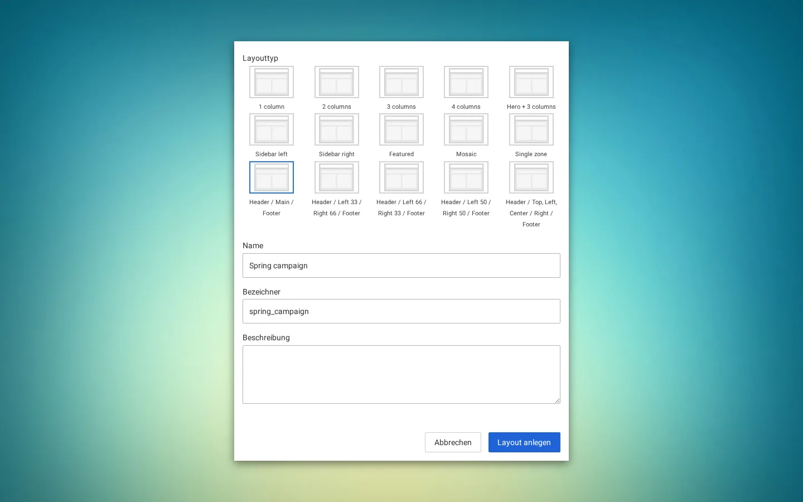
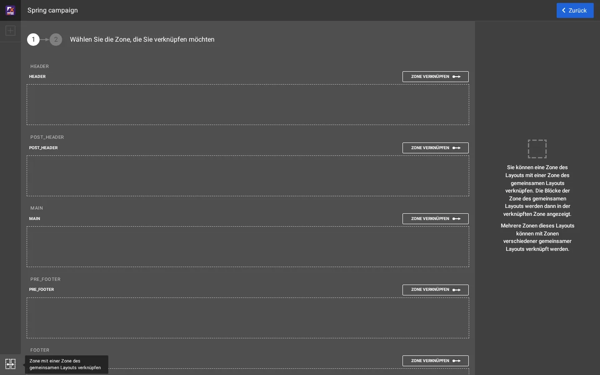
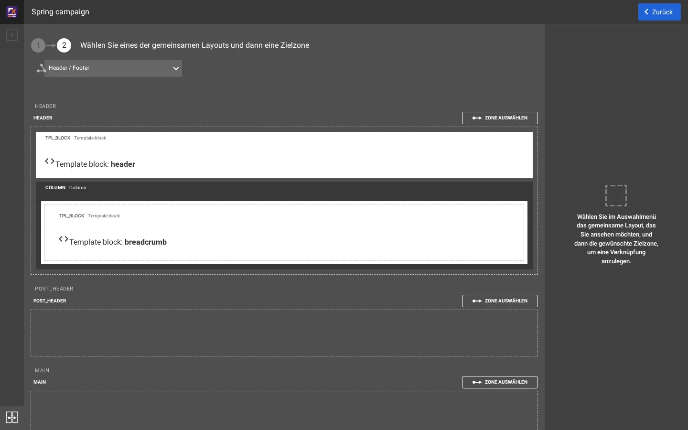
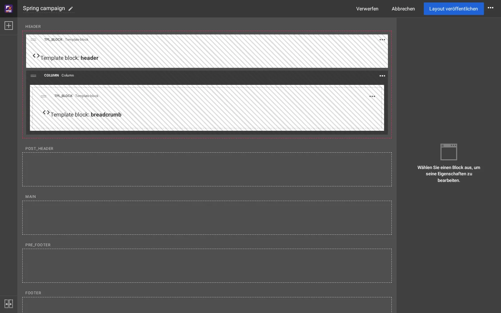
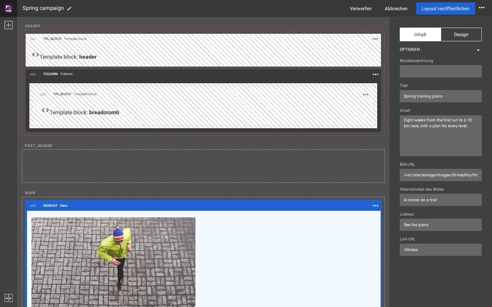
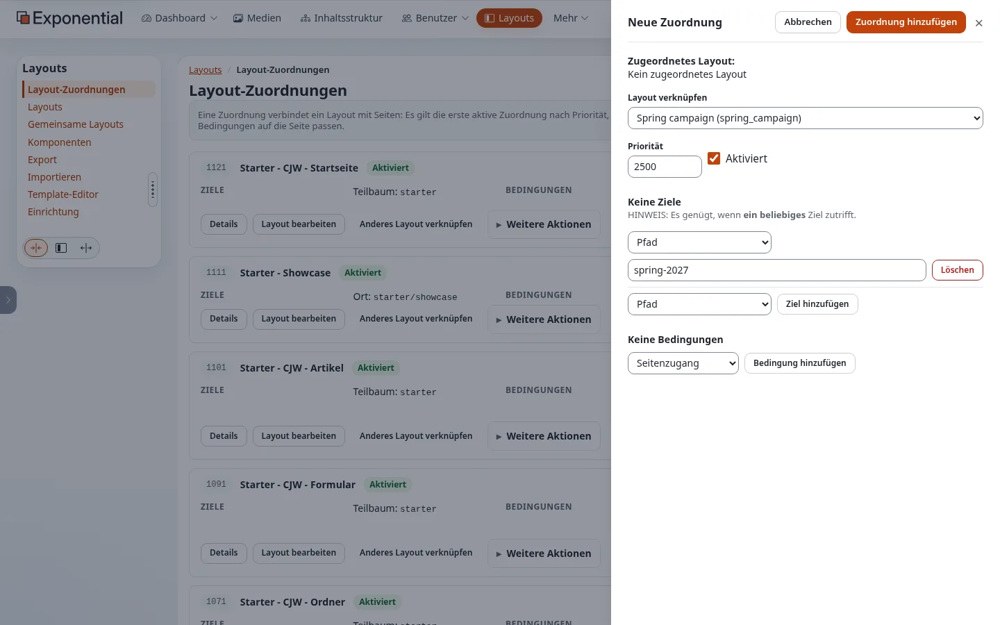

# Eine Kampagnenseite bauen, von Anfang bis Ende

Dies ist das eine Beispiel auf diesen Seiten, das jeden Bildschirm durchgeht, auf einer Kopie der Site Fit & Healthy: eine
Seite *Spring campaign* unter `/spring-2027` mit Kopf- und Fußzeile der Site und einem Hero. Es brauchte sechs Bildschirme
und keinen Code. Die zweite Hälfte baut dieselbe Seite mit Templates.

## Inhalt

1. [Das Layout anlegen](#1-das-layout-anlegen)
2. [Kopf- und Fußzeile verknüpfen](#2-kopf--und-fußzeile-verknüpfen)
3. [Den Hero hinzufügen](#3-den-hero-hinzufügen)
4. [Das Layout veröffentlichen](#4-das-layout-veröffentlichen)
5. [Die Seite anlegen](#5-die-seite-anlegen)
6. [Das Layout der Seite zuordnen](#6-das-layout-der-seite-zuordnen)
7. [Das Ergebnis](#7-das-ergebnis)
8. [Dieselbe Seite mit Templates](#dieselbe-seite-mit-templates)

## 1. Das Layout anlegen

**Layouts > Layouts > Neues Layout**. Wählen Sie den Layouttyp **Header / Main / Footer** (`layout_2`, der Typ jedes Layouts
von Fit & Healthy: Zonen `header`, `post_header`, `main`, `pre_footer`, `footer`), geben Sie einen **Name** und einen
**Bezeichner** an und klicken Sie auf **Layout anlegen**.



Der Editor öffnet sich mit fünf leeren Zonen.

## 2. Kopf- und Fußzeile verknüpfen

Klicken Sie unten links im Editor auf die Verknüpfungs-Schaltfläche. Jede Zone bekommt **Zone verknüpfen**.



**Zone verknüpfen** bei HEADER zeigt die gemeinsamen Layouts. Wählen Sie **Header / Footer** und klicken Sie bei dessen Zone
HEADER auf **Zone auswählen**.



Der Editor kehrt mit verknüpfter Zone header zurück: Er zeigt die gemeinsamen Blöcke gestreift, da sie nicht die eigenen
dieses Layouts sind. Machen Sie dasselbe für FOOTER.



## 3. Den Hero hinzufügen

Öffnen Sie die Blockpalette (**+** oben links), ziehen Sie **Hero** (Gruppe *Components*) in MAIN, wählen Sie ihn aus und
füllen Sie seine Felder aus: **Title**, **Content**, **Image URL**, **Image alt text**, **Link text**, **Link URL**.



## 4. Das Layout veröffentlichen

**Layout veröffentlichen**. Das Layout existiert jetzt, aber noch keine Seite verwendet es.

## 5. Die Seite anlegen

Öffnen Sie in der **Inhaltsstruktur** **Fit & Healthy**, **Neu erstellen > Landing page**, Titel *Spring 2027*, **Zur
Veröffentlichung schicken**. Ihre URL ist `/spring-2027`.

## 6. Das Layout der Seite zuordnen

**Layouts > Layout-Zuordnungen > Neue Zuordnung**. **Layout verknüpfen**: *Spring campaign*. **Priorität**: höher als die
Zuordnungen, die die Seite sonst übernehmen würden (hier 2500). Ziel **Pfad** `spring-2027`, **Ziel hinzufügen**.
**Zuordnung hinzufügen**.



## 7. Das Ergebnis


Das Kopfmenü auf diesem Bild ist das aus [Ein Kopfmenü, das dem Baum folgt](kopfmenue-aus-dem-baum.md), das auf der
Testkopie aktiv war.

## Dieselbe Seite mit Templates

Ohne Layouts kommt das Aussehen der Seite aus ihrem Full-View-Template. Das Theme zeigt bereits, wie man einer einzelnen Seite
eine eigene Full View gibt: `extension/sevenx_themes_media/settings/siteaccess/site/override.ini.append.php` ordnet die
Tour-Seite (`/exponential-live`) über ihre Remote-ID zu, vor den Overrides der Klassen:

```ini
[node/view/full#showcase_s1_tour]
Source=node/view/full.tpl
MatchFile=node/view/full/showcase_s1_tour.tpl
Subdir=templates
Match[remote_id]=showcase-s1-tour
Priority=0
```

Dasselbe in Ihrer Erweiterung für die Kampagnenseite: ein solcher Block in
`extension/mysite/settings/siteaccess/site/override.ini.append.php` mit `Match[remote_id]=` der Remote-ID der Seite (in der
Administration als **Remote-ID** angezeigt) und das Template
`extension/mysite/design/media/override/templates/node/view/full/spring_2027.tpl` mit dem Markup des Hero und den Feldern der
Seite (`$node.data_map.title`, `$node.data_map.full_intro`, `$node.data_map.image` der Klasse Landing page). So bleibt alles
in git; jede Änderung von Text oder Bild ist ein Deployment, und ein Redakteur kann keine Blöcke verschieben oder hinzufügen.

| | Layout-Editor | Template-Override |
|---|---|---|
| Schritte hier | sechs Bildschirme, kein Code | ein Override-Block, ein Template, ein Deployment, ein Leeren von Template & Inhalt |
| Wer den Text später ändert | ein Redakteur, im Hero-Block | ein Entwickler, im Template |
| Wiederverwendung für die nächste Kampagne | das Layout kopieren oder den Hero ändern | das Template und den Override-Block kopieren |
| Kopf- und Fußzeile | mit dem gemeinsamen Layout verknüpft | das Seitenlayout des Designs, wie für jede Seite |

## Verwandte Seiten

- [Gemeinsame Layouts und Zonenverknüpfung](gemeinsame-layouts-und-zonenverknuepfung.md)
- [Welches Layout bekommt eine Seite?](layout-zuordnungen.md)
- [Beispiele zum Lebenszyklus](beispiele/README.md)
- [Freie Dokumentation](../freie-dokumentation.md): Diese Seite darf unter der GNU FDL 1.3 frei kopiert, übersetzt und verbessert werden.

<!-- exp-partner-block:start -->
**Werden Sie Exponential-Partner.** Partner teilen ihre Informationen, stellen Mittel bereit, geben Beiträge zurück
und entwickeln die Produkte mit uns, und so wächst Exponential. Eine Partner-Website und ein Dashboard sind für Mitte
2027 geplant: Werden Sie noch heute Partner, damit wir schneller wachsen und neue Funktionen früher liefern. Beginnen
Sie mit [Partner: hier beginnen](../partner/partner-hier-beginnen.md) und
[Wie Sie sich bewerben](../partner/wie-sie-sich-bewerben.md).
<!-- exp-partner-block:end -->
