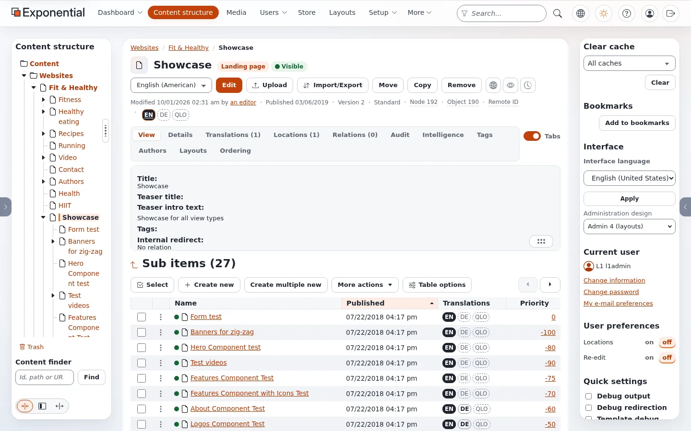
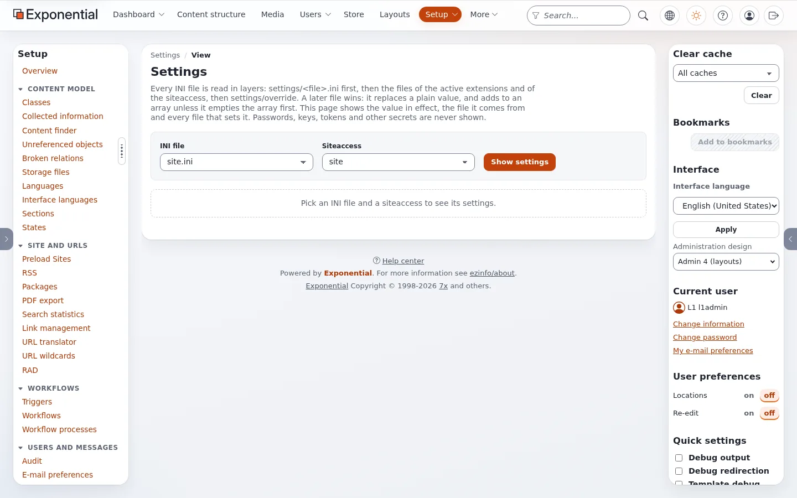
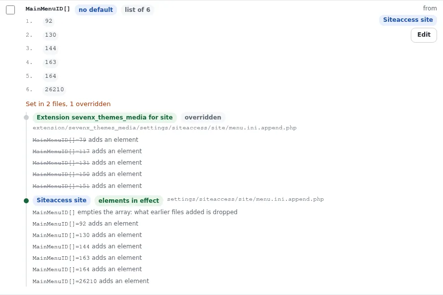
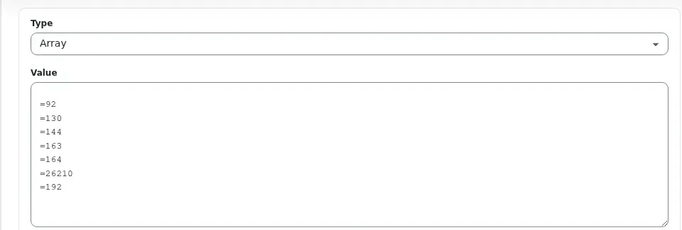
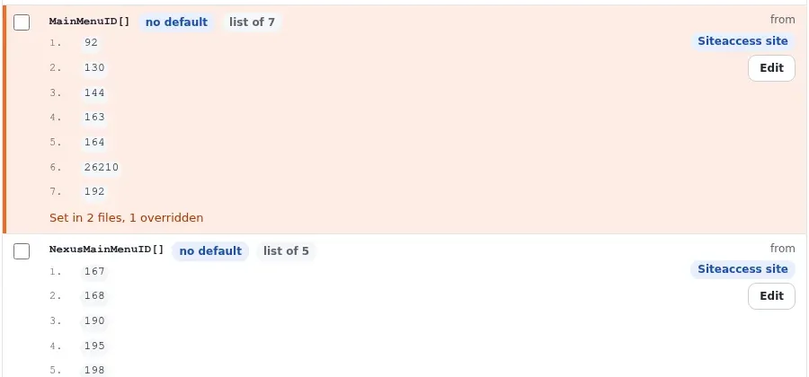
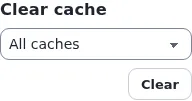

# Das Kopfmenü in der Administration

Sie brauchen ein Konto, das die Einstellungsseiten der Administration verwenden darf (die Rolle Administrator darf es).
Das Beispiel fügt die Seite **Showcase** zum Kopfmenü der Site Fit & Healthy hinzu.

## Inhalt

1. [Die Knoten-ID finden](#1-die-knoten-id-finden)
2. [Die Menü-Einstellungen öffnen](#2-die-menü-einstellungen-öffnen)
3. [MainMenuID bearbeiten](#3-mainmenuid-bearbeiten)
4. [Speichern](#4-speichern)
5. [Die Caches leeren](#5-die-caches-leeren)
6. [Die Site prüfen](#6-die-site-prüfen)

## 1. Die Knoten-ID finden

Öffnen Sie die Seite in der **Inhaltsstruktur**. Die Zeile unter den Schaltflächen zeigt `Knoten 192`: Das ist die Zahl,
die das Menü braucht (nicht die Objektnummer daneben).

Andere Wege, sie zu finden, stehen unter [Eine Knoten-ID finden](knoten-id-finden.md).

## 2. Die Menü-Einstellungen öffnen

Gehen Sie zu **Setup > INI-Einstellungen** (Bereich *System*). Wählen Sie als **INI-Datei** `menu.ini` und als
**Siteaccess** `site` und klicken Sie dann auf **Einstellungen anzeigen**.

Suchen Sie den Block `[SiteInfo]` und die Einstellung `MainMenuID[]`. Sie listet die Menüeinträge in ihrer Reihenfolge.
Öffnen Sie **In 2 Dateien gesetzt, 1 überschrieben**, um zu sehen, woher die Liste kommt: Die Theme-Erweiterung
`sevenx_themes_media` bringt eine Liste mit, und die Datei `settings/siteaccess/site/menu.ini.append.php` der Installation
leert sie (`MainMenuID[]`) und setzt eine eigene. Die zweite Datei gewinnt, also ist sie die, die zu ändern ist.

## 3. MainMenuID bearbeiten

Klicken Sie in der Zeile `MainMenuID[]` auf **Bearbeiten**. Die Bearbeitungsseite zeigt noch einmal dieselbe Kette, dann **Neuer Wert**:

- **Typ**: `Liste` (so lassen).
- **Wert**: eine Zeile pro Eintrag, `=` gefolgt von der Knoten-ID. Die erste Zeile ist leer: Sie behält das Zurücksetzen,
  sodass nur diese Einträge gezeigt werden.

Fügen Sie an der Stelle, an der der Eintrag erscheinen soll, eine Zeile hinzu. Damit Showcase der letzte Eintrag wird,
fügen Sie am Ende `=192` hinzu.

**Speichern in** bleibt auf *Nur Siteaccess site* (`settings/siteaccess/site/menu.ini.append.php`), der Datei, die die
Liste bereits enthält.

## 4. Speichern

Klicken Sie auf **Speichern**. Die Seite kehrt mit der Meldung *Gespeichert: [SiteInfo] MainMenuID in
settings/siteaccess/site/menu.ini.append.php* zu den Einstellungen der `menu.ini` zurück und markiert die geänderte Zeile.
Die Liste hat jetzt sieben Einträge.

Das Speichern leert die INI-Caches. Es leert **nicht** die kompilierten Templates, und das Menü-Template der Kopfzeile wird
mit der Liste darin kompiliert.

## 5. Die Caches leeren

Wählen Sie im Kasten **Cache leeren** rechts **Template & Inhalt** und klicken Sie auf **Leeren**. Das leert die
kompilierten Templates, die Template-Blöcke, den View-Cache der Inhalte und den Seiten-Cache (HTTP) zusammen.

Die Auswahlmöglichkeiten dieses Kastens sind: Alle Caches, Inhalte, Inhalt - Knoten, Inhalt - Teil der Baumstruktur,
Template, Template & Inhalt, INI-Einstellungen und Statisch.

## 6. Die Site prüfen

Laden Sie die Site neu. Die Kopfzeile hat den neuen Eintrag, mit dem Namen der Seite als Text.

Es erscheint nichts? Siehe [Fehlerbehebung beim Kopfmenü](kopfmenue-fehlerbehebung.md).

## Verwandte Seiten

- [Einen Eintrag zum Kopfmenü hinzufügen](kopfmenue-eintrag-hinzufuegen.md)
- [Das Kopfmenü über die Kommandozeile](kopfmenue-per-kommandozeile.md)
- [INI-Einstellungen in der Administration](ini-einstellungen-in-der-administration.md)
- [Caches nach einer Änderung](caches-nach-einer-aenderung.md)
- [Freie Dokumentation](../freie-dokumentation.md): Diese Seite darf unter der GNU FDL 1.3 frei kopiert, übersetzt und verbessert werden.

<!-- exp-partner-block:start -->
**Werden Sie Exponential-Partner.** Partner teilen ihre Informationen, stellen Mittel bereit, geben Beiträge zurück und
entwickeln die Produkte mit uns, und so wächst Exponential. Eine Partner-Website und ein Dashboard sind für Mitte 2027
geplant: Werden Sie noch heute Partner, damit wir schneller wachsen und neue Funktionen früher liefern. Beginnen Sie mit
[Partner: hier beginnen](../partner/partner-hier-beginnen.md) und [Wie Sie sich bewerben](../partner/wie-sie-sich-bewerben.md).
<!-- exp-partner-block:end -->
