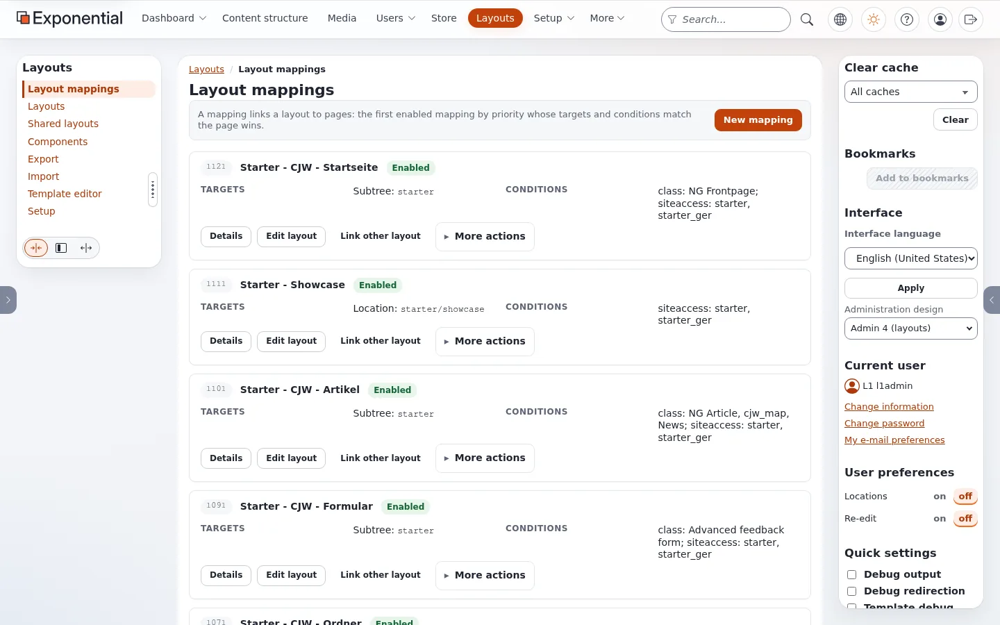
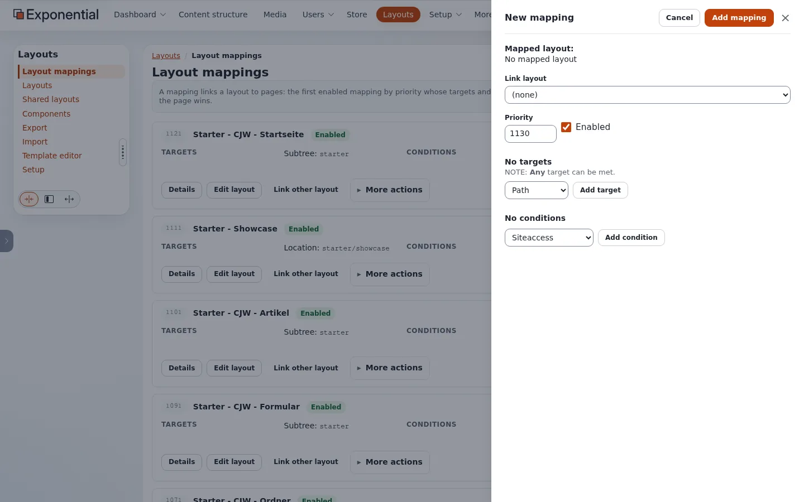
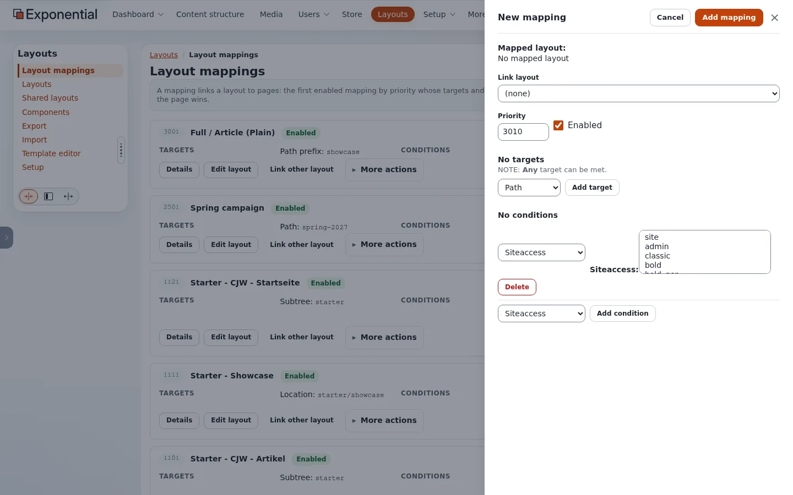

# Welches Layout bekommt eine Seite?

**Layouts > Layout-Zuordnungen** listet die Regeln, die Layouts mit Seiten verbinden. Die Seite erklärt es in einem Satz:
*Eine Zuordnung verbindet ein Layout mit Seiten: Es gilt die erste aktive Zuordnung nach Priorität, deren Ziele und
Bedingungen auf die Seite passen.*

## Inhalt

1. [Ziele und Bedingungen](#ziele-und-bedingungen)
2. [Die Zuordnungen von Fit & Healthy](#die-zuordnungen-von-fit--healthy)
3. [Eine Zuordnung anlegen](#eine-zuordnung-anlegen)
4. [Das Layout einer Seite finden](#das-layout-einer-seite-finden)
5. [Templates und Zuordnungen](#templates-und-zuordnungen)

## Ziele und Bedingungen

| Teil | Arten auf dieser Installation | Beispiel |
|---|---|---|
| Ziel | Ort (ein Knoten), Teilbaum (ein Knoten und alles darunter), Pfadpräfix | Teilbaum: `starter` |
| Bedingung | Inhaltsklasse, Siteaccess | Klasse: NG Article; Siteaccess: starter, starter_ger |
| Priorität | eine Zahl; höhere wird zuerst probiert | 210 für die Startseite |
| Aktiviert | an oder aus | |

## Die Zuordnungen von Fit & Healthy

Aus der Datenbank der Installation (aktivierte Zuordnungen für den Baum von Fit & Healthy, Knoten 89):

| Priorität | Ziel | Bedingung | Layout |
|---|---|---|---|
| 210 | Ort 89 (die Startseite) | | Landing Page / Home |
| 160 | Teilbaum 89 | Klasse `ng_recipe` | Full / Recipe |
| 130 | Teilbaum 89 | Klasse `ng_article`, `ng_blog_post`, `ng_news` | Full / Article |
| 120 | Teilbaum 89 | Klasse `ng_topic` | Full / Topic |
| 10 | Pfadpräfix `/` | | Default Layout |

Zuordnungen nach Ort verbinden die Landingpages Fitness (92), Healthy eating (130), Running (163), Video (164) und Showcase
(192) mit ihren Layouts; weitere Zuordnungen bedienen die Sites Bold Agency und Starter. Ein Rezept passt auf die
Rezept-Zuordnung (160) vor der Artikel-Zuordnung (130); eine Seite, die keine andere Zuordnung übernimmt, fällt auf
**Default Layout** (10) durch, das seine Zonen `header` und `footer` mit Header / Footer verknüpft.

## Eine Zuordnung anlegen

**Neue Zuordnung** öffnet ein Feld: **Layout verknüpfen** (das Layout), **Priorität**, **Aktiviert**, dann Ziele und
Bedingungen. Die angebotenen Zieltypen sind Pfad, Pfadpräfix, Pfad (regulärer Ausdruck), Ort, Teilbaum und Route;
die Bedingungstypen Siteaccess, Klasse, Abfrageparameter, Routenparameter und Zeit. *Any target can be
met*; jede Bedingung muss erfüllt sein.

Eine Siteaccess-Bedingung ist eine Liste der Siteaccesse der Installation zur Auswahl:

Ein Ziel vom Typ **Route** nennt statt einer Adresse eine Modulansicht von Exponential: `content/search` (die
Suchseite), `user/*` (alle Benutzerseiten), `content/view` (jede Inhaltsseite; ein URL-Alias zählt als die
Inhaltsansicht, für die er steht) oder `*` (jedes Modul). Ein führender Schrägstrich ist erlaubt. Seit explayouts 1.4.42
passt ein Route-Ziel auf der Site. Das Media-Design gestaltet Seiten, die keine Inhaltsseiten sind (Suche, Benutzer, ein
Modul einer Erweiterung), nur über eine Zuordnung mit Route-Ziel; die Auffang- und Pfad-Zuordnungen bleiben bei
Inhaltsseiten. In einem eigenen Template liefert `fetch( 'explayouts', 'resolve_route_layout', hash() )` das Layout,
das eine Route-Zuordnung gewählt hat.

Der Resolver merkt sich seine Antwort pro Adresse und Siteaccess für `[ResolverSettings] CacheTTL` (auf dieser Installation
3600 Sekunden). Seit explayouts 1.4.42 gibt es zwei Ausnahmen:

- Eine Antwort, die von einer Bedingung **Abfrageparameter** einer Zuordnung für die Seite abhängt, wird nicht gemerkt;
  `/showcase` und `/showcase?variant=b` bekommen also bei jeder Anfrage ihr eigenes Layout (A/B unter einer Adresse
  funktioniert). Der Seiten-Cache behält keine Adresse, deren Query einen Parameter außerhalb von
  `[HttpCacheSettings] QueryStringParameters` hat. Auf der Live-Installation zeigte eine Zuordnung mit dem
  Abfrageparameter `p643b=b` an einem Artikel mit `?p643b=b` `layout_4` und ohne ihn das normale `layout_2`, auf Apache
  und auf Velocity, in jeder Reihenfolge der Anfragen.
- Eine Antwort, die von einer Bedingung **Zeit** abhängt, wird nur bis zum nächsten Beginn oder Ende der Bedingung
  (`from`, `to`) gemerkt, nicht für `CacheTTL`. Liegt dieser Zeitpunkt innerhalb von `[HttpCacheSettings] MaxAge` des
  Seiten-Cache (3600 Sekunden), bleibt die Seite aus den Seiten-Caches (`Cache-Control: private, no-store`). Eine
  Zeit-Bedingung schaltet also zu Beginn und Ende um, ohne Verzögerung. Ein abgelaufener Zeitraum wird normal gecacht.

## Das Layout einer Seite finden

1. Im HTML der Site nennt der Wrapper des Layouts seinen Typ ohne den Unterstrich (`
`
   für `layout_2`), und jede Zone ist eine
   `<section class="zone zone-<identifier>">`.
2. In der Administration hat eine Inhaltsseite einen Reiter **Layouts**.
3. Gehen Sie in den Layout-Zuordnungen von der höchsten Priorität abwärts: Die erste Zuordnung, deren Ziel und Bedingungen
   auf die Seite passen, ist die richtige.

## Templates und Zuordnungen

Eine Seite ohne passende Zuordnung oder deren Layout keine Blöcke hat, wird vom schlichten Seitenlayout des Designs gezeichnet
(`pagelayout.tpl` mit `pagelayout/header.tpl`, dem Modulergebnis und `pagelayout/footer.tpl`). Eine Site kann also ganz ohne
Zuordnung laufen: allein auf dem Weg über Templates.

## Verwandte Seiten

- [Gemeinsame Layouts und Zonenverknüpfung](gemeinsame-layouts-und-zonenverknuepfung.md)
- [Warum erscheint meine Änderung nicht?](warum-erscheint-meine-aenderung-nicht.md)
- [Freie Dokumentation](../freie-dokumentation.md): Diese Seite darf unter der GNU FDL 1.3 frei kopiert, übersetzt und verbessert werden.

<!-- exp-partner-block:start -->
**Werden Sie Exponential-Partner.** Partner teilen ihre Informationen, stellen Mittel bereit, geben Beiträge zurück
und entwickeln die Produkte mit uns, und so wächst Exponential. Eine Partner-Website und ein Dashboard sind für Mitte
2027 geplant: Werden Sie noch heute Partner, damit wir schneller wachsen und neue Funktionen früher liefern. Beginnen
Sie mit [Partner: hier beginnen](../partner/partner-hier-beginnen.md) und
[Wie Sie sich bewerben](../partner/wie-sie-sich-bewerben.md).
<!-- exp-partner-block:end -->
