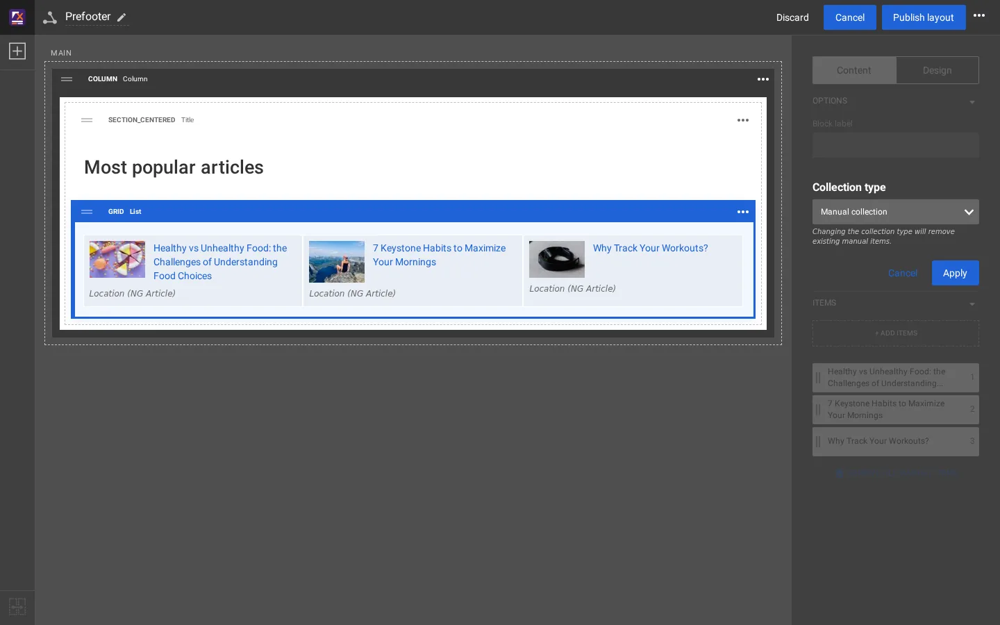

# Manuelle und dynamische Sammlungen

Ein Block, der Inhalte listet (List, Grid, die Galerie-Blöcke), hat eine **Sammlung**. Die Sammlung ist entweder:

| Typ | Einträge | Typische Verwendung |
|---|---|---|
| **Manuelle Sammlung** | von Hand im Content Browser ausgewählt, jeder eine Knoten-ID, in der Reihenfolge, die Sie festlegen | „Most popular articles“, eine kuratierte Teaser-Reihe |
| **Dynamische Sammlung** | das Ergebnis einer Abfrage auf den Inhaltsbaum, ausgeführt, wenn die Seite dargestellt wird (und wie der Rest der Seite in den Seiten-Caches gehalten) | „Die neuesten Artikel von Fitness“, „alles mit dem Tag Running“ |

## Inhalt

1. [Den Typ umschalten](#den-typ-umschalten)
2. [Die Optionen einer dynamischen Sammlung](#die-optionen-einer-dynamischen-sammlung)
3. [Dasselbe in einem Template](#dasselbe-in-einem-template)

## Den Typ umschalten

Wählen Sie den Block aus und klicken Sie dann im Reiter **Inhalt** neben **Sammlungstyp** auf **Ändern**. Das Feld warnt:
*Beim Ändern des Sammlungstyps werden vorhandene manuelle Elemente entfernt.* Wählen Sie **Dynamische Sammlung**, dann den
**Abfragetyp**, und klicken Sie auf **Anwenden**.



Die auf dieser Installation angebotenen Abfragetypen sind **Exponential** (`exponential_content_search`, eine Suche unterhalb
eines übergeordneten Orts) und **Themen** (`content_by_topic`, Inhalte mit einem Tag).

## Die Optionen einer dynamischen Sammlung

Für **Exponential** zeigt das Feld:

| Option | Bedeutet |
|---|---|
| Use current location as parent | unterhalb der gerade angezeigten Seite listen statt unterhalb eines festen übergeordneten Orts |
| Parent location | der Knoten, unterhalb dessen gesucht wird; die Ordner-Schaltfläche öffnet den Content Browser, **Im CMS anzeigen** öffnet ihn in der Administration |
| Sortierart | Veröffentlicht, Geändert, Alphabetical, Priorität, Defined by parent |
| Sortierrichtung | Absteigend, Aufsteigend |
| Erweiterte Optionen | Filter (Inhaltstypen, Sektionen, Objektzustände) |
| Versatz & Anzahl der Elemente | die ersten Einträge überspringen, die Anzahl begrenzen |


Die Mitte des Editors zeigt das Ergebnis sofort. Auf der Testkopie blieben die drei handverlesenen Einträge nach dem
Umschalten oben in der Liste, gefolgt vom Ergebnis der Abfrage. Der Entwurf wurde danach mit **Verwerfen** verworfen.

## Dasselbe in einem Template

Der Weg über Templates, um die neuesten Artikel unterhalb von Fitness (Knoten 92) zu listen:

```smarty
{def $latest = fetch( 'content', 'list', hash( 'parent_node_id', 92,
                                                'class_filter_type', 'include',
                                                'class_filter_array', array( 'ng_article' ),
                                                'sort_by', array( 'published', false() ),
                                                'limit', 3 ) )}
<ul>
{foreach $latest as $item}
    <li><a href={$item.url_alias|ezurl}>{$item.name|wash}</a></li>
{/foreach}
</ul>
{undef $latest}
```

| | Dynamische Sammlung | `fetch()` in einem Template |
|---|---|---|
| Wer übergeordneten Ort, Sortierung und Anzahl ändert | ein Redakteur, im Layout-Editor | ein Entwickler, im Template |
| Wo sie erscheinen kann | in jeder Zone jedes Layouts | überall, wo das Template eingebunden wird |
| Aussehen | Ansichtstyp und Ansichtstyp der Elemente des Blocks | das eigene Markup des Templates |

Beide lesen denselben Inhaltsbaum. Eine übliche Aufteilung: Das Template legt fest, wie ein Eintrag aussieht (ein
Ansichtstyp der Elemente), der Redakteur entscheidet, welche Einträge und wo.

## Verwandte Seiten

- [Den Prefooter im Layout-Editor ändern](prefooter-im-layout-editor.md)
- [Wie ein Block seinen Templates zugeordnet wird](../../../eng-us/help/build-two-ways/block-to-template-map.md)
- [Freie Dokumentation](../freie-dokumentation.md): Diese Seite darf unter der GNU FDL 1.3 frei kopiert, übersetzt und verbessert werden.

<!-- exp-partner-block:start -->
**Werden Sie Exponential-Partner.** Partner teilen ihre Informationen, stellen Mittel bereit, geben Beiträge zurück und
entwickeln die Produkte mit uns, und so wächst Exponential. Eine Partner-Website und ein Dashboard sind für Mitte 2027
geplant: Werden Sie noch heute Partner, damit wir schneller wachsen und neue Funktionen früher liefern. Beginnen Sie mit
[Partner: hier beginnen](../partner/partner-hier-beginnen.md) und [Wie Sie sich bewerben](../partner/wie-sie-sich-bewerben.md).
<!-- exp-partner-block:end -->
