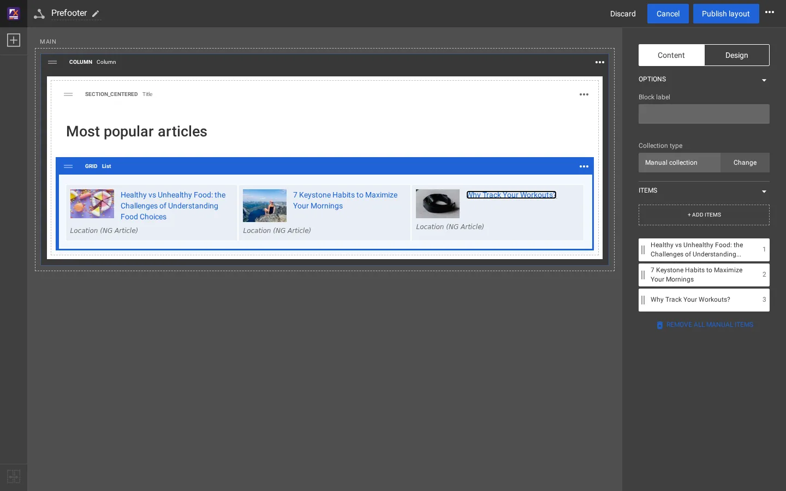
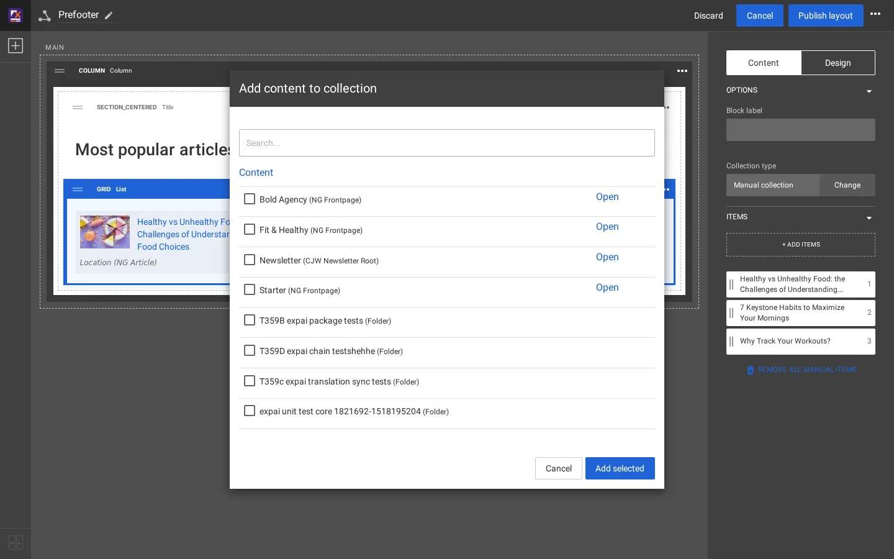

# Den Prefooter im Layout-Editor ändern

Das Band aus Blöcken über der Fußzeile von Artikel- und Rezeptseiten („Most popular articles“) ist das gemeinsame Layout
**Prefooter**. Anders als das Kopfmenü besteht es aus echten Layouts-Blöcken und wird deshalb im Editor geändert. Diese
Seite fügt ihm einen vierten Artikel hinzu.

## Inhalt

1. [Das gemeinsame Layout öffnen](#1-das-gemeinsame-layout-öffnen)
2. [Die Liste auswählen](#2-die-liste-auswählen)
3. [Einen Eintrag hinzufügen](#3-einen-eintrag-hinzufügen)
4. [Die Einträge ordnen](#4-die-einträge-ordnen)
5. [Veröffentlichen und prüfen](#5-veröffentlichen-und-prüfen)
6. [Was sich hier noch ändern lässt](#was-sich-hier-noch-ändern-lässt)

## 1. Das gemeinsame Layout öffnen

**Layouts > Gemeinsame Layouts**, dann der Name **Prefooter** (er zeigt „2 Verweise“: Full / Article und Full / Recipe
verknüpfen ihre Zone `pre_footer` damit). Der Editor öffnet das Layout in einem Entwurf.

Seine Zone `main` enthält eine **Column** (Hintergrundfarbe `secondary`) und darin einen **Title** (Ansicht `section_centered`,
„Most popular articles“) und eine **List** (Ansicht `grid`, 3 Spalten).

## 2. Die Liste auswählen

Klicken Sie auf die Liste. Das Eigenschaftenfeld rechts zeigt im Reiter **Inhalt** den **Sammlungstyp** (Manuelle Sammlung)
und die **Elemente** in ihrer Reihenfolge.

## 3. Einen Eintrag hinzufügen

Klicken Sie auf **+ Elemente hinzufügen**. Das Fenster **Inhalt zur Sammlung hinzufügen** listet die Spitze des Inhaltsbaums.
**Öffnen** Sie einen Zweig, um hinabzusteigen (hier Fit & Healthy, dann Fitness), haken Sie den Artikel an (hier
*Why Should You Choose Strength Training?*) und klicken Sie auf **Auswahl hinzufügen**.

Auf der Testkopie lieferte das Suchfeld des Fensters für das ausprobierte Wort „Kein Inhalt gefunden.“; das Durchblättern
des Baums funktioniert immer.

## 4. Die Einträge ordnen

Der neue Eintrag erscheint mit seiner Nummer in der Liste der Einträge. Ziehen Sie die Einträge an ihrem Griff, um die
Reihenfolge zu ändern. Die Mitte des Editors zeigt den Block so, wie die Site ihn zeigen wird.

## 5. Veröffentlichen und prüfen

Klicken Sie auf **Layout veröffentlichen**. Auf der Testkopie zeigte die nächste Anfrage eines Artikels den Antwort-Header
`X-Exp-Cache: MISS (purged)` und die neue Liste, ohne dass ein Cache von Hand geleert wurde.

Um den Entwurf stattdessen wegzuwerfen, klicken Sie auf **Verwerfen**.

## Was sich hier noch ändern lässt

| Änderung | Wo |
|---|---|
| Der Text der Überschrift oder ihr Tag | Den Title auswählen, Reiter **Inhalt** |
| Raster oder Liste, Anzahl der Spalten, Aussehen der Einträge | Die List auswählen, Reiter **Design**: Ansichtstyp, Ansichtstyp der Elemente, Number of columns |
| Hintergrund, Abstände, CSS-Klasse, Container | Reiter **Design** der Column oder der List |
| Eine Liste, die sich selbst füllt | Sammlungstyp **Ändern** > Dynamische Sammlung ([Manuelle und dynamische Sammlungen](manuelle-und-dynamische-sammlungen.md)) |
| Das Band auf anderen Seitentypen zeigen | Die Zone `pre_footer` ihrer Layouts mit Prefooter verknüpfen ([Gemeinsame Layouts und Zonenverknüpfung](../../../eng-us/help/build-two-ways/shared-layouts-and-zone-linking.md)) |

## Verwandte Seiten

- [Gemeinsame Layouts und Zonenverknüpfung](../../../eng-us/help/build-two-ways/shared-layouts-and-zone-linking.md)
- [Manuelle und dynamische Sammlungen](manuelle-und-dynamische-sammlungen.md)
- [Der Layout-Editor, ein Rundgang](rundgang-durch-den-layout-editor.md)
- [Freie Dokumentation](../freie-dokumentation.md): Diese Seite darf unter der GNU FDL 1.3 frei kopiert, übersetzt und verbessert werden.

<!-- exp-partner-block:start -->
**Werden Sie Exponential-Partner.** Partner teilen ihre Informationen, stellen Mittel bereit, geben Beiträge zurück und
entwickeln die Produkte mit uns, und so wächst Exponential. Eine Partner-Website und ein Dashboard sind für Mitte 2027
geplant: Werden Sie noch heute Partner, damit wir schneller wachsen und neue Funktionen früher liefern. Beginnen Sie mit
[Partner: hier beginnen](../partner/partner-hier-beginnen.md) und [Wie Sie sich bewerben](../partner/wie-sie-sich-bewerben.md).
<!-- exp-partner-block:end -->
