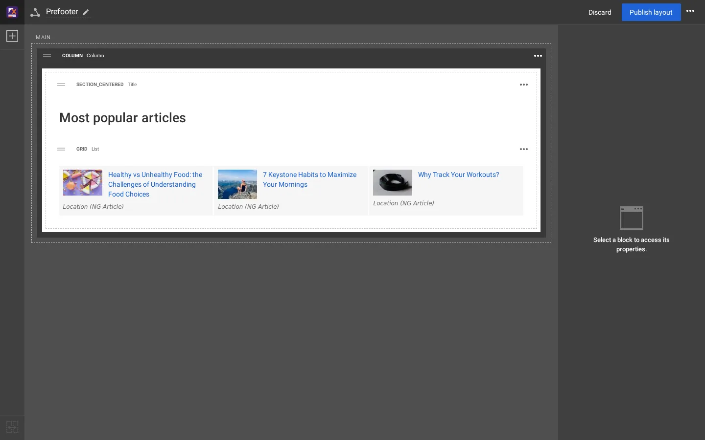
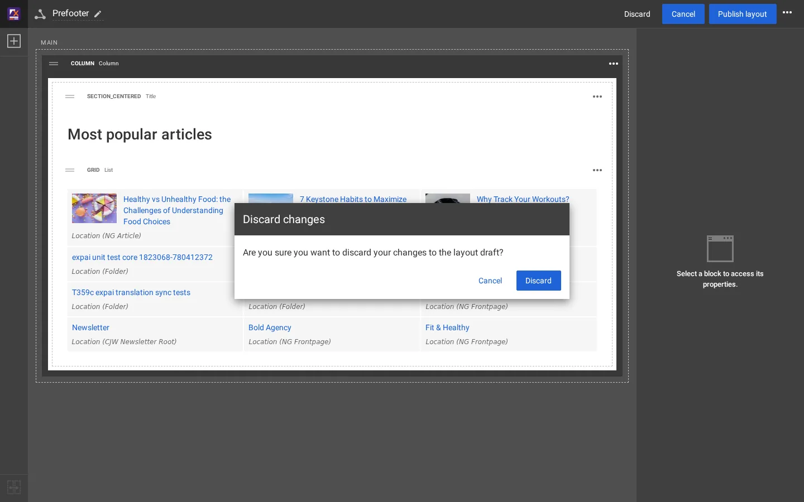

# Der Layout-Editor, ein Rundgang

Öffnen Sie ein beliebiges Layout mit **Layouts > Layouts** (oder **Gemeinsame Layouts**) und seinem Namen. Der Editor füllt das Browserfenster.

## Inhalt

1. [Die obere Leiste](#die-obere-leiste)
2. [Die Blockpalette](#die-blockpalette)
3. [Zonen und Blöcke](#zonen-und-blöcke)
4. [Das Eigenschaftenfeld](#das-eigenschaftenfeld)
5. [Den Editor verlassen](#den-editor-verlassen)

## Die obere Leiste

| Teil | Macht |
|---|---|
| Name des Layouts mit einem Stift | der Name des Layouts |
| **Verwerfen** | den Entwurf wegwerfen (fragt vorher nach) |
| **Abbrechen** | erscheint, solange ein Block ausgewählt ist |
| **Layout veröffentlichen** | macht den Entwurf zum veröffentlichten Layout |
| `...` | weitere Aktionen |

## Die Blockpalette

Die Schaltfläche **+** oben links öffnet die Palette. Ihre Gruppen und Blöcke auf dieser Installation:

| Gruppe | Blöcke |
|---|---|
| Basic | Title, Text, Button / Link, Rich text, External video, Map, Markdown, HTML snippet, Image, Spacer, Divider, Card, Alert, Badge, Progress bar, Accordion, Tabs |
| Components | Hero, About, Features, Logos, Quote, Lead |
| Listing | List, Grid, Zig-Zag (List), Accordion (List) |
| Gallery | Gallery, Slider, Thumb gallery, Grid gallery, Sushi bar, Carousel |
| Containers | Column, Two columns, Three columns, Four columns |
| Placeholders | Template block, Full view, Single content |

Ziehen Sie einen Block aus der Palette in eine Zone. Erweiterungen können eigene hinzufügen ([Einen Blocktyp hinzufügen](../../../eng-us/help/build-two-ways/add-a-block-type.md)).

## Zonen und Blöcke

Zonen sind die gestrichelten Bereiche, beschriftet mit ihrem Bezeichner (HEADER, MAIN, PRE_FOOTER ...). Eine **verknüpfte**
Zone zeigt die Blöcke eines gemeinsamen Layouts ([Gemeinsame Layouts und Zonenverknüpfung](../../../eng-us/help/build-two-ways/shared-layouts-and-zone-linking.md)).

Jeder Block hat einen Kopf: einen Griff zum Ziehen, den **Ansichtstyp** in Großbuchstaben, den **Namen des Blocktyps** und
ein Menü `...`. Die Mitte des Blocks zeigt eine Vorschau. Container (Column, Two columns ...) enthalten in ihren
Platzhaltern andere Blöcke.

## Das Eigenschaftenfeld

Klicken Sie auf einen Block, um ihn auszuwählen. Das Feld rechts hat zwei Reiter:

- **Inhalt**: die Blockbezeichnung und bei Listenblöcken der **Sammlungstyp** und die **Elemente**
  ([Manuelle und dynamische Sammlungen](manuelle-und-dynamische-sammlungen.md)).
- **Design**: der Ansichtstyp und die Optionen des Blocks ([Der Reiter Design](der-reiter-design.md)).

Änderungen werden beim Vornehmen in den Entwurf gespeichert, und die Vorschau in der Mitte folgt, mit einer Ausnahme im
Reiter **Design** ([Bekanntes Verhalten des Editors](bekanntes-verhalten-des-editors.md)).

## Den Editor verlassen

Auf der Site ist nichts sichtbar, bis Sie auf **Layout veröffentlichen** klicken. Ein Entwurf bleibt in der Datenbank,
wenn Sie den Editor verlassen (`./console exp:layouts list --drafts` listet offene Entwürfe); **Verwerfen** entfernt ihn.

## Verwandte Seiten

- [Den Prefooter im Layout-Editor ändern](prefooter-im-layout-editor.md)
- [Der Layout-Editor](../layout-editor.md)
- [Bekanntes Verhalten des Editors](bekanntes-verhalten-des-editors.md)
- [Freie Dokumentation](../freie-dokumentation.md): Diese Seite darf unter der GNU FDL 1.3 frei kopiert, übersetzt und verbessert werden.

<!-- exp-partner-block:start -->
**Werden Sie Exponential-Partner.** Partner teilen ihre Informationen, stellen Mittel bereit, geben Beiträge zurück und
entwickeln die Produkte mit uns, und so wächst Exponential. Eine Partner-Website und ein Dashboard sind für Mitte 2027
geplant: Werden Sie noch heute Partner, damit wir schneller wachsen und neue Funktionen früher liefern. Beginnen Sie mit
[Partner: hier beginnen](../partner/partner-hier-beginnen.md) und [Wie Sie sich bewerben](../partner/wie-sie-sich-bewerben.md).
<!-- exp-partner-block:end -->
