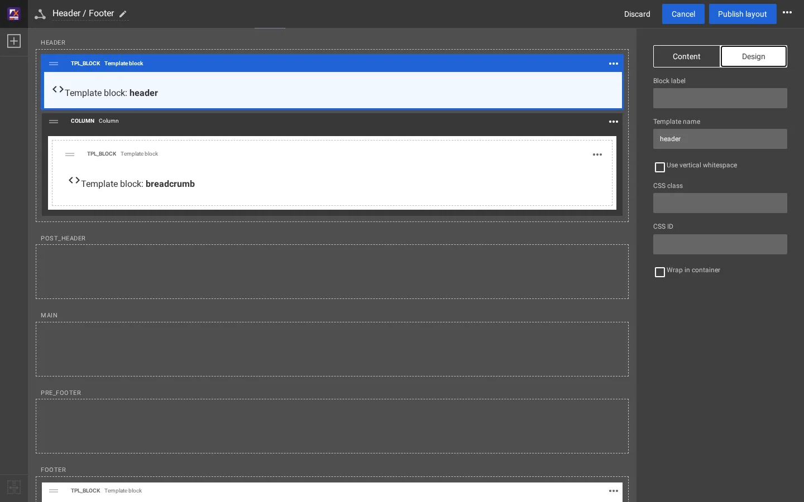

# Wie die Kopfzeile aufgebaut ist

Die Kopfzeile einer Seite von Fit & Healthy durchläuft zwei Welten: das **Layout** (in der Datenbank gespeichert, im
Layout-Editor bearbeitet) und die **Templates** (Dateien in einer Design-Erweiterung). Diese Seite folgt einer Anfrage von
der einen zur anderen. Dateipfade sind relativ zur Wurzel der Installation.

## Inhalt

1. [Die Kette auf einen Blick](#die-kette-auf-einen-blick)
2. [Die Seite des Layouts](#die-seite-des-layouts)
3. [Die Seite der Templates](#die-seite-der-templates)
4. [Seiten ohne Layout](#seiten-ohne-layout)
5. [Was jeder Teil Sie ändern lässt](#was-jeder-teil-sie-ändern-lässt)

## Die Kette auf einen Blick

| Schritt | Was | Wo |
|---|---|---|
| 1 | Das Layout der Seite wird von den Layout-Zuordnungen (Regeln) gewählt | Layouts > Layout-Zuordnungen |
| 2 | Seine Zone `header` ist mit der Zone `header` des gemeinsamen Layouts **Header / Footer** **verknüpft** | Zonenverknüpfung, siehe [Gemeinsame Layouts und Zonenverknüpfung](gemeinsame-layouts-und-zonenverknuepfung.md) |
| 3 | Diese Zone enthält einen **Template block** (`tpl_block`) mit dem Template-Namen `header` | Layout-Editor |
| 4 | Das Design stellt die Zone mit `explayouts/zone.tpl` und den Block mit `explayouts/block/block.tpl` dar | `extension/sevenx_themes_media/design/media/templates/explayouts/` |
| 5 | Für einen Template-Block nennt der Operator `tpl_block_template()` das einzubindende Template: `pagelayout/header.tpl` | `extension/sevenx_themes_media/autoloads/sevenxthemesmediaoperators.php` |
| 6 | `pagelayout/header.tpl` bindet Logo, Menü, Suche, Benutzermenü und Sprachauswahl ein | `.../templates/pagelayout/header.tpl` |
| 7 | `pagelayout/header/main_menu.tpl` geht in einer Schleife über `menu.ini [SiteInfo] MainMenuID[]` | `.../templates/pagelayout/header/main_menu.tpl` |
| 8 | Die Liste für den Siteaccess `site` | `settings/siteaccess/site/menu.ini.append.php` |

## Die Seite des Layouts

**Header / Footer** ist ein gemeinsames Layout (Layouttyp `layout_2`) mit fünf Zonen: `header`, `post_header`, `main`,
`pre_footer` und `footer`. Auf der Site Fit & Healthy enthalten seine Zonen:

| Zone | Blöcke |
|---|---|
| `header` | Template-Block `header`; eine Column (Hintergrundfarbe `primary`) mit dem Template-Block `breadcrumb` |
| `post_header`, `main`, `pre_footer` | nichts |
| `footer` | Template-Block `footer` |


Die Auswahl des header-Blocks zeigt seine Eigenschaften. Der Reiter **Inhalt** hat nur die Blockbezeichnung; der Reiter
**Design** zeigt den **Template name** (`header`, der Parameter `block_name`), den der Block auch auf sich selbst zeigt,
„Template block: **header**“.




Achtzehn weitere Layouts der Site verknüpfen ihre Zonen `header` und `footer` mit diesem Layout; deshalb bedient eine einzige
Kopfzeile die ganze Site. Die Blockdefinition steht in `extension/explayouts/settings/explayouts.ini.append.php`:

```ini
[BlockDefinition_tpl_block]
Name=Template block
Handler=expLayoutsTplBlockHandler
ViewTypes[]=tpl_block
Category=placeholders
```

Sein Handler, `expLayoutsTplBlockHandler`, hat einen Parameter, `block_name` („Template name“).

## Die Seite der Templates

Das Media-Design stellt jede Zone mit `explayouts/zone.tpl` dar, das für jeden Block der obersten Ebene
`explayouts/block/block.tpl` einbindet. `block.tpl` umschließt den Block mit `<div class="ngl-block ngl-<definition> ...">`
und bindet `design:explayouts/block/<definition>.tpl` ein, hier `explayouts/block/tpl_block.tpl`:

```smarty
{def $tpl_tpl = tpl_block_template($block.id)}
{if $tpl_tpl|ne('')}
{include uri=concat('design:', $tpl_tpl) module_result=$module_result}
{/if}
```

`tpl_block_template()` (Methode `tplBlockTemplate()` von `sevenxthemesmediaoperators.php`) antwortet in drei Schritten:

1. Eine feste Zuordnung der Block-IDs, die das Theme mitbringt: Block 13 ist `pagelayout/header.tpl`, Block 477
   `pagelayout/breadcrumbs.tpl`, Block 14 `pagelayout/footer.tpl` (und einige Inhaltsteile).
2. Sonst nach Platz: Ein Wurzelblock in der Zone `header` ist `pagelayout/header.tpl`, ein Block in einer Spalte der Zone
   `header` ist `pagelayout/breadcrumbs.tpl`, ein Wurzelblock in der Zone `footer` ist `pagelayout/footer.tpl`.
3. Sonst nach dem eigenen `block_name` des Blocks: `explayouts/tpl_block/<block_name>.tpl`, wenn ein Design diese Datei hat.

`pagelayout/header.tpl` ist der `<header class="site-header">`. Es bindet `content/parts/site_logo.tpl` und vier Teile aus
`pagelayout/header/` ein: `main_menu.tpl`, `search_box.tpl`, `user_menu.tpl` und `language_selector.tpl`.

`main_menu.tpl` liest die Liste und stellt ein `<li>` pro vorhandenem Knoten dar:

```smarty
{def $mm_ids = ezini('SiteInfo','MainMenuID','menu.ini')|unique}
...
{foreach $mm_ids as $mm_index => $mm_id}
    {set $mm_node = fetch('content','node',hash('node_id',$mm_id))}
    ...
    {if is_object($mm_node)}
    <li id="menu-item-main_menu-location-id-{$mm_display_id}" ...>
        <a href={$mm_node.url_alias|ezurl}>{$mm_node.name|wash}</a>
    </li>
    {/if}
{/foreach}
```

Was daraus folgt:

- Der Text des Eintrags ist der **Name** des Knotens, der Link sein **URL-Alias**. Benennen Sie die Seite um, und der Eintrag folgt.
- Ein Listeneintrag, dessen Knoten sich nicht holen lässt (zum Beispiel gelöscht), wird **übersprungen**, nicht leer gezeigt.
  Der Fetch prüft das Leserecht des Besuchers nicht: Eine gelistete Seite, die der Besucher nicht lesen darf, wird trotzdem
  als Eintrag gezeigt.
- Die Vorfahren der aktuellen Seite bekommen die Klasse `active`.
- `NexusMainMenuID[]` gibt den Attributen `id` und `data-location-id` der ersten Einträge die IDs der Referenz-Site, von der das
  Theme portiert wurde. Es ändert nicht, was gezeigt wird; ein Eintrag ohne Partner dort verwendet seine eigene Knoten-ID.

Die kompilierte Form von `main_menu.tpl` enthält die Werte von `ezini()`. Deshalb braucht eine geänderte Liste das Leeren
des Template-Cache ([Caches nach einer Änderung](caches-nach-einer-aenderung.md)).

## Seiten ohne Layout

Eine Seite, die kein Layout bekommt (oder ein Layout ohne Blöcke), verwendet das schlichte Seitenlayout des Designs:
`pagelayout.tpl` bindet `pagelayout/header.tpl` direkt ein. Dasselbe Template, dasselbe Menü; das Menü ist also mit und
ohne Layouts identisch.

## Was jeder Teil Sie ändern lässt

| Teil | Ändern mit | Beispiel |
|---|---|---|
| Welche Seiten im Menü stehen, ihre Reihenfolge | `menu.ini` (Administration oder `exp:ini`) | [Einen Eintrag zum Kopfmenü hinzufügen](kopfmenue-eintrag-hinzufuegen.md) |
| Text und Link des Eintrags | Die Seite selbst (Name, URL-Alias) | [Das Kopfmenü und der Inhaltsbaum](kopfmenue-und-inhaltsbaum.md) |
| Was die Kopfzeile auf jeder Seite umgibt | Der Layout-Editor, gemeinsames Layout Header / Footer | Einen Block zur Zone `post_header` hinzufügen |
| Das Markup der Kopfzeile | Ein Template-Override in Ihrer eigenen Design-Erweiterung | Die Templates unter `pagelayout/header/` |

## Verwandte Seiten

- [Einen Eintrag zum Kopfmenü hinzufügen](kopfmenue-eintrag-hinzufuegen.md)
- [Wie die Fußzeile aufgebaut ist](wie-die-fusszeile-aufgebaut-ist.md)
- [Gemeinsame Layouts und Zonenverknüpfung](gemeinsame-layouts-und-zonenverknuepfung.md)
- [Zwei Wege zum Bauen](zwei-wege-zum-bauen.md)
- [Freie Dokumentation](../freie-dokumentation.md): Diese Seite darf unter der GNU FDL 1.3 frei kopiert, übersetzt und verbessert werden.

<!-- exp-partner-block:start -->
**Werden Sie Exponential-Partner.** Partner teilen ihre Informationen, stellen Mittel bereit, geben Beiträge zurück und
entwickeln die Produkte mit uns, und so wächst Exponential. Eine Partner-Website und ein Dashboard sind für Mitte 2027
geplant: Werden Sie noch heute Partner, damit wir schneller wachsen und neue Funktionen früher liefern. Beginnen Sie mit
[Partner: hier beginnen](../partner/partner-hier-beginnen.md) und [Wie Sie sich bewerben](../partner/wie-sie-sich-bewerben.md).
<!-- exp-partner-block:end -->
