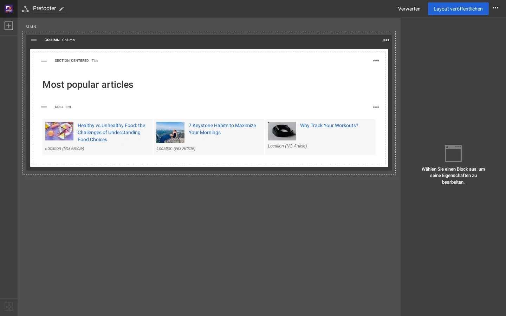

# Wie ein Block seinen Templates zugeordnet wird

Jeder Block, den Sie im Editor sehen, wird von Templates gezeichnet. Wenn Sie wissen, welche es sind, können Sie das Markup
jedes Blocks ändern, für alle Seiten auf einmal, ohne die Layouts anzufassen.

## Inhalt

1. [Die Kette](#die-kette)
2. [Wo jeder Blocktyp dargestellt wird](#wo-jeder-blocktyp-dargestellt-wird)
3. [Ansichtstypen und Ansichtstypen der Elemente](#ansichtstypen-und-ansichtstypen-der-elemente)
4. [Eines überschreiben](#eines-überschreiben)
5. [Was der Blockkopf im Editor verrät](#was-der-blockkopf-im-editor-verrät)

## Die Kette

Für eine Seite mit Layout im Media-Design (Pfade unterhalb von `extension/sevenx_themes_media/design/media/templates/`):

| Schritt | Template | Macht |
|---|---|---|
| 1 | `pagelayout.tpl` | ermittelt das Layout der Seite und bindet `explayouts/layout.tpl` ein |
| 2 | `explayouts/layout.tpl` | setzt die Zone `header` vor `<main>`, `footer` danach, den Rest hinein |
| 3 | `explayouts/zone.tpl` | `<section class="zone zone-<identifier>">`, ein Include pro Block der obersten Ebene |
| 4 | `explayouts/block/block.tpl` | der Wrapper `<div class="ngl-block ngl-<type> ngl-vt-<view type> ...">`, Abstände, Hintergrund, CSS-Klasse und -ID, Container; bindet dann Schritt 5 ein |
| 5 | `explayouts/block/<block type>.tpl` | der Block selbst |
| 6 | `explayouts/block/<block type>/<view type>.tpl` | für Blocktypen, deren Template nach Ansichtstyp verteilt (List, Title, Gallery ...) |
| 7 | `content/views/<item view type>/...` | wie jeder Eintrag einer Liste gezeigt wird |

Wenn das Media-Design kein `explayouts/block/<block type>.tpl` hat, antwortet das nächste Design in der Reihe: das eigene
`extension/explayouts/design/standard/templates/explayouts/block/<block type>.tpl` von Layouts.

## Wo jeder Blocktyp dargestellt wird

| Blocktyp (Name im Editor) | Media-Design | Verteilung nach Ansichtstyp |
|---|---|---|
| `title` (Title) | `explayouts/block/title.tpl` | `title/`: `title`, `title_centered`, `centered`, `section`, `section_centered` |
| `list` (List) | `explayouts/block/list.tpl` | `list/`: `list`, `grid`, `grid_featured`, `list_zigzag`, `list_accordion`, `numbered`, `zigzag`, `accordion`, `mini`, `running`, `eatwell` (dazu `list_items.tpl`; das Raster nach Spalten in `list/grid/`: `2_columns`, `3_columns`, `4_columns`, `6_columns`) |
| `gallery` (Gallery) | `explayouts/block/gallery.tpl` | `gallery/`: `slider`, `grid_gallery`, `thumb_gallery`, `sushi_bar` |
| `column` (Column), `two_columns` | `column.tpl`, `two_columns.tpl` | jeder Kindblock wieder über `explayouts/block/block.tpl` (verschachtelt) |
| `tpl_block` (Template block) | `tpl_block.tpl` | nach Template-Name, siehe [Eigene Template-Blöcke](eigene-template-bloecke.md) |
| `button`, `rich_text`, `html_snippet` | `button.tpl`, `rich_text.tpl`, `html_snippet.tpl` | |
| `exp_component_hero`, `_about`, `_features`, `_lead`, `_logos`, `_quote` | `exp_component_<name>.tpl` | Ansichtstypen `<name>_style_1` ... |
| `product_highlight` | `product_highlight.tpl` | |
| jeder andere Typ (text, image, map, card, alert, tabs ...) | nicht im Media-Design | Standard-Design von Layouts: `extension/explayouts/design/standard/templates/explayouts/block/<type>.tpl` |

Die Blocktypen und ihre Ansichtstypen sind in `extension/explayouts/settings/explayouts.ini.append.php` definiert
(`[BlockDefinition_<type>]`, `ViewTypes[]`).

## Ansichtstypen und Ansichtstypen der Elemente

- Der **Ansichtstyp** (Reiter Design, *Ansichtstyp*) wählt das eigene Aussehen des Blocks; im Media-Design benennt er das
  verteilende Template aus Schritt 6 und erscheint als `ngl-vt-<view type>` am Wrapper.
- Der **Ansichtstyp der Elemente** (Reiter Design, *Ansichtstyp der Elemente*, bei Listen: Standard, Standard (with intro),
  Overlay, Card, Card (with intro), Line, Mini, List item, List item (with intro)) wählt, wie jeder Eintrag gezeichnet wird,
  aus den Inhaltsansichten unter `content/views/` (`standard`, `overlay`, `card`, `line`, `mini`, `listitem` ...).

Einige mit dem Theme importierte Blöcke tragen Ansichtstypen, die ihre INI-Definition nicht aufführt: Der Title des Prefooters
verwendet `section_centered`, während `[BlockDefinition_title]` nur `default` listet. Das Template existiert trotzdem und
stellt sie dar.

## Eines überschreiben

Kopieren Sie das Template an denselben Pfad in Ihrer eigenen Design-Erweiterung und ändern Sie die Kopie, zum Beispiel das
Raster des List-Blocks:

```text
extension/sevenx_themes_media/design/media/templates/explayouts/block/list/grid.tpl    the theme's
extension/mysite/design/media/templates/explayouts/block/list/grid.tpl                 yours (wins)
```

Leeren Sie dann **Template & Inhalt**. Jeder List-Block in der Rasteransicht verwendet in jedem Layout Ihre Kopie.
Einrichtung und Reihenfolge der Erweiterungen: [Ihre eigene Design-Erweiterung](eigene-design-erweiterung.md).

## Was der Blockkopf im Editor verrät

Jeder Block im Editor hat einen Kopf wie `GRID List` oder `SECTION_CENTERED Title`: den **Ansichtstyp** in Großbuchstaben,
dann den **Namen des Blocktyps**. Diese beiden ergeben direkt den Template-Pfad: List in der Ansicht `grid` ist
`explayouts/block/list/grid.tpl`.



## Verwandte Seiten

- [Einen Ansichtstyp hinzufügen](ansichtstyp-hinzufuegen.md)
- [Einen Blocktyp hinzufügen](blocktyp-hinzufuegen.md)
- [Wie die Kopfzeile aufgebaut ist](wie-die-kopfzeile-aufgebaut-ist.md)
- [Freie Dokumentation](../freie-dokumentation.md): Diese Seite darf unter der GNU FDL 1.3 frei kopiert, übersetzt und verbessert werden.

<!-- exp-partner-block:start -->
**Werden Sie Exponential-Partner.** Partner teilen ihre Informationen, stellen Mittel bereit, geben Beiträge zurück
und entwickeln die Produkte mit uns, und so wächst Exponential. Eine Partner-Website und ein Dashboard sind für Mitte
2027 geplant: Werden Sie noch heute Partner, damit wir schneller wachsen und neue Funktionen früher liefern. Beginnen
Sie mit [Partner: hier beginnen](../partner/partner-hier-beginnen.md) und
[Wie Sie sich bewerben](../partner/wie-sie-sich-bewerben.md).
<!-- exp-partner-block:end -->
