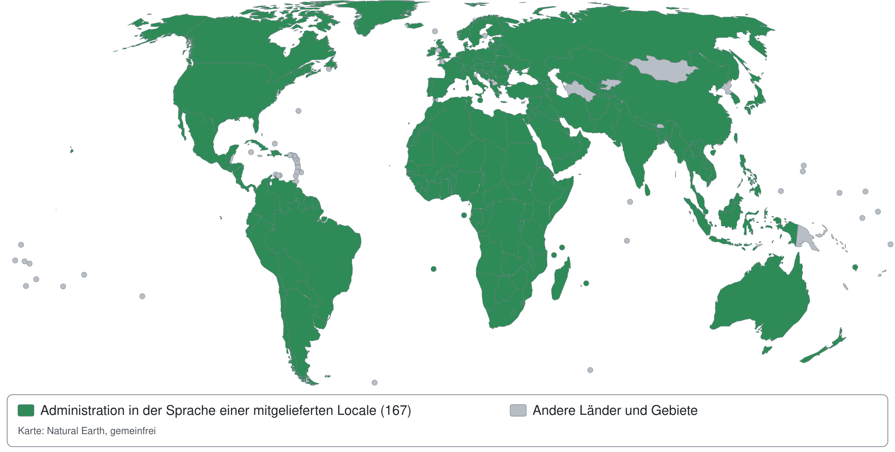

# Sprachen in Exponential

<!-- generated: exp:i18n coverage 2026-10-29 (start) -->
**Auf einen Blick, Stand 29. Oktober 2026.** Eine Standardinstallation (die mitgelieferten `share/locale`,
`share/translations` und `settings/i18n.ini`, ohne Erweiterungen) hat:

| Was | Anzahl |
|---|---:|
| Sprachen der Administration: Übersetzungen in `share/translations` | **155**, davon 3 vollständig |
| Locales: Dateien `share/locale/*.ini` | **368**: 361 Sprachen und Länder, 1 Testsprache, 6 Varianten |
| Bekannte Sprachen: die Sprachcodes der Locales (ohne Varianten und Testsprache) | **150** |
| davon von der Administration übersetzt gezeigt (eigene Übersetzung, Fallback oder Englisch) | **150** |
| davon nicht übersetzt ([Liste](#die-noch-nicht-übersetzten-sprachen)) | **0** |
| Länder und Gebiete der Locales | **247** |
| davon mit der Administration in ihrer Sprache (grün auf der Karte) | **247** |
| Codes aus ISO 3166-1 (`settings/country.ini`) ohne Locale | **4**, alle mit Absicht: unbewohnt oder zurückgezogen (Liste unter der Karte) |
| Locales, die von rechts nach links geschrieben werden | **43** |



Ein Land ist grün, wenn für es eine Locale mitgeliefert wird, deren Sprache die Administration übersetzt zeigt:
mit einer eigenen Übersetzung oder der ersten Übersetzung ihrer Fallback-Kette (`i18n.ini [TranslationSettings]`,
`FallbackMode=first`, siehe [Abschnitt 13](#13-übersetzungs-fallbacks)). Englisch zählt als übersetzt: Es ist die
Sprache der Quelltexte. Die Karte als Vektorgrafik: `doc/ger-de/bilder/sprachen/abdeckungskarte.svg`; Umrisse: Natural Earth, gemeinfrei.

Ebenfalls grün sind die unbewohnten Gebiete ohne Locale mit Absicht: Antarktis (`AQ`), Bouvetinsel (`BV`) und Heard- und McDonald-Inseln (`HM`).
Exponential bedient diese Gebiete in jeder Sprache; lokale Konventionen gibt es keine.

<details><summary>Die 247 Länder und Gebiete in Grün</summary>

| Land oder Gebiet | Code | Locales und die Übersetzung, die sie zeigen |
|---|---|---|
| Afghanistan | AF | `fas-AF`, `pus-AF` |
| Ägypten | EG | `ara-EG` → `ara-SA` |
| Alandinseln | AX | `swe-AX` → `swe-SE` |
| Albanien | AL | `sqi-AL` |
| Algerien | DZ | `ara-DZ` → `ara-SA`, `fre-DZ` → `fre-FR`, `kab-DZ` |
| Amerikanisch-Ozeanien | UM | `eng-UM` (Quelltexte) |
| Amerikanisch-Samoa | AS | `eng-AS` (Quelltexte) |
| Amerikanische Jungferninseln | VI | `eng-VI` (Quelltexte) |
| Andorra | AD | `cat-AD` → `cat-ES` |
| Angola | AO | `por-AO` → `por-PT` |
| Anguilla | AI | `eng-AI` (Quelltexte) |
| Antigua und Barbuda | AG | `eng-AG` (Quelltexte) |
| Äquatorialguinea | GQ | `esl-GQ` → `esl-ES`, `fre-GQ` → `fre-FR` |
| Argentinien | AR | `esl-AR` → `esl-ES` |
| Armenien | AM | `hye-AM` |
| Aruba | AW | `dut-AW` → `dut-NL` |
| Aserbaidschan | AZ | `aze-AZ` |
| Äthiopien | ET | `amh-ET`, `orm-ET`, `tir-ET` |
| Australien | AU | `eng-AU` |
| Bahamas | BS | `eng-BS` (Quelltexte) |
| Bahrain | BH | `ara-BH` → `ara-SA` |
| Bangladesch | BD | `ben-BD` |
| Barbados | BB | `eng-BB` (Quelltexte) |
| Belarus | BY | `bel-BY`, `rus-BY` → `rus-RU` |
| Belgien | BE | `dut-BE` → `dut-NL`, `fre-BE` → `fre-FR`, `ger-BE` → `ger-DE` |
| Belize | BZ | `eng-BZ` (Quelltexte) |
| Benin | BJ | `fre-BJ` → `fre-FR` |
| Bermuda | BM | `eng-BM` (Quelltexte) |
| Bhutan | BT | `dzo-BT` |
| Birma (Myanmar) | MM | `mya-MM` |
| Bolivien | BO | `esl-BO` → `esl-ES` |
| Bonaire, Saint Eustatius and Saba | BQ | `dut-BQ` → `dut-NL` |
| Bosnien und Herzegowina | BA | `bos-BA` |
| Botsuana | BW | `eng-BW` (Quelltexte) |
| Brasilien | BR | `por-BR` |
| Britische Jungferninseln | VG | `eng-VG` (Quelltexte) |
| Britisches Territorium im Indischen Ozean | IO | `eng-IO` (Quelltexte) |
| Brunei | BN | `msa-BN` → `msa-MY` |
| Bulgarien | BG | `bul-BG` |
| Burkina Faso | BF | `fre-BF` → `fre-FR` |
| Burundi | BI | `fre-BI` → `fre-FR`, `run-BI` |
| Chile | CL | `esl-CL` → `esl-ES` |
| China | CN | `bod-CN`, `chi-CN`, `uig-CN` |
| Cookinseln | CK | `eng-CK` (Quelltexte) |
| Costa Rica | CR | `esl-CR` → `esl-ES` |
| Curaçao | CW | `dut-CW` → `dut-NL` |
| Dänemark | DK | `dan-DK` |
| Deutschland | DE | `dsb-DE`, `ger-DE`, `hsb-DE` |
| Dominica | DM | `eng-DM` (Quelltexte) |
| Dominikanische Republik | DO | `esl-DO` → `esl-ES` |
| Dschibuti | DJ | `ara-DJ` → `ara-SA`, `fre-DJ` → `fre-FR` |
| Ecuador | EC | `esl-EC` → `esl-ES` |
| Ehemalige jugoslawische Republik Mazedonien | MK | `mkd-MK` |
| El Salvador | SV | `esl-SV` → `esl-ES` |
| Elfenbeinküste | CI | `fre-CI` → `fre-FR` |
| Eritrea | ER | `ara-ER` → `ara-SA` |
| Estland | EE | `est-EE` |
| Falklandinseln | FK | `eng-FK` (Quelltexte) |
| Färöer-Inseln | FO | `dan-FO` → `dan-DK`, `fao-FO` |
| Fidschi | FJ | `eng-FJ` (Quelltexte) |
| Finnland | FI | `fin-FI` |
| Frankreich | FR | `bre-FR`, `fre-FR`, `oci-FR` |
| Französisch-Guayana | GF | `fre-GF` → `fre-FR` |
| Französisch-Polynesien | PF | `fre-PF` → `fre-FR` |
| Französische Süd- und Antarktisgebiete | TF | `fre-TF` → `fre-FR` |
| Gabun | GA | `fre-GA` → `fre-FR` |
| Gambia | GM | `eng-GM` (Quelltexte) |
| Georgien | GE | `kat-GE` |
| Ghana | GH | `aka-GH`, `eng-GH` (Quelltexte), `ewe-GH` |
| Gibraltar | GI | `eng-GI` (Quelltexte) |
| Grenada | GD | `eng-GD` (Quelltexte) |
| Griechenland | GR | `ell-GR` |
| Grönland | GL | `kal-GL` |
| Guadeloupe | GP | `fre-GP` → `fre-FR` |
| Guam | GU | `eng-GU` (Quelltexte) |
| Guatemala | GT | `esl-GT` → `esl-ES` |
| Guernsey | GG | `eng-GG` (Quelltexte) |
| Guinea | GN | `fre-GN` → `fre-FR`, `nqo-GN` |
| Guinea-Bissau | GW | `por-GW` → `por-PT` |
| Guyana | GY | `eng-GY` (Quelltexte) |
| Haiti | HT | `fre-HT` → `fre-FR` |
| Honduras | HN | `esl-HN` → `esl-ES` |
| Hongkong | HK | `chi-HK` → `chi-TW` |
| Indien | IN | `asm-IN`, `ben-IN` → `ben-BD`, `bho-IN`, `brx-IN`, `doi-IN`, `eng-IN` (Quelltexte), `guj-IN`, `hin-IN`, `kan-IN`, `kas-IN`, `kok-IN`, `mai-IN`, `mal-IN`, `mar-IN`, `mni-IN`, `ori-IN`, `pan-IN`, `san-IN`, `sat-IN`, `tam-IN`, `tel-IN`, `urd-IN` → `urd-PK` |
| Indonesien | ID | `ind-ID`, `jav-ID`, `sun-ID` |
| Insel Man | IM | `eng-IM` (Quelltexte) |
| Irak | IQ | `ara-IQ` → `ara-SA`, `arc-IQ`, `ckb-IQ`, `syr-IQ` |
| Iran (Islamische Republik) | IR | `fas-IR` |
| Irland | IE | `eng-IE` (Quelltexte), `gle-IE` |
| Island | IS | `isl-IS` |
| Israel | IL | `heb-IL`, `huy-IL` |
| Italien | IT | `ita-IT` |
| Jamaika | JM | `eng-JM` (Quelltexte) |
| Japan | JP | `jpn-JP` |
| Jemen | YE | `ara-YE` → `ara-SA` |
| Jersey | JE | `eng-JE` (Quelltexte) |
| Jordanien | JO | `ara-JO` → `ara-SA` |
| Kaimaninseln | KY | `eng-KY` (Quelltexte) |
| Kambodscha | KH | `khm-KH` |
| Kamerun | CM | `fre-CM` → `fre-FR` |
| Kanada | CA | `eng-CA` (Quelltexte), `fre-CA` → `fre-FR` |
| Kap Verde | CV | `por-CV` → `por-PT` |
| Kasachstan | KZ | `kaz-KZ`, `rus-KZ` → `rus-RU` |
| Katar | QA | `ara-QA` → `ara-SA` |
| Kenia | KE | `eng-KE` (Quelltexte), `kik-KE`, `swa-KE` |
| Kirgistan | KG | `kir-KG`, `rus-KG` → `rus-RU` |
| Kiribati | KI | `eng-KI` (Quelltexte) |
| Kokosinseln | CC | `eng-CC` → `eng-AU` |
| Kolumbien | CO | `esl-CO` → `esl-ES` |
| Komoren | KM | `ara-KM` → `ara-SA`, `fre-KM` → `fre-FR` |
| Kongo (Republik Kongo) | CG | `fre-CG` → `fre-FR` |
| Kosovo | XK | `sqi-XK` → `sqi-AL` |
| Kroatien | HR | `cro-HR` |
| Kuba | CU | `esl-CU` → `esl-ES` |
| Kuwait | KW | `ara-KW` → `ara-SA` |
| Land Sint Maarten | SX | `dut-SX` → `dut-NL` |
| Laos | LA | `lao-LA` |
| Lesotho | LS | `eng-LS` (Quelltexte) |
| Lettland | LV | `lav-LV` |
| Libanon | LB | `ara-LB` → `ara-SA` |
| Liberia | LR | `eng-LR` (Quelltexte) |
| Libysch-Arabische Dschamahirija | LY | `ara-LY` → `ara-SA` |
| Liechtenstein | LI | `ger-LI` → `ger-DE` |
| Litauen | LT | `lit-LT` |
| Luxemburg | LU | `fre-LU` → `fre-FR`, `ger-LU` → `ger-DE`, `ltz-LU` |
| Macau | MO | `chi-MO` → `chi-TW` |
| Madagaskar | MG | `fre-MG` → `fre-FR`, `mlg-MG` |
| Malawi | MW | `eng-MW` (Quelltexte) |
| Malaysien | MY | `msa-MY` |
| Malediven | MV | `div-MV` |
| Mali | ML | `bam-ML`, `fre-ML` → `fre-FR` |
| Malta | MT | `mlt-MT` |
| Marokko | MA | `ara-MA` → `ara-SA`, `fre-MA` → `fre-FR`, `zgh-MA` |
| Marshall-Inseln | MH | `eng-MH` (Quelltexte) |
| Martinique | MQ | `fre-MQ` → `fre-FR` |
| Mauretanien | MR | `ara-MR` → `ara-SA`, `fre-MR` → `fre-FR` |
| Mauritius | MU | `fre-MU` → `fre-FR` |
| Mayotte | YT | `fre-YT` → `fre-FR` |
| Mexiko | MX | `esl-MX` |
| Mikronesien | FM | `eng-FM` (Quelltexte) |
| Moldau (Republik Moldau) | MD | `ron-MD` → `ron-RO`, `rus-MD` → `rus-RU` |
| Monaco | MC | `fre-MC` → `fre-FR` |
| Mongolei | MN | `mon-MN` |
| Montenegro | ME | `srp-ME` → `srp-RS` |
| Montserrat | MS | `eng-MS` (Quelltexte) |
| Mosambik | MZ | `por-MZ` → `por-PT` |
| Namibia | NA | `eng-NA` (Quelltexte) |
| Nauru | NR | `eng-NR` (Quelltexte) |
| Nepal | NP | `nep-NP` |
| Neukaledonien | NC | `fre-NC` → `fre-FR` |
| Neuseeland | NZ | `eng-NZ` → `eng-AU`, `mri-NZ` |
| Niederlande | NL | `dut-NL`, `fry-NL` |
| Niger | NE | `fre-NE` → `fre-FR` |
| Nigeria | NG | `eng-NG` (Quelltexte), `hau-NG`, `ibo-NG`, `pcm-NG`, `yor-NG` |
| Nikaragua | NI | `esl-NI` → `esl-ES` |
| Niue | NU | `eng-NU` (Quelltexte) |
| Nordkorea | KP | `kor-KP` |
| Nördliche Marianen | MP | `eng-MP` (Quelltexte) |
| Norfolkinsel | NF | `eng-NF` → `eng-AU` |
| Norwegen | NO | `nno-NO` → `nor-NO`, `nor-NO`, `sme-NO` |
| Oman | OM | `ara-OM` → `ara-SA` |
| Österreich | AT | `ger-AT` → `ger-DE` |
| Pakistan | PK | `eng-PK` (Quelltexte), `pnb-PK`, `snd-PK`, `urd-PK` |
| Palästinensische Autonomiegebiete | PS | `ara-PS` → `ara-SA` |
| Palau | PW | `eng-PW` (Quelltexte) |
| Panama | PA | `esl-PA` → `esl-ES` |
| Papua-Neuguinea | PG | `eng-PG` (Quelltexte) |
| Paraguay | PY | `esl-PY` → `esl-ES` |
| Peru | PE | `esl-PE` → `esl-ES`, `que-PE` |
| Philippinen | PH | `ceb-PH`, `eng-PH` (Quelltexte), `fil-PH` |
| Pitcairn | PN | `eng-PN` (Quelltexte) |
| Polen | PL | `pol-PL` |
| Portugal | PT | `por-PT` |
| Puerto Rico | PR | `esl-PR` → `esl-ES` |
| Republik Südafrika | ZA | `afr-ZA`, `eng-ZA` (Quelltexte), `xho-ZA`, `zul-ZA` |
| Réunion | RE | `fre-RE` → `fre-FR` |
| Ruanda | RW | `fre-RW` → `fre-FR`, `kin-RW` |
| Rumänien | RO | `ron-RO` |
| Russland | RU | `che-RU`, `rus-RU`, `tat-RU` |
| Saint Kitts und Nevis | KN | `eng-KN` (Quelltexte) |
| Sambia | ZM | `eng-ZM` (Quelltexte) |
| Samoa | WS | `eng-WS` (Quelltexte) |
| San Marino | SM | `ita-SM` → `ita-IT` |
| Sao Tomé und Principe | ST | `por-ST` → `por-PT` |
| Saudi-Arabien | SA | `ara-SA` |
| Schweden | SE | `swe-SE` |
| Schweiz | CH | `fre-CH` → `fre-FR`, `ger-CH` → `ger-DE`, `ita-CH` → `ita-IT`, `roh-CH` |
| Senegal | SN | `fre-SN` → `fre-FR`, `ful-SN`, `wol-SN` |
| Serbien | RS | `ser-SR`, `srp-RS` |
| Seychellen | SC | `fre-SC` → `fre-FR` |
| Sierra Leone | SL | `eng-SL` (Quelltexte) |
| Simbabwe | ZW | `eng-ZW` (Quelltexte), `sna-ZW` |
| Singapur | SG | `chi-SG` → `chi-CN`, `eng-SG` (Quelltexte), `msa-SG` → `msa-MY`, `tam-SG` → `tam-IN` |
| Slowakei (Slowakische Republik) | SK | `slk-SK` |
| Slowenien | SI | `slv-SI` |
| Solomon-Inseln | SB | `eng-SB` (Quelltexte) |
| Somalia | SO | `ara-SO` → `ara-SA`, `som-SO` |
| Spanien | ES | `ast-ES`, `cat-ES`, `esl-ES`, `eus-ES`, `glg-ES` |
| Sri Lanka | LK | `sin-LK`, `tam-LK` → `tam-IN` |
| St. Barthélemy | BL | `fre-BL` → `fre-FR` |
| St. Helena | SH | `eng-SH` (Quelltexte) |
| St. Lucia | LC | `eng-LC` (Quelltexte) |
| St. Martin | MF | `fre-MF` → `fre-FR` |
| St. Pierre und Miquelon | PM | `fre-PM` → `fre-FR` |
| St. Vincent und die Grenadinen | VC | `eng-VC` (Quelltexte) |
| Staat der Vatikanstadt | VA | `lat-VA` |
| Sudan | SD | `ara-SD` → `ara-SA` |
| Südgeorgien und die Südlichen Sandwichinseln | GS | `eng-GS` (Quelltexte) |
| Südkorea | KR | `kor-KR` |
| Südsudan | SS | `eng-SS` (Quelltexte) |
| Suriname | SR | `dut-SR` → `dut-NL` |
| Svalbard und Jan Mayen | SJ | `nor-SJ` → `nor-NO` |
| Swasiland | SZ | `eng-SZ` (Quelltexte) |
| Syrien | SY | `ara-SY` → `ara-SA`, `syr-SY` → `syr-IQ` |
| Tadschikistan | TJ | `tgk-TJ` |
| Taiwan | TW | `chi-TW` |
| Tansania | TZ | `swa-TZ` → `swa-KE` |
| Thailand | TH | `tha-TH` |
| Timor-Leste | TL | `por-TL` → `por-PT` |
| Togo | TG | `fre-TG` → `fre-FR` |
| Tokelau | TK | `eng-TK` (Quelltexte) |
| Tonga | TO | `eng-TO` (Quelltexte), `ton-TO` |
| Trinidad und Tobago | TT | `eng-TT` (Quelltexte) |
| Tschad | TD | `ara-TD` → `ara-SA`, `fre-TD` → `fre-FR` |
| Tschechien | CZ | `cze-CZ` |
| Tunesien | TN | `ara-TN` → `ara-SA`, `fre-TN` → `fre-FR` |
| Türkei | TR | `kur-TR`, `tur-TR` |
| Turkmenistan | TM | `tuk-TM` |
| Turks- und Caicosinseln | TC | `eng-TC` (Quelltexte) |
| Tuwalu | TV | `eng-TV` (Quelltexte) |
| Uganda | UG | `eng-UG` (Quelltexte), `lug-UG` |
| Ukraine | UA | `ukr-UA` |
| Ungarn | HU | `hun-HU` |
| Uruguay | UY | `esl-UY` → `esl-ES` |
| USA | US | `eng-US`, `esl-US` → `esl-ES`, `haw-US`, `yid-US` |
| Usbekistan | UZ | `uzb-UZ` |
| Vanuatu | VU | `fre-VU` → `fre-FR` |
| Venezuela | VE | `esl-VE` → `esl-ES` |
| Vereinigte Arabische Emirate | AE | `ara-AE` → `ara-SA` |
| Vereinigtes Königreich | GB | `cym-GB`, `eng-GB` (Quelltexte), `gla-GB` |
| Vietnam | VN | `vie-VN` |
| Wallis und Futuna | WF | `fre-WF` → `fre-FR` |
| Weihnachtsinsel | CX | `eng-CX` → `eng-AU` |
| Westsahara | EH | `ara-EH` → `ara-SA` |
| Zaire | CD | `fre-CD` → `fre-FR`, `lin-CD` |
| Zentralafrikanische Republik | CF | `fre-CF` → `fre-FR` |
| Zypern | CY | `ell-CY` → `ell-GR`, `tur-CY` → `tur-TR` |

</details>

<details><summary>Die 0 Länder und Gebiete mit einer Locale, aber der Administration auf Englisch</summary>

| Land oder Gebiet | Code | Locales |
|---|---|---|

</details>

<details><summary>Die 4 Codes aus ISO 3166-1 ohne Locale</summary>

| Land oder Gebiet | Code | Warum |
|---|---|---|
| Niederländische Antillen | AN | Keine Locale, mit Absicht: Code 2010 zurückgezogen; seine Nachfolger Bonaire, Saint Eustatius and Saba (BQ), Curaçao (CW) und Land Sint Maarten (SX) haben je eine eigene Locale |
| Antarktis | AQ | Keine Locale, mit Absicht: unbewohnt, CLDR definiert keine Locale dafür (grün dargestellt: Exponential bedient diese Gebiete in jeder Sprache; lokale Konventionen gibt es keine) |
| Bouvetinsel | BV | Keine Locale, mit Absicht: unbewohnt, CLDR definiert keine Locale dafür (grün dargestellt: Exponential bedient diese Gebiete in jeder Sprache; lokale Konventionen gibt es keine) |
| Heard- und McDonald-Inseln | HM | Keine Locale, mit Absicht: unbewohnt, CLDR definiert keine Locale dafür (grün dargestellt: Exponential bedient diese Gebiete in jeder Sprache; lokale Konventionen gibt es keine) |

</details>

Erzeugt mit `./console exp:i18n coverage` aus den mitgelieferten Dateien; `./console exp:i18n coverage --check` und der Test `expI18nCoverageMapTest` schlagen fehl, sobald Zahlen oder Karte veraltet sind.
<!-- generated: exp:i18n coverage (end) -->

Die eine Stelle, die angibt, welche Sprachen Exponential unterstützt, auf welcher Stufe, und wie Sie weitere
hinzufügen. Die Zahlen wurden am 15. Oktober 2026 erhoben, die der Übersetzungen der Administrationsoberfläche am
26. Oktober 2026 (Exponential 6.0.15).

<!-- generated: exp:i18n coverage translations (start) -->
Kurz gefasst: **368 Locale-Dateien** (361 Sprachen und Länder, die Testsprache Lorem Ipsum und 6 Varianten, 43 davon
von rechts nach links geschrieben) lassen sich als Inhaltssprachen und Siteaccess-Locales wählen; es gibt **155
Übersetzungen der Administrationsoberfläche**, 3 davon vollständig: English (Australia) (`eng-AU`), English (United
States) (`eng-US`), German (Germany) (`ger-DE`). Die Namen sind die englischen der Locale-Dateien.
<!-- generated: exp:i18n coverage translations (end) -->
Jede Locale ist reines INI: Nichts davon benötigt zur Laufzeit eine PHP-Extension.

## Inhalt

1. [Locales, Übersetzungen, Inhaltssprachen und Siteaccesses](#1-locales-übersetzungen-inhaltssprachen-und-siteaccesses)
2. [Unterstützungsstufen](#2-unterstützungsstufen)
3. [Alle Locales](#3-alle-locales)
4. [Alle Übersetzungen der Administrationsoberfläche](#4-alle-übersetzungen-der-administrationsoberfläche)
5. [Die großen Sprachen der Welt](#5-die-großen-sprachen-der-welt)
6. [Verbreitete Sprachen, die noch fehlen](#6-verbreitete-sprachen-die-noch-fehlen)
7. [Eine Locale hinzufügen](#7-eine-locale-hinzufügen)
8. [Eine Übersetzung der Administrationsoberfläche hinzufügen oder vervollständigen](#8-eine-übersetzung-der-administrationsoberfläche-hinzufügen-oder-vervollständigen)
9. [Sprachen, die von rechts nach links geschrieben werden](#9-sprachen-die-von-rechts-nach-links-geschrieben-werden)
10. [Keine PHP-Extension zur Laufzeit](#10-keine-php-extension-zur-laufzeit)
11. [Die Grenze von 62 Inhaltssprachen](#11-die-grenze-von-62-inhaltssprachen)
12. [Testsprachen: Lorem Ipsum](#12-testsprachen-lorem-ipsum)
13. [Übersetzungs-Fallbacks](#13-übersetzungs-fallbacks)

<!-- generated: exp:i18n coverage languages (start) -->
## Die noch nicht übersetzten Sprachen

Exponential kennt **150 Sprachen**: so viele verschiedene Sprachcodes (die drei Buchstaben vor dem
Bindestrich) haben die mitgelieferten Locales `share/locale/*.ini`, ohne Varianten und Testsprache. **150** davon
zeigt die Administration übersetzt: mindestens eine ihrer Locales hat eine eigene Übersetzung, fällt auf die erste
Übersetzung ihrer Kette zurück (`FallbackMode=first`) oder ist Englisch, die Sprache der Quelltexte. Für die
übrigen **0** zeigt sie die Quelltexte auf Englisch; jede ist ein Kandidat für eine neue Übersetzung
(siehe [Abschnitt 8](#8-eine-übersetzung-der-administrationsoberfläche-hinzufügen-oder-vervollständigen)). Die Namen sind die englischen der Locale-Dateien.

<details><summary>Die 0 nicht übersetzten Sprachen</summary>

| Sprache | Eigener Name | Code | Locales (Länder) |
|---|---|---|---|

</details>
<!-- generated: exp:i18n coverage languages (end) -->

## 1. Locales, Übersetzungen, Inhaltssprachen und Siteaccesses

Vier Dinge werden leicht verwechselt:

| Begriff | Ort | Was er tut |
|---|---|---|
| **Locale** | `share/locale/<code>.ini`, gelesen von `eZLocale` | Namen der Sprache und des Landes, das HTTP-Sprach-Tag, die Schreibrichtung, Datums- und Zeitformate, Tages- und Monatsnamen, der erste Tag der Woche, Zahlen- und Währungsformate, übersetzte Ländernamen. |
| **Übersetzung der Administrationsoberfläche** | `share/translations/<code>/translation.ts` (und `translations/<code>/` einer Extension) | Die Texte der Oberfläche: die `|i18n()`-Texte der Templates und `ezpI18n::tr()` in PHP. |
| **Inhaltssprache** | Setup > Sprachen (`ezcontent_language`) | Eine Sprache, in der Inhalte geschrieben werden können. Sie ist ein Locale-Code, daher lässt sich nur eine Locale mit Datei hinzufügen. |
| **Siteaccess-Locale** | `site.ini [RegionalSettings] Locale` eines Siteaccess | Die Locale, mit der ein Siteaccess formatiert, und die Übersetzung, die seine Oberfläche verwendet. `SiteLanguageList[]` gibt an, welche Inhaltssprachen er zeigt. |

Eine Locale-Datei ist alles, was eine Inhaltssprache braucht. Das Hinzufügen einer Locale-Datei macht die Sprache nur
auswählbar: Es fügt keine Inhaltssprache hinzu, ändert keinen Siteaccess und belegt keinen der höchstens 62 Plätze für
Inhaltssprachen (30 auf 32-Bit-PHP; siehe [Abschnitt 11](#11-die-grenze-von-62-inhaltssprachen)).

Die Einzelheiten stehen an anderer Stelle und werden hier nicht wiederholt:

- [Inhaltssprachen](anleitungen/inhaltssprachen.md): Hinzufügen, Anzeigen, Übersetzen, Verschieben und Entfernen der
  Sprachen, in denen Inhalte geschrieben werden.
- [Übersetzungen und Sprachen](funktionen/6.0/uebersetzungen-und-sprachen.md): der Stand der Übersetzungen der
  Administrationsoberfläche, eigene Texte übersetzbar machen, die HTML-Sprach-Tags.
- [Die Wahl der Oberflächensprache](funktionen/6.0/ui-umschalter-sprachen.md): das Auswahlfeld der rechten Werkzeugleiste,
  seine Gruppen, seine A–Z-Liste und die angezeigte Abdeckung.
- [Die Fallback-Locale eines Inhaltsobjekts](bc/6.0/ersatz-locale-fuer-inhaltsobjekte.md).

## 2. Unterstützungsstufen

| Stufe | Was funktioniert | Sprachen |
|---|---|---|
| **Vollständig: Oberfläche und Inhalt** | Die Administrationsoberfläche spricht die Sprache vollständig (mindestens 99 % der aktuellen Texte); Inhalte, Datumsangaben, Zahlen und Währung folgen der Locale. | `eng-US` (und jede `eng-*`-Locale, da Englisch die Sprache der Quelltexte ist), `ger-DE`, `esl-ES`, `esl-MX`, `fre-FR`, `heb-IL`, `ara-SA`, `lat-VA`, `tlh-QO`, `ukr-UA`, `tur-TR`, `pol-PL`, `ita-IT`, `por-BR`, `dut-NL`, `swe-SE`, `nor-NO`, `dan-DK`, `cze-CZ`, `cro-HR`, `fas-IR` (und `fas-AF`, Dari, das darauf zurückfällt), `pus-AF`, `kur-TR`, `swa-KE` (und `swa-TZ`, das darauf zurückfällt), `hin-IN`, `kor-KR`, `jpn-JP`, `ell-GR`, `fin-FI`, `hun-HU`, `ron-RO`, `slk-SK`, `slv-SI`, `bos-BA`, `sqi-AL`, `est-EE`, `lav-LV`, `isl-IS`, `gle-IE`, `mlt-MT`, `dsb-DE`, `kal-GL`, `rus-RU`, `cat-ES`, `srp-RS`, `ser-SR`, `bul-BG`, `lit-LT`, `por-PT` (und `por-AO`, `por-CV`, `por-MZ`, die darauf zurückfallen), `chi-CN` (und `chi-SG`, das darauf zurückfällt), `chi-TW` (und `chi-HK`, das darauf zurückfällt), `afr-ZA`, `ben-BD` (und `ben-IN`), `urd-PK` (und `urd-IN`), `mar-IN`, `tel-IN`, `tam-IN` (und `tam-LK`, `tam-SG`), `hau-NG`, `guj-IN`, `kan-IN`, `amh-ET`, `yor-NG`, `mal-IN`, `pan-IN`, `ori-IN`, `ibo-NG`, `zul-ZA`, `som-SO`, `xho-ZA`, `yid-US`, `vie-VN`, `ind-ID`, `tha-TH`, `lao-LA`, `msa-MY` (und `msa-SG`, `msa-BN`, die darauf zurückfallen), `jav-ID`, `sun-ID`, `nep-NP`, `bho-IN`, `mai-IN`, `pcm-NG`, `syr-IQ` (und `syr-SY`, das darauf zurückfällt), `arc-IQ`, `huy-IL`, `kat-GE`, `sna-ZW`, `kaz-KZ`, `gla-GB`, `mri-NZ`, `fil-PH`, `che-RU`, `lin-CD`, `ful-SN`, `orm-ET`, `eng-AU` (und `eng-NZ`, das darauf zurückfällt), `hye-AM`, `uzb-UZ`, `snd-PK`, `pnb-PK`, `mya-MM`, `haw-US`, `aze-AZ`, `aka-GH`, `sin-LK`, `asm-IN`, `kin-RW`, `mlg-MG`, `uig-CN`, `khm-KH`, `ceb-PH`, `ckb-IQ`, `tir-ET`, `kik-KE`, `run-BI`, `tgk-TJ`, `bod-CN`, `bel-BY`, `mon-MN`, `glg-ES`, `kir-KG`, `eus-ES`, `tat-RU`, `cym-GB`, `tuk-TM`, `mkd-MK`, `lug-UG`, `ltz-LU`, `wol-SN`, `kor-KP`, `ast-ES`, `bam-ML`, `dzo-BT`, `bre-FR`, `ewe-GH`, `oci-FR`, `kab-DZ`, `div-MV`, `kok-IN`, `roh-CH`, `zgh-MA`, `hsb-DE`, `mni-IN`, `fry-NL`, `doi-IN`, `fao-FO`, `nqo-GN`, `kas-IN`, `sme-NO`, `que-PE`, `epo-EO`, `brx-IN`, `ton-TO`, `sat-IN`, `san-IN`, `nno-NO` (fällt auf `nor-NO` zurück) (alle außer `eng-US` und `ger-DE` zumindest teilweise maschinell unterstützt, siehe [Abschnitt 4](#4-alle-übersetzungen-der-administrationsoberfläche)) |
| **Nur Inhalt** | Keine Übersetzung der Administrationsoberfläche: Die Oberfläche bleibt englisch. Inhalte lassen sich in der Sprache schreiben, und ein Siteaccess mit der Locale formatiert Datumsangaben, Zahlen und Währung für sie. | jede andere Locale, darunter fast alle 237, die in 6.0.15 hinzukamen |

Ein Land ohne eigene Übersetzung spricht die Sprache, die `i18n.ini [TranslationSettings] FallbackLanguages[]` nennt,
auf derselben Stufe: Jedes deutsch-, französisch- und spanischsprachige Land fällt auf `ger-DE`, `fre-FR` und `esl-ES`
zurück (auch Lateinamerika: `esl-ES` ist die vollständige, `esl-MX` fehlen einige Kernel-Texte und vier Extensions;
`esl-MX` selbst nimmt für diese Extensions `esl-ES`), die arabischen Länder auf `ara-SA`,
und die anderen Sprachen ebenso (`por-MZ` auf `por-PT`, `ita-CH` auf `ita-IT`). Der Übersetzer schlägt den Fallback
für den Kernel und für jede Extension getrennt nach. `expUISwitchLanguageProviderTest` schlägt fehl, wenn ein Land
einer übersetzten Sprache keines von beiden hat. Die Spalte „Übersetzungsabdeckung“ unten zählt nur die eigene
Übersetzung einer Locale; die Wahl der Oberflächensprache zeigt die des Fallbacks. Ketten, der automatische Fallback
innerhalb derselben Sprache, Regeln von Extensions, `./console exp:i18n` und Setup > Oberflächensprachen:
[Abschnitt 13](#13-übersetzungs-fallbacks).

## 3. Alle Locales

`share/locale` enthält am 18. Oktober 2026 268 Dateien: 49, die es schon vor 6.0.15 gab, 170, die in 6.0.15
hinzukamen, die Testsprache `qlo-ZZ` ([Abschnitt 12](#12-testsprachen-lorem-ipsum)) und 48, die am 18. Oktober 2026 hinzukamen (die übrigen Länder des Spanischen, Französischen, Arabischen und Deutschen, auf dieselbe Weise
aus CLDR 48 erzeugt). Das Formular zum Hinzufügen unter Setup > Sprachen bietet die 280 ohne Variante an (eine Variante wie `ger-DE@euro` überschreibt nur einige
Schlüssel ihrer Basisdatei und wird in `site.ini` gewählt), sortiert nach englischem Namen, jeweils mit Eigennamen,
Land (sofern der Name es nicht schon nennt) und Code, und ein Suchfeld, das auf jedes davon passt: `bengali`, `বাংলা`,
`ben`, `bangladesh` finden alle `ben-BD`. Die Wahl der Oberflächensprache bietet dieselben Locales in ihrer A–Z-Liste
an, einem nativen Auswahlfeld mit Schnellsuche beim Tippen (die Eingabe „Kis“ springt zu Kiswahili).

Die Spalten:

- **Richtung**: `RTL` für eine Sprache, die von rechts nach links geschrieben wird ([Abschnitt 9](#9-sprachen-die-von-rechts-nach-links-geschrieben-werden)).
- **Schrift**: die Schrift nach ISO 15924, in der die Namen der Datei geschrieben sind: die wahrscheinliche Schrift der
  Sprache laut ICU, geprüft an den Buchstaben des eigenen Eigennamens und der Monatsnamen der Datei (die Datei hat
  Vorrang: `ser-SR` ist Serbisch in lateinischer Schrift).
- **Quelle**: `CLDR 44` für eine Datei, die in 6.0.15 aus Unicode CLDR 44 erzeugt wurde; `älter, neu erzeugt aus
  CLDR 44` für eine ältere Datei, die fehlerhaft war und neu erzeugt wurde; `Namen von Hand, Konventionen aus CLDR 44`,
  wo CLDR keine Daten für die Sprache hat und die Namen von Hand geschrieben wurden; `von Hand erstellt` für eine
  vollständig von Hand geschriebene Datei; `älter, von Hand erstellt, korrigiert in 6.0.15` für eine ältere Datei mit
  einzelnen von Hand korrigierten Werten; `älter, von Hand erstellt` für die Dateien, die mit früheren Releases kamen,
  unverändert.
- **Übersetzungsabdeckung**: der Anteil der heutigen Oberflächentexte, den die eigene Übersetzung der
  Administrationsoberfläche der Locale übersetzt, so wie ihn die Wahl der Oberflächensprache anzeigt
  (`expUISwitchLanguageCatalogue::coveragePercent()`, abgerundet; Englisch ist die Quellsprache und immer 100 %); `—`
  ohne Übersetzung.

Die Tabelle wird aus den Locale-Dateien erzeugt; bearbeiten Sie sie nicht von Hand.

| Code | Englischer Name | Eigenname | Region | Richtung | Schrift | Quelle | Übersetzungsabdeckung |
|---|---|---|---|---|---|---|---:|
| `afr-ZA` | Afrikaans | Afrikaans | Afrika | LTR | Lateinisch (`Latn`) | CLDR 44 | 98 % |
| `aka-GH` | Akan | Akan | Afrika | LTR | Lateinisch (`Latn`) | CLDR 44 | 98 % |
| `amh-ET` | Amharic | አማርኛ | Afrika | LTR | Äthiopisch (`Ethi`) | CLDR 44 | 98 % |
| `ara-AE` | Arabic (United Arab Emirates) | العربية (الإمارات العربية المتحدة) | Naher Osten | RTL | Arabisch (`Arab`) | CLDR 44 | 98 % (fällt auf `ara-SA` zurück) |
| `ara-BH` | Arabic (Bahrain) | العربية (البحرين) | Naher Osten | RTL | Arabisch (`Arab`) | CLDR 48 | 98 % (fällt auf `ara-SA` zurück) |
| `ara-DJ` | Arabic (Djibouti) | العربية (جيبوتي) | Afrika | RTL | Arabisch (`Arab`) | CLDR 48 | 98 % (fällt auf `ara-SA` zurück) |
| `ara-DZ` | Arabic (Algeria) | العربية (الجزائر) | Afrika | RTL | Arabisch (`Arab`) | CLDR 44 | 98 % (fällt auf `ara-SA` zurück) |
| `ara-EG` | Arabic (Egypt) | العربية (مصر) | Naher Osten | RTL | Arabisch (`Arab`) | CLDR 44 | 98 % (fällt auf `ara-SA` zurück) |
| `ara-EH` | Arabic (Western Sahara) | العربية (الصحراء الغربية) | Afrika | RTL | Arabisch (`Arab`) | CLDR 44 | 98 % (fällt auf `ara-SA` zurück) |
| `ara-ER` | Arabic (Eritrea) | العربية (إريتريا) | Afrika | RTL | Arabisch (`Arab`) | CLDR 48 | 98 % (fällt auf `ara-SA` zurück) |
| `ara-IQ` | Arabic (Iraq) | العربية (العراق) | Naher Osten | RTL | Arabisch (`Arab`) | CLDR 44 | 98 % (fällt auf `ara-SA` zurück) |
| `ara-JO` | Arabic (Jordan) | العربية (الأردن) | Naher Osten | RTL | Arabisch (`Arab`) | CLDR 44 | 98 % (fällt auf `ara-SA` zurück) |
| `ara-KM` | Arabic (Comoros) | العربية (جزر القمر) | Afrika | RTL | Arabisch (`Arab`) | CLDR 48 | 98 % (fällt auf `ara-SA` zurück) |
| `ara-KW` | Arabic (Kuwait) | العربية (الكويت) | Naher Osten | RTL | Arabisch (`Arab`) | CLDR 44 | 98 % (fällt auf `ara-SA` zurück) |
| `ara-LB` | Arabic (Lebanon) | العربية (لبنان) | Naher Osten | RTL | Arabisch (`Arab`) | CLDR 44 | 98 % (fällt auf `ara-SA` zurück) |
| `ara-LY` | Arabic (Libya) | العربية (ليبيا) | Afrika | RTL | Arabisch (`Arab`) | CLDR 48 | 98 % (fällt auf `ara-SA` zurück) |
| `ara-MA` | Arabic (Morocco) | العربية (المغرب) | Afrika | RTL | Arabisch (`Arab`) | CLDR 44 | 98 % (fällt auf `ara-SA` zurück) |
| `ara-MR` | Arabic (Mauritania) | العربية (موريتانيا) | Afrika | RTL | Arabisch (`Arab`) | CLDR 48 | 98 % (fällt auf `ara-SA` zurück) |
| `ara-OM` | Arabic (Oman) | العربية (عُمان) | Naher Osten | RTL | Arabisch (`Arab`) | CLDR 48 | 98 % (fällt auf `ara-SA` zurück) |
| `ara-PS` | Arabic (Palestinian Territories) | العربية (الأراضي الفلسطينية) | Naher Osten | RTL | Arabisch (`Arab`) | CLDR 48 | 98 % (fällt auf `ara-SA` zurück) |
| `ara-QA` | Arabic (Qatar) | العربية (قطر) | Naher Osten | RTL | Arabisch (`Arab`) | CLDR 44 | 98 % (fällt auf `ara-SA` zurück) |
| `ara-SA` | Arabic (Saudi Arabia) | العربية (المملكة العربية السعودية) | Naher Osten | RTL | Arabisch (`Arab`) | älter, neu erzeugt aus CLDR 48 | 98 % |
| `ara-SD` | Arabic (Sudan) | العربية (السودان) | Afrika | RTL | Arabisch (`Arab`) | CLDR 48 | 98 % (fällt auf `ara-SA` zurück) |
| `ara-SO` | Arabic (Somalia) | العربية (الصومال) | Afrika | RTL | Arabisch (`Arab`) | CLDR 48 | 98 % (fällt auf `ara-SA` zurück) |
| `ara-SY` | Arabic (Syria) | العربية (سوريا) | Naher Osten | RTL | Arabisch (`Arab`) | CLDR 44 | 98 % (fällt auf `ara-SA` zurück) |
| `ara-TD` | Arabic (Chad) | العربية (تشاد) | Afrika | RTL | Arabisch (`Arab`) | CLDR 48 | 98 % (fällt auf `ara-SA` zurück) |
| `ara-TN` | Arabic (Tunisia) | العربية (تونس) | Afrika | RTL | Arabisch (`Arab`) | CLDR 44 | 98 % (fällt auf `ara-SA` zurück) |
| `ara-YE` | Arabic (Yemen) | العربية (اليمن) | Naher Osten | RTL | Arabisch (`Arab`) | CLDR 48 | 98 % (fällt auf `ara-SA` zurück) |
| `arc-IQ` | Imperial Aramaic | ארמית | Naher Osten | RTL | Hebräisch (`Hebr`) | Namen von Hand, Konventionen aus CLDR 44 | 98 % |
| `asm-IN` | Assamese | অসমীয়া | Südasien | LTR | Bengalisch (`Beng`) | CLDR 44 | 98 % |
| `ast-ES` | Asturian | Asturianu | Europa | LTR | Lateinisch (`Latn`) | CLDR 44 | 98 % |
| `aze-AZ` | Azerbaijani | Azərbaycan | Zentralasien und Kaukasus | LTR | Lateinisch (`Latn`) | CLDR 44 | 98 % |
| `bam-ML` | Bambara | Bamanakan | Afrika | LTR | Lateinisch (`Latn`) | CLDR 44 | 98 % |
| `bel-BY` | Belarusian | Беларуская | Europa | LTR | Kyrillisch (`Cyrl`) | CLDR 44 | 98 % |
| `ben-BD` | Bengali (Bangladesh) | বাংলা (বাংলাদেশ) | Südasien | LTR | Bengalisch (`Beng`) | CLDR 44 | 98 % |
| `ben-IN` | Bengali (India) | বাংলা (ভারত) | Südasien | LTR | Bengalisch (`Beng`) | CLDR 44 | 98 % (fällt auf `ben-BD` zurück) |
| `bho-IN` | Bhojpuri | भोजपुरी | Südasien | LTR | Devanagari (`Deva`) | CLDR 44 | 98 % |
| `bod-CN` | Tibetan | བོད་སྐད་ | Ostasien | LTR | Tibetisch (`Tibt`) | CLDR 44 | 98 % |
| `bos-BA` | Bosnian | Bosanski | Europa | LTR | Lateinisch (`Latn`) | CLDR 44 | 98 % |
| `bre-FR` | Breton | Brezhoneg | Europa | LTR | Lateinisch (`Latn`) | CLDR 44 | 98 % |
| `brx-IN` | Bodo | बर’ | Südasien | LTR | Devanagari (`Deva`) | CLDR 44 | 98 % |
| `bul-BG` | Bulgarian | Български | Europa | LTR | Kyrillisch (`Cyrl`) | CLDR 44 | 98 % |
| `cat-AD` | Catalan (Andorra) | Català (Andorra) | Europa | LTR | Lateinisch (`Latn`) | CLDR 44 | 98 % (fällt auf `cat-ES` zurück) |
| `cat-ES` | Catalan | Català | Europa | LTR | Lateinisch (`Latn`) | älter, von Hand erstellt | 98 % |
| `ceb-PH` | Cebuano | Cebuano | Südostasien | LTR | Lateinisch (`Latn`) | CLDR 44 | 98 % |
| `che-RU` | Chechen | Нохчийн | Europa | LTR | Kyrillisch (`Cyrl`) | CLDR 44 | 98 % |
| `chi-CN` | Simplified Chinese | 简体中文 | Ostasien | LTR | Han (vereinfacht) (`Hans`) | älter, von Hand erstellt, korrigiert in 6.0.15 | 98 % |
| `chi-HK` | Traditional Chinese (HongKong) | 繁體中文 (香港) | Ostasien | LTR | Han (traditionell) (`Hant`) | älter, von Hand erstellt, korrigiert in 6.0.15 | 98 % (fällt auf `chi-TW` zurück) |
| `chi-MO` | Chinese (Macao SAR China) | 中文 (中國澳門特別行政區) | Ostasien | LTR | Han (traditionell) (`Hant`) | CLDR 44 | 98 % (fällt auf `chi-TW` zurück) |
| `chi-SG` | Simplified Chinese (Singapore) | 简体中文 (新加坡) | Südostasien | LTR | Han (vereinfacht) (`Hans`) | CLDR 44 | 98 % (fällt auf `chi-CN` zurück) |
| `chi-TW` | Traditional Chinese (Taiwan) | 繁體中文 (臺灣) | Ostasien | LTR | Han (traditionell) (`Hant`) | älter, von Hand erstellt | 98 % |
| `ckb-IQ` | Central Kurdish | کوردیی ناوەندی | Naher Osten | RTL | Arabisch (`Arab`) | CLDR 44 | 98 % |
| `cro-HR` | Croatian | Hrvatski | Europa | LTR | Lateinisch (`Latn`) | älter, von Hand erstellt | 98 % |
| `cym-GB` | Welsh | Cymraeg | Europa | LTR | Lateinisch (`Latn`) | CLDR 44 | 98 % |
| `cze-CZ` | Czech | Čeština | Europa | LTR | Lateinisch (`Latn`) | älter, von Hand erstellt | 98 % |
| `dan-DK` | Danish | Dansk | Europa | LTR | Lateinisch (`Latn`) | älter, von Hand erstellt | 98 % |
| `dan-FO` | Danish (Faroe Islands) | Dansk (Færøerne) | Europa | LTR | Lateinisch (`Latn`) | CLDR 44 | 98 % (fällt auf `dan-DK` zurück) |
| `div-MV` | Dhivehi | ދިވެހި | Südasien | RTL | Thaana (`Thaa`) | Namen von Hand, Konventionen aus CLDR 44 | 98 % |
| `doi-IN` | Dogri | डोगरी | Südasien | LTR | Devanagari (`Deva`) | CLDR 44 | 98 % |
| `dsb-DE` | Lower Sorbian | Dolnoserbšćina | Europa | LTR | Lateinisch (`Latn`) | CLDR 44 | 98 % |
| `dut-AW` | Dutch (Aruba) | Nederlands (Aruba) | Amerika | LTR | Lateinisch (`Latn`) | CLDR 44 | 98 % (fällt auf `dut-NL` zurück) |
| `dut-BE` | Dutch (Belgium) | Nederlands (België) | Europa | LTR | Lateinisch (`Latn`) | CLDR 44 | 98 % (fällt auf `dut-NL` zurück) |
| `dut-BQ` | Dutch (Caribbean Netherlands) | Nederlands (Caribisch Nederland) | Amerika | LTR | Lateinisch (`Latn`) | CLDR 44 | 98 % (fällt auf `dut-NL` zurück) |
| `dut-CW` | Dutch (Curaçao) | Nederlands (Curaçao) | Amerika | LTR | Lateinisch (`Latn`) | CLDR 44 | 98 % (fällt auf `dut-NL` zurück) |
| `dut-NL` | Dutch (Netherlands) | Nederlands (Nederland) | Europa | LTR | Lateinisch (`Latn`) | älter, von Hand erstellt | 98 % |
| `dut-SR` | Dutch (Suriname) | Nederlands (Suriname) | Amerika | LTR | Lateinisch (`Latn`) | CLDR 44 | 98 % (fällt auf `dut-NL` zurück) |
| `dut-SX` | Dutch (Sint Maarten) | Nederlands (Sint-Maarten) | Amerika | LTR | Lateinisch (`Latn`) | CLDR 44 | 98 % (fällt auf `dut-NL` zurück) |
| `dzo-BT` | Dzongkha | རྫོང་ཁ | Südasien | LTR | Tibetisch (`Tibt`) | CLDR 44 | 98 % |
| `ell-CY` | Greek (Cyprus) | Ελληνικά (Κύπρος) | Europa | LTR | Griechisch (`Grek`) | CLDR 44 | 98 % (fällt auf `ell-GR` zurück) |
| `ell-GR` | Greek (Hellenic) | Ελληνικά | Europa | LTR | Griechisch (`Grek`) | älter, von Hand erstellt, korrigiert in 6.0.15 | 98 % |
| `eng-AG` | English (Antigua & Barbuda) | English (Antigua & Barbuda) | Amerika | LTR | Lateinisch (`Latn`) | CLDR 44 | 100 % |
| `eng-AI` | English (Anguilla) | English (Anguilla) | Amerika | LTR | Lateinisch (`Latn`) | CLDR 44 | 100 % |
| `eng-AS` | English (American Samoa) | English (American Samoa) | Ozeanien | LTR | Lateinisch (`Latn`) | CLDR 44 | 100 % |
| `eng-AU` | English (Australia) | English (Australia) | Ozeanien | LTR | Lateinisch (`Latn`) | älter, von Hand erstellt | 100 % |
| `eng-BB` | English (Barbados) | English (Barbados) | Amerika | LTR | Lateinisch (`Latn`) | CLDR 44 | 100 % |
| `eng-BM` | English (Bermuda) | English (Bermuda) | Amerika | LTR | Lateinisch (`Latn`) | CLDR 44 | 100 % |
| `eng-BS` | English (Bahamas) | English (Bahamas) | Amerika | LTR | Lateinisch (`Latn`) | CLDR 44 | 100 % |
| `eng-BW` | English (Botswana) | English (Botswana) | Afrika | LTR | Lateinisch (`Latn`) | CLDR 44 | 100 % |
| `eng-BZ` | English (Belize) | English (Belize) | Amerika | LTR | Lateinisch (`Latn`) | CLDR 44 | 100 % |
| `eng-CA` | English (Canada) | English (Canada) | Amerika | LTR | Lateinisch (`Latn`) | älter, von Hand erstellt | 100 % |
| `eng-CC` | English (Cocos (Keeling) Islands) | English (Cocos (Keeling) Islands) | Südostasien | LTR | Lateinisch (`Latn`) | CLDR 44 | 100 % (fällt auf `eng-AU` zurück) |
| `eng-CK` | English (Cook Islands) | English (Cook Islands) | Ozeanien | LTR | Lateinisch (`Latn`) | CLDR 44 | 100 % |
| `eng-CX` | English (Christmas Island) | English (Christmas Island) | Südostasien | LTR | Lateinisch (`Latn`) | CLDR 44 | 100 % (fällt auf `eng-AU` zurück) |
| `eng-DM` | English (Dominica) | English (Dominica) | Amerika | LTR | Lateinisch (`Latn`) | CLDR 44 | 100 % |
| `eng-FJ` | English (Fiji) | English (Fiji) | Ozeanien | LTR | Lateinisch (`Latn`) | CLDR 44 | 100 % |
| `eng-FK` | English (Falkland Islands) | English (Falkland Islands) | Amerika | LTR | Lateinisch (`Latn`) | CLDR 44 | 100 % |
| `eng-FM` | English (Micronesia) | English (Micronesia) | Ozeanien | LTR | Lateinisch (`Latn`) | CLDR 44 | 100 % |
| `eng-GB` | English (United Kingdom) | English (United Kingdom) | Europa | LTR | Lateinisch (`Latn`) | älter, von Hand erstellt | 100 % |
| `eng-GB@euro` | Variant of `eng-GB`: Euro support |  | Europa | LTR | Lateinisch (`Latn`) | ältere Variante, von Hand erstellt | 100 % |
| `eng-GD` | English (Grenada) | English (Grenada) | Amerika | LTR | Lateinisch (`Latn`) | CLDR 44 | 100 % |
| `eng-GG` | English (Guernsey) | English (Guernsey) | Europa | LTR | Lateinisch (`Latn`) | CLDR 44 | 100 % |
| `eng-GH` | English (Ghana) | English (Ghana) | Afrika | LTR | Lateinisch (`Latn`) | CLDR 44 | 100 % |
| `eng-GI` | English (Gibraltar) | English (Gibraltar) | Europa | LTR | Lateinisch (`Latn`) | CLDR 44 | 100 % |
| `eng-GM` | English (Gambia) | English (Gambia) | Afrika | LTR | Lateinisch (`Latn`) | CLDR 44 | 100 % |
| `eng-GS` | English (South Georgia & South Sandwich Islands) | English (South Georgia & South Sandwich Islands) | Amerika | LTR | Lateinisch (`Latn`) | CLDR 44 | 100 % |
| `eng-GU` | English (Guam) | English (Guam) | Ozeanien | LTR | Lateinisch (`Latn`) | CLDR 44 | 100 % |
| `eng-GY` | English (Guyana) | English (Guyana) | Amerika | LTR | Lateinisch (`Latn`) | CLDR 44 | 100 % |
| `eng-IE` | English (Ireland) | English (Ireland) | Europa | LTR | Lateinisch (`Latn`) | CLDR 44 | 100 % |
| `eng-IM` | English (Isle of Man) | English (Isle of Man) | Europa | LTR | Lateinisch (`Latn`) | CLDR 44 | 100 % |
| `eng-IN` | English (India) | English (India) | Südasien | LTR | Lateinisch (`Latn`) | CLDR 44 | 100 % |
| `eng-IO` | English (British Indian Ocean Territory) | English (British Indian Ocean Territory) | Südasien | LTR | Lateinisch (`Latn`) | CLDR 44 | 100 % |
| `eng-JE` | English (Jersey) | English (Jersey) | Europa | LTR | Lateinisch (`Latn`) | CLDR 44 | 100 % |
| `eng-JM` | English (Jamaica) | English (Jamaica) | Amerika | LTR | Lateinisch (`Latn`) | CLDR 44 | 100 % |
| `eng-KE` | English (Kenya) | English (Kenya) | Afrika | LTR | Lateinisch (`Latn`) | CLDR 44 | 100 % |
| `eng-KI` | English (Kiribati) | English (Kiribati) | Ozeanien | LTR | Lateinisch (`Latn`) | CLDR 44 | 100 % |
| `eng-KN` | English (St. Kitts & Nevis) | English (St Kitts & Nevis) | Amerika | LTR | Lateinisch (`Latn`) | CLDR 44 | 100 % |
| `eng-KY` | English (Cayman Islands) | English (Cayman Islands) | Amerika | LTR | Lateinisch (`Latn`) | CLDR 44 | 100 % |
| `eng-LC` | English (St. Lucia) | English (St Lucia) | Amerika | LTR | Lateinisch (`Latn`) | CLDR 44 | 100 % |
| `eng-LR` | English (Liberia) | English (Liberia) | Afrika | LTR | Lateinisch (`Latn`) | CLDR 44 | 100 % |
| `eng-LS` | English (Lesotho) | English (Lesotho) | Afrika | LTR | Lateinisch (`Latn`) | CLDR 44 | 100 % |
| `eng-MH` | English (Marshall Islands) | English (Marshall Islands) | Ozeanien | LTR | Lateinisch (`Latn`) | CLDR 44 | 100 % |
| `eng-MP` | English (Northern Mariana Islands) | English (Northern Mariana Islands) | Ozeanien | LTR | Lateinisch (`Latn`) | CLDR 44 | 100 % |
| `eng-MS` | English (Montserrat) | English (Montserrat) | Amerika | LTR | Lateinisch (`Latn`) | CLDR 44 | 100 % |
| `eng-MW` | English (Malawi) | English (Malawi) | Afrika | LTR | Lateinisch (`Latn`) | CLDR 44 | 100 % |
| `eng-NA` | English (Namibia) | English (Namibia) | Afrika | LTR | Lateinisch (`Latn`) | CLDR 44 | 100 % |
| `eng-NF` | English (Norfolk Island) | English (Norfolk Island) | Ozeanien | LTR | Lateinisch (`Latn`) | CLDR 44 | 100 % (fällt auf `eng-AU` zurück) |
| `eng-NG` | English (Nigeria) | English (Nigeria) | Afrika | LTR | Lateinisch (`Latn`) | CLDR 44 | 100 % |
| `eng-NR` | English (Nauru) | English (Nauru) | Ozeanien | LTR | Lateinisch (`Latn`) | CLDR 44 | 100 % |
| `eng-NU` | English (Niue) | English (Niue) | Ozeanien | LTR | Lateinisch (`Latn`) | CLDR 44 | 100 % |
| `eng-NZ` | English (New Zealand) | English (New Zealand) | Ozeanien | LTR | Lateinisch (`Latn`) | älter, von Hand erstellt | 100 % (fällt auf `eng-AU` zurück) |
| `eng-PG` | English (Papua New Guinea) | English (Papua New Guinea) | Ozeanien | LTR | Lateinisch (`Latn`) | CLDR 44 | 100 % |
| `eng-PH` | English (Philippines) | English (Philippines) | Südostasien | LTR | Lateinisch (`Latn`) | CLDR 44 | 100 % |
| `eng-PK` | English (Pakistan) | English (Pakistan) | Südasien | LTR | Lateinisch (`Latn`) | CLDR 44 | 100 % |
| `eng-PN` | English (Pitcairn Islands) | English (Pitcairn Islands) | Ozeanien | LTR | Lateinisch (`Latn`) | CLDR 44 | 100 % |
| `eng-PW` | English (Palau) | English (Palau) | Ozeanien | LTR | Lateinisch (`Latn`) | CLDR 44 | 100 % |
| `eng-SB` | English (Solomon Islands) | English (Solomon Islands) | Ozeanien | LTR | Lateinisch (`Latn`) | CLDR 44 | 100 % |
| `eng-SG` | English (Singapore) | English (Singapore) | Südostasien | LTR | Lateinisch (`Latn`) | CLDR 44 | 100 % |
| `eng-SH` | English (St. Helena) | English (St Helena) | Afrika | LTR | Lateinisch (`Latn`) | CLDR 44 | 100 % |
| `eng-SL` | English (Sierra Leone) | English (Sierra Leone) | Afrika | LTR | Lateinisch (`Latn`) | CLDR 44 | 100 % |
| `eng-SS` | English (South Sudan) | English (South Sudan) | Afrika | LTR | Lateinisch (`Latn`) | CLDR 44 | 100 % |
| `eng-SZ` | English (Eswatini) | English (Eswatini) | Afrika | LTR | Lateinisch (`Latn`) | CLDR 44 | 100 % |
| `eng-TC` | English (Turks & Caicos Islands) | English (Turks & Caicos Islands) | Amerika | LTR | Lateinisch (`Latn`) | CLDR 44 | 100 % |
| `eng-TK` | English (Tokelau) | English (Tokelau) | Ozeanien | LTR | Lateinisch (`Latn`) | CLDR 44 | 100 % |
| `eng-TO` | English (Tonga) | English (Tonga) | Ozeanien | LTR | Lateinisch (`Latn`) | CLDR 44 | 100 % |
| `eng-TT` | English (Trinidad & Tobago) | English (Trinidad & Tobago) | Amerika | LTR | Lateinisch (`Latn`) | CLDR 44 | 100 % |
| `eng-TV` | English (Tuvalu) | English (Tuvalu) | Ozeanien | LTR | Lateinisch (`Latn`) | CLDR 44 | 100 % |
| `eng-UG` | English (Uganda) | English (Uganda) | Afrika | LTR | Lateinisch (`Latn`) | CLDR 44 | 100 % |
| `eng-UM` | English (U.S. Outlying Islands) | English (U.S. Outlying Islands) | Ozeanien | LTR | Lateinisch (`Latn`) | CLDR 44 | 100 % |
| `eng-US` | English (United States) | English (United States) | Amerika | LTR | Lateinisch (`Latn`) | älter, von Hand erstellt | 100 % |
| `eng-VC` | English (St. Vincent & Grenadines) | English (St Vincent & the Grenadines) | Amerika | LTR | Lateinisch (`Latn`) | CLDR 44 | 100 % |
| `eng-VG` | English (British Virgin Islands) | English (British Virgin Islands) | Amerika | LTR | Lateinisch (`Latn`) | CLDR 44 | 100 % |
| `eng-VI` | English (U.S. Virgin Islands) | English (U.S. Virgin Islands) | Amerika | LTR | Lateinisch (`Latn`) | CLDR 44 | 100 % |
| `eng-WS` | English (Samoa) | English (Samoa) | Ozeanien | LTR | Lateinisch (`Latn`) | CLDR 44 | 100 % |
| `eng-ZA` | English (South Africa) | English (South Africa) | Afrika | LTR | Lateinisch (`Latn`) | CLDR 44 | 100 % |
| `eng-ZM` | English (Zambia) | English (Zambia) | Afrika | LTR | Lateinisch (`Latn`) | CLDR 44 | 100 % |
| `eng-ZW` | English (Zimbabwe) | English (Zimbabwe) | Afrika | LTR | Lateinisch (`Latn`) | CLDR 44 | 100 % |
| `epo-EO` | Esperanto | Esperanto | Weltweit | LTR | Lateinisch (`Latn`) | älter, von Hand erstellt | 98 % |
| `esl-AR` | Spanish (Argentina) | Español (Argentina) | Amerika | LTR | Lateinisch (`Latn`) | CLDR 44 | 98 % (fällt auf `esl-ES` zurück) |
| `esl-BO` | Spanish (Bolivia) | Español (Bolivia) | Amerika | LTR | Lateinisch (`Latn`) | CLDR 44 | 98 % (fällt auf `esl-ES` zurück) |
| `esl-CL` | Spanish (Chile) | Español (Chile) | Amerika | LTR | Lateinisch (`Latn`) | CLDR 44 | 98 % (fällt auf `esl-ES` zurück) |
| `esl-CO` | Spanish (Colombia) | Español (Colombia) | Amerika | LTR | Lateinisch (`Latn`) | CLDR 44 | 98 % (fällt auf `esl-ES` zurück) |
| `esl-CR` | Spanish (Costa Rica) | Español (Costa Rica) | Amerika | LTR | Lateinisch (`Latn`) | CLDR 48 | 98 % (fällt auf `esl-ES` zurück) |
| `esl-CU` | Spanish (Cuba) | Español (Cuba) | Amerika | LTR | Lateinisch (`Latn`) | CLDR 44 | 98 % (fällt auf `esl-ES` zurück) |
| `esl-DO` | Spanish (Dominican Republic) | Español (República Dominicana) | Amerika | LTR | Lateinisch (`Latn`) | CLDR 44 | 98 % (fällt auf `esl-ES` zurück) |
| `esl-EC` | Spanish (Ecuador) | Español (Ecuador) | Amerika | LTR | Lateinisch (`Latn`) | CLDR 44 | 98 % (fällt auf `esl-ES` zurück) |
| `esl-ES` | Spanish (Spain) | Español (España) | Europa | LTR | Lateinisch (`Latn`) | älter, von Hand erstellt | 98 % |
| `esl-GQ` | Spanish (Equatorial Guinea) | Español (Guinea Ecuatorial) | Afrika | LTR | Lateinisch (`Latn`) | CLDR 48 | 98 % (fällt auf `esl-ES` zurück) |
| `esl-GT` | Spanish (Guatemala) | Español (Guatemala) | Amerika | LTR | Lateinisch (`Latn`) | CLDR 44 | 98 % (fällt auf `esl-ES` zurück) |
| `esl-HN` | Spanish (Honduras) | Español (Honduras) | Amerika | LTR | Lateinisch (`Latn`) | CLDR 48 | 98 % (fällt auf `esl-ES` zurück) |
| `esl-MX` | Spanish (Mexico) | Español (México) | Amerika | LTR | Lateinisch (`Latn`) | älter, von Hand erstellt | 98 % |
| `esl-NI` | Spanish (Nicaragua) | Español (Nicaragua) | Amerika | LTR | Lateinisch (`Latn`) | CLDR 48 | 98 % (fällt auf `esl-ES` zurück) |
| `esl-PA` | Spanish (Panama) | Español (Panamá) | Amerika | LTR | Lateinisch (`Latn`) | CLDR 48 | 98 % (fällt auf `esl-ES` zurück) |
| `esl-PE` | Spanish (Peru) | Español (Perú) | Amerika | LTR | Lateinisch (`Latn`) | CLDR 44 | 98 % (fällt auf `esl-ES` zurück) |
| `esl-PR` | Spanish (Puerto Rico) | Español (Puerto Rico) | Amerika | LTR | Lateinisch (`Latn`) | CLDR 48 | 98 % (fällt auf `esl-ES` zurück) |
| `esl-PY` | Spanish (Paraguay) | Español (Paraguay) | Amerika | LTR | Lateinisch (`Latn`) | CLDR 48 | 98 % (fällt auf `esl-ES` zurück) |
| `esl-SV` | Spanish (El Salvador) | Español (El Salvador) | Amerika | LTR | Lateinisch (`Latn`) | CLDR 48 | 98 % (fällt auf `esl-ES` zurück) |
| `esl-US` | Spanish (United States) | Español (Estados Unidos) | Amerika | LTR | Lateinisch (`Latn`) | CLDR 44 | 98 % (fällt auf `esl-ES` zurück) |
| `esl-UY` | Spanish (Uruguay) | Español (Uruguay) | Amerika | LTR | Lateinisch (`Latn`) | CLDR 44 | 98 % (fällt auf `esl-ES` zurück) |
| `esl-VE` | Spanish (Venezuela) | Español (Venezuela) | Amerika | LTR | Lateinisch (`Latn`) | CLDR 44 | 98 % (fällt auf `esl-ES` zurück) |
| `est-EE` | Estonian | Eesti | Europa | LTR | Lateinisch (`Latn`) | CLDR 44 | 98 % |
| `eus-ES` | Basque | Euskara | Europa | LTR | Lateinisch (`Latn`) | CLDR 44 | 98 % |
| `ewe-GH` | Ewe | Eʋegbe | Afrika | LTR | Lateinisch (`Latn`) | CLDR 44 | 98 % |
| `fao-FO` | Faroese | Føroyskt | Europa | LTR | Lateinisch (`Latn`) | CLDR 44 | 98 % |
| `fas-AF` | Dari (Afghanistan) | دری (افغانستان) | Zentralasien und Kaukasus | RTL | Arabisch (`Arab`) | CLDR 44 | 98 % |
| `fas-IR` | Persian | فارسی | Naher Osten | RTL | Arabisch (`Arab`) | CLDR 44 | 98 % |
| `fil-PH` | Filipino | Filipino | Südostasien | LTR | Lateinisch (`Latn`) | CLDR 44 | 98 % |
| `fin-FI` | Finnish | Suomi | Europa | LTR | Lateinisch (`Latn`) | älter, von Hand erstellt | 98 % |
| `fre-BE` | French (Belgium) | Français (Belgique) | Europa | LTR | Lateinisch (`Latn`) | älter, von Hand erstellt | 98 % (fällt auf `fre-FR` zurück) |
| `fre-BF` | French (Burkina Faso) | Français (Burkina Faso) | Afrika | LTR | Lateinisch (`Latn`) | CLDR 48 | 98 % (fällt auf `fre-FR` zurück) |
| `fre-BI` | French (Burundi) | Français (Burundi) | Afrika | LTR | Lateinisch (`Latn`) | CLDR 48 | 98 % (fällt auf `fre-FR` zurück) |
| `fre-BJ` | French (Benin) | Français (Bénin) | Afrika | LTR | Lateinisch (`Latn`) | CLDR 48 | 98 % (fällt auf `fre-FR` zurück) |
| `fre-BL` | French (St. Barthélemy) | Français (Saint-Barthélemy) | Amerika | LTR | Lateinisch (`Latn`) | CLDR 44 | 98 % (fällt auf `fre-FR` zurück) |
| `fre-CA` | French (Canada) | Français (Canada) | Amerika | LTR | Lateinisch (`Latn`) | älter, von Hand erstellt | 98 % (fällt auf `fre-FR` zurück) |
| `fre-CD` | French (Congo - Kinshasa) | Français (Congo-Kinshasa) | Afrika | LTR | Lateinisch (`Latn`) | CLDR 44 | 98 % (fällt auf `fre-FR` zurück) |
| `fre-CF` | French (Central African Republic) | Français (République centrafricaine) | Afrika | LTR | Lateinisch (`Latn`) | CLDR 48 | 98 % (fällt auf `fre-FR` zurück) |
| `fre-CG` | French (Congo - Brazzaville) | Français (Congo-Brazzaville) | Afrika | LTR | Lateinisch (`Latn`) | CLDR 48 | 98 % (fällt auf `fre-FR` zurück) |
| `fre-CH` | French (Switzerland) | Français (Suisse) | Europa | LTR | Lateinisch (`Latn`) | CLDR 44 | 98 % (fällt auf `fre-FR` zurück) |
| `fre-CI` | French (Côte d’Ivoire) | Français (Côte d’Ivoire) | Afrika | LTR | Lateinisch (`Latn`) | CLDR 44 | 98 % (fällt auf `fre-FR` zurück) |
| `fre-CM` | French (Cameroon) | Français (Cameroun) | Afrika | LTR | Lateinisch (`Latn`) | CLDR 44 | 98 % (fällt auf `fre-FR` zurück) |
| `fre-DJ` | French (Djibouti) | Français (Djibouti) | Afrika | LTR | Lateinisch (`Latn`) | CLDR 48 | 98 % (fällt auf `fre-FR` zurück) |
| `fre-DZ` | French (Algeria) | Français (Algérie) | Afrika | LTR | Lateinisch (`Latn`) | CLDR 48 | 98 % (fällt auf `fre-FR` zurück) |
| `fre-FR` | French (France) | Français (France) | Europa | LTR | Lateinisch (`Latn`) | älter, von Hand erstellt | 98 % |
| `fre-GA` | French (Gabon) | Français (Gabon) | Afrika | LTR | Lateinisch (`Latn`) | CLDR 48 | 98 % (fällt auf `fre-FR` zurück) |
| `fre-GF` | French (French Guiana) | Français (Guyane française) | Amerika | LTR | Lateinisch (`Latn`) | CLDR 44 | 98 % (fällt auf `fre-FR` zurück) |
| `fre-GN` | French (Guinea) | Français (Guinée) | Afrika | LTR | Lateinisch (`Latn`) | CLDR 48 | 98 % (fällt auf `fre-FR` zurück) |
| `fre-GP` | French (Guadeloupe) | Français (Guadeloupe) | Amerika | LTR | Lateinisch (`Latn`) | CLDR 44 | 98 % (fällt auf `fre-FR` zurück) |
| `fre-GQ` | French (Equatorial Guinea) | Français (Guinée équatoriale) | Afrika | LTR | Lateinisch (`Latn`) | CLDR 48 | 98 % (fällt auf `fre-FR` zurück) |
| `fre-HT` | French (Haiti) | Français (Haïti) | Amerika | LTR | Lateinisch (`Latn`) | CLDR 48 | 98 % (fällt auf `fre-FR` zurück) |
| `fre-KM` | French (Comoros) | Français (Comores) | Afrika | LTR | Lateinisch (`Latn`) | CLDR 48 | 98 % (fällt auf `fre-FR` zurück) |
| `fre-LU` | French (Luxembourg) | Français (Luxembourg) | Europa | LTR | Lateinisch (`Latn`) | CLDR 48 | 98 % (fällt auf `fre-FR` zurück) |
| `fre-MA` | French (Morocco) | Français (Maroc) | Afrika | LTR | Lateinisch (`Latn`) | CLDR 44 | 98 % (fällt auf `fre-FR` zurück) |
| `fre-MC` | French (Monaco) | Français (Monaco) | Europa | LTR | Lateinisch (`Latn`) | CLDR 48 | 98 % (fällt auf `fre-FR` zurück) |
| `fre-MF` | French (St. Martin) | Français (Saint-Martin) | Amerika | LTR | Lateinisch (`Latn`) | CLDR 44 | 98 % (fällt auf `fre-FR` zurück) |
| `fre-MG` | French (Madagascar) | Français (Madagascar) | Afrika | LTR | Lateinisch (`Latn`) | CLDR 48 | 98 % (fällt auf `fre-FR` zurück) |
| `fre-ML` | French (Mali) | Français (Mali) | Afrika | LTR | Lateinisch (`Latn`) | CLDR 48 | 98 % (fällt auf `fre-FR` zurück) |
| `fre-MQ` | French (Martinique) | Français (Martinique) | Amerika | LTR | Lateinisch (`Latn`) | CLDR 44 | 98 % (fällt auf `fre-FR` zurück) |
| `fre-MR` | French (Mauritania) | Français (Mauritanie) | Afrika | LTR | Lateinisch (`Latn`) | CLDR 48 | 98 % (fällt auf `fre-FR` zurück) |
| `fre-MU` | French (Mauritius) | Français (Maurice) | Afrika | LTR | Lateinisch (`Latn`) | CLDR 48 | 98 % (fällt auf `fre-FR` zurück) |
| `fre-NC` | French (New Caledonia) | Français (Nouvelle-Calédonie) | Ozeanien | LTR | Lateinisch (`Latn`) | CLDR 44 | 98 % (fällt auf `fre-FR` zurück) |
| `fre-NE` | French (Niger) | Français (Niger) | Afrika | LTR | Lateinisch (`Latn`) | CLDR 48 | 98 % (fällt auf `fre-FR` zurück) |
| `fre-PF` | French (French Polynesia) | Français (Polynésie française) | Ozeanien | LTR | Lateinisch (`Latn`) | CLDR 44 | 98 % (fällt auf `fre-FR` zurück) |
| `fre-PM` | French (St. Pierre & Miquelon) | Français (Saint-Pierre-et-Miquelon) | Amerika | LTR | Lateinisch (`Latn`) | CLDR 44 | 98 % (fällt auf `fre-FR` zurück) |
| `fre-RE` | French (Réunion) | Français (La Réunion) | Afrika | LTR | Lateinisch (`Latn`) | CLDR 44 | 98 % (fällt auf `fre-FR` zurück) |
| `fre-RW` | French (Rwanda) | Français (Rwanda) | Afrika | LTR | Lateinisch (`Latn`) | CLDR 48 | 98 % (fällt auf `fre-FR` zurück) |
| `fre-SC` | French (Seychelles) | Français (Seychelles) | Afrika | LTR | Lateinisch (`Latn`) | CLDR 48 | 98 % (fällt auf `fre-FR` zurück) |
| `fre-SN` | French (Senegal) | Français (Sénégal) | Afrika | LTR | Lateinisch (`Latn`) | CLDR 44 | 98 % (fällt auf `fre-FR` zurück) |
| `fre-TD` | French (Chad) | Français (Tchad) | Afrika | LTR | Lateinisch (`Latn`) | CLDR 48 | 98 % (fällt auf `fre-FR` zurück) |
| `fre-TF` | French (French Southern Territories) | Français (Terres australes françaises) | Afrika | LTR | Lateinisch (`Latn`) | CLDR 44 | 98 % (fällt auf `fre-FR` zurück) |
| `fre-TG` | French (Togo) | Français (Togo) | Afrika | LTR | Lateinisch (`Latn`) | CLDR 48 | 98 % (fällt auf `fre-FR` zurück) |
| `fre-TN` | French (Tunisia) | Français (Tunisie) | Afrika | LTR | Lateinisch (`Latn`) | CLDR 48 | 98 % (fällt auf `fre-FR` zurück) |
| `fre-VU` | French (Vanuatu) | Français (Vanuatu) | Ozeanien | LTR | Lateinisch (`Latn`) | CLDR 48 | 98 % (fällt auf `fre-FR` zurück) |
| `fre-WF` | French (Wallis & Futuna) | Français (Wallis-et-Futuna) | Ozeanien | LTR | Lateinisch (`Latn`) | CLDR 44 | 98 % (fällt auf `fre-FR` zurück) |
| `fre-YT` | French (Mayotte) | Français (Mayotte) | Afrika | LTR | Lateinisch (`Latn`) | CLDR 44 | 98 % (fällt auf `fre-FR` zurück) |
| `fry-NL` | Western Frisian | Frysk | Europa | LTR | Lateinisch (`Latn`) | CLDR 44 | 98 % |
| `ful-SN` | Fula | Pulaar | Afrika | LTR | Lateinisch (`Latn`) | CLDR 44 | 98 % |
| `ger-AT` | German (Austria) | Deutsch (Österreich) | Europa | LTR | Lateinisch (`Latn`) | CLDR 44 | 100 % (fällt auf `ger-DE` zurück) |
| `ger-BE` | German (Belgium) | Deutsch (Belgien) | Europa | LTR | Lateinisch (`Latn`) | CLDR 48 | 100 % (fällt auf `ger-DE` zurück) |
| `ger-CH` | German (Switzerland) | Deutsch (Schweiz) | Europa | LTR | Lateinisch (`Latn`) | CLDR 44 | 100 % (fällt auf `ger-DE` zurück) |
| `ger-DE` | German (Germany) | Deutsch (Deutschland) | Europa | LTR | Lateinisch (`Latn`) | älter, von Hand erstellt | 100 % |
| `ger-DE@euro` | Variant of `ger-DE`: Euro support |  | Europa | LTR | Lateinisch (`Latn`) | ältere Variante, von Hand erstellt | 100 % (fällt auf `ger-DE` zurück) |
| `ger-LI` | German (Liechtenstein) | Deutsch (Liechtenstein) | Europa | LTR | Lateinisch (`Latn`) | CLDR 48 | 100 % (fällt auf `ger-DE` zurück) |
| `ger-LU` | German (Luxembourg) | Deutsch (Luxemburg) | Europa | LTR | Lateinisch (`Latn`) | CLDR 48 | 100 % (fällt auf `ger-DE` zurück) |
| `gla-GB` | Scottish Gaelic | Gàidhlig | Europa | LTR | Lateinisch (`Latn`) | CLDR 44 | 98 % |
| `gle-IE` | Irish | Gaeilge | Europa | LTR | Lateinisch (`Latn`) | CLDR 44 | 98 % |
| `glg-ES` | Galician | Galego | Europa | LTR | Lateinisch (`Latn`) | CLDR 44 | 98 % |
| `guj-IN` | Gujarati | ગુજરાતી | Südasien | LTR | Gujarati (`Gujr`) | CLDR 44 | 98 % |
| `hau-NG` | Hausa | Hausa | Afrika | LTR | Lateinisch (`Latn`) | CLDR 44 | 98 % |
| `haw-US` | Hawaiian | ʻŌlelo Hawaiʻi | Ozeanien | LTR | Lateinisch (`Latn`) | CLDR 44 | 98 % |
| `heb-IL` | Hebrew | עברית | Naher Osten | RTL | Hebräisch (`Hebr`) | älter, neu erzeugt aus CLDR 44 | 98 % |
| `hin-IN` | Hindi | हिन्दी | Südasien | LTR | Devanagari (`Deva`) | älter, neu erzeugt aus CLDR 44 | 98 % |
| `hsb-DE` | Upper Sorbian | Hornjoserbšćina | Europa | LTR | Lateinisch (`Latn`) | CLDR 44 | 98 % |
| `hun-HU` | Hungarian | Magyar | Europa | LTR | Lateinisch (`Latn`) | älter, von Hand erstellt | 98 % |
| `huy-IL` | Hulaulá | הולאולא | Naher Osten | RTL | Hebräisch (`Hebr`) | Namen von Hand, Konventionen aus CLDR 44 | 98 % |
| `hye-AM` | Armenian | Հայերեն | Zentralasien und Kaukasus | LTR | Armenisch (`Armn`) | CLDR 44 | 98 % |
| `ibo-NG` | Igbo | Igbo | Afrika | LTR | Lateinisch (`Latn`) | CLDR 44 | 98 % |
| `ind-ID` | Indonesian | Indonesian | Südostasien | LTR | Lateinisch (`Latn`) | älter, von Hand erstellt | 98 % |
| `isl-IS` | Icelandic | Íslenska | Europa | LTR | Lateinisch (`Latn`) | CLDR 44 | 98 % |
| `ita-CH` | Italian (Switzerland) | Italiano (Svizzera) | Europa | LTR | Lateinisch (`Latn`) | CLDR 44 | 98 % (fällt auf `ita-IT` zurück) |
| `ita-IT` | Italian (Italy) | Italiano (Italia) | Europa | LTR | Lateinisch (`Latn`) | älter, von Hand erstellt | 98 % |
| `ita-SM` | Italian (San Marino) | Italiano (San Marino) | Europa | LTR | Lateinisch (`Latn`) | CLDR 44 | 98 % (fällt auf `ita-IT` zurück) |
| `jav-ID` | Javanese | Jawa | Südostasien | LTR | Lateinisch (`Latn`) | CLDR 44 | 98 % |
| `jpn-JP` | Japanese | 日本語 | Ostasien | LTR | Japanisch (Han, Hiragana, Katakana) (`Jpan`) | älter, von Hand erstellt | 98 % |
| `jpn-JP@international` | Variant of `jpn-JP`: @international |  | Ostasien | LTR | Japanisch (Han, Hiragana, Katakana) (`Jpan`) | ältere Variante, von Hand erstellt | 98 % (fällt auf `jpn-JP` zurück) |
| `kab-DZ` | Kabyle | Taqbaylit | Afrika | LTR | Lateinisch (`Latn`) | CLDR 44 | 98 % |
| `kal-GL` | Greenlandic | Kalaallisut | Amerika | LTR | Lateinisch (`Latn`) | CLDR 44 | 98 % |
| `kan-IN` | Kannada | ಕನ್ನಡ | Südasien | LTR | Kannada (`Knda`) | CLDR 44 | 98 % |
| `kas-IN` | Kashmiri | کٲشُر | Südasien | RTL | Arabisch (`Arab`) | CLDR 44 | 98 % |
| `kat-GE` | Georgian | ქართული | Zentralasien und Kaukasus | LTR | Georgisch (`Geor`) | CLDR 44 | 98 % |
| `kaz-KZ` | Kazakh | Қазақ тілі | Zentralasien und Kaukasus | LTR | Kyrillisch (`Cyrl`) | CLDR 44 | 98 % |
| `khm-KH` | Khmer | ខ្មែរ | Südostasien | LTR | Khmer (`Khmr`) | CLDR 44 | 98 % |
| `kik-KE` | Kikuyu | Gikuyu | Afrika | LTR | Lateinisch (`Latn`) | CLDR 44 | 98 % |
| `kin-RW` | Kinyarwanda | Kinyarwanda | Afrika | LTR | Lateinisch (`Latn`) | CLDR 44 | 98 % |
| `kir-KG` | Kyrgyz | Кыргызча | Zentralasien und Kaukasus | LTR | Kyrillisch (`Cyrl`) | CLDR 44 | 98 % |
| `kok-IN` | Konkani | कोंकणी | Südasien | LTR | Devanagari (`Deva`) | CLDR 44 | 98 % |
| `kor-KP` | Korean (North Korea) | 한국어 (조선민주주의인민공화국) | Ostasien | LTR | Koreanisch (Hangul, Han) (`Kore`) | CLDR 44 | 98 % |
| `kor-KR` | Korean | 한국어 | Ostasien | LTR | Koreanisch (Hangul, Han) (`Kore`) | älter, neu erzeugt aus CLDR 44 | 98 % |
| `kur-TR` | Kurdish | Kurdî (kurmancî) | Naher Osten | LTR | Lateinisch (`Latn`) | CLDR 44 | 98 % |
| `lao-LA` | Lao | ລາວ | Südostasien | LTR | Laotisch (`Laoo`) | CLDR 44 | 98 % |
| `lat-VA` | Latin | Latina | Europa | LTR | Lateinisch (`Latn`) | Namen von Hand, Konventionen aus CLDR 44 | 98 % |
| `lav-LV` | Latvian | Latviešu | Europa | LTR | Lateinisch (`Latn`) | CLDR 44 | 98 % |
| `lin-CD` | Lingala | Lingála | Afrika | LTR | Lateinisch (`Latn`) | CLDR 44 | 98 % |
| `lit-LT` | Lithuanian | Lietuvių | Europa | LTR | Lateinisch (`Latn`) | CLDR 44 | 98 % |
| `ltz-LU` | Luxembourgish | Lëtzebuergesch | Europa | LTR | Lateinisch (`Latn`) | CLDR 44 | 98 % |
| `lug-UG` | Ganda | Luganda | Afrika | LTR | Lateinisch (`Latn`) | CLDR 44 | 98 % |
| `mai-IN` | Maithili | मैथिली | Südasien | LTR | Devanagari (`Deva`) | CLDR 44 | 98 % |
| `mal-IN` | Malayalam | മലയാളം | Südasien | LTR | Malayalam (`Mlym`) | CLDR 44 | 98 % |
| `mar-IN` | Marathi | मराठी | Südasien | LTR | Devanagari (`Deva`) | CLDR 44 | 98 % |
| `mkd-MK` | Macedonian | Македонски | Europa | LTR | Kyrillisch (`Cyrl`) | CLDR 44 | 98 % |
| `mlg-MG` | Malagasy | Malagasy | Afrika | LTR | Lateinisch (`Latn`) | CLDR 44 | 98 % |
| `mlt-MT` | Maltese | Malti | Europa | LTR | Lateinisch (`Latn`) | CLDR 44 | 98 % |
| `mni-IN` | Manipuri | মৈতৈলোন্ | Südasien | LTR | Bengalisch (`Beng`) | CLDR 44 | 98 % |
| `mon-MN` | Mongolian | Монгол | Ostasien | LTR | Kyrillisch (`Cyrl`) | CLDR 44 | 98 % |
| `mri-NZ` | Māori | Māori | Ozeanien | LTR | Lateinisch (`Latn`) | CLDR 44 | 98 % |
| `msa-BN` | Malay (Brunei) | Melayu (Brunei) | Südostasien | LTR | Lateinisch (`Latn`) | CLDR 44 | 98 % (fällt auf `msa-MY` zurück) |
| `msa-MY` | Malay (Malaysia) | Melayu (Malaysia) | Südostasien | LTR | Lateinisch (`Latn`) | CLDR 44 | 98 % |
| `msa-SG` | Malay (Singapore) | Melayu (Singapura) | Südostasien | LTR | Lateinisch (`Latn`) | CLDR 44 | 98 % (fällt auf `msa-MY` zurück) |
| `mya-MM` | Burmese | မြန်မာ | Südostasien | LTR | Myanmar (`Mymr`) | CLDR 44 | 98 % |
| `nep-NP` | Nepali | नेपाली | Südasien | LTR | Devanagari (`Deva`) | CLDR 44 | 98 % |
| `nno-NO` | Norwegian (Nynorsk) | Norsk (Nynorsk) | Europa | LTR | Lateinisch (`Latn`) | älter, von Hand erstellt | 98 % (fällt auf `nor-NO` zurück) |
| `nor-NO` | Norwegian Bokmål | Norsk (Bokmål) | Europa | LTR | Lateinisch (`Latn`) | älter, von Hand erstellt | 98 % |
| `nor-NO@intl` | Variant of `nor-NO`: Internasjonalt Format |  | Europa | LTR | Lateinisch (`Latn`) | ältere Variante, von Hand erstellt | 98 % (fällt auf `nor-NO` zurück) |
| `nor-NO@spraakraad` | Variant of `nor-NO`: Norsk Språkråd |  | Europa | LTR | Lateinisch (`Latn`) | ältere Variante, von Hand erstellt | 98 % (fällt auf `nor-NO` zurück) |
| `nor-SJ` | Norwegian Bokmål (Svalbard & Jan Mayen) | Norsk bokmål (Svalbard og Jan Mayen) | Europa | LTR | Lateinisch (`Latn`) | CLDR 44 | 98 % (fällt auf `nor-NO` zurück) |
| `nqo-GN` | N’Ko | ߒߞߏ | Afrika | RTL | N’Ko (`Nkoo`) | CLDR 44 | 98 % |
| `oci-FR` | Occitan | Occitan | Europa | LTR | Lateinisch (`Latn`) | CLDR 44 | 98 % |
| `ori-IN` | Odia | ଓଡ଼ିଆ | Südasien | LTR | Oriya (Odia) (`Orya`) | CLDR 44 | 98 % |
| `orm-ET` | Oromo | Oromoo | Afrika | LTR | Lateinisch (`Latn`) | CLDR 44 | 98 % |
| `pan-IN` | Punjabi | ਪੰਜਾਬੀ | Südasien | LTR | Gurmukhi (`Guru`) | CLDR 44 | 98 % |
| `pcm-NG` | Nigerian Pidgin | Naijíriá Píjin | Afrika | LTR | Lateinisch (`Latn`) | CLDR 44 | 98 % |
| `pnb-PK` | Western Punjabi (Shahmukhi) | پنجابی | Südasien | RTL | Arabisch (`Arab`) | CLDR 44 | 98 % |
| `pol-PL` | Polish | Polski | Europa | LTR | Lateinisch (`Latn`) | älter, von Hand erstellt | 98 % |
| `por-AO` | Portuguese (Angola) | Português (Angola) | Afrika | LTR | Lateinisch (`Latn`) | CLDR 44 | 98 % (fällt auf `por-PT` zurück) |
| `por-BR` | Portuguese (Brazil) | Português (Brasil) | Amerika | LTR | Lateinisch (`Latn`) | älter, von Hand erstellt | 98 % |
| `por-CV` | Portuguese (Cape Verde) | Português (Cabo Verde) | Afrika | LTR | Lateinisch (`Latn`) | CLDR 44 | 98 % (fällt auf `por-PT` zurück) |
| `por-GW` | Portuguese (Guinea-Bissau) | Português (Guiné-Bissau) | Afrika | LTR | Lateinisch (`Latn`) | CLDR 44 | 98 % (fällt auf `por-PT` zurück) |
| `por-MZ` | Portuguese (Mozambique) | Português | Afrika | LTR | Lateinisch (`Latn`) | älter, von Hand erstellt | 98 % (fällt auf `por-PT` zurück) |
| `por-PT` | Portuguese (Portugal) | Português | Europa | LTR | Lateinisch (`Latn`) | älter, von Hand erstellt | 98 % |
| `por-PT@euro` | Variant of `por-PT`: Suporte para Euro |  | Europa | LTR | Lateinisch (`Latn`) | ältere Variante, von Hand erstellt | 98 % (fällt auf `por-PT` zurück) |
| `por-ST` | Portuguese (São Tomé & Príncipe) | Português (São Tomé e Príncipe) | Afrika | LTR | Lateinisch (`Latn`) | CLDR 44 | 98 % (fällt auf `por-PT` zurück) |
| `por-TL` | Portuguese (Timor-Leste) | Português (Timor-Leste) | Südostasien | LTR | Lateinisch (`Latn`) | CLDR 44 | 98 % (fällt auf `por-PT` zurück) |
| `pus-AF` | Pashto | پښتو | Südasien | RTL | Arabisch (`Arab`) | CLDR 44 | 98 % |
| `qlo-ZZ` | Lorem Ipsum | Lorem Ipsum | Keine (Testsprache) | LTR | Lateinisch (`Latn`) | von Hand erstellt, nur Testsprache | — |
| `que-PE` | Quechua | Runasimi | Amerika | LTR | Lateinisch (`Latn`) | CLDR 44 | 98 % |
| `roh-CH` | Romansh | Rumantsch | Europa | LTR | Lateinisch (`Latn`) | CLDR 44 | 98 % |
| `ron-MD` | Romanian (Moldova) | Română (Republica Moldova) | Europa | LTR | Lateinisch (`Latn`) | CLDR 44 | 98 % (fällt auf `ron-RO` zurück) |
| `ron-RO` | Romanian | Română | Europa | LTR | Lateinisch (`Latn`) | CLDR 44 | 98 % |
| `run-BI` | Kirundi | Ikirundi | Afrika | LTR | Lateinisch (`Latn`) | CLDR 44 | 98 % |
| `rus-BY` | Russian (Belarus) | Русский (Беларусь) | Europa | LTR | Kyrillisch (`Cyrl`) | CLDR 44 | 98 % (fällt auf `rus-RU` zurück) |
| `rus-KG` | Russian (Kyrgyzstan) | Русский (Киргизия) | Zentralasien und Kaukasus | LTR | Kyrillisch (`Cyrl`) | CLDR 44 | 98 % (fällt auf `rus-RU` zurück) |
| `rus-KZ` | Russian (Kazakhstan) | Русский (Казахстан) | Zentralasien und Kaukasus | LTR | Kyrillisch (`Cyrl`) | CLDR 44 | 98 % (fällt auf `rus-RU` zurück) |
| `rus-MD` | Russian (Moldova) | Русский (Молдова) | Europa | LTR | Kyrillisch (`Cyrl`) | CLDR 44 | 98 % (fällt auf `rus-RU` zurück) |
| `rus-RU` | Russian | Русский | Europa | LTR | Kyrillisch (`Cyrl`) | älter, von Hand erstellt | 98 % |
| `san-IN` | Sanskrit | संस्कृत भाषा | Südasien | LTR | Devanagari (`Deva`) | CLDR 44 | 98 % |
| `sat-IN` | Santali | ᱥᱟᱱᱛᱟᱲᱤ | Südasien | LTR | Ol Chiki (`Olck`) | CLDR 44 | 98 % |
| `ser-SR` | Serbian (Srpski) | Serbian (Srpski) | Europa | LTR | Lateinisch (`Latn`) | älter, von Hand erstellt | 98 % |
| `sin-LK` | Sinhala | සිංහල | Südasien | LTR | Singhalesisch (`Sinh`) | CLDR 44 | 98 % |
| `slk-SK` | Slovak | Slovenčina | Europa | LTR | Lateinisch (`Latn`) | älter, von Hand erstellt | 98 % |
| `slv-SI` | Slovenian | Slovenščina | Europa | LTR | Lateinisch (`Latn`) | CLDR 44 | 98 % |
| `sme-NO` | Northern Sami | Davvisámegiella | Europa | LTR | Lateinisch (`Latn`) | CLDR 44 | 98 % |
| `sna-ZW` | Shona | ChiShona | Afrika | LTR | Lateinisch (`Latn`) | CLDR 44 | 98 % |
| `snd-PK` | Sindhi | سنڌي | Südasien | RTL | Arabisch (`Arab`) | CLDR 44 | 98 % |
| `som-SO` | Somali | Soomaali | Afrika | LTR | Lateinisch (`Latn`) | CLDR 44 | 98 % |
| `sqi-AL` | Albanian | Shqip | Europa | LTR | Lateinisch (`Latn`) | CLDR 44 | 98 % |
| `sqi-XK` | Albanian (Kosovo) | Shqip (Kosovë) | Europa | LTR | Lateinisch (`Latn`) | CLDR 44 | 98 % (fällt auf `sqi-AL` zurück) |
| `srp-ME` | Serbian (Montenegro) | Српски (Црна Гора) | Europa | LTR | Kyrillisch (`Cyrl`) | CLDR 44 | 98 % (fällt auf `srp-RS` zurück) |
| `srp-RS` | Serbian (Српски) | Serbian (Српски) | Europa | LTR | Kyrillisch (`Cyrl`) | älter, von Hand erstellt | 98 % |
| `sun-ID` | Sundanese | Basa Sunda | Südostasien | LTR | Lateinisch (`Latn`) | CLDR 44 | 98 % |
| `swa-KE` | Swahili (Kenya) | Kiswahili (Kenya) | Afrika | LTR | Lateinisch (`Latn`) | CLDR 44 | 98 % |
| `swa-TZ` | Swahili (Tanzania) | Kiswahili (Tanzania) | Afrika | LTR | Lateinisch (`Latn`) | CLDR 44 | 98 % (fällt auf `swa-KE` zurück) |
| `swe-AX` | Swedish (Åland Islands) | Svenska (Åland) | Europa | LTR | Lateinisch (`Latn`) | CLDR 44 | 98 % (fällt auf `swe-SE` zurück) |
| `swe-SE` | Swedish | Svenska | Europa | LTR | Lateinisch (`Latn`) | älter, von Hand erstellt | 98 % |
| `syr-IQ` | Syriac (Iraq) | ܣܘܪܝܝܐ (ܥܝܪܩ) | Naher Osten | RTL | Syrisch (`Syrc`) | CLDR 44 | 98 % |
| `syr-SY` | Syriac (Syria) | ܣܘܪܝܝܐ (ܣܘܪܝܐ) | Naher Osten | RTL | Syrisch (`Syrc`) | CLDR 44 | 98 % (fällt auf `syr-IQ` zurück) |
| `tam-IN` | Tamil (India) | தமிழ் (இந்தியா) | Südasien | LTR | Tamil (`Taml`) | CLDR 44 | 98 % |
| `tam-LK` | Tamil (Sri Lanka) | தமிழ் (இலங்கை) | Südasien | LTR | Tamil (`Taml`) | CLDR 44 | 98 % (fällt auf `tam-IN` zurück) |
| `tam-SG` | Tamil (Singapore) | தமிழ் (சிங்கப்பூர்) | Südostasien | LTR | Tamil (`Taml`) | CLDR 44 | 98 % (fällt auf `tam-IN` zurück) |
| `tat-RU` | Tatar | Татар | Europa | LTR | Kyrillisch (`Cyrl`) | CLDR 44 | 98 % |
| `tel-IN` | Telugu | తెలుగు | Südasien | LTR | Telugu (`Telu`) | CLDR 44 | 98 % |
| `tgk-TJ` | Tajik | Тоҷикӣ | Zentralasien und Kaukasus | LTR | Kyrillisch (`Cyrl`) | CLDR 44 | 98 % |
| `tha-TH` | Thai | ไทย | Südostasien | LTR | Thai (`Thai`) | CLDR 44 | 98 % |
| `tir-ET` | Tigrinya | ትግርኛ | Afrika | LTR | Äthiopisch (`Ethi`) | CLDR 44 | 98 % |
| `tlh-QO` | Klingon | tlhIngan Hol | Weltweit (fiktiv) | LTR | Lateinisch (`Latn`) | von Hand erstellt | 98 % |
| `ton-TO` | Tongan | Lea fakatonga | Ozeanien | LTR | Lateinisch (`Latn`) | CLDR 44 | 98 % |
| `tuk-TM` | Turkmen | Türkmen dili | Zentralasien und Kaukasus | LTR | Lateinisch (`Latn`) | CLDR 44 | 98 % |
| `tur-CY` | Turkish (Cyprus) | Türkçe (Kıbrıs) | Europa | LTR | Lateinisch (`Latn`) | CLDR 44 | 98 % (fällt auf `tur-TR` zurück) |
| `tur-TR` | Turkish | Türkçe | Naher Osten | LTR | Lateinisch (`Latn`) | älter, von Hand erstellt | 98 % |
| `uig-CN` | Uyghur | ئۇيغۇرچە | Ostasien | RTL | Arabisch (`Arab`) | CLDR 44 | 98 % |
| `ukr-UA` | Ukrainian | Українська | Europa | LTR | Kyrillisch (`Cyrl`) | älter, von Hand erstellt, korrigiert in 6.0.15 | 98 % |
| `urd-IN` | Urdu (India) | اردو (بھارت) | Südasien | RTL | Arabisch (`Arab`) | CLDR 44 | 98 % (fällt auf `urd-PK` zurück) |
| `urd-PK` | Urdu (Pakistan) | اردو (پاکستان) | Südasien | RTL | Arabisch (`Arab`) | CLDR 44 | 98 % |
| `uzb-UZ` | Uzbek | O‘zbek | Zentralasien und Kaukasus | LTR | Lateinisch (`Latn`) | CLDR 44 | 98 % |
| `vie-VN` | Vietnamese | Tiếng Việt | Südostasien | LTR | Lateinisch (`Latn`) | CLDR 44 | 98 % |
| `wol-SN` | Wolof | Wolof | Afrika | LTR | Lateinisch (`Latn`) | CLDR 44 | 98 % |
| `xho-ZA` | Xhosa | IsiXhosa | Afrika | LTR | Lateinisch (`Latn`) | CLDR 44 | 98 % |
| `yid-US` | Yiddish | ייִדיש | Amerika | RTL | Hebräisch (`Hebr`) | CLDR 44 | 98 % |
| `yor-NG` | Yoruba | Èdè Yorùbá | Afrika | LTR | Lateinisch (`Latn`) | CLDR 44 | 98 % |
| `zgh-MA` | Standard Moroccan Tamazight | ⵜⴰⵎⴰⵣⵉⵖⵜ | Afrika | LTR | Tifinagh (`Tfng`) | CLDR 44 | 98 % |
| `zul-ZA` | Zulu | IsiZulu | Afrika | LTR | Lateinisch (`Latn`) | CLDR 44 | 98 % |

Wie die erzeugten Dateien entstanden sind und wo sie von CLDR abweichen, steht in [Abschnitt 7](#7-eine-locale-hinzufügen).
Hinweise zu einzelnen Locales:

- **Latein** (`lat-VA`) ist eine klassische Sprache: Kein Land spricht sie als Muttersprache, und der Heilige Stuhl
  (Vatikanstadt), wo sie Amtssprache ist, steht für ihr Land. CLDR 44 hat keine Daten für Latein, daher folgen ihre
  Zahlen, ihre Währung (Euro) und ihre Datumsmuster den Konventionen des Heiligen Stuhls (CLDR `it_VA`), und ihre Namen
  sind von Hand geschrieben: `Latina`, Monatsnamen im Nominativ (`Ianuarius`), die kirchlichen Tagesnamen, die der
  Heilige Stuhl verwendet (`Dominica`, `Feria secunda` ... `Sabbatum`); das lange Datum zeigt den kurzen Monat
  (`Feria tertia, 14 Nov. 2023`). Ihre Ländernamen sind die englischen von CLDR.
- **Hebräisch** (`heb-IL`) gab es schon zuvor; seine Datei nannte `windows-1255` und enthielt doppelt kodierte Monats-
  und Tagesnamen. Sie wurde in 6.0.15 aus CLDR `he_IL` neu erzeugt (UTF-8, `he-IL`, `₪`, die hebräischen Ländernamen
  von CLDR). Auch `hin-IN` und `kor-KR` wurden neu erzeugt: `hin-IN` hatte englische Namen („Hindi (Devnagari)“,
  englische Monate und Tage) und Ländernamen, deren Zeichen zu `?` verloren gegangen waren; `kor-KR` hatte ein
  ungültiges langes Datum (das Jahreszeichen 년 vor dem Jahr) und kurze Tagesnamen, die den langen glichen.
- **Von Hand korrigiert** in 6.0.15, der Rest der älteren Datei beibehalten: `chi-HK` (sein langes Datum gab 月 zweimal
  aus, und es war die einzige Datei mit einem Byte Order Mark), `chi-CN` (kurzer Sonntag `周日`), `ell-GR` (Eigenname
  `Ελληνικά` statt „Greek (Hellenic)“), `ukr-UA` (`Українська` statt „Ukrainian“; Monatsnamen in der Form innerhalb
  eines Datums, `15 жовтня` statt `15 Жовтень`, mit der alleinstehenden Form daneben). `kat-GE` verlor einen
  Großbuchstaben, den sein Generator ihm gegeben hatte (Georgisch kennt im fortlaufenden Text keine: `ქართული`).
- **Noch zu verbessern** in älteren Dateien: `ser-SR` und `srp-RS` mischen Englisch und Eigensprache („Serbian (Српски)“, und `srp-RS`
  schreibt seine Tagesnamen groß), `chi-CN` und `chi-TW` behalten ihre alten Datumsmuster (`2025年 十月 15日`,
  lesbar, aber nicht das `2025年10月15日` von CLDR). Die kurzen Monatsnamen von `rus-RU` (`Янв`, `Май`)
  sind keine der beiden Formen von CLDR, und `som-SO` benennt die Monate auf die
  traditionelle Weise (`Bisha Tobnaad`); diese Dateien haben dafür noch keine alleinstehende Gruppe.
- **Dhivehi** (`div-MV`): ICU 74 hat keine Daten für Dhivehi. Zahlen, die Rufiyaa (Symbol `Rf`) und die Datumsmuster
  folgen CLDR `en_MV`; der Name der Sprache (ދިވެހި, englisch „Dhivehi“, die maledivische Schreibung), der Name der
  Währung und die Monats- und Tagesnamen in Thaana sind von Hand geschrieben und brauchen eine Prüfung durch einen
  Muttersprachler. CLDR lässt die Woche auf den Malediven am Freitag beginnen; `eZLocale` kennt nur Montag und
  Sonntag, daher beginnt die Woche am Sonntag.
- **Jiddisch** (`yid-US`): CLDR 44 hat Jiddisch nur als `yi_UA` (bis CLDR 43 `yi_001`, „Welt“), und ein Locale-Code
  braucht ein zweibuchstabiges Land. Die größte jiddischsprachige Gemeinschaft lebt in den Vereinigten Staaten, daher
  enthält die Datei die jiddischen Namen von CLDR mit den Konventionen und der Währung der Vereinigten Staaten.
- **Reichsaramäisch** (`arc-IQ`) und **Hulaulá** (`huy-IL`, jüdisches Neuaramäisch) haben keine CLDR-Daten und werden
  in hebräischer Quadratschrift geschrieben. `arc-IQ` übernimmt die Konventionen von CLDR `syr_IQ` (irakischer Dinar)
  und dessen aramäische Monats- und Ländernamen, aus der syrischen Schrift transliteriert; die Tagesnamen sind die
  aramäischen (חד בשבא ... שבתא). `huy-IL` übernimmt Konventionen, Monats- und Ländernamen von CLDR `he_IL` (Neuer
  Schekel) und die jüdisch-aramäischen Tagesnamen (חד בשבא ... מעלי שבתא, שבתא). Sprach- und Währungsnamen sind von
  Hand geschrieben; jede Datei nennt die Quelle jedes Werts und braucht eine Prüfung.
- **Dari** (`fas-AF`) ist das Persisch Afghanistans, wie in CLDR (`fa_AF`, Anzeigename „Dari“, دری); `fas-IR`
  bleibt „Persian“.
- **Zentralkurdisch** (`ckb-IQ`, Sorani, arabische Schrift, von rechts nach links) hat keinen Code nach ISO 639-2
  (639-2 hat nur `kur` für das gesamte Kurdische, das `kur-TR`, Kurmandschi in lateinischer Schrift, bereits
  verwendet), daher nimmt es seinen Code nach ISO 639-3.
- **Klingonisch** (`tlh-QO`) ist von Hand erstellt, zum Spaß und als Test einer Locale ohne CLDR-Daten. `tlh` ist der
  Code nach ISO 639-2 für Klingonisch; `QO` liegt im benutzerdefinierten Bereich von ISO 3166 (QM bis QZ), daher ist
  das Land `None (private-use region QO)`, und das HTTP-Tag ist das bloße `tlh`, das keinen realen Ort beansprucht
  (wie `eo` für `epo-EO`). Es hat keine Währung (ISO 4217 `XXX`, Zeichen `¤`), Zahlen wie `eng-US`, die 24-Stunden-Uhr,
  die Tagesnamen von Marc Okrand (`DaSjaj` ... `lojmItjaj`) und die Monate als „Monat“ plus Zahl (`jar wa'` ...
  `jar wa'maH cha'`), in der lateinischen Transkription. Es wird nur in der A–Z-Liste der Wahl der Oberflächensprache
  angeboten, in keiner Gruppe. Die klingonische Schrift pIqaD ist nicht im eigentlichen Unicode enthalten (die
  ConScript Unicode Registry legt sie in den Bereich zur privaten Nutzung, U+F8D0 bis U+F8FF) und wird nie in
  Oberflächentexten oder Locale-Dateien verwendet; eine Website, die sie zur Dekoration möchte, lädt selbst eine
  ConScript-kompatible Schrift, während der Text in der Transkription bleibt.
- **Interlingua** (`ia_001`) wird nicht angeboten: CLDR hat es nur für die Region „Welt“ (`001`), und ein Locale-Code
  braucht ein zweibuchstabiges Land.
- Testsprachen, gekennzeichnet mit `[LanguageSettings] TestLanguage=true` (Lorem Ipsum, `qlo-ZZ`), stehen am Ende der
  Tabelle, als „nur Testsprache“, und werden in diesem Dokument nirgends mitgezählt.

### Schriften, Fonts und Zeilenumbruch

Eine Locale-Datei enthält nur Text; ob eine Schrift angezeigt wird, hängt von den Fonts des Systems des Lesers ab.
Die Designs der Administrationsoberfläche (admin4, admin4l und das klassische Admin teilen sich `components.css`)
verwenden nur Systemschriften und laden nichts herunter. Ihr Font-Token `--a4-font` behält seine lateinischen
Schriftfamilien vorn (sodass lateinischer Text unverändert bleibt) und nennt danach über `--a4-font-intl` die
verbreiteten Systemschriften der anderen Schriftsysteme: Chinesisch, Japanisch und Koreanisch (`--a4-font-cjk`:
PingFang, Hiragino, Microsoft YaHei und JhengHei, Yu Gothic, Meiryo, Malgun Gothic, Apple SD Gothic Neo, Noto Sans
CJK), Thai (Leelawadee UI, Thonburi, Noto Sans Thai), Devanagari (Nirmala UI, Kohinoor Devanagari, Noto Sans
Devanagari), Arabisch und Hebräisch (Segoe UI, Noto Sans Arabic, Geeza Pro, Noto Sans Hebrew, Arial Hebrew).
Han-Zeichen werden von Chinesisch, Japanisch und Koreanisch geteilt, aber in jeder Sprache anders gezeichnet, daher
folgt die Reihenfolge von `--a4-font-cjk` der Oberflächensprache (`:lang(ja)`, `:lang(ko)`, `:lang(zh-TW)`,
`:lang(zh-HK)`: die Schriften dieser Sprache zuerst; sonst vereinfachtes Chinesisch zuerst). Das klassische Admin und
die Admin UI fügen `--a4-font-intl` nach ihren eigenen lateinischen Schriftfamilien hinzu. Eine Schrift, die auch
lateinische Buchstaben enthält (Droid Sans Fallback), ist absichtlich weggelassen: Auf einem System ohne die
lateinischen Schriftfamilien würde sie auch lateinischen Text übernehmen. Jedes nicht abgedeckte Schriftsystem fällt
auf das zurück, was das System anbietet.

Der Zeilenumbruch folgt der Sprache der Seite oder eines Elements mit `lang`:

```css
html:lang(ja), [lang]:lang(ja) { line-break: strict; }
html:lang(ko), [lang]:lang(ko) { word-break: keep-all; overflow-wrap: break-word; }
html:lang(th|lo|km|my), [lang]:lang(th|lo|km|my) { overflow-wrap: break-word; }
```

Japanisch vermeidet einen Umbruch vor kleinem Kana und schließender Interpunktion; Koreanisch bricht an den
Leerzeichen zwischen Wörtern um, wie es gesetzt wird; Thai, Laotisch, Khmer und Birmanisch, die ohne Leerzeichen
geschrieben werden, brechen an den Wortgrenzen des Browser-Wörterbuchs um, mit `break-word` als Sicherheitsnetz für
eine Zeichenfolge, die es nicht kennt. Chinesisch braucht nichts: Browser brechen zwischen Ideogrammen um. Die
klingonische Schrift pIqaD wird nie verwendet (siehe Klingonisch oben).

## 4. Alle Übersetzungen der Administrationsoberfläche

Gemessen am 16. Oktober 2026 (die zehn am 18. Oktober 2026 hinzugekommenen Übersetzungen gegen die 17.763 Texte jenes Tages, die drei am 19. Oktober 2026 hinzugekommenen gegen die 17.834 Texte jenes Tages, Suaheli, am 23. Oktober 2026 hinzugekommen, gegen die 18.404 Texte jenes Tages), auf zwei Arten (beide abgerundet). Am 26. Oktober 2026 wurde jede Übersetzung erneut gegen die 18.811 aktuellen Texte gemessen: Alle 73 übersetzen mindestens 99 % davon, 38 jeden einzelnen (Jiddisch, Vietnamesisch und Indonesisch, am selben Tag hinzugekommen, gegen 18.812); den übrigen 35 fehlen nur die 22 Texte des Moduls für Datentabellen (`kernel/datatable/module`), und `kal-GL` lässt zusätzlich 25 längere Sätze unfertig:

- **Eigene Datei fertig**: fertige Meldungen der Datei geteilt durch alle ihre Meldungen, veraltete nicht
  mitgerechnet, jede Kombination aus Kontext, Quelle und Kommentar einmal gezählt.
  `php bin/php/ezchecktranslation.php <code>` gibt einen ähnlichen Wert „Percent finished“ aus.
- **Aktuelle Texte übersetzt**: wie viele der 18.839 Texte in `share/translations/untranslated/translation.ts` (jeder
  Text, den der Kernel und seine Designs heute anfordern) die Datei übersetzt, mit gleichem Kontext, gleicher Quelle
  und gleichem Kommentar, fertig und nicht leer. Das ist es, was ein Administrator sieht und was die Wahl der
  Oberflächensprache als Abdeckung anzeigt: Der Rest erscheint auf Englisch.

Die meisten Übersetzungen waren für die Texte älterer Releases vollständig; 6.0 hat etwa 10.000 Texte hinzugefügt
(admin4, die neuen Setup-Seiten, Audit, Pakete, Jobs und mehr), die bisher nur `eng-US`, `ger-DE` und die sechs
maschinell unterstützten Übersetzungen übersetzen. Englisch ist die Quellsprache: Die zwei Texte, die `eng-US` fehlen,
zeigen ihren englischen Quelltext, und die Wahl der Oberflächensprache zählt Englisch als 100 %.

| Übersetzung | Eigene Datei fertig | Aktuelle Texte übersetzt |
|---|---:|---:|
| `afr-ZA` | 100 % (18.844 von 18.844) | 100 % (18.839 von 18.839) |
| `amh-ET` | 100 % (18.839 von 18.839) | 100 % (18.839 von 18.839) |
| `ara-SA` | 100 % (18.844 von 18.844) | 100 % (18.839 von 18.839) |
| `ben-BD` | 100 % (18.839 von 18.839) | 100 % (18.839 von 18.839) |
| `bos-BA` | 100 % (18.844 von 18.844) | 100 % (18.839 von 18.839) |
| `bul-BG` | 100 % (18.844 von 18.844) | 100 % (18.839 von 18.839) |
| `cat-ES` | 100 % (18.844 von 18.844) | 100 % (18.839 von 18.839) |
| `chi-CN` | 100 % (18.839 von 18.839) | 100 % (18.839 von 18.839) |
| `chi-TW` | 100 % (18.839 von 18.839) | 100 % (18.839 von 18.839) |
| `cro-HR` | 100 % (18.840 von 18.840) | 100 % (18.839 von 18.839) |
| `cze-CZ` | 100 % (18.841 von 18.841) | 100 % (18.839 von 18.839) |
| `dan-DK` | 100 % (18.841 von 18.841) | 100 % (18.839 von 18.839) |
| `dsb-DE` | 100 % (18.844 von 18.844) | 100 % (18.839 von 18.839) |
| `dut-NL` | 100 % (18.840 von 18.840) | 100 % (18.839 von 18.839) |
| `ell-GR` | 100 % (18.844 von 18.844) | 100 % (18.839 von 18.839) |
| `eng-AU` | 100 % (18.844 von 18.844) | 100 % (18.839 von 18.839) |
| `eng-US` | 100 % (18.844 von 18.844) | 100 % (18.839 von 18.839) |
| `esl-ES` | 100 % (18.844 von 18.844) | 100 % (18.839 von 18.839) |
| `esl-MX` | 100 % (18.844 von 18.844) | 100 % (18.839 von 18.839) |
| `est-EE` | 100 % (18.844 von 18.844) | 100 % (18.839 von 18.839) |
| `fas-IR` | 100 % (18.839 von 18.839) | 100 % (18.839 von 18.839) |
| `fin-FI` | 100 % (18.844 von 18.844) | 100 % (18.839 von 18.839) |
| `fre-FR` | 100 % (18.844 von 18.844) | 100 % (18.839 von 18.839) |
| `ger-DE` | 100 % (18.850 von 18.850) | 100 % (18.839 von 18.839) |
| `gle-IE` | 100 % (18.844 von 18.844) | 100 % (18.839 von 18.839) |
| `guj-IN` | 100 % (18.839 von 18.839) | 100 % (18.839 von 18.839) |
| `hau-NG` | 100 % (18.839 von 18.839) | 100 % (18.839 von 18.839) |
| `heb-IL` | 100 % (18.844 von 18.844) | 100 % (18.839 von 18.839) |
| `hin-IN` | 100 % (18.844 von 18.844) | 100 % (18.839 von 18.839) |
| `hun-HU` | 100 % (18.844 von 18.844) | 100 % (18.839 von 18.839) |
| `ibo-NG` | 100 % (18.839 von 18.839) | 100 % (18.839 von 18.839) |
| `ind-ID` | 100 % (18.839 von 18.839) | 100 % (18.839 von 18.839) |
| `isl-IS` | 100 % (18.844 von 18.844) | 100 % (18.839 von 18.839) |
| `ita-IT` | 100 % (18.840 von 18.840) | 100 % (18.839 von 18.839) |
| `jpn-JP` | 100 % (18.844 von 18.844) | 100 % (18.839 von 18.839) |
| `kal-GL` | 100 % (18.844 von 18.844) | 100 % (18.839 von 18.839) |
| `kan-IN` | 100 % (18.839 von 18.839) | 100 % (18.839 von 18.839) |
| `kor-KR` | 100 % (18.844 von 18.844) | 100 % (18.839 von 18.839) |
| `kur-TR` | 100 % (18.839 von 18.839) | 100 % (18.839 von 18.839) |
| `lao-LA` | 100 % (18.839 von 18.839) | 100 % (18.839 von 18.839) |
| `lat-VA` | 100 % (18.844 von 18.844) | 100 % (18.839 von 18.839) |
| `lav-LV` | 100 % (18.844 von 18.844) | 100 % (18.839 von 18.839) |
| `lit-LT` | 100 % (18.844 von 18.844) | 100 % (18.839 von 18.839) |
| `mal-IN` | 100 % (18.839 von 18.839) | 100 % (18.839 von 18.839) |
| `mar-IN` | 100 % (18.839 von 18.839) | 100 % (18.839 von 18.839) |
| `mlt-MT` | 100 % (18.844 von 18.844) | 100 % (18.839 von 18.839) |
| `msa-MY` | 100 % (18.839 von 18.839) | 100 % (18.839 von 18.839) |
| `nor-NO` | 100 % (18.840 von 18.840) | 100 % (18.839 von 18.839) |
| `ori-IN` | 100 % (18.839 von 18.839) | 100 % (18.839 von 18.839) |
| `pan-IN` | 100 % (18.839 von 18.839) | 100 % (18.839 von 18.839) |
| `pol-PL` | 100 % (18.840 von 18.840) | 100 % (18.839 von 18.839) |
| `por-BR` | 100 % (18.841 von 18.841) | 100 % (18.839 von 18.839) |
| `por-PT` | 100 % (18.844 von 18.844) | 100 % (18.839 von 18.839) |
| `pus-AF` | 100 % (18.839 von 18.839) | 100 % (18.839 von 18.839) |
| `ron-RO` | 100 % (18.844 von 18.844) | 100 % (18.839 von 18.839) |
| `rus-RU` | 100 % (18.844 von 18.844) | 100 % (18.839 von 18.839) |
| `ser-SR` | 100 % (18.844 von 18.844) | 100 % (18.839 von 18.839) |
| `slk-SK` | 100 % (18.844 von 18.844) | 100 % (18.839 von 18.839) |
| `slv-SI` | 100 % (18.844 von 18.844) | 100 % (18.839 von 18.839) |
| `som-SO` | 100 % (18.839 von 18.839) | 100 % (18.839 von 18.839) |
| `sqi-AL` | 100 % (18.844 von 18.844) | 100 % (18.839 von 18.839) |
| `srp-RS` | 100 % (18.844 von 18.844) | 100 % (18.839 von 18.839) |
| `swa-KE` | 100 % (18.839 von 18.839) | 100 % (18.839 von 18.839) |
| `swe-SE` | 100 % (18.840 von 18.840) | 100 % (18.839 von 18.839) |
| `tam-IN` | 100 % (18.839 von 18.839) | 100 % (18.839 von 18.839) |
| `tel-IN` | 100 % (18.839 von 18.839) | 100 % (18.839 von 18.839) |
| `tha-TH` | 100 % (18.839 von 18.839) | 100 % (18.839 von 18.839) |
| `tlh-QO` | 100 % (18.844 von 18.844) | 100 % (18.839 von 18.839) |
| `tur-TR` | 100 % (18.840 von 18.840) | 100 % (18.839 von 18.839) |
| `ukr-UA` | 100 % (18.844 von 18.844) | 100 % (18.839 von 18.839) |
| `urd-PK` | 100 % (18.839 von 18.839) | 100 % (18.839 von 18.839) |
| `vie-VN` | 100 % (18.839 von 18.839) | 100 % (18.839 von 18.839) |
| `xho-ZA` | 100 % (18.839 von 18.839) | 100 % (18.839 von 18.839) |
| `yid-US` | 100 % (18.839 von 18.839) | 100 % (18.839 von 18.839) |
| `yor-NG` | 100 % (18.839 von 18.839) | 100 % (18.839 von 18.839) |
| `zul-ZA` | 100 % (18.839 von 18.839) | 100 % (18.839 von 18.839) |
| `jav-ID` | 100 % (18.811 von 18.811) | 99 % (18.809 von 18.839) |
| `syr-IQ` | 100 % (18.812 von 18.812) | 100 % (18.812 von 18.812) |
| `arc-IQ` | 100 % (18.812 von 18.812) | 100 % (18.812 von 18.812) |
| `huy-IL` | 100 % (18.812 von 18.812) | 100 % (18.812 von 18.812) |
| `sun-ID` | 100 % (18.812 von 18.812) | 100 % (18.812 von 18.812) |
| `nep-NP` | 100 % (18.812 von 18.812) | 100 % (18.812 von 18.812) |
| `bho-IN` | 100 % (18.812 von 18.812) | 100 % (18.812 von 18.812) |
| `mai-IN` | 100 % (18.812 von 18.812) | 100 % (18.812 von 18.812) |
| `pcm-NG` | 100 % (18.812 von 18.812) | 100 % (18.812 von 18.812) |
| `kat-GE` | 100 % (18.839 von 18.839) | 100 % (18.839 von 18.839) |
| `sna-ZW` | 100 % (18.839 von 18.839) | 100 % (18.839 von 18.839) |
| `kaz-KZ` | 100 % (18.839 von 18.839) | 100 % (18.839 von 18.839) |
| `gla-GB` | 100 % (18.839 von 18.839) | 100 % (18.839 von 18.839) |
| `mri-NZ` | 100 % (18.839 von 18.839) | 100 % (18.839 von 18.839) |
| `fil-PH` | 100 % (18.839 von 18.839) | 100 % (18.839 von 18.839) |
| `che-RU` | 100 % (18.839 von 18.839) | 100 % (18.839 von 18.839) |
| `snd-PK` | 100 % (18.839 von 18.839) | 100 % (18.839 von 18.839) |
| `pnb-PK` | 100 % (18.839 von 18.839) | 100 % (18.839 von 18.839) |
| `uzb-UZ` | 100 % (18.839 von 18.839) | 100 % (18.839 von 18.839) |
| `mya-MM` | 100 % (18.839 von 18.839) | 100 % (18.839 von 18.839) |
| `haw-US` | 100 % (18.839 von 18.839) | 100 % (18.839 von 18.839) |
| `hye-AM` | 100 % (18.839 von 18.839) | 100 % (18.839 von 18.839) |
| `lin-CD` | 100 % (18.839 von 18.839) | 100 % (18.839 von 18.839) |
| `ful-SN` | 100 % (18.839 von 18.839) | 100 % (18.839 von 18.839) |
| `orm-ET` | 100 % (18.839 von 18.839) | 100 % (18.839 von 18.839) |
| `aze-AZ` | 100 % (18.839 von 18.839) | 100 % (18.839 von 18.839) |
| `aka-GH` | 100 % (18.839 von 18.839) | 100 % (18.839 von 18.839) |
| `sin-LK` | 100 % (18.839 von 18.839) | 100 % (18.839 von 18.839) |
| `khm-KH` | 100 % (18.839 von 18.839) | 100 % (18.839 von 18.839) |
| `asm-IN` | 100 % (18.839 von 18.839) | 100 % (18.839 von 18.839) |
| `kik-KE` | 100 % (18.839 von 18.839) | 100 % (18.839 von 18.839) |
| `uig-CN` | 100 % (18.839 von 18.839) | 100 % (18.839 von 18.839) |
| `kin-RW` | 100 % (18.839 von 18.839) | 100 % (18.839 von 18.839) |
| `ceb-PH` | 100 % (18.839 von 18.839) | 100 % (18.839 von 18.839) |
| `ckb-IQ` | 100 % (18.839 von 18.839) | 100 % (18.839 von 18.839) |
| `tir-ET` | 100 % (18.839 von 18.839) | 100 % (18.839 von 18.839) |
| `mlg-MG` | 100 % (18.839 von 18.839) | 100 % (18.839 von 18.839) |
| `run-BI` | 100 % (18.839 von 18.839) | 100 % (18.839 von 18.839) |
| `tgk-TJ` | 100 % (18.839 von 18.839) | 100 % (18.839 von 18.839) |
| `bod-CN` | 100 % (18.839 von 18.839) | 100 % (18.839 von 18.839) |
| `bel-BY` | 100 % (18.839 von 18.839) | 100 % (18.839 von 18.839) |
| `mon-MN` | 100 % (18.839 von 18.839) | 100 % (18.839 von 18.839) |
| `glg-ES` | 100 % (18.839 von 18.839) | 100 % (18.839 von 18.839) |
| `kir-KG` | 100 % (18.839 von 18.839) | 100 % (18.839 von 18.839) |
| `eus-ES` | 100 % (18.839 von 18.839) | 100 % (18.839 von 18.839) |
| `tat-RU` | 100 % (18.839 von 18.839) | 100 % (18.839 von 18.839) |
| `cym-GB` | 100 % (18.839 von 18.839) | 100 % (18.839 von 18.839) |
| `tuk-TM` | 100 % (18.839 von 18.839) | 100 % (18.839 von 18.839) |
| `mkd-MK` | 100 % (18.839 von 18.839) | 100 % (18.839 von 18.839) |
| `lug-UG` | 100 % (18.839 von 18.839) | 100 % (18.839 von 18.839) |
| `ltz-LU` | 100 % (18.839 von 18.839) | 100 % (18.839 von 18.839) |
| `wol-SN` | 100 % (18.839 von 18.839) | 100 % (18.839 von 18.839) |
| `kor-KP` | 100 % (18.839 von 18.839) | 100 % (18.839 von 18.839) |
| `ast-ES` | 100 % (18.839 von 18.839) | 100 % (18.839 von 18.839) |
| `fas-AF` | 100 % (18.839 von 18.839) | 100 % (18.839 von 18.839) |
| `bam-ML` | 100 % (18.839 von 18.839) | 100 % (18.839 von 18.839) |
| `dzo-BT` | 100 % (18.839 von 18.839) | 100 % (18.839 von 18.839) |
| `bre-FR` | 100 % (18.839 von 18.839) | 100 % (18.839 von 18.839) |
| `ewe-GH` | 100 % (18.839 von 18.839) | 100 % (18.839 von 18.839) |
| `oci-FR` | 100 % (18.839 von 18.839) | 100 % (18.839 von 18.839) |
| `kab-DZ` | 100 % (18.839 von 18.839) | 100 % (18.839 von 18.839) |
| `div-MV` | 100 % (18.839 von 18.839) | 100 % (18.839 von 18.839) |
| `kok-IN` | 100 % (18.839 von 18.839) | 100 % (18.839 von 18.839) |
| `roh-CH` | 100 % (18.839 von 18.839) | 100 % (18.839 von 18.839) |
| `zgh-MA` | 100 % (18.839 von 18.839) | 100 % (18.839 von 18.839) |
| `hsb-DE` | 100 % (18.839 von 18.839) | 100 % (18.839 von 18.839) |
| `mni-IN` | 100 % (18.839 von 18.839) | 100 % (18.839 von 18.839) |
| `fry-NL` | 100 % (18.839 von 18.839) | 100 % (18.839 von 18.839) |
| `doi-IN` | 100 % (18.839 von 18.839) | 100 % (18.839 von 18.839) |
| `fao-FO` | 100 % (18.839 von 18.839) | 100 % (18.839 von 18.839) |
| `nqo-GN` | 100 % (18.839 von 18.839) | 100 % (18.839 von 18.839) |
| `kas-IN` | 100 % (18.839 von 18.839) | 100 % (18.839 von 18.839) |
| `sme-NO` | 100 % (18.839 von 18.839) | 100 % (18.839 von 18.839) |
| `que-PE` | 100 % (18.839 von 18.839) | 100 % (18.839 von 18.839) |
| `epo-EO` | 100 % (18.839 von 18.839) | 100 % (18.839 von 18.839) |
| `brx-IN` | 100 % (18.839 von 18.839) | 100 % (18.839 von 18.839) |
| `ton-TO` | 100 % (18.839 von 18.839) | 100 % (18.839 von 18.839) |
| `sat-IN` | 100 % (18.839 von 18.839) | 100 % (18.839 von 18.839) |
| `san-IN` | 100 % (18.839 von 18.839) | 100 % (18.839 von 18.839) |

Hinweise:

- **Sanskrit** (`san-IN`, संस्कृत भाषा) ist am 28. Oktober 2026 hinzugekommen, maschinell unterstützt, in modernem
  Standard-Sanskrit in Devanagari, wie es Sanskrit-Lokalisierungen verwenden, mit Handlungsnomen auf Schaltflächen
  (संरक्षणम्, रद्दीकरणम्, निरसनम्, सम्पादनम्), dem höflichen Imperativ mit कृपया in Anleitungen, dem Danda als Satzende und
  Sandhi, das Platzhalter und lateinische Wörter frei lässt, wobei Hindi (`hin-IN`) nur zur Prüfung moderner Begriffe
  diente, mit einem Glossar (`share/translations/san-IN/GUIDE.md`); die Kataloge von Kernel, ezoe und ezjscore sind
  vollständig. Eine Prüfung durch Muttersprachler ist willkommen.
- **Santali** (`sat-IN`, ᱥᱟᱱᱛᱟᱲᱤ) ist am 28. Oktober 2026 hinzugekommen, maschinell unterstützt, in geschriebenem
  Standard-Santali in Ol-Chiki-Schrift mit ᱾ als Satzende und lateinischen Ziffern, Santali-Grammatik, dem bloßen Verb
  auf Schaltflächen (ᱨᱟᱠᱷᱟᱣ, ᱵᱟᱛᱟᱞ, ᱢᱮᱴᱟᱣ, ᱥᱟᱯᱲᱟᱣ) und frei stehenden Platzhaltern, wobei Bengalisch (`ben-BD`) und
  Hindi (`hin-IN`) nur zur Prüfung der Begriffe dienten, mit einem Glossar (`share/translations/sat-IN/GUIDE.md`); die
  Kataloge von Kernel, ezoe und ezjscore sind vollständig. Eine Prüfung durch Muttersprachler ist willkommen.
- **Tongaisch** (`ton-TO`, lea fakatonga) ist am 28. Oktober 2026 hinzugekommen, maschinell unterstützt, im amtlichen
  tongaischen Alphabet mit dem Fakauʻa ʻ und den Makron-Vokalen ā, ē, ī, ō und ū, im höflichen Alltagsregister, mit der
  Anrede *koe*, dem bloßen Verb auf Schaltflächen (Tauhi, Tamateʻi, Fakatonutonu) und Lehnwörtern der Informatik aus
  dem Englischen in tongaischer Schreibung (faile, sēva, kēsi), mit einem Glossar
  (`share/translations/ton-TO/GUIDE.md`); die Kataloge von Kernel, ezoe und ezjscore sind vollständig. Eine Prüfung
  durch Muttersprachler ist willkommen.
- **Bodo** (`brx-IN`, बर’) ist am 28. Oktober 2026 hinzugekommen, maschinell unterstützt, in geschriebenem
  Standard-Bodo in Devanagari mit Bodo-Grammatik statt assamesischer oder Hindi-Formen, dem bloßen Verbstamm auf
  Schaltflächen (रैखा, बन्द, मेटा, सोलोंथाय), der höflichen Bitte mit नाजा und dem Punkt als Satzende, wobei Assamesisch
  (`asm-IN`) und Hindi (`hin-IN`) nur zur Prüfung der Begriffe dienten, mit einem Glossar
  (`share/translations/brx-IN/GUIDE.md`); die Kataloge von Kernel, ezoe und ezjscore sind vollständig. Eine Prüfung
  durch Muttersprachler ist willkommen.
- **Esperanto** (`epo-EO`) ist am 28. Oktober 2026 hinzugekommen, maschinell unterstützt, nach dem Fundamento mit dem
  etablierten Computerwortschatz der Esperanto-Übersetzungen, der Anrede *vi*, dem Infinitiv auf Schaltflächen
  (Konservi, Nuligi, Forigi, Redakti), den Buchstaben ĉ ĝ ĥ ĵ ŝ ŭ und Platzhaltern ohne Endung, mit einem Glossar
  (`share/translations/epo-EO/GUIDE.md`); die Kataloge von Kernel, ezoe und ezjscore sind vollständig. Eine Prüfung
  durch Muttersprachler ist willkommen.
- **Quechua** (`que-PE`, Runasimi) ist am 28. Oktober 2026 hinzugekommen, maschinell unterstützt, im südlichen Quechua
  und dem amtlichen Drei-Vokal-Alphabet Perus, der Anrede *qam* mit dem Possessiv *-yki*, dem Imperativ auf
  Schaltflächen (Waqaychay, Chinkachiy, Hukchay), spanischen Lehnwörtern in Quechua-Schreibung, wo dem Quechua ein Wort
  fehlt, und mit Bindestrich an Platzhalter gefügten Suffixen, mit einem Glossar (`share/translations/que-PE/GUIDE.md`);
  die Kataloge von Kernel, ezoe und ezjscore sind vollständig. Eine Prüfung durch Muttersprachler ist willkommen.
- **Nordsamisch** (`sme-NO`, davvisámegiella) ist am 28. Oktober 2026 hinzugekommen, maschinell unterstützt, in der
  gemeinsamen Schriftsprache mit den Fachwörtern der samischen Übersetzungen, der Anrede *don*, dem Infinitiv auf
  Schaltflächen (Vurket, Gaskkalduhttit, Sihkkut, Rievdadit), samischen statt norwegischen oder finnischen Wörtern und
  Platzhaltern ohne Kasusendung, mit einem Glossar (`share/translations/sme-NO/GUIDE.md`); die Kataloge von Kernel,
  ezoe und ezjscore sind vollständig. Eine Prüfung durch Muttersprachler ist willkommen.
- **Kaschmiri** (`kas-IN`, کٲشُر) ist am 28. Oktober 2026 hinzugekommen, maschinell unterstützt, in geschriebenem
  Standard-Kaschmiri in persisch-arabischer Schrift von rechts nach links, mit den Vokalbuchstaben der
  Standardorthographie, kaschmirischer statt urdischer Grammatik, dem höflichen Imperativ auf Schaltflächen
  (محفوظ کٔرِو, منسوٗخ کٔرِو, مٹٲوِو, تَرمیم کٔرِو) und frei stehenden Platzhaltern, wobei Urdu (`urd-PK`) nur zur Prüfung
  der Begriffe diente, mit einem Glossar (`share/translations/kas-IN/GUIDE.md`); „Login“ ist in den Listen der
  Benutzer, Sitzungen und des Audits der Anmeldename. Die Kataloge von Kernel, ezoe und ezjscore sind vollständig. Eine
  Prüfung durch Muttersprachler ist willkommen.
- **N’Ko** (`nqo-GN`, ߒߞߏ) ist am 28. Oktober 2026 hinzugekommen, maschinell unterstützt: die gemeinsame
  Manding-Sprache in der N’Ko-Schrift, von rechts nach links, ohne Tonzeichen, mit den Begriffen des Bambara-Glossars in
  N’Ko-Buchstaben, der Anrede *ߌ* und dem bloßen Verb auf Schaltflächen (ߡߊߙߊ, ߘߊߓߌߟߊ, ߖߐߛߌ), mit einem Leitfaden
  (`share/translations/nqo-GN/GUIDE.md`); die Kataloge von Kernel, ezoe und ezjscore sind vollständig. Eine Prüfung
  durch Muttersprachler ist willkommen.
- **Färöisch** (`fao-FO`, føroyskt) ist am 28. Oktober 2026 hinzugekommen, maschinell unterstützt, in der färöischen
  Standardschriftsprache mit den Fachwörtern der färöischen Terminologiearbeit, der Anrede *tú*, dem Infinitiv auf
  Schaltflächen (Goyma, Ógilda, Strika, Rætta), färöischen statt dänischen oder isländischen Formen und Platzhaltern
  ohne Kasusendung, mit einem Glossar (`share/translations/fao-FO/GUIDE.md`); die Kataloge von Kernel, ezoe und
  ezjscore sind vollständig. Eine Prüfung durch Muttersprachler ist willkommen.
- **Dogri** (`doi-IN`, डोगरी) ist am 28. Oktober 2026 hinzugekommen, maschinell unterstützt, in geschriebenem
  Standard-Dogri in Devanagari mit Dogri-Grammatik und -Postpositionen statt Hindi-Formen, der höflichen Anrede *tus*,
  dem höflichen Imperativ auf Schaltflächen (सहेजो, रद्द करो, मेटो, संपादन करो) und dem Danda als Satzende, wobei Hindi
  (`hin-IN`) und Westpunjabi (`pnb-PK`) nur zur Prüfung der Begriffe dienten, mit einem Glossar
  (`share/translations/doi-IN/GUIDE.md`); die Kataloge von Kernel, ezoe und ezjscore sind vollständig. Eine Prüfung
  durch Muttersprachler ist willkommen.
- **Westfriesisch** (`fry-NL`, Frysk) ist am 28. Oktober 2026 hinzugekommen, maschinell unterstützt, in der amtlichen
  Rechtschreibung von 2015 mit den Fachwörtern der friesischen Übersetzungen, der höflichen Anrede *jo*, dem
  Infinitiv auf Schaltflächen (Bewarje, Annulearje, Fuortsmite, Bewurkje) und friesischen statt niederländischen
  Wörtern, mit einem Glossar (`share/translations/fry-NL/GUIDE.md`); die Kataloge von Kernel, ezoe und ezjscore sind
  vollständig. Eine Prüfung durch Muttersprachler ist willkommen.
- **Manipuri** (`mni-IN`, মৈতৈলোন্) ist am 28. Oktober 2026 hinzugekommen, maschinell unterstützt, in geschriebenem
  Standard-Meiteilon in bengalischer Schrift, wie die Locale sie führt, mit Meitei-Grammatik und -Suffixen, der
  höflichen Bitte in Anleitungen, dem Verbalnomen auf Schaltflächen (থম্বা, কেন্সেল তৌবা, ফাহনবা, এডিট তৌবা) und
  Platzhaltern, an die nie ein Suffix tritt, wobei Bengalisch (`ben-BD`) und Assamesisch (`asm-IN`) nur zur Prüfung der
  Begriffe dienten, mit einem Glossar (`share/translations/mni-IN/GUIDE.md`); die Kataloge von Kernel, ezoe und
  ezjscore sind vollständig. Eine Prüfung durch Muttersprachler ist willkommen.
- **Obersorbisch** (`hsb-DE`, hornjoserbšćina) ist am 28. Oktober 2026 hinzugekommen, maschinell unterstützt, im
  obersorbischen Standard mit dem Wortschatz der obersorbischen Wörterbücher und Übersetzungen, der großgeschriebenen
  Höflichkeitsform *Wy*, dem Infinitiv auf Schaltflächen (Składować, Přetorhnyć, Zhašeć, Wobdźěłać), obersorbischen
  statt niedersorbischen Formen und Platzhaltern, die nie dekliniert werden, mit einem Glossar
  (`share/translations/hsb-DE/GUIDE.md`); die Kataloge von Kernel, ezoe und ezjscore sind vollständig. Eine Prüfung
  durch Muttersprachler ist willkommen.
- **Marokkanisches Standard-Tamazight** (`zgh-MA`, ⵜⴰⵎⴰⵣⵉⵖⵜ) ist am 28. Oktober 2026 hinzugekommen, maschinell
  unterstützt, im Tifinagh-Alphabet des IRCAM und mit seinem Standardwortschatz, der Anrede in der zweiten Person
  Singular, dem Imperativ auf Schaltflächen (ⵃⴹⵓ, ⵙⵔ, ⵙⵙⴼⴹ, ⵙⵏⴼⵍ) und Produktnamen, Codes und Abkürzungen in
  lateinischer Schrift, mit einem Glossar (`share/translations/zgh-MA/GUIDE.md`); die Kataloge von Kernel, ezoe und
  ezjscore sind vollständig. Eine Prüfung durch Muttersprachler ist willkommen.
- **Konkani** (`kok-IN`, कोंकणी) ist am 28. Oktober 2026 hinzugekommen, maschinell unterstützt, in geschriebenem
  Standard-Konkani in Devanagari, der amtlichen Schrift Goas, mit der höflichen Anrede *tumi*, dem höflichen Imperativ
  auf Schaltflächen (जतन करात, रद्द करात, मेटयात, संपादन करात) und Konkani- statt Marathi-Formen, wobei Marathi
  (`mar-IN`) nur zur Prüfung der Begriffe diente, mit einem Glossar (`share/translations/kok-IN/GUIDE.md`); die Kataloge
  von Kernel, ezoe und ezjscore sind vollständig. Eine Prüfung durch Muttersprachler ist willkommen.
- **Dhivehi** (`div-MV`, ދިވެހި) ist am 28. Oktober 2026 hinzugekommen, maschinell unterstützt, in geschriebenem
  Standard-Dhivehi in Thaana-Schrift von rechts nach links, im höflichen Ton maledivischer Behördentexte, mit
  Schaltflächen im höflichen Imperativ (ރައްކާކުރޭ, ކެންސަލްކުރޭ, ފޮހެލާ, އެޑިޓްކުރޭ), arabischen Lehnwörtern, wo
  Dhivehi sie verwendet, und frei stehenden Platzhaltern, mit einem Glossar (`share/translations/div-MV/GUIDE.md`);
  „Login“ ist in den Listen der Benutzer, Sitzungen und des Audits der Anmeldename. Die Kataloge von Kernel, ezoe und
  ezjscore sind vollständig. Eine Prüfung durch Muttersprachler ist willkommen.
- **Kabylisch** (`kab-DZ`, Taqbaylit) ist am 28. Oktober 2026 hinzugekommen, maschinell unterstützt, im
  berberisch-lateinischen Alphabet des Kabylischen mit den Buchstaben č, ḍ, ǧ, ḥ, ɣ, ṛ, ṣ, ṭ, ẓ und ɛ, der Anrede in
  der zweiten Person Singular, dem Imperativ auf Schaltflächen (Sekles, Sefsex, Kkes, Ẓreg) und den Fachwörtern der
  kabylischen Übersetzungen von Mozilla und LibreOffice (afaylu, aqeddac, tazarkatut), mit einem Glossar
  (`share/translations/kab-DZ/GUIDE.md`); die Kataloge von Kernel, ezoe und ezjscore sind vollständig. Eine Prüfung
  durch Muttersprachler ist willkommen.
- **Rätoromanisch** (`roh-CH`, rumantsch) ist am 28. Oktober 2026 hinzugekommen, maschinell unterstützt, in der
  gemeinsamen Schriftsprache Rumantsch Grischun mit den Fachwörtern des Pledari Grond und der rätoromanischen
  Übersetzungen, der höflichen Anrede *Vus*, dem Infinitiv auf Schaltflächen (Memorisar, Interrumper, Stizzar,
  Modifitgar) und rätoromanischen statt deutschen oder italienischen Wörtern, mit einem Glossar
  (`share/translations/roh-CH/GUIDE.md`); die Kataloge von Kernel, ezoe und ezjscore sind vollständig. Eine Prüfung
  durch Muttersprachler ist willkommen.
- **Okzitanisch** (`oci-FR`, occitan) ist am 28. Oktober 2026 hinzugekommen, maschinell unterstützt, in der
  languedokischen Form und der klassischen Schreibung des Conselh de la Lenga Occitana mit den Fachwörtern der
  okzitanischen Übersetzungen, der höflichen Anrede *vos*, dem Infinitiv auf Schaltflächen (Enregistrar, Anullar,
  Suprimir, Modificar) und okzitanischen statt französischen oder katalanischen Wörtern, mit einem Glossar
  (`share/translations/oci-FR/GUIDE.md`); die Kataloge von Kernel, ezoe und ezjscore sind vollständig. Eine Prüfung
  durch Muttersprachler ist willkommen.
- **Ewe** (`ewe-GH`, Eʋegbe) ist am 28. Oktober 2026 hinzugekommen, maschinell unterstützt, im Ewe-Alphabet mit den
  Buchstaben ɖ, ɛ, ƒ, ɣ, ŋ, ɔ und ʋ, der Anrede *wò*, dem bloßen Verb auf Schaltflächen (Dzra ɖo, Tutu ɖa, Trɔ asi le
  eŋu) und Lehnwörtern der Informatik aus dem Englischen in Ewe-Schreibung (faɛl, sɛva, kase), mit einem Glossar
  (`share/translations/ewe-GH/GUIDE.md`); die Kataloge von Kernel, ezoe und ezjscore sind vollständig. Eine Prüfung
  durch Muttersprachler ist willkommen.
- **Bretonisch** (`bre-FR`, brezhoneg) ist am 27. Oktober 2026 hinzugekommen, maschinell unterstützt, in der
  Einheitsschreibung (peurunvan) mit den Fachwörtern des Ofis Publik ar Brezhoneg und der bretonischen Übersetzungen,
  der höflichen Anrede *c'hwi*, Verbalnomen auf Schaltflächen (Enrollañ, Nullañ, Dilemel, Kemmañ), den Mutationen
  der Grammatik und Platzhaltern, die nie mutiert werden, mit einem Glossar (`share/translations/bre-FR/GUIDE.md`);
  die Kataloge von Kernel, ezoe und ezjscore sind vollständig. Eine Prüfung durch Muttersprachler ist willkommen.
- **Dzongkha** (`dzo-BT`, རྫོང་ཁ) ist am 27. Oktober 2026 hinzugekommen, maschinell unterstützt, in geschriebenem
  Standard-Dzongkha in tibetischer Schrift mit Tsheg und Shad, im höflich-neutralen Ton bhutanischer Behördentexte, mit
  dem bloßen Verb auf Schaltflächen (སྲུང་བཞག, ཆ་མེད་གཏང་།, བཏོན་གཏང་།, ཞུན་དག) und Fachwörtern des Dzongkha, wobei
  Tibetisch (`bod-CN`) nur zur Prüfung der Begriffe diente, mit einem Glossar (`share/translations/dzo-BT/GUIDE.md`);
  die Kataloge von Kernel, ezoe und ezjscore sind vollständig. Eine Prüfung durch Muttersprachler ist willkommen.
- **Bambara** (`bam-ML`, Bamanankan) ist am 28. Oktober 2026 hinzugekommen, maschinell unterstützt, im amtlichen
  lateinischen Alphabet Malis mit den Buchstaben ɛ, ɔ, ɲ und ŋ, der Anrede *i*, dem bloßen Verb auf Schaltflächen
  (Mara, Dabila, Jɔsi, Yɛlɛma) und Lehnwörtern der Informatik aus dem Französischen in Bambara-Schreibung (fisiye,
  dosiye, sɛriwɛri), mit einem Glossar (`share/translations/bam-ML/GUIDE.md`), das die N'Ko-Übersetzung mitbenutzt;
  die Kataloge von Kernel, ezoe und ezjscore sind vollständig. Eine Prüfung durch Muttersprachler ist willkommen.
- **Dari** (`fas-AF`, دری) hat seit dem 27. Oktober 2026 einen eigenen Katalog, maschinell unterstützt, Zeile für Zeile
  aus dem vollständigen iranisch-persischen Katalog an den afghanischen Sprachgebrauch angepasst: معلومات für
  Information, بلی und نخیر, die afghanische Schreibung von Lehnwörtern (ویب، انترنت، کمپیوتر، تیلفون) und die Wörter
  des afghanischen Schreibgebrauchs, wo das iranische Persisch eigene hat (فولدر، لینک، آدرس، رمز عبور، فرمایش für
  eine Bestellung im Shop, تخلص, ولایت), in arabischer Schrift, von rechts nach links, mit einem Glossar
  (`share/translations/fas-AF/GUIDE.md`); die Kataloge von Kernel, ezoe und ezjscore sind vollständig, und die Locale
  fällt nicht mehr auf `fas-IR` zurück. Eine Prüfung durch Muttersprachler ist willkommen.
- **Asturisch** (`ast-ES`, asturianu) ist am 27. Oktober 2026 hinzugekommen, maschinell unterstützt, im Standard der
  Academia de la Llingua Asturiana mit den Fachwörtern der asturischen Übersetzungen, der Anrede *tu*, dem Infinitiv
  auf Schaltflächen (Guardar, Encaboxar, Desaniciar, Editar) und asturischen statt spanischen Wörtern, mit einem
  Glossar (`share/translations/ast-ES/GUIDE.md`); die Kataloge von Kernel, ezoe und ezjscore sind vollständig. Eine
  Prüfung durch Muttersprachler ist willkommen.
- **Koreanisch (Nord)** (`kor-KP`, 조선말) ist am 27. Oktober 2026 hinzugekommen, maschinell unterstützt, Zeile für
  Zeile aus dem vollständigen südkoreanischen Katalog an die Kultursprache der DVRK (문화어) angepasst: das anlautende
  ㄹ und ㄴ sinokoreanischer Wörter bleibt (리용, 련결, 렬), ‑였‑ nach ㅣ und ㅐ (되였습니다), kein Sai-Siot (수자),
  abhängige Nomen und Hilfsverben werden angehängt (할수 있습니다, 확인해주십시오), Anführungszeichen 《》 und die
  nordkoreanischen Fachwörter, wo sie abweichen (화일, 클라스, 그루빠, 페지, 자료기지, 차림표, 봉사기, 오유, 찰칵), mit
  einem Glossar (`share/translations/kor-KP/GUIDE.md`), das die aus `kor-KR` übernommenen Fachwörter nennt, deren
  nordkoreanische Form unsicher ist; die Kataloge von Kernel, ezoe und ezjscore sind vollständig, die Locale ist aus
  CLDR (`ko_KP`) erzeugt. `kor-KP` fällt nicht auf `kor-KR` zurück. Eine Prüfung durch Muttersprachler ist willkommen.
- **Wolof** (`wol-SN`) ist am 27. Oktober 2026 hinzugekommen, maschinell unterstützt, in der amtlichen lateinischen
  Rechtschreibung Senegals mit den Buchstaben à, é, ë, ó, ñ und ŋ, der Anrede *yow*, dem kurzen Imperativ auf
  Schaltflächen (Denc, Neenal, Far, Soppi) und Lehnwörtern der Informatik aus dem Französischen in Wolof-Schreibung
  (fisie, dosie, serwëer), mit einem Glossar (`share/translations/wol-SN/GUIDE.md`); die Kataloge von Kernel, ezoe und
  ezjscore sind vollständig. Eine Prüfung durch Muttersprachler ist willkommen.
- **Luxemburgisch** (`ltz-LU`, Lëtzebuergesch) ist am 27. Oktober 2026 hinzugekommen, maschinell unterstützt, in der
  amtlichen Rechtschreibung von 2019 mit der n-Regel, großgeschriebenen Substantiven, der höflichen Anrede *Dir*, dem
  Infinitiv auf Schaltflächen (Späicheren, Ofbriechen, Läschen, Änneren) und luxemburgischen, oft aus dem Französischen
  stammenden statt der deutschen Wörter von `ger-DE`, mit einem Glossar (`share/translations/ltz-LU/GUIDE.md`); die
  Kataloge von Kernel, ezoe und ezjscore sind vollständig. Eine Prüfung durch Muttersprachler ist willkommen.
- **Luganda** (`lug-UG`, Ganda) ist am 27. Oktober 2026 hinzugekommen, maschinell unterstützt, in der
  Standardrechtschreibung des Luganda mit doppelten Vokalen und Konsonanten und dem Buchstaben ŋ, der Anrede *ggwe*,
  dem kurzen Imperativ auf Schaltflächen (Tereka, Sazaamu, Sangula, Longoosa) und Lehnwörtern der Informatik in
  Luganda-Schreibung (seeva, fayiro, kiraasi), mit einem Glossar (`share/translations/lug-UG/GUIDE.md`); die Kataloge
  von Kernel, ezoe und ezjscore sind vollständig. Eine Prüfung durch Muttersprachler ist willkommen.
- **Mazedonisch** (`mkd-MK`, македонски) ist am 27. Oktober 2026 hinzugekommen, maschinell unterstützt, in der
  Standardsprache im mazedonischen kyrillischen Alphabet (ѓ, ќ, ѕ, џ, љ, њ, ј), der höflichen Anrede *Вие*, dem
  Imperativ auf Schaltflächen (Зачувај, Откажи, Избриши, Уреди) und mazedonischen statt der bulgarischen oder
  serbischen Wörter von `bul-BG` und `srp-RS`, mit einem Glossar (`share/translations/mkd-MK/GUIDE.md`); die Kataloge
  von Kernel, ezoe und ezjscore sind vollständig. Eine Prüfung durch Muttersprachler ist willkommen.
- **Turkmenisch** (`tuk-TM`, Türkmen dili) ist am 27. Oktober 2026 hinzugekommen, maschinell unterstützt, in
  turkmenischer Schriftsprache im lateinischen Alphabet Turkmenistans mit den Buchstaben ç, ä, ž, ň, ö, ş, ü und ý,
  der höflichen Anrede *Siz*, dem kurzen Imperativ auf Schaltflächen (Ýatda sakla, Ýatyr, Poz, Redaktirle) und dem
  höflichen Imperativ auf -yň/-iň in Anleitungen, mit einem Glossar (`share/translations/tuk-TM/GUIDE.md`); die
  Kataloge von Kernel, ezoe und ezjscore sind vollständig. Eine Prüfung durch Muttersprachler ist willkommen.
- **Walisisch** (`cym-GB`, Cymraeg) ist am 27. Oktober 2026 hinzugekommen, maschinell unterstützt, in der walisischen
  Standardschriftsprache mit den Fachwörtern der Terminologiedatenbank der walisischen Regierung, der höflichen
  Anrede *chi*, Verbalnomen auf Schaltflächen (Cadw, Canslo, Dileu, Golygu), den Mutationen der Grammatik und
  Platzhaltern, die nie mutiert werden, mit einem Glossar (`share/translations/cym-GB/GUIDE.md`); die Kataloge von
  Kernel, ezoe und ezjscore sind vollständig. Eine Prüfung durch Muttersprachler ist willkommen.
- **Tatarisch** (`tat-RU`, Татар теле) ist am 27. Oktober 2026 hinzugekommen, maschinell unterstützt, in tatarischer
  Schriftsprache in kyrillischer Schrift mit den Buchstaben ә, ө, ү, җ, ң und һ, der höflichen Anrede *Сез*, dem
  Verbalnomen auf Schaltflächen (Саклау, Баш тарту, Бетерү, Төзәтү) und dem höflichen Imperativ auf -гыз/-гез in
  Anleitungen, mit einem Glossar (`share/translations/tat-RU/GUIDE.md`); die Kataloge von Kernel, ezoe und ezjscore
  sind vollständig. Eine Prüfung durch Muttersprachler ist willkommen.
- **Baskisch** (`eus-ES`, euskara) ist am 27. Oktober 2026 hinzugekommen, maschinell unterstützt, in der
  Einheitssprache (euskara batua) mit den Fachwörtern der baskischen Übersetzungen, der Anrede *zu*, der
  Wörterbuchform des Verbs auf Schaltflächen (Gorde, Utzi, Ezabatu, Editatu), Platzhaltern ohne angehängte
  Kasusendungen und baskischen statt der spanischen Wörter von `esl-ES`, mit einem Glossar
  (`share/translations/eus-ES/GUIDE.md`); die Kataloge von Kernel, ezoe und ezjscore sind vollständig. Eine Prüfung
  durch Muttersprachler ist willkommen.
- **Kirgisisch** (`kir-KG`, Кыргызча) ist am 27. Oktober 2026 hinzugekommen, maschinell unterstützt, in
  kirgisischer Schriftsprache in kyrillischer Schrift mit den Buchstaben ң, ө und ү, der höflichen Anrede *Сиз*, dem
  Verbalnomen auf Schaltflächen (Сактоо, Жокко чыгаруу, Жок кылуу, Түзөтүү) und dem höflichen Imperativ auf -ңыз in
  Anleitungen, mit einem Glossar (`share/translations/kir-KG/GUIDE.md`); die Kataloge von Kernel, ezoe und ezjscore
  sind vollständig. Eine Prüfung durch Muttersprachler ist willkommen.
- **Galicisch** (`glg-ES`, galego) ist am 27. Oktober 2026 hinzugekommen, maschinell unterstützt, in der Norm der
  Real Academia Galega mit den Fachwörtern der galicischen Freie-Software-Übersetzungen (ficheiro, contrasinal,
  cartafol, ligazón), der Anrede *vostede*, dem Infinitiv auf Schaltflächen (Gardar, Cancelar, Eliminar, Editar) und
  galicischen statt der spanischen oder portugiesischen Wörter von `esl-ES` und `por-PT`, mit einem Glossar
  (`share/translations/glg-ES/GUIDE.md`); die Kataloge von Kernel, ezoe und ezjscore sind vollständig. Eine Prüfung
  durch Muttersprachler ist willkommen.
- **Mongolisch** (`mon-MN`, Монгол хэл) ist am 27. Oktober 2026 hinzugekommen, maschinell unterstützt, in
  Chalcha-Mongolisch in kyrillischer Schrift mit den Buchstaben ө und ү, der höflichen Anrede *Та*, dem Verb auf -х
  auf Schaltflächen (Хадгалах, Цуцлах, Устгах, Засах) und der Bitte auf -на уу / -нэ үү, mit einem Glossar
  (`share/translations/mon-MN/GUIDE.md`); die Kataloge von Kernel, ezoe und ezjscore sind vollständig. Eine Prüfung
  durch Muttersprachler ist willkommen.
- **Belarussisch** (`bel-BY`, беларуская) ist am 27. Oktober 2026 hinzugekommen, maschinell unterstützt, in der
  amtlichen Rechtschreibung von 2008 mit і, ў und dem Apostroph, der höflichen Anrede *вы*, dem Infinitiv auf
  Schaltflächen (Захаваць, Скасаваць, Выдаліць, Рэдагаваць) und belarussischen statt der russischen Wörter von
  `rus-RU`, mit einem Glossar (`share/translations/bel-BY/GUIDE.md`); die Kataloge von Kernel, ezoe und ezjscore sind
  vollständig. Eine Prüfung durch Muttersprachler ist willkommen.
- **Tibetisch** (`bod-CN`, བོད་སྐད་) ist am 27. Oktober 2026 hinzugekommen, maschinell unterstützt, in modernem
  geschriebenem Standardtibetisch nahe dem Lhasa-Standard, in tibetischer Schrift mit dem Tsheg zwischen den Silben und
  dem Shad als Satzende, den eingeführten tibetischen Computerbegriffen und bloßen Verben auf Schaltflächen, mit einem
  Glossar (`share/translations/bod-CN/GUIDE.md`); die Kataloge von Kernel, ezoe und ezjscore sind vollständig. Eine
  Prüfung durch Muttersprachler ist willkommen.
- **Kikuyu** (`kik-KE`, Gĩkũyũ) ist am 27. Oktober 2026 hinzugekommen, maschinell unterstützt, in der
  Standardrechtschreibung mit den Buchstaben ĩ und ũ, der Anrede *wee*, dem kurzen Imperativ auf Schaltflächen (Iga,
  Tiga, Thiria, Cenjia) und Lehnwörtern in Kikuyu-Schreibung, meist über Suaheli (`swa-KE`), mit einem Glossar
  (`share/translations/kik-KE/GUIDE.md`); die Kataloge von Kernel, ezoe und ezjscore sind vollständig. Eine Prüfung
  durch Muttersprachler ist willkommen.
- **Hawaiianisch** (`haw-US`) ist am 26. Oktober 2026 hinzugekommen, maschinell unterstützt, in der modernen
  Rechtschreibung mit ʻokina und kahakō, mit den Computerwörtern des Hawaiian Lexicon Committee, wo es sie gibt
  (Begriffe ohne eines wurden aus hawaiianischen Wurzeln gebildet und im Glossar als „coined“ markiert), der Anrede
  ʻoe, bloßen Verben auf Schaltflächen und einem Glossar (`share/translations/haw-US/GUIDE.md`); die Kataloge von
  Kernel, ezoe und ezjscore sind vollständig. Eine Prüfung durch Muttersprachler ist willkommen, vor allem für die
  gebildeten Begriffe.
- **Usbekisch** (`uzb-UZ`) ist am 26. Oktober 2026 hinzugekommen, maschinell unterstützt, in der usbekischen
  Standardsprache im lateinischen Alphabet von 1995 mit der Höflichkeitsform *Siz*, Verbalnomen auf -sh auf
  Schaltflächen und usbekischen statt der türkischen Wörter ihrer Verwandten `tur-TR`, mit einem Glossar
  (`share/translations/uzb-UZ/GUIDE.md`); die Kataloge von Kernel, ezoe und ezjscore sind vollständig. Eine Prüfung
  durch Muttersprachler ist willkommen.
- **Sindhi** (`snd-PK`) ist am 26. Oktober 2026 hinzugekommen, maschinell unterstützt, in Standard-Sindhi in
  persisch-arabischer Schrift (von rechts nach links) mit der Höflichkeitsform توهان, nur für gemeinsame Begriffe
  nach dem Urdu-Katalog (`urd-PK`) angepasst und in sindhischer Grammatik geschrieben, mit einem Glossar
  (`share/translations/snd-PK/GUIDE.md`); die Kataloge von Kernel, ezoe und ezjscore sind vollständig. Eine Prüfung
  durch Muttersprachler ist willkommen.
- **Westpunjabi** (`pnb-PK`) ist am 26. Oktober 2026 hinzugekommen, maschinell unterstützt, in Punjabi, wie es in
  Pakistan geschrieben wird, in Shahmukhi-Schrift (von rechts nach links): Der Punjabi-Katalog in Gurmukhi (`pan-IN`)
  wurde umgeschrieben und dem pakistanischen Wortschatz angepasst, mit dem Urdu-Katalog (`urd-PK`) als Vorlage für
  persisch-arabische Begriffe, und einem Glossar (`share/translations/pnb-PK/GUIDE.md`); die Kataloge von Kernel,
  ezoe und ezjscore sind vollständig. Eine Prüfung durch Muttersprachler ist willkommen.
- **Birmanisch** (`mya-MM`) ist am 26. Oktober 2026 hinzugekommen, maschinell unterstützt, im förmlichen
  Schriftstil (Satzenden သည် und ပါသည်, nicht das gesprochene တယ်), der Anrede သင်, Verben auf -ရန် auf
  Schaltflächen und einem Glossar (`share/translations/mya-MM/GUIDE.md`); die Kataloge von Kernel, ezoe und ezjscore
  sind vollständig. Eine Prüfung durch Muttersprachler ist willkommen.
- **Ful** (`ful-SN`, Pulaar des Senegal), **Lingala** (`lin-CD`) und **Oromo** (`orm-ET`) sind am 26. Oktober 2026
  hinzugekommen, maschinell unterstützt, jeweils mit einem Glossar (`share/translations/ful-SN/GUIDE.md`,
  `lin-CD/GUIDE.md`, `orm-ET/GUIDE.md`): Pulaar in der amtlichen lateinischen Rechtschreibung des Senegal, mit
  französischen Lehnwörtern in französischer Schreibung für Fachbegriffe ohne Pulaar-Wort; Lingala aus Kinshasa mit
  derselben Regel für französische Begriffe; Oromo im lateinischen Qubee-Alphabet. Die Kataloge von Kernel, ezoe und
  ezjscore sind vollständig. Eine Prüfung durch Muttersprachler ist besonders willkommen, vor allem für Pulaar, das
  wenig gebräuchlichen Software-Wortschatz hat.
- **Bhojpuri** (`bho-IN`), **Maithili** (`mai-IN`) und **Nepali** (`nep-NP`) sind am 26. Oktober 2026 hinzugekommen,
  maschinell unterstützt, in Devanagari-Schrift, jeweils mit einem Glossar (`share/translations/bho-IN/GUIDE.md`,
  `mai-IN/GUIDE.md`, `nep-NP/GUIDE.md`). Bhojpuri und Maithili wurden für gemeinsame Fachbegriffe nach dem
  Hindi-Katalog (`hin-IN`) angepasst und in eigener Grammatik geschrieben; Nepali verwendet nepalische, keine
  Hindi-Formen. Eine Prüfung durch Muttersprachler ist willkommen.
- **Nigerianisches Pidgin** (`pcm-NG`) ist am 26. Oktober 2026 hinzugekommen, maschinell unterstützt, in der
  englisch gestützten Schreibung des BBC-News-Pidgin-Dienstes mit Pidgin-Grammatik (*dey*, *don*, *go*, *na*) statt
  Englisch mit ein paar anderen Wörtern, mit einem Glossar (`share/translations/pcm-NG/GUIDE.md`); die Kataloge von
  Kernel, ezoe und ezjscore sind vollständig. Eine Prüfung durch Muttersprachler ist willkommen.
- **Javanisch** (`jav-ID`) und **Sundanesisch** (`sun-ID`) sind am 26. Oktober 2026 hinzugekommen, maschinell
  unterstützt und für gemeinsame Fachbegriffe nach dem indonesischen Katalog (`ind-ID`) angepasst, jeweils mit einem
  Glossar (`share/translations/jav-ID/GUIDE.md`, `sun-ID/GUIDE.md`): Javanisch in *ngoko alus* (die alltäglichen Formen
  mit respektvollen Wörtern für den Benutzer), Sundanesisch im Register *loma* mit Höflichkeitsformen für die
  Handlungen des Benutzers. Die Kataloge von Kernel, ezoe und ezjscore sind vollständig. Eine Prüfung durch
  Muttersprachler ist willkommen.
- **Armenisch** (`hye-AM`) ist am 26. Oktober 2026 hinzugekommen, maschinell unterstützt, in Ostarmenisch mit der
  höflichen Anrede (Դուք), Infinitiven auf Schaltflächen, dem armenischen Punkt ։ und Fragezeichen ՞, Guillemets und
  frei stehenden Platzhaltern, mit einem Glossar (`share/translations/hye-AM/GUIDE.md`); die Kataloge des Kernels,
  von ezoe und ezjscore sind vollständig. Eine Durchsicht durch Muttersprachler ist willkommen.
- **Kasachisch** (`kaz-KZ`) ist am 26. Oktober 2026 hinzugekommen, maschinell unterstützt, in kyrillischer Schrift
  (der Schrift des Locales und heutiger kasachischer Software; der 2017 beschlossene Wechsel zum lateinischen
  Alphabet ist bis etwa 2031 geplant) mit der höflichen Anrede (Сіз), Verbalnomen auf Schaltflächen und frei
  stehenden Platzhaltern, mit einem Glossar (`share/translations/kaz-KZ/GUIDE.md`); die Kataloge des Kernels, von
  ezoe und ezjscore sind vollständig. Eine Durchsicht durch Muttersprachler ist willkommen.
- **Shona** (`sna-ZW`) ist am 26. Oktober 2026 hinzugekommen, maschinell unterstützt, in Standard-Shona mit der
  respektvollen Anrede im Plural (imi), Verbstämmen auf Schaltflächen, Shona-Lehnwörtern für Fachbegriffe und frei
  stehenden Platzhaltern, mit einem Glossar (`share/translations/sna-ZW/GUIDE.md`); die Kataloge des Kernels, von
  ezoe und ezjscore sind vollständig. Eine Durchsicht durch Muttersprachler ist besonders willkommen.
- **Georgisch** (`kat-GE`) ist am 26. Oktober 2026 hinzugekommen, maschinell unterstützt, in Mchedruli-Schrift mit
  der höflichen Anrede (თქვენ), Verbalnomen auf Schaltflächen und frei stehenden Platzhaltern, mit einem Glossar
  (`share/translations/kat-GE/GUIDE.md`); die Kataloge des Kernels, von ezoe und ezjscore sind vollständig. Eine
  Durchsicht durch Muttersprachler ist willkommen.
- **Malaiisch** (`msa-MY`) ist am 26. Oktober 2026 hinzugekommen, maschinell unterstützt, in malaysischem Standard-Malaiisch
  (Rumi-Schrift) mit der höflichen Anrede *anda*, den Fachbegriffen von Dewan Bahasa dan Pustaka und einem Glossar, das
  die Unterschiede zum Indonesischen nennt (`share/translations/msa-MY/GUIDE.md`); die Kataloge des Kernels, von ezoe und
  ezjscore sind vollständig. `msa-SG` und `msa-BN` fallen darauf zurück. Eine Prüfung durch Muttersprachler ist
  willkommen.
- **Thai** (`tha-TH`) und **Laotisch** (`lao-LA`) sind am 26. Oktober 2026 hinzugekommen, maschinell unterstützt, im
  höflichen, neutralen Ton aktueller Software ohne Satzendpartikel, mit Wörtern ohne Leerzeichen dazwischen und frei
  stehenden Platzhaltern, jede mit einem Glossar (`share/translations/tha-TH/GUIDE.md`,
  `share/translations/lao-LA/GUIDE.md`); die Kataloge des Kernels, von ezoe und ezjscore sind vollständig. Eine
  Prüfung durch Muttersprachler ist willkommen.
- **Aramäisch** ist am 26. Oktober 2026 hinzugekommen, maschinell unterstützt. `syr-IQ` ist modernes Aramäisch in
  syrischer Schrift (assyrisch/syrisch), unvokalisiert und von rechts nach links, mit der höflichen Anrede im Plural
  und einem Glossar (`share/translations/syr-IQ/GUIDE.md`); `syr-SY` fällt darauf zurück. `arc-IQ` (Reichsaramäisch)
  und `huy-IL` (Hulaulá, jüdisches Neuaramäisch) werden in hebräischer Quadratschrift geschrieben und sind keine
  eigenen Übersetzungen: Ihre Kataloge sind der Text von syr-IQ, Buchstabe für Buchstabe transliteriert (ihre
  GUIDE.md nennt die Zuordnung). Die Kataloge des Kernels, von ezoe und ezjscore sind bei allen dreien vollständig.
  Eine Prüfung durch Muttersprachler ist willkommen.
- **Jiddisch** (`yid-US`) ist am 26. Oktober 2026 hinzugekommen, maschinell unterstützt, in der YIVO-Rechtschreibung und
  von rechts nach links, mit der höflichen Anrede und einem Glossar (`share/translations/yid-US/GUIDE.md`); die Kataloge
  des Kernels, von ezoe und ezjscore sind vollständig. Eine Prüfung durch Muttersprachler ist willkommen.
- **Vietnamesisch** (`vie-VN`) und **Indonesisch** (`ind-ID`) sind am 26. Oktober 2026 hinzugekommen, maschinell
  unterstützt, jeweils mit Stilrichtlinie und Glossar (`share/translations/vie-VN/GUIDE.md`,
  `share/translations/ind-ID/GUIDE.md`): Vietnamesisch in neutralem Ton mit „bạn“, wo ein Pronomen nötig ist,
  Indonesisch in der Standardschreibung (EYD) mit dem höflichen „Anda“. Die Kataloge des Kernels, von ezoe und
  ezjscore sind vollständig; `ind-ID` fällt nicht mehr auf die Quelltexte zurück. Eine Prüfung durch
  Muttersprachler ist willkommen.
- **Schottisch-Gälisch** (`gla-GB`) ist am 26. Oktober 2026 hinzugekommen, maschinell unterstützt, nach den Gaelic
  Orthographic Conventions (nur Gravis-Akzente), mit dem höflichen „sibh“ und einem Glossar in der
  Akerbeltz-Terminologie (`share/translations/gla-GB/GUIDE.md`); die Kataloge des Kernels, von ezoe und ezjscore sind
  vollständig. Eine Prüfung durch Muttersprachler ist willkommen.
- **Māori** (`mri-NZ`) ist am 26. Oktober 2026 hinzugekommen, maschinell unterstützt, in te reo Māori mit Makrons nach
  den Regeln von Te Taura Whiri i te Reo Māori und im Ton neuseeländischer Behördensoftware, mit einem Glossar
  (`share/translations/mri-NZ/GUIDE.md`); die Kataloge des Kernels, von ezoe und ezjscore sind vollständig. Eine
  Prüfung durch Muttersprachler ist willkommen.
- **Filipino** (`fil-PH`) ist am 26. Oktober 2026 hinzugekommen, maschinell unterstützt, in der KWF-Rechtschreibung
  mit der Anrede „mo“ und den englischen Lehnwörtern philippinischer Software, mit einem Glossar
  (`share/translations/fil-PH/GUIDE.md`); die Kataloge des Kernels, von ezoe und ezjscore sind vollständig. Eine
  Prüfung durch Muttersprachler ist willkommen.
- **Tschetschenisch** (`che-RU`) ist am 26. Oktober 2026 hinzugekommen, maschinell unterstützt, in Kyrillisch mit der
  Palotschka (Ӏ, U+04C0) und dem höflichen „шу“, mit einem Glossar (`share/translations/che-RU/GUIDE.md`); die
  Kataloge des Kernels, von ezoe und ezjscore sind vollständig. Eine Prüfung durch Muttersprachler ist willkommen.
- **Chinesisch** (`chi-CN`, `chi-TW`) ist seit dem 24. Oktober 2026 vollständig, maschinell unterstützt mit Leitfaden und
  Glossar je Sprache (Festland: 帐户, 单击; Taiwan: 帳戶, 按一下, 垃圾桶). `chi-HK` hat keinen eigenen Katalog mehr und fällt auf
  `chi-TW` zurück, `chi-SG` auf `chi-CN`. Eine Prüfung durch Muttersprachler ist willkommen.
- **Bengalisch, Urdu, Marathi, Telugu, Tamil, Gujarati, Kannada, Malayalam, Punjabi (Gurmukhi), Oriya, Hausa, Amharisch,
  Yoruba, Igbo, isiZulu, Somali, isiXhosa** sind am 26. Oktober 2026 hinzugekommen, maschinell unterstützt mit
  Leitfaden und Glossar je Sprache. Mehrdeutige Wörter haben hier noch keine kontextabhängigen Übersetzungen, und
  einige Texte ohne verlässlichen Fachbegriff stehen bis zur Prüfung durch Muttersprachler auf Englisch (in der
  Allowlist so begründet). Eine Prüfung durch Muttersprachler ist besonders bei den afrikanischen Sprachen erwünscht.
- **Russisch, Katalanisch, Serbisch, Bulgarisch, Litauisch, Portugiesisch (Portugal), Afrikaans** wurden am
  25. Oktober 2026 vervollständigt bzw. neu angelegt, maschinell unterstützt mit Leitfaden und Glossar je Sprache
  (`share/translations/<code>/GUIDE.md`) und mit denselben Tests geprüft wie jede andere Sprache. `ser-SR` wird nicht
  eigens übersetzt: es ist `srp-RS`, Buchstabe für Buchstabe in lateinische Schrift umgeschrieben. `eng-AU` ist aus den
  Quelltexten mit einer geprüften Wortliste erzeugt (australische Schreibung, GST statt VAT). `nno-NO` (Nynorsk) und
  `eng-NZ` haben keinen eigenen Katalog mehr und fallen auf `nor-NO` bzw. `eng-AU` zurück. Eine Prüfung durch
  Muttersprachler ist willkommen.
- **Spanisch** (`esl-ES`, `esl-MX`) war für ein älteres Release vollständig; die seither hinzugekommenen Texte wurden
  für 6.0.15 maschinell unterstützt übersetzt, im jeweiligen Sprachgebrauch des Landes. Eine Prüfung durch einen
  Muttersprachler ist willkommen.
- **Arabisch** (`ara-SA`) ist neu: modernes Hocharabisch für jedes arabische Land, maschinell unterstützt und in einem
  zweiten Durchgang gegen ein Glossar geprüft; Produktnamen, Dateinamen und Einstellungen bleiben in lateinischen
  Buchstaben. Eine Prüfung durch einen Muttersprachler ist willkommen.
- **Hebräisch** (`heb-IL`), **Latein** (`lat-VA`) und **Klingonisch** (`tlh-QO`) sind seit 6.0.15 vollständig. Sie
  sind maschinell unterstützt und sollten geprüft werden, bevor sich eine Website auf sie verlässt: Hebräisch von
  einem Muttersprachler, Latein von einem Latinisten (neue Begriffe folgen den Konventionen moderner lateinischer
  Softwareübersetzungen), Klingonisch im Stil des Klingon Language Institute. Klingonisch ist in der lateinischen
  Transkription von Marc Okrands *The Klingon Dictionary* geschrieben (`nej` Suchen, `mej` Abmelden, `pegh mu'`
  Passwort, `SeHlaw` Setup, `veQ` Papierkorb), mit beschreibenden Komposita für neuere Begriffe.
- **Französisch** (`fre-FR`) ist seit dem 17. Oktober 2026 vollständig, gemessen an den 17.295 Texten der
  unübersetzten Datei jenes Tages. Seine älteren, von Hand erstellten Übersetzungen bleiben; die seither
  hinzugekommenen Texte und etwa neunzig ältere, die einen Platzhalter, ein Tag oder einen Zeilenumbruch verloren
  hatten oder englisch geblieben waren, wurden maschinell unterstützt übersetzt. Eine Prüfung durch einen
  Muttersprachler ist willkommen. Die Kataloge von ezoe und ezjscore sind ebenfalls vollständig.
- **Ukrainisch** (`ukr-UA`) ist neu und seit dem 17. Oktober 2026 vollständig, gemessen an den 17.295 Texten der
  unübersetzten Datei jenes Tages, durchgehend maschinell unterstützt; die Kataloge von ezoe und ezjscore sind
  ebenfalls vollständig. Eine Prüfung durch einen Muttersprachler ist willkommen. Ukrainisch hat drei Pluralformen,
  die Quelltexte nur zwei (`%count item(s)`), daher lesen sich einige Zählungen für 2 bis 4 holprig; die meisten
  solchen Texte sind als „Bezeichnung: %count“ formuliert.
- **Türkisch** (`tur-TR`, neu), **Polnisch** (`pol-PL`), **Italienisch** (`ita-IT`), **Portugiesisch (Brasilien)**
  (`por-BR`), **Niederländisch** (`dut-NL`), **Schwedisch** (`swe-SE`), **Norwegisch (Bokmål)** (`nor-NO`),
  **Dänisch** (`dan-DK`), **Tschechisch** (`cze-CZ`) und **Kroatisch** (`cro-HR`) sind seit dem 18. Oktober 2026 für
  die 17.287 Texte des Kernels vollständig, maschinell unterstützt mit einem Glossar pro Sprache; die Kataloge von ezoe
  und ezjscore sind ebenfalls vollständig. Die 478 Meldungen, die der unübersetzten Datei während der Arbeit
  hinzugefügt wurden, wurden beim Merge auf dieselbe Weise übersetzt, sodass jede alle 17.763 Texte vom 18. Oktober
  2026 abdeckt. Anredeformen: Polnisch Imperativ auf Schaltflächen und bei Aktionen („Zapisz“, „Otwórz“; Fragen
  behalten den Infinitiv) und unpersönliche Sätze, Türkisch *siz*, Italienisch *tu*, brasilianisches Portugiesisch
  *você*, Niederländisch *je*, Tschechisch und Kroatisch das förmliche *vy* / *vi*, Schwedisch, Norwegisch und Dänisch
  *du*. Die älteren Übersetzungen dieser Sprachen, die defekte Platzhalter, Tags, Zeilenumbrüche, englische Reste,
  falsche Begriffe oder gemischte Anredeformen hatten, wurden neu erstellt; veraltete Einträge bleiben, wie sie waren.
  Eine Prüfung durch einen Muttersprachler ist willkommen.
- **Persisch** (`fas-IR`, neu), **Paschtu** (`pus-AF`, neu) und **Kurdisch** (`kur-TR`, neu, Kurmandschi in
  lateinischer Schrift) sind seit dem 19. Oktober 2026 für alle 17.834 Texte jenes Tages vollständig, maschinell
  unterstützt mit einem Glossar pro Sprache, dessen Begriffe nach dem ersten Durchgang festgelegt wurden, und in einem
  zweiten Durchgang geprüft; die Kataloge von ezoe und ezjscore sind ebenfalls vollständig, die der anderen
  mitgelieferten Extensions kommen mit deren eigenen Releases. Alle drei sprechen den Benutzer förmlich an (Persisch
  *shomā*, Paschtu *tāso*, Kurmandschi *hûn*); Schaltflächen und Menüeinträge sind Substantive oder substantivierte
  Verben. Persisch ist geschriebenes Standardpersisch mit den persischen Buchstaben ی und ک und dem Zero-Width
  Non-Joiner; Dari (`fas-AF`) hat seit dem 27. Oktober 2026 einen eigenen Katalog, siehe oben. Für Kurmandschi gibt es noch keinen
  Katalog für andere Länder. Eine Prüfung durch einen Muttersprachler ist willkommen.
- **Suaheli** (`swa-KE`, neu) ist seit dem 23. Oktober 2026 für alle 18.404 Texte jenes Tages vollständig, auf dieselbe
  Weise entstanden; die Kataloge von ezoe und ezjscore sind ebenfalls vollständig, die der anderen mitgelieferten
  Extensions kommen mit deren eigenen Releases. Es ist Standard-Suaheli (Kiswahili sanifu) mit den in Kenia üblichen
  Begriffen; Tansania (`swa-TZ`) fällt darauf zurück. Suaheli kennt keine Höflichkeitsform der Anrede: Sätze sprechen
  den Benutzer im Singular an und bitten mit *tafadhali* (bitte), Schaltflächen und Menüeinträge sind kurze Imperative
  (*Hifadhi*, *Futa*), wie in anderer Suaheli-Software. Eine Prüfung durch einen Muttersprachler ist willkommen.
- **Hindi** (`hin-IN`), **Koreanisch** (`kor-KR`), **Ungarisch** (`hun-HU`), **Rumänisch** (`ron-RO`), **Slowakisch**
  (`slk-SK`), **Slowenisch** (`slv-SI`), **Bosnisch** (`bos-BA`), **Albanisch** (`sqi-AL`), **Estnisch** (`est-EE`),
  **Lettisch** (`lav-LV`), **Isländisch** (`isl-IS`), **Irisch** (`gle-IE`), **Maltesisch** (`mlt-MT`),
  **Niedersorbisch** (`dsb-DE`) und **Grönländisch** (`kal-GL`), alle neu, sowie **Japanisch** (`jpn-JP`),
  **Griechisch** (`ell-GR`) und **Finnisch** (`fin-FI`), deren ältere Übersetzungen etwa ein Drittel abdeckten, sind
  seit dem 24. Oktober 2026 für alle 18.411 Texte jenes Tages vollständig, auf dieselbe Weise entstanden; die Kataloge
  von ezoe und ezjscore sind ebenfalls vollständig, die der anderen mitgelieferten Extensions kommen mit deren eigenen
  Releases. Die älteren japanischen, griechischen und finnischen Übersetzungen blieben, wo sie richtig waren und zum
  Glossar passten, und wurden sonst neu gemacht. Texte, die an verschiedenen Stellen ein anderes Wort brauchen
  („Store“ als Shop-Reiter oder als Speichern, „Order“ als Shop-Bestellung oder als Sortierung, „State“, „Login“,
  „View“), sind je nach Kontext übersetzt. Anrede: förmlich in Hindi (*āp*), Koreanisch (Stil *hamnida*), Japanisch
  (*desu/masu*), Griechisch, Ungarisch (*Ön*), Rumänisch (*dumneavoastră*), Slowakisch, Slowenisch, Bosnisch,
  Albanisch, Lettisch und Niedersorbisch (*Wy*); der Singular, wie in ihrer Software üblich, in Estnisch, Finnisch,
  Isländisch, Irisch, Maltesisch und Grönländisch. Schaltflächen sind im Slowakischen und Lettischen (wie im
  Tschechischen) Infinitive, im Koreanischen, Japanischen, Griechischen und Ungarischen Nomen. Die `GUIDE.md` jeder
  Sprache nennt die Einzelheiten. Eine Prüfung durch Muttersprachler ist willkommen, vor allem für Grönländisch,
  Niedersorbisch, Maltesisch und Irisch.
- Jede Extension veröffentlicht ihre eigenen Kataloge. Für die zehn Sprachen oben haben ezoe, ezjscore und
  explayouts_ui (der Reiter Layouts) vollständige; die anderen Extensions zeigen ihre Texte in diesen Sprachen auf
  Englisch, bis sie einen bekommen.
- Zwei Verzeichnisse haben keine Locale-Datei mit derselben Bedeutung: `ser-SR` und `srp-RS` sind beide Serbisch
  (`ser-SR` in lateinischer Schrift, `srp-RS` in kyrillischer; beide Locale-Dateien existieren).
- Übersetzungen von Extensions liegen im Verzeichnis `translations/` der jeweiligen Extension und werden hier nicht
  mitgezählt.

## 5. Die großen Sprachen der Welt

Die Sprachen mit 50 Millionen oder mehr Sprechern (Erst- und Zweitsprache zusammen), wie sie
[Wikipedias „List of languages by total number of speakers“](https://en.wikipedia.org/wiki/List_of_languages_by_total_number_of_speakers)
aufführt, die ihre Zahlen aus dem Ethnologue (Ausgabe 2026) bezieht; abgerufen am 15. Oktober 2026. Die Sprecherzahlen
sind auf Millionen gerundet.

| # | Sprache | Sprecher (Mio.) | Locales | Übersetzung der Administrationsoberfläche |
|---:|---|---:|---|---|
| 1 | Englisch | 1.493 | `eng-US`, `eng-GB`, `eng-CA`, `eng-AU`, `eng-NZ`, `eng-IE`, `eng-IN`, `eng-SG`, `eng-ZA`, `eng-NG`, `eng-KE`, `eng-GH`, `eng-PK`, `eng-PH` | `eng-US` vollständig; `eng-AU` vollständig, `eng-NZ` fällt darauf zurück |
| 2 | Mandarin-Chinesisch | 1.183 | `chi-CN`, `chi-SG` (vereinfacht), `chi-TW`, `chi-HK` (traditionell) | `chi-CN`, `chi-TW` vollständig; `chi-SG` fällt auf `chi-CN`, `chi-HK` auf `chi-TW` zurück |
| 3 | Hindi | 611 | `hin-IN` | `hin-IN` vollständig |
| 4 | Spanisch | 561 | `esl-ES`, `esl-MX`, `esl-AR`, `esl-CO`, `esl-CL`, `esl-PE`, `esl-US`, `esl-VE`, `esl-EC`, `esl-GT`, `esl-CU`, `esl-DO`, `esl-BO`, `esl-UY`, `esl-PY`, `esl-CR`, `esl-PA`, `esl-HN`, `esl-SV`, `esl-NI`, `esl-PR`, `esl-GQ` | `esl-ES`, `esl-MX` vollständig |
| 5 | Modernes Hocharabisch | 335 | `ara-SA`, `ara-EG`, `ara-AE`, `ara-EH`, `ara-MA`, `ara-DZ`, `ara-TN`, `ara-IQ`, `ara-JO`, `ara-LB`, `ara-SY`, `ara-KW`, `ara-QA`, `ara-BH`, `ara-OM`, `ara-LY`, `ara-PS`, `ara-YE`, `ara-SD`, `ara-MR`, `ara-DJ`, `ara-KM`, `ara-SO`, `ara-TD`, `ara-ER` | `ara-SA` vollständig; die übrigen `ara-*`-Locales fallen darauf zurück |
| 6 | Französisch | 334 | `fre-FR`, `fre-BE`, `fre-CA`, `fre-CH`, `fre-SN`, `fre-CI`, `fre-CM`, `fre-MA`, `fre-CD`, `fre-LU`, `fre-MC`, `fre-HT`, `fre-BJ`, `fre-BF`, `fre-BI`, `fre-CF`, `fre-TD`, `fre-KM`, `fre-CG`, `fre-DJ`, `fre-GQ`, `fre-GA`, `fre-GN`, `fre-MG`, `fre-ML`, `fre-NE`, `fre-RW`, `fre-SC`, `fre-TG`, `fre-VU`, `fre-DZ`, `fre-TN`, `fre-MR`, `fre-MU` | `fre-FR` vollständig |
| 7 | Bengalisch | 274 | `ben-BD`, `ben-IN` | `ben-BD` vollständig; `ben-IN` fällt darauf zurück |
| 8 | Portugiesisch | 269 | `por-PT`, `por-BR`, `por-MZ`, `por-AO`, `por-CV` | `por-BR`, `por-PT` vollständig; `por-MZ`, `por-AO`, `por-CV` fallen auf `por-PT` zurück |
| 9 | Indonesisch | 255 | `ind-ID` | `ind-ID` vollständig |
| 10 | Urdu | 246 | `urd-PK`, `urd-IN` | `urd-PK` vollständig; `urd-IN` fällt darauf zurück |
| 11 | Russisch | 210 | `rus-RU` | `rus-RU` vollständig |
| 12 | Deutsch | 133 | `ger-DE`, `ger-AT`, `ger-CH`, `ger-LU`, `ger-LI`, `ger-BE` | `ger-DE` vollständig |
| 13 | Japanisch | 126 | `jpn-JP` | `jpn-JP` vollständig |
| 14 | Nigerianisches Pidgin | 121 | `pcm-NG` | `pcm-NG` vollständig |
| 15 | Ägyptisches Arabisch | 118 | `ara-EG` (geschriebenes Arabisch) | `ara-EG` fällt auf `ara-SA` zurück |
| 16 | Marathi | 99 | `mar-IN` | `mar-IN` vollständig |
| 17 | Vietnamesisch | 97 | `vie-VN` | `vie-VN` vollständig |
| 18 | Telugu | 96 | `tel-IN` | `tel-IN` vollständig |
| 19 | Swahili | 95 | `swa-KE`, `swa-TZ` | `swa-KE` vollständig, `swa-TZ` fällt darauf zurück |
| 20 | Hausa | 94 | `hau-NG` | `hau-NG` vollständig |
| 21 | Türkisch | 94 | `tur-TR` | `tur-TR` vollständig |
| 22 | Westpandschabi | 90 | `pnb-PK` (Shahmukhi-Schrift; `pan-IN` ist Pandschabi in Gurmukhi-Schrift) | `pnb-PK` vollständig (und `pan-IN` für die Gurmukhi-Schrift) |
| 23 | Tagalog | 87 | `fil-PH` (Filipino, die Standardform des Tagalog) | `fil-PH` vollständig |
| 24 | Tamil | 86 | `tam-IN`, `tam-LK`, `tam-SG` | `tam-IN` vollständig; `tam-LK`, `tam-SG` fallen darauf zurück |
| 25 | Yue-Chinesisch (Kantonesisch) | 86 | `chi-HK` (geschriebenes traditionelles Chinesisch) | `chi-HK` fällt auf `chi-TW` zurück |
| 26 | Wu-Chinesisch | 83 | geschrieben als vereinfachtes Chinesisch: `chi-CN` | `chi-CN` vollständig |
| 27 | Persisch | 82 | `fas-IR`, `fas-AF` (Dari) | `fas-IR`, `fas-AF` vollständig |
| 28 | Koreanisch | 82 | `kor-KR`, `kor-KP` | `kor-KR`, `kor-KP` vollständig |
| 29 | Amharisch | 78 | `amh-ET` | `amh-ET` vollständig |
| 30 | Thai | 71 | `tha-TH` | `tha-TH` vollständig |
| 31 | Javanisch | 69 | `jav-ID` | `jav-ID` vollständig |
| 32 | Italienisch | 66 | `ita-IT`, `ita-CH` | `ita-IT` vollständig |
| 33 | Gujarati | 62 | `guj-IN` | `guj-IN` vollständig |
| 34 | Kannada | 59 | `kan-IN` | `kan-IN` vollständig |
| 35 | Levantinisches Arabisch | 58 | geschriebenes Arabisch: `ara-JO`, `ara-LB`, `ara-SY` | `ara-JO`, `ara-LB`, `ara-SY` fallen auf `ara-SA` zurück |
| 36 | Sudanesisches Arabisch | 54 | geschriebenes Arabisch: `ara-*` | `ara-*` fallen auf `ara-SA` zurück |
| 37 | Yoruba | 53 | `yor-NG` | `yor-NG` vollständig |
| 38 | Bhojpuri | 53 | `bho-IN` | `bho-IN` vollständig |

Vor 6.0.15 hatten 18 dieser 38 Sprachen eine Locale (eine gesprochene Varietät nach ihrer Schriftsprache gezählt);
jetzt haben alle 38 eine. Alle 38 haben eine vollständige Übersetzung der Administrationsoberfläche, eine eigene oder,
bei den arabischen Varietäten, die von `ara-SA`.

Darüber hinaus deckt die A–Z-Liste jetzt fast jede Sprache mit einer Schriftnorm und CLDR-Daten ab: die Amtssprachen
Indiens (alle 22 Sprachen des Achten Anhangs der Verfassung, darunter Maithili, Konkani, Manipuri, Santali, Dogri, Bodo
und Sanskrit), die großen Sprachen Afrikas (Fulfulde, Akan, Ewe, Wolof, Bambara, Lingala, Kirundi, Luganda, Kikuyu,
Kabylisch, Tamazight, N'Ko), Zentralasiens (Turkmenisch, Kirgisisch, Tatarisch, Tschetschenisch) und des Himalaya
(Tibetisch, Dzongkha), die keltischen und anderen Regionalsprachen Europas (Bretonisch, Schottisch-Gälisch,
Färöisch, Rätoromanisch, Westfriesisch, Okzitanisch, Asturisch, Nordsamisch, Ober- und Niedersorbisch) sowie Maori,
Hawaiisch, Tongaisch, Grönländisch, Sundanesisch und Cebuano.

## 6. Verbreitete Sprachen, die noch fehlen

Jede Sprache der Tabelle oben hat eine Locale. Sprachen mit einer Million oder mehr Sprechern, die noch keine haben:

- **Keine Daten in ICU 74 (CLDR 44)**: Haitianisches Kreolisch (`hat`), Setswana (`tsn`), Sesotho (`sot`),
  Nord-Sotho (`nso`), Xitsonga (`tso`), Siswati (`ssw`), Tshivenda (`ven`) und Süd-Ndebele (`nbl`) (Amtssprachen
  Südafrikas), Chichewa (`nya`), Guaraní (`grn`), Aymara (`aym`), Baschkirisch (`bak`), Ilokano (`ilo`), Hmong
  (`hmn`), Inuktitut (`iku`), Samoanisch (`smo`), Korsisch (`cos`), Tok Pisin (`tpi`), Fidschianisch (`fij`) und
  Belutschisch (`bal`). Jede braucht eine von Hand erstellte Datei (wie Latein und Dhivehi sie haben), am besten von
  einem Sprecher geschrieben oder geprüft; CLDR 45 und spätere Versionen fügen einige davon hinzu, und ein neueres ICU
  auf dem Build-Rechner würde diese erzeugen.
- **Mit CLDR-Daten, vorerst weggelassen** (klein oder eine zweite Schrift einer Sprache, die eine Locale hat): Manx
  (`glv`), Kornisch (`cor`), Schweizerdeutsch (`gsw`, in Standarddeutsch geschrieben), Friaulisch (`fur`), Sardisch
  (`srd`), Ligurisch, Venetisch, Schlesisch, Cherokee (`chr`), Nheengatu, Ossetisch (`oss`), Jakutisch (`sah`),
  Tschuwaschisch (`chv`), Zentralatlas-Tamazight, Sango (`sag`), Masanderanisch und Nord-Luri (CLDR hat für beide
  englische Tagesnamen), Fulfulde in Adlam-Schrift, Usbekisch in arabischer Schrift, Interlingua (nur für die Region
  „Welt“, siehe [Abschnitt 3](#3-alle-locales)).
- **Weitere regionale Varianten**: Portugiesisch von Guinea-Bissau; Englisch von Hongkong und Malaysia; Schwedisch
  von Finnland; Russisch von Kasachstan und Belarus; traditionelles Chinesisch von Macau. (Die übrigen Länder des
  Spanischen, Französischen, Arabischen und Deutschen kamen am 18. Oktober 2026 hinzu.)
- Gesprochene Varietäten, die in einer Standardsprache geschrieben werden (arabische Dialekte, Wu- und
  Yue-Chinesisch), brauchen keine eigene Locale.

Jede davon mit CLDR-Daten ist nur eine Zeile im Generator entfernt; siehe den nächsten Abschnitt.

## 7. Eine Locale hinzufügen

### Die Datei

`share/locale/<language>-<COUNTRY>.ini`, UTF-8, erste Zeile `#?ini charset="utf-8"?`. `eZLocale` liest diese
Gruppen und Schlüssel (`lib/ezlocale/classes/ezlocale.php`, `initCountry()` und `initLanguage()`):

| Gruppe | Schlüssel | Bedeutung |
|---|---|---|
| `[RegionalSettings]` | `Country` | Name des Landes (in den meisten Dateien auf Englisch). |
| | `LanguageName` | Name der Sprache in der Sprache selbst; mit dem Land in Klammern, wo eine Sprache mehrere Locales hat: `Deutsch (Österreich)`. Wird als Eigenname angezeigt. |
| | `InternationalLanguageName` | Englischer Name, ebenso: `German (Austria)`. Der Name, den eine Inhaltssprache beim Hinzufügen erhält. |
| | `LanguageComment`, `CountryComment` | Optional; die Beschreibung einer Variante (`Euro support`). |
| `[LanguageSettings]` | `TextDirection` | `rtl` für eine Sprache, die von rechts nach links geschrieben wird, gelesen von `eZLocale::textDirection()`. Nur die Dateien für Rechts-nach-links-Sprachen haben ihn; eine Datei ohne ihn ist links nach rechts. Siehe [Abschnitt 9](#9-sprachen-die-von-rechts-nach-links-geschrieben-werden). |
| `[Charset]` | `Preferred`, `Allowed[]` | Zeichensatz. Neue Dateien verwenden `utf-8`; ältere Dateien nennen alte Zeichensätze, die eine UTF-8-Website ignoriert. |
| `[HTTP]` | `ContentLanguage` | Das BCP-47-Tag, das als `lang` der Seite ausgegeben wird: Sprache nach ISO 639-1 (oder der Code aus drei Buchstaben, wo es keinen gibt), Land nach ISO 3166 (`de-AT`). |
| `[Currency]` | `Symbol`, `Name`, `ShortName` | Symbol, Name und Code nach ISO 4217 der Währung des Landes. |
| | `DecimalSymbol`, `ThousandsSeparator`, `FractDigits` | Zahlenformat von Beträgen; `FractDigits=0` für Währungen ohne Untereinheit (JPY, KRW, VND, IRR). |
| | `PositiveSymbol`, `NegativeSymbol`, `PositiveFormat`, `NegativeFormat` | Vorzeichen und Anordnung: `%c` Symbol, `%p` Vorzeichen, `%q` Zahl. `%c %p%q` ergibt `€ 1.234,50`, `%p%q %c` ergibt `1.234,50 €`. |
| `[Numbers]` | `DecimalSymbol`, `ThousandsSeparator`, `FractDigits`, `PositiveSymbol`, `NegativeSymbol` | Zahlenformat. Jedes Trennzeichen muss ein einzelnes Byte sein (ein normales Leerzeichen, kein geschütztes Leerzeichen), weil `eZLocale::internalNumber()` es in einem regulären Ausdruck verwendet. |
| `[DateTime]` | `TimeFormat`, `ShortTimeFormat`, `DateFormat`, `ShortDateFormat`, `DateTimeFormat`, `ShortDateTimeFormat` | Formate in Buchstaben von PHP `date()` hinter `%`: `%d`/`%j` Tag, `%m`/`%n` Monat, `%Y`/`%y` Jahr, `%H`/`%G` 24 Stunden, `%h`/`%g` 12 Stunden, `%i` Minuten, `%s` Sekunden, `%a`/`%A` am/pm; und die Namen der Locale: `%l` langer Tag, `%D` kurzer Tag, `%F` langer Monat, `%M` kurzer Monat. Andere Buchstaben sind wörtlicher Text. |
| | `MondayFirst` | `yes`, wenn die Woche am Montag beginnt, sonst beginnt sie am Sonntag (`eZLocale` kennt keinen Wochenbeginn am Samstag oder Freitag). |
| `[ShortMonthNames]`, `[LongMonthNames]` | `jan` ... `dec` | Monatsnamen, in der Form, die innerhalb eines Datums verwendet wird (Genitiv in slawischen Sprachen: `января`). |
| `[ShortMonthNamesStandalone]`, `[LongMonthNamesStandalone]` | `jan` ... `dec` | Optional. Monatsnamen, wie sie für sich allein lauten, in einer Kalenderüberschrift oder einer Monatsliste (`январь`). `eZLocale::longMonthNameStandalone()`, `shortMonthNameStandalone()` und das Template-Attribut `month_name_standalone_list` lesen sie und fallen Monat für Monat auf die Gruppe darüber zurück. |
| `[ShortDayNames]`, `[LongDayNames]` | `mon` ... `sun` | Tagesnamen. |
| `[CountryNames]` | `Countries[XX]` | Ländernamen in der Sprache, für den Datentyp Land. Optional. |

CLDR kennt für einen Monat zwei Formen: die Formatform (Muster `MMMM`), innerhalb eines Datums, und die
alleinstehende Form (`LLLL`), wo der Monat für sich steht. Im Englischen sind sie gleich; in Sprachen, die den
Monatsnamen beugen, nicht (Polnisch `15 października 2025`, aber `październik 2025` über einem Kalender), und auch
manche Abkürzungen unterscheiden sich (österreichisches Deutsch `März` im Datum, `Mär` allein). Eine Datei braucht
dann die alleinstehenden Gruppen. Katalanisch nimmt die Präposition in die Formatform auf (`d’octubre`, `de març`);
ein eigenes Format, das `%F` allein ausgibt, zeigt sie deshalb auch dort. Für den alleinstehenden Namen gibt es keinen
`%`-Buchstaben, dafür `month_name_standalone_list` oder `longMonthNameStandalone()`.

### Der Code

Drei Buchstaben für die Sprache, ein Bindestrich, das Land nach ISO 3166 in zwei Buchstaben: `ben-BD`. Das Land muss
aus zwei Buchstaben bestehen: `eZLocale::localeRegexp()` erlaubt dort nur Buchstaben, daher lassen sich die
numerischen Regionen von CLDR (`001` „Welt“, `419` „Lateinamerika“) nicht verwenden, und eine Sprache, die CLDR nur
für die Welt hat, nimmt das Land ihrer größten Gemeinschaft (`yid-US`) oder einen benutzerdefinierten Code nach
ISO 3166 (`tlh-QO`).

Der Sprachteil folgt den Codes, die Exponential schon immer verwendet hat: `eng`, `ger` (Deutsch), `fre`
(Französisch), `esl` (Spanisch), `chi` (Chinesisch), `dut` (Niederländisch), `cze`, `cro`, `ita`, `jpn`, `por`, `rus`,
`ara` und die übrigen der älteren Dateien; eine regionale Variante verwendet diesen Code wieder (`ger-AT`, `esl-AR`,
`chi-SG`, `ara-EG`, `fre-SN`). Eine Sprache ohne bestehenden Code erhält ihren Code nach ISO 639-2/T (den
terminologischen, nicht den bibliografischen): `ben` Bengalisch, `urd` Urdu, `vie` Vietnamesisch, `fas` Persisch,
`ron` Rumänisch, `msa` Malaiisch, `hye` Armenisch, `kat` Georgisch, `sqi` Albanisch, `mkd` Mazedonisch, `isl`
Isländisch, `cym` Walisisch, `eus` Baskisch, `bod` Tibetisch, `mri` Maori, `fry` Westfriesisch. `fil` (Filipino) hat
keinen anderen Code nach 639-2/T als diesen; eine Sprache ganz ohne Code nach ISO 639-2 nimmt ihren Code nach
ISO 639-3 (`ckb` Zentralkurdisch, `pcm` Nigerianisches Pidgin, `pnb` Westpandschabi, `brx` Bodo). Eine Variante einer
Locale ist `<code>@<name>.ini` und enthält nur die Schlüssel, die sie ändert.

### Wie die Dateien von 6.0.15 entstanden sind

Sie wurden, nur zur Build-Zeit, aus Unicode CLDR 44 über die PHP-Extension `intl` (ICU 74.2) erzeugt, mit dem
gregorianischen Kalender und lateinischen Ziffern, von einem Generator, der eine Liste aus Exponential-Code,
ICU-Locale und Region entgegennimmt:

- Namen aus den Anzeigenamen von CLDR (englisch und in Eigensprache), das HTTP-Tag aus der ICU-Locale;
- die Währung des Landes, ihr Symbol, ihr Name und ihre Dezimalstellen; Trennzeichen auf ein Byte reduziert (ein
  geschütztes Leerzeichen wird zu einem Leerzeichen, `’` wird zu `'`); ein Symbol, das in CLDR unsichtbar ist (der
  Kap-Verde-Escudo, dessen Cifrão das Dezimaltrennzeichen ist), wird zum ISO-Code (`CVE`);
- das vollständige Datumsmuster für `DateFormat`, das kurze für `ShortDateFormat` mit vierstelliger Jahreszahl, die
  mittleren und kurzen Zeitmuster; `DateTimeFormat` ist Datum und Uhrzeit, durch ein Leerzeichen verbunden; Ären,
  Zeitzonen und Quartale, die `eZLocale` nicht ausgeben kann, sind weggelassen;
- eine 12-Stunden-Uhr, wo CLDR eine verwendet und ihre Kennzeichnung `AM`/`am` ist; wo die Kennzeichnung ein anderes
  Wort ist (`ص`, `上午`, `a.m.`), verwendet die Datei die 24-Stunden-Uhr, weil `eZLocale` nur `am`/`pm` ausgibt, und
  sagt das in einem Kommentar;
- Tages- und Monatsnamen im Formatkontext, der erste Tag der Woche und die Ländernamen;
- später, aus ICU 78 (CLDR 48), die alleinstehenden Monatsgruppen, in jeder Datei, deren Monatsnamen die Formatnamen
  von CLDR sind und wo sich die alleinstehenden Namen von CLDR unterscheiden: slawisch (`pol-PL`, `cze-CZ`, `slk-SK`,
  `cro-HR`, `rus-RU`, `ukr-UA`, `bel-BY`, `dsb-DE`, `hsb-DE`), baltisch (`lit-LT`), Griechisch, Finnisch, Armenisch,
  Katalanisch, Asturisch, Rätoromanisch, Schottisch-Gälisch, Grönländisch und weitere (51 Dateien:
  `grep -l MonthNamesStandalone share/locale/*.ini`). Eine Datei, deren Monatsnamen nicht die Formatnamen von CLDR
  sind, behält eine einzige Form, bis sie korrigiert ist;
- englische Namen, die denen von CLDR vorgezogen werden, wo Leser nach einem anderen suchen: `Bengali` (CLDR: Bangla),
  `Kirundi` (Rundi), `Greenlandic` (Kalaallisut), `Simplified Chinese (Singapore)` (passend zu `chi-CN`), `Western
  Punjabi (Shahmukhi)` und `Dari`;
- das Land in Klammern, sobald eine Sprache zwei Locales hat: Das Hinzufügen von `msa-SG` und `tam-LK` benannte
  `msa-MY` in `Malay (Malaysia)` und `tam-IN` in `Tamil (India)` um (eine bestehende Inhaltssprache behält den Namen,
  den sie erhalten hat);
- `[LanguageSettings] TextDirection=rtl`, wo ICU die Locale von rechts nach links schreibt (und der Kommentar zur
  Schreibrichtung von rechts nach links);
- für Sprachen, die ICU 74 fehlen, ein **von Hand erstellter** Teil: Latein (Konventionen von `it_VA`) und Dhivehi
  (Konventionen von `en_MV`) erhalten ihre Namen von Hand im Generator geschrieben und sagen das im Dateikopf (siehe
  [Abschnitt 3](#3-alle-locales)).

Jede erzeugte Datei nennt in ihren ersten Zeilen ihre Quelle und Lizenz: CLDR ist Copyright © Unicode, Inc., unter
der [Unicode License v3](https://www.unicode.org/license.txt).

**Von Hand erstellte Dateien** werden vom Generator nie überschrieben. Neben den älteren Dateien ist Klingonisch
(`tlh-QO`) vollständig von Hand erstellt: Sein Kopf nennt seine Quellen (The Klingon Dictionary, das Klingon Language
Institute) und jede Entscheidung. Eine ältere Datei wird nur neu erzeugt, wenn sie fehlerhaft ist, eine nach der
anderen (`heb-IL`, `hin-IN`, `kor-KR` und `ara-SA`, das Marokko als sein Land, den marokkanischen Dirham als seine
Währung, ISO-8859-1 als seinen Zeichensatz und eine 12-Stunden-Uhr mit lateinischem am/pm nannte).

Um eine weitere Locale mit CLDR-Daten hinzuzufügen, erzeugen Sie sie auf dieselbe Weise mit `intl`; ohne CLDR-Daten
kopieren Sie eine ähnliche Datei und ändern sie von Hand. Prüfen Sie sie dann wie unten beschrieben.

### Die Prüfung

`tests/tests/lib/ezlocale/expLocaleFilesTest.php` (ohne Datenbank, in der Suite `lib`) lädt jede
`share/locale/*.ini` über `eZINI` und `eZLocale` und schlägt fehl, wenn eine Datei kein gültiges UTF-8 ist, ihr ein
Schlüssel aus der Tabelle oben fehlt, sie einen leeren Tages- oder Monatsnamen hat, ein Datum, eine Uhrzeit, eine Zahl
oder eine Währung nicht formatieren oder ihre eigene Zahl nicht zurücklesen kann. Für die erzeugten Dateien prüft er
außerdem die Form des Codes, `utf-8`, das HTTP-Tag, zwölf verschiedene Monate, sieben verschiedene Tage,
Ein-Byte-Trennzeichen, die Lizenzzeile und den Hinweis zur Schreibrichtung von rechts nach links. Für jede Datei prüft
er, dass `TextDirection=rtl` genau dann vorhanden ist, wenn die Sprache von rechts nach links geschrieben wird, und
dass keine Datei doppelt kodiertes UTF-8 enthält; die Dateien für Latein, Hebräisch und Klingonisch werden Wert für
Wert geprüft, und jede Rechts-nach-links-Locale und jede Weltsprache, die in 6.0.15 hinzukam, muss als Inhaltssprache
angeboten werden. `expLocaleTextDirectionTest` deckt `eZLocale::textDirection()`, `isRightToLeft()`,
`textDirectionOf()`, `normalizeTextDirection()` und die Template-Attribute ab. `eZLocaleFormattingTest` prüft
ebenfalls jede Datei. `expLocaleStandaloneMonthNamesTest` prüft, dass Datumsangaben die Formatform verwenden und
`longMonthNameStandalone()` die alleinstehende Form, den Rückfall auf die Formatform und dass jede alleinstehende
Gruppe zwölf Namen hat und sich von ihrer Formatgruppe unterscheidet.

```bash
vendor/bin/phpunit tests/tests/lib/ezlocale
vendor/bin/phpunit tests/tests/kernel/classes/uiswitch/expUISwitchLanguageProviderTest.php
```

Eine neue Locale wird sofort unter Setup > Sprachen > Sprache hinzufügen und in der Wahl der Oberflächensprache
angeboten; kein Cache muss geleert werden (der Katalog der Auswahl ist nach Namen, Größen und Zeitstempeln der Dateien
verschlüsselt).

## 8. Eine Übersetzung der Administrationsoberfläche hinzufügen oder vervollständigen

1. **Texte.** `share/translations/untranslated/translation.ts` enthält jeden Quelltext. Sie wird von `ezlupdate`
   erzeugt, gebaut aus `support/ezlupdate-qt4.5` (Qt 4.5, `qmake ezlupdate.pro && make`, Binärdatei in `bin/linux`):
   `bin/linux/ezlupdate -u` aktualisiert die unübersetzte Datei, `bin/linux/ezlupdate <code>` fügt die neuen Texte zu
   einer Übersetzung hinzu und markiert die verschwundenen als veraltet. Extensions:
   `ezlupdate -e extension/<name> <code>`.
2. **Eine neue Übersetzung.** Legen Sie `share/translations/<code>/` mit dem Code der Locale an und kopieren Sie die
   unübersetzte `translation.ts` hinein. Ändern Sie das Attribut `language` von `<TS>` auf den Code.
3. **Übersetzen** Sie mit Qt Linguist oder einem beliebigen XML-Editor. Eine Meldung zählt, wenn ihr `<translation>`
   Text hat und kein `type="unfinished"`. Behalten Sie Platzhalter (`%1`, `%name`), HTML-Entitäten und
   Tastaturhinweise genau wie in der Quelle bei; schreiben Sie in `eng-US` amerikanisches Englisch (license, color,
   behavior).
4. **Messen.** `php bin/php/ezchecktranslation.php <code> --allow-root-user` gibt den fertigen Anteil der Datei aus.
   Der Vergleich mit der unübersetzten Datei, wie in [Abschnitt 4](#4-alle-übersetzungen-der-administrationsoberfläche), zeigt, was
   für das aktuelle Release fehlt.
5. **Prüfen.** Ein zweiter Sprecher liest das Ergebnis in der laufenden Administrationsoberfläche: ein Siteaccess
   (oder die Einstellung eines Benutzers) mit `Locale=<code>`, nachdem der Übersetzungs-Cache geleert wurde
   (`php bin/php/ezcache.php --clear-tag=i18n --allow-root-user`).

**Übersetzungsleitfäden.** `share/translations/TRANSLATING.md` enthält die Regeln, die für jede Sprache gelten
(Platzhalter, Markup, Wörter, die ihren Kontext brauchen, Prüfen); jede vollständige Sprache hat neben ihrem Katalog
eine `GUIDE.md` (`share/translations/<code>/GUIDE.md`) mit ihrer Anrede, Schrift und Typografie und einem Glossar,
das für den Kernel und jede Extension verbindlich ist. Beide auf Englisch. Vor einer Änderung an einem Katalog beide
lesen, und einen Begriff zuerst im Leitfaden ändern.

**Qualitätstest.** `tests/tests/lib/ezi18n/expTranslationQualityTest.php` (keine Datenbank nötig) prüft die
maschinell unterstützten Kataloge und die von ezoe und ezjscore: Eine fertige Übersetzung behält die Platzhalter,
HTML-Tags und Entitäten, führende und abschließende Leerzeichen und die Zeilenumbrüche ihrer Quelle und ist weder leer
noch der englische Text selbst. Wo der englische Text richtig ist (ein Produktname, ein Code, ein gleich geschriebenes
Wort), fügen Sie ihn mit Begründung zu `tests/tests/lib/ezi18n/translation-identical-allowlist.json` hinzu;
schwächen Sie den Test nie ab. Eine neu vervollständigte Sprache kommt auf die Liste der Sprachen des Tests; die zehn
am 18. Oktober 2026 hinzugekommenen Sprachen stehen darauf. Deutsch (`ger-DE`) steht seit 6.0.15 darauf, mit den
Katalogen des Kernels, von ezoe und von ezjscore; die Wörter, die das Deutsche aus dem Englischen übernimmt (Cache,
Layout, Login, Siteaccess, Extension ...), stehen in der Liste `ger-DE` der Allowlist.

Die seit 6.0 hinzugekommenen Texte (etwa 10.000) sind in allen 101 Übersetzungen übersetzt; die nützlichste Arbeit ist
daher die Prüfung der maschinell unterstützten durch Muttersprachler, das heißt jeder Übersetzung außer `eng-US` und
`ger-DE`.

**Übersetzungswellen.** Die Arbeit, die für jede Sprache bleibt (der Administrationskatalog, die Erweiterungen und die
Hilfe), ist gemessen und in kleine, voneinander unabhängige Wellen geteilt, geordnet nach der Prioritätsgruppe der
Herkunftssprachen geflüchteter Kinder, dann nach Sprechern und Schwierigkeit, in
[Übersetzungswellen](uebersetzungswellen.md).

## 9. Sprachen, die von rechts nach links geschrieben werden

43 Locale-Dateien werden von rechts nach links geschrieben:

| Sprache | Locales | Schrift |
|---|---|---|
| Arabisch | `ara-SA`, `ara-EG`, `ara-AE`, `ara-MA`, `ara-DZ`, `ara-TN`, `ara-IQ`, `ara-JO`, `ara-LB`, `ara-SY`, `ara-KW`, `ara-QA`, `ara-BH`, `ara-OM`, `ara-LY`, `ara-PS`, `ara-YE`, `ara-SD`, `ara-MR`, `ara-DJ`, `ara-KM`, `ara-SO`, `ara-TD`, `ara-ER` | Arabisch |
| Hebräisch | `heb-IL` | Hebräisch |
| Jiddisch | `yid-US` | Hebräisch |
| Reichsaramäisch | `arc-IQ` | Hebräisch |
| Hulaulá (jüdisches Neuaramäisch) | `huy-IL` | Hebräisch |
| Persisch, Dari | `fas-IR`, `fas-AF` | Arabisch |
| Urdu | `urd-PK`, `urd-IN` | Arabisch |
| Paschtu | `pus-AF` | Arabisch |
| Westpandschabi | `pnb-PK` | Arabisch (Shahmukhi) |
| Sindhi | `snd-PK` | Arabisch |
| Kaschmiri | `kas-IN` | Arabisch |
| Uigurisch | `uig-CN` | Arabisch |
| Zentralkurdisch (Sorani) | `ckb-IQ` | Arabisch |
| Syrisch (Aramäisch) | `syr-IQ`, `syr-SY` | Syrisch |
| N’Ko | `nqo-GN` | N’Ko |
| Dhivehi | `div-MV` | Thaana |

Die Richtung wird durch die Zeichenreihenfolge der Locale laut ICU bestimmt (und gegen die Liste der
Rechts-nach-links-Sprachen des Generators geprüft), daher sind Kurdisch (`kur-TR`, Kurmandschi) und Usbekisch
(`uzb-UZ`), die die lateinische Schrift verwenden, links nach rechts, ebenso wie Fulfulde (`ful-SN`) und Tamazight
(`zgh-MA`, Tifinagh).

**Die Locale sagt es.** Jede dieser Dateien hat

```ini
# Text direction: right-to-left ([LanguageSettings] TextDirection, see "Right-to-left languages" in doc/eng-us/languages.md).
[LanguageSettings]
TextDirection=rtl
```

und keine andere Datei hat den Schlüssel (siehe [Abschnitt 7](#7-eine-locale-hinzufügen)). Eine Datei ohne ihn ist links nach
rechts.

**eZLocale liest es.** `eZLocale::textDirection()` gibt `rtl` oder `ltr` zurück, `isRightToLeft()` dasselbe als
Boolean, und das statische `eZLocale::textDirectionOf( 'heb-IL' )` liefert die Richtung jedes Locale-Codes (`ltr` für
einen unbekannten). Templates erreichen sie als `$locale.text_direction` und `$locale.is_right_to_left`, zum Beispiel
über das `locale_object` einer Inhaltssprache. Nur `rtl` und `right-to-left` (in beliebiger Schreibweise) gelten als
rechts nach links; `eZLocale::normalizeTextDirection()` macht aus jedem anderen Wert `ltr`.

**Seiten und Inhalte.** Das Seitenlayout erhält `$site.text_direction` (`rtl` oder `ltr`), die Richtung der
Siteaccess-Locale, für das Attribut `dir` von `<html>`. Inhalte in einer Rechts-nach-links-Sprache werden mit
`dir="rtl"` angezeigt, auch auf einer Links-nach-rechts-Seite, sodass sich eine hebräische Übersetzung innerhalb einer
englischen Website richtig liest.

**Adressen.** Die ausgelieferte Transformation für URL-Aliase `urlalias` hat keine Transliterationstabelle für die
arabische Schrift, deshalb wird ein arabischer, persischer, paschtunischer oder Urdu-Titel stattdessen mit
`urlalias_iri` umgewandelt (`دليل المستخدم` wird zu `دليل-المستخدم`, nicht zu `node_<ID>`); Hebräisch wird wie bisher
transliteriert. Die Regel und die Einstellung `[URLTranslator] ScriptFallbackTransformationGroup` stehen unter
[Titel in Schriften ohne Transliterationstabelle](anleitungen/urls-und-aliase.md#10-titel-in-schriften-ohne-transliterationstabelle).

**Die Administrationsoberfläche.** Die Seitenlayouts des Admin setzen `dir="rtl"`, wenn die Oberflächensprache von
rechts nach links geschrieben wird, und ihr Layoutgerüst (Kopf, linkes Menü, Inhalt, rechte Werkzeugleiste) ist
richtungssicher: Der Browser spiegelt es, statt dass es über links und rechts platziert wird. Die Einzelheiten, die
CSS-Regeln und was noch zu prüfen ist, stehen unter
[Sprachen, die von rechts nach links geschrieben werden](funktionen/6.0/rechts-nach-links.md).

**Übersetzungen der Oberfläche.** Zwölf Rechts-nach-links-Übersetzungen der
Administrationsoberfläche sind vollständig: Hebräisch (`heb-IL`), Arabisch (`ara-SA`, modernes Hocharabisch, sodass jedes arabische
Land darauf zurückfällt), Persisch (`fas-IR`), Dari (`fas-AF`), Paschtu (`pus-AF`), Urdu (`urd-PK`), Sindhi (`snd-PK`),
Westpunjabi (`pnb-PK`, Shahmukhi-Schrift) und Jiddisch (`yid-US`); Aramäisch hat eine in syrischer Schrift (`syr-IQ`, `syr-SY` fällt darauf zurück) und zwei in hebräischer Schrift (`arc-IQ`, `huy-IL`, daraus transliteriert). Alle decken
den Kernel und die Kataloge der mitgelieferten ezoe und ezjscore ab, und alle sind maschinell unterstützt: Sie
brauchen eine Prüfung durch einen Muttersprachler, bevor sich eine Website auf sie verlässt
([Abschnitt 8](#8-eine-übersetzung-der-administrationsoberfläche-hinzufügen-oder-vervollständigen)).
Die Wahl einer davon als Oberflächensprache stellt die gesamte Administrationsoberfläche (admin4l, admin4 und das
klassische Admin) auf rechts nach links um. Ihre Platzhalter (`%name`, `%1`) bleiben innerhalb des
Rechts-nach-links-Textes, wie sie sind; der bidirektionale Algorithmus des Browsers platziert sie, sodass eine
Übersetzung keine eigenen Richtungszeichen braucht. Der Übersetzer kennt keine Pluralformen (keine
`numerus`-Meldungen), daher schreibt man eine Anzahl am besten neutral formuliert statt im Plural.
`expTranslationQualityTest` prüft Platzhalter, Markup und unübersetztes Englisch (mit den Begründungen in
`tests/tests/lib/ezi18n/translation-identical-allowlist.json`), und `expAdminTranslationsRegisteredTest` prüft, dass
jeder Katalog vollständig, registriert und in seiner Schrift geschrieben ist und dass ein Wort mit zwei Bedeutungen
(„Store“ der Shop-Reiter, „Login“ der Benutzername) die richtige erhält.

## 10. Keine PHP-Extension zur Laufzeit

Locales sind reine INI-Dateien, die von `eZINI` und `eZLocale` in PHP gelesen werden: kein `intl`, kein Pfad, der nur
mit `mbstring` funktioniert, kein ICU und nichts, das von 64-Bit-PHP abhängt. `intl` wurde nur verwendet, um die
Dateien von 6.0.15 zu erzeugen (die Wahl der Oberflächensprache verwendet es, wenn vorhanden, für Namen in der Sprache
des Lesers und zum Sortieren). Die Übersetzungen der Administrationsoberfläche sind XML, das von `eZTSTranslator`
gelesen und als PHP gecacht wird. (Die Anzahl der Inhaltssprachen ist eine andere Grenze: 62 auf 64-Bit-PHP, 30 auf
32-Bit, siehe [Abschnitt 11](#11-die-grenze-von-62-inhaltssprachen).)

## 11. Die Grenze von 62 Inhaltssprachen

Eine Installation enthält höchstens **62 Inhaltssprachen auf 64-Bit-PHP** (30 auf 32-Bit-PHP;
`eZContentLanguage::maxCount()` ist `8 * PHP_INT_SIZE - 2`). Setup > Sprachen zeigt, wie viele in Gebrauch sind und
wie viele noch hinzugefügt werden können; das Formular zum Hinzufügen sagt es in seiner Einleitung und weist eine
Sprache über der Grenze mit einer Meldung zurück, die erklärt, wie man einen Platz freimacht.

**Warum.** Jede Inhaltssprache ist ein Bit. Ihre ID ist eine Zweierpotenz (2, 4, 8, 16 ...), und ein Objekt, eine
Version, eine Klasse und ein Objektzustand speichern alle ihre Sprachen in einer Ganzzahl, `language_mask`; ein
Attribut oder eine Namenszeile trägt das einzelne Bit seiner Sprache in `language_id`. Bit 0 (Wert 1) ist reserviert:
Es ist das Kennzeichen „immer verfügbar“ in derselben Maske. Die Ganzzahl von PHP und `BIGINT` der Datenbank sind
vorzeichenbehaftete 64-Bit-Zahlen, daher lassen das Vorzeichenbit und Bit 0 62 Bits für Sprachen übrig. „Welche
Objekte gibt es auf Deutsch?“ ist dann ein Bittest pro Zeile (`language_mask & 8 > 0`), und das macht das Filtern
nach Sprache in jeder Abfrage des Kernels günstig.

**Was zählt.** Nur die unter Setup > Sprachen hinzugefügten Inhaltssprachen, die in `ezcontent_language`. Die Locales
in `share/locale` zählen nicht: 286 davon können angeboten werden, während eine Installation zwei Sprachen verwendet.
Eine Sprache, die hinzugefügt und nie verwendet wurde, belegt trotzdem ihr Bit.

**Einen Platz freimachen.** Entfernen Sie eine Inhaltssprache, in der kein Objekt und keine Klasse eine Übersetzung
hat (Setup > Sprachen, die Seite der Sprache; [Abschnitt 9 von Inhaltssprachen](anleitungen/inhaltssprachen.md)
erklärt, was ein Entfernen verhindert und wie Sie Inhalte zuerst aus einer Sprache herausverschieben). Ihr Bit wird
frei, und die nächste hinzugefügte Sprache erhält das niedrigste freie.

**Warum die Grenze nicht angehoben wird.** Mehr als 62 Sprachen bräuchten eine andere Speicherung der Sprachmenge:
eine Verknüpfungstabelle (Objekt, Version, Sprache) oder zusätzliche Maskenspalten (`language_mask_2` ...) in jeder
Tabelle, die eine hat, wobei jede Abfrage, die eine Maske prüft, entsprechend umgeschrieben werden müsste. Beides
ändert das Datenbankschema und das SQL, das eigener Code, Extensions und Berichte heute gegen `language_mask` und
`language_id` ausführen, ein Bruch der Abwärtskompatibilität für jede Installation, um einen Fall zu bedienen, den
keine bekannte Website erreicht hat. Daher wird es nicht getan; eine Website, die mehr als 62 Sprachen braucht, wäre
ein eigenes Projekt.

## 12. Testsprachen: Lorem Ipsum

`share/locale/qlo-ZZ.ini` ist **Lorem Ipsum**, eine Sprache zum Testen von Inhaltsübersetzungen und für nichts
anderes. Sie wird nicht zu den Sprachen oben gezählt, und keine Installation fügt sie hinzu: weder die sauberen
Daten noch die Seeds des Installers, die Pakete oder der Kickstart. Setup > Sprachen > Sprache hinzufügen bietet sie
wie jede andere Locale an, unter ihrem schlichten Namen *Lorem Ipsum*; fügen Sie sie für einen Test hinzu und
entfernen Sie sie danach. Wie: [Die Testsprache Lorem
Ipsum](guides/test-language-lorem-ipsum.md).

**Der Code.** `qlo` liegt im Bereich `qaa`-`qtz` von ISO 639-2, den ISO für die lokale Nutzung reserviert, daher kann
er nie mit einer realen Sprache kollidieren; `ZZ` ist der Code nach ISO 3166 / CLDR für eine unbekannte Region, und
das HTTP-Tag `qlo-ZZ` ist ein gültiges BCP-47-Tag zur privaten Nutzung. Der Code hat die übliche Form (drei
Buchstaben, ein Bindestrich, zwei Buchstaben), sodass `eZLocale`, das Formular zum Hinzufügen und
`ezcontent_language.locale` ihn unverändert akzeptieren.

**Die Datei.** Englische Zahlen- und Datumsformate (`1,234.50`, kurze ISO-Datumsangaben, Montag zuerst), Monats- und
Tagesnamen im Lorem-Stil (*Ipsumdies 14 Temporember 2023*), Währung `¤` mit dem Code `XXX` nach ISO 4217 (keine
Währung), keine Ländernamen, UTF-8. Sie ist von Hand geschrieben.

**Die Kennzeichnung.** `[LanguageSettings] TestLanguage=true` macht eine Locale zur Testsprache
(`expTestLanguage::isTestLocale()`). Das ändert zwei Dinge:

- Die Wahl der Oberflächensprache (`uiswitch.ini [UISwitch_language]`) setzt eine Testsprache nie in eine Ranggruppe
  oder in die A-Z-Liste von `AllLanguages=enabled`; nur wenn sie in `AllowedValues[]` genannt wird, wird sie
  angeboten, und dann in A-Z;
- `exp:loremipsum` (`bin/php/exploremipsumfill.php`) füllt nur Testsprachen mit Lorem-Ipsum-Text.

Eine eigene Locale im Bereich `qaa`-`qtz` muss die Kennzeichnung tragen, und nur solche dürfen es;
`tests/tests/kernel/classes/expTestLanguageTest.php` prüft beides, die Datei selbst, dass keine Standardinstallation
`qlo-ZZ` nennt, und den Text, den `exp:loremipsum` pro Datentyp schreibt. `expUISwitchTestLanguageTest` prüft die Wahl
der Oberflächensprache.

## 13. Übersetzungs-Fallbacks

Eine Locale ohne eigene Übersetzung bleibt nicht auf Englisch: Der Übersetzer (`eZTSTranslator`) probiert die
Übersetzungen, auf die sie **zurückfällt**, der Reihe nach, für jede Übersetzungswurzel getrennt (das
`share/translations` des Kernels, dann das Verzeichnis `translations` jeder Extension in `site.ini [RegionalSettings]
TranslationExtensions[]`). Die einzige maßgebliche Quelle für diese Reihenfolge ist `expI18nFallbackResolver`
(`lib/ezi18n/classes/`); die Wahl der Oberflächensprache, `./console exp:i18n` und Setup > Oberflächensprachen
verwenden dieselbe Klasse, sodass das, was sie zeigen, das ist, was der Übersetzer lädt.

### Die Kette

Jeder Schritt wird von der ersten Regel entschieden, die antwortet:

1. `i18n.ini [TranslationSettings] FallbackLanguages[]`: Was konfiguriert ist, gewinnt immer.
2. Die Klassen aus `FallbackRules[]`, in ihrer Reihenfolge: Regeln, die Extensions hinzufügen (siehe
   [Eine Fallback-Regel schreiben](funktionen/6.0/ui-umschalter-sprachen.md#eine-ausweichregel-schreiben)).
3. Mit `AutomaticLanguageFallback=enabled` (der Standard) der **automatische Fallback innerhalb derselben Sprache**:
   Eine Locale ohne eigene Kernel-Übersetzung und ohne konfigurierten Fallback nimmt die vollständigste Übersetzung
   ihrer Sprache (die drei Buchstaben vor dem Bindestrich): `fre-NC` auf `fre-FR`, `ger-IT` auf `ger-DE`. So braucht
   eine neue Länder-Locale einer übersetzten Sprache keine INI-Zeile. `AutomaticFallbackExclude[]` nennt Sprachen
   (`eng`, der Standard: Englisch ist die Sprache der Quelltexte) oder Locales, die nie automatisch zurückfallen. Jedes
   mitgelieferte Land einer übersetzten Sprache hat seine Zeile `FallbackLanguages[]`, daher ändert der automatische
   Fallback für sie nichts (`expI18nFallbackResolverTest` prüft das); er ist für später hinzugefügte Locales gedacht.

Der Resolver fragt dann erneut nach der Antwort, wodurch eine **Kette** entsteht:

```ini
FallbackLanguages[esl-AR]=esl-MX
FallbackLanguages[esl-MX]=esl-ES
```

ergibt `esl-AR -> esl-MX -> esl-ES`. Eine Kette endet bei einer Locale, für die keine Regel antwortet, bei den
Quelltexten (`untranslated`, auch `eng-GB` geschrieben, wie schon immer), vor einer Locale, die bereits darin
enthalten ist (ein **Zyklus**, der gemeldet wird), oder nach `FallbackMaxDepth` Schritten (Standard 4, höchstens 16;
eine längere Kette wird abgeschnitten und gemeldet). Eine Variante (`ger-AT@euro`) lädt zuerst ihre Locale (`ger-AT`)
und deren Kette, wie bisher.

### First oder merge

`FallbackMode=first` (der Standard, das Verhalten vor 6.0.15) lädt in jeder Wurzel die erste Datei der Kette, die
diese Wurzel hat: `esl-MX` hat eine eigene Kernel-Übersetzung, daher zeigt der Kernel `esl-MX`; eine Extension ohne
`esl-MX`-Datei zeigt ihr `esl-ES`. `FallbackMode=merge` lädt jede Datei der Kette in einer Wurzel, die allgemeinste
zuerst, sodass eine Meldung, die der spezifischen Übersetzung fehlt oder die sie leer lässt, aus der nächsten kommt:
`esl-MX` mit `esl-ES` dahinter zeigt überhaupt kein Englisch. Eine leere Übersetzung ersetzt nie eine zuvor geladene.

Der Übersetzungs-Cache folgt den Einstellungen: Sein Verzeichnisname enthält die Signatur des Resolvers, und mit
`site.ini [RegionalSettings] TranslationCheckMTime=enabled` erneuert eine geänderte Datei eines beliebigen Schritts
der Kette den Cache der Locales, die auf sie zurückfallen.

### Die Fallbacks ansehen und prüfen

```bash
./console exp:i18n fallbacks                         # every locale: kernel coverage, extensions, chain
./console exp:i18n fallbacks --only=fallback         # only those translated through a fallback (own, untranslated)
./console exp:i18n fallbacks --locale=esl-AR,ger-AT  # each step with its rule, and every extension
./console exp:i18n fallbacks --format=json
./console exp:i18n check [--strict]                  # exit 1 on a problem: for CI
./console exp:i18n coverage [--check]                # die Zahlen und die Karte oben auf dieser Seite
```

`check` meldet als Fehler einen Zyklus, eine Kette länger als `FallbackMaxDepth`, ein Ziel, das kein Locale-Code ist
oder weder eine Locale-Datei noch eine Übersetzung hat, und einen Eintrag in `FallbackRules[]`, der keine Klasse ist,
die `expI18nFallbackRuleInterface` implementiert; als Warnungen (Fehler mit `--strict`) eine konfigurierte Locale
ohne Locale-Datei und eine Kette, deren letzter Schritt keine Übersetzung hat (sie zeigt die englischen Quelltexte;
die arabischen Länder fallen absichtlich auf diese Weise auf `ara-SA` zurück, in Erwartung dieser Übersetzung, und
enden bei `untranslated`, daher werden sie nicht gemeldet). Die Abdeckung der Extensions wird in
`var/<site>/cache/i18n/fallback-report.json` gecacht und neu erstellt, wenn sich eine Datei oder eine Einstellung
ändert; der erste Lauf liest jeden Extension-Katalog und dauert einige Sekunden.

`coverage` listet auch die Codes aus `settings/country.ini` (ISO 3166-1), die keine Locale nennt. Die Codes, die mit
Absicht keine Locale haben, stehen mit dem Grund in `expI18nCoverageMap::NO_LOCALE_BY_DESIGN`: die Antarktis (`AQ`),
die Bouvetinsel (`BV`) und die Heard- und McDonald-Inseln (`HM`) sind unbewohnt, und CLDR definiert für sie keine
Locale (die Karte zeigt sie trotzdem grün: Exponential bedient diese Gebiete in jeder Sprache; lokale Konventionen
gibt es keine); der Code der Niederländischen Antillen (`AN`) wurde 2010 zurückgezogen, seine Nachfolger `BQ`, `CW` und `SX`
haben Locales. Jeder andere Code ohne Locale wird als „noch nicht“ geführt, und der Test `expI18nCoverageMapTest`
schlägt dann fehl.

**Setup > Oberflächensprachen** (`setup/languages`, Richtlinie `setup/system_info`, neben Sprachen im Menü Setup) zeigt
dieselbe Liste in der Administrationsoberfläche: jede Locale mit der Übersetzung, die sie zeigt, die Abdeckung des
Kernels und der Extensions, die Kette (ein Schritt des automatischen Fallbacks wird hervorgehoben), die Probleme und
die geltenden Einstellungen. Der Code einer Locale öffnet ihre Kette Schritt für Schritt mit der Regel jedes Schritts
und jeder Extension. Die Seite ist schreibgeschützt.

### Einstellungen

| `i18n.ini [TranslationSettings]` | Standard | Bedeutung |
|---|---|---|
| `FallbackLanguages[<locale>]` | 146 Einträge | Die Übersetzung, auf die eine Locale zurückfällt; `eng-GB` oder `untranslated` für die Quelltexte. |
| `FallbackRules[]` | leer | Klassen, die `expI18nFallbackRuleInterface` implementieren, abgefragt nach `FallbackLanguages[]`. |
| `AutomaticLanguageFallback` | `enabled` | Der Fallback innerhalb derselben Sprache für Locales ohne Übersetzung und Konfiguration. |
| `AutomaticFallbackExclude[]` | `eng` | Sprachen oder Locales, die der automatische Fallback in Ruhe lässt. |
| `FallbackMaxDepth` | `4` | Die meisten Schritte einer Kette (1 bis 16). |
| `FallbackMode` | `first` | `first` oder `merge`, siehe oben. |
