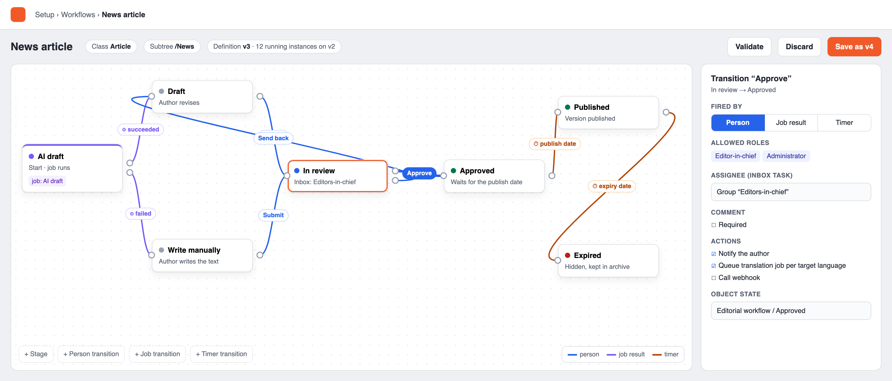

# Build spec: `expworkflow` — graphical editorial workflows for Exponential 6

Redmine #16702. Paste this whole document into your coding agent at the root of an Exponential 6 checkout and
let it build the extension milestone by milestone. The document is self-contained: everything it refers
to is in one of three public repositories, checked on 30.10.2026.

| Path in this spec | Repository | Checked at |
|---|---|---|
| `kernel/…`, `lib/…`, `settings/…`, `design/…`, `doc/eng-us/…`, `tests/…`, `extension/expimageeditor/…` | `se7enxweb/exponential`, branch `main` | `2133357dc4` |
| `extension/expqueue/…` (inside the repo: the path without `extension/expqueue/`) | `se7enxweb/expqueue` | default branch |
| `extension/expai/…` (inside the repo: the path without `extension/expai/`) | `se7enxweb/expai` | default branch |

Code is referred to by class and method name, not by line number. Third-party code to vendor: Drawflow
0.0.60, MIT, `github.com/jerosoler/Drawflow` (npm `drawflow@0.0.60`, files `dist/drawflow.min.js` and
`dist/drawflow.min.css`).

Two files are attached to the ticket next to this one: `workflow-designer.png` (the mockup) and
`workflow-designer.html` (its source, a standalone page with Drawflow from a CDN — a visual reference
only, it does not follow the CSP rules of section 8.2).

---

## 0. Instructions for the agent building this

- Read first: `extension/expqueue/doc/api.md`, `extension/expqueue/doc/database.md`,
  `extension/expimageeditor/README.md`, `doc/eng-us/features/6.0/admin4-design.md`
  (section "Extending it"), `kernel/classes/workflowtypes/event/ezapprove/ezapprovetype.php`,
  `kernel/classes/collaborationhandlers/ezapprove/ezapprovecollaborationhandler.php`,
  `kernel/classes/expcollaborationinbox.php`.
- **No kernel changes.** Everything lives in `extension/expworkflow/`. If something seems to need a
  kernel change, stop and ask; do not patch `kernel/` or `lib/`.
- **Measure, don't assume.** When this spec says "verify", run it against a real installation (or a
  throwaway test database, `tests/toolkit/ezpthrowawaydatabase.php`) before building on it.
- Work in milestones (section 12). Each milestone ends with green tests and a short note of what was
  measured.
- Commit messages and code comments contain no reference to the tool used to write them.
- New files carry `@copyright Copyright CJW Network and Exponential Foundation. All rights reserved.` and
  `@license GNU General Public License v2.0 (or any later version)`, `@package expworkflow`.

---

## 1. Goal

Editors and administrators draw editorial workflows in admin4 and run them inside Exponential. There is
no external engine and no extra service: the extension builds on what the kernel and two extensions
already provide.

| Building block | Where | Used for |
|---|---|---|
| Kernel workflow + trigger `content/publish/before` | `kernel/classes/eztrigger.php`, `kernel/content/operation_definition.php` (operation `publish`, trigger `pre_publish`) | the publish gate |
| Cron part `workflow` | `kernel/private/classes/cronjobs/workflow.php` | resumes deferred publishes (as for `ezapprove`) |
| Collaboration items + inbox | `kernel/classes/ezcollaborationitemhandler.php`, `expcollaborationinbox.php` | tasks for people |
| Object states | `kernel/private/classes/ezcontentobjectstate*.php`, `eZContentOperationCollection::updateObjectState()` | stages, visible in lists and search |
| `expqueue` | `extension/expqueue` | actions, job-result transitions, timers |
| `expai` | `extension/expai` | AI draft and translation actions |
| Drawflow 0.0.60 (MIT) | to be vendored | the editor |

The model is **stages and transitions**, like Ibexa's editorial workflow. It is not BPMN. Parallel
paths are out of scope (section 11).

**`expworkflow` is the only workflow extension a site needs.** Everything that sites have so far
assembled from separate workflow extensions — multi-approver approval, scheduled visibility,
notifications on every review step, webhooks, an editorial dashboard — is part of this extension
(section 7), and importers move existing setups over (section 7.2). No other workflow engine or
workflow library is added.



*Mockup, not a real screen: the "News article" workflow from section 3, with the transition "Approve"
selected.*

---

## 2. Reference cases — the extension is done when all four run end to end

1. **Editorial approval.** Draft → In review → Approved → Published. "Send back" from review returns the
   version to draft with a comment. Tests permissions per transition, the inbox assignee, going back and
   the publish gate.
2. **Translation into several languages.** Source approved → machine translation per target language
   (expai) → human review → language version approved. **Decided: the source never waits for the
   languages.** Every language version is its own version and gets its own workflow instance, bound by a
   rule with a language (section 5). There are no parallel paths inside one instance.
3. **Page with an AI draft and mandatory review.** An AI draft job runs; on success → Draft (the author
   revises), on failure → "Write manually"; then review → approval. Needs **job-result transitions**.
4. **Content with an expiry date.** Approved → published at date X → expired at date Y (hidden, kept)
   with a reminder to the owner beforehand. Needs **timer transitions**. `ezwaituntildate` stays as it
   is (decision: keep it alongside, do not migrate).

Cases 1, 3 and 4 combined are the "News article" example in section 3 and in the mockup.

---

## 3. The definition format (stored JSON)

A definition is a versioned JSON document. Drawflow's export is converted into this format on save, so
the stored format does not depend on the library (section 8).

```json
{
  "identifier": "news_article",
  "name": "News article",
  "start": "ai_draft",
  "stages": [
    { "id": "ai_draft",  "name": "AI draft",       "kind": "draft",     "color": "#7a5af8",
      "on_enter": [ { "action": "expai.draft", "params": { "alias": "default", "prompt_attribute": "intro" } } ] },
    { "id": "manual",    "name": "Write manually", "kind": "draft",     "color": "#98a2b3" },
    { "id": "draft",     "name": "Draft",          "kind": "draft",     "color": "#98a2b3" },
    { "id": "review",    "name": "In review",      "kind": "waiting",   "color": "#2563eb",
      "assignee": { "groups": [ 123 ] } },
    { "id": "approved",  "name": "Approved",       "kind": "waiting",   "color": "#067647" },
    { "id": "published", "name": "Published",      "kind": "published", "color": "#047857" },
    { "id": "expired",   "name": "Expired",        "kind": "closed",    "color": "#b42318",
      "on_enter": [ { "action": "hide" } ] }
  ],
  "transitions": [
    { "id": "ai_ok",     "from": "ai_draft", "to": "draft",     "by": "job",    "on": "done" },
    { "id": "ai_failed", "from": "ai_draft", "to": "manual",    "by": "job",    "on": "failed" },
    { "id": "submit",    "from": "draft",    "to": "review",    "by": "person", "submit": true },
    { "id": "submit_m",  "from": "manual",   "to": "review",    "by": "person", "submit": true },
    { "id": "approve",   "from": "review",   "to": "approved",  "by": "person", "roles": [ 4, 2 ],
      "comment": "optional",
      "actions": [ { "action": "notify", "params": { "to": "author" } },
                   { "action": "expai.translation.check" } ] },
    { "id": "send_back", "from": "review",   "to": "draft",     "by": "person", "roles": [ 4, 2 ],
      "comment": "required" },
    { "id": "go_live",   "from": "approved", "to": "published", "by": "timer",
      "at": { "attribute": "publish_date", "fallback": "now" } },
    { "id": "expire",    "from": "published","to": "expired",   "by": "timer",
      "at": { "attribute": "expiry_date" },
      "remind": { "before": "P2D", "to": "owner" } }
  ],
  "layout": { "ai_draft": [20, 150], "draft": [265, 30], "...": [0, 0] }
}
```

### Stage kinds — how a stage maps to the version

| `kind` | Version status | Publish gate | Notes |
|---|---|---|---|
| `draft` | draft (the author edits normally) | — | Leaving it by a `submit` transition = the author clicks "Send for publishing" |
| `waiting` | pending (the publish operation is deferred) | defers (`STATUS_DEFERRED_TO_CRON_REPEAT`) | like `ezapprove` while waiting |
| `published` | published | accepts (`STATUS_ACCEPTED`) | the publish completes on the next cron `workflow` run |
| `closed` | published (unchanged) | — | after publishing; actions such as `hide` |

### Transition triggers (`by`)

- `person`: fired from the Workflow tab or the inbox. Allowed when the user has the policy
  `expworkflow/transition` (section 9) **and** at least one of `roles` (role IDs); an empty `roles` means
  the policy alone decides. `comment` is `none` | `optional` | `required`. `submit: true` marks the one
  transition that the editor's normal "Send for publishing" button fires (at most one per `draft` stage).
  Review options for person transitions out of a `waiting` stage (from ezapprove2, section 7):
  - `quorum`: `{ "min": 2 }` — the transition fires only when at least `min` distinct users with the
    right have chosen it. Votes are stored per instance and stage and are reset when the stage is
    re-entered. A competing transition with `"veto": true` (typically "Send back") fires at once.
  - `author_selects`: `{ "from_groups": [ 456 ], "min": 1, "max": 3 }` — on submit the author picks the
    reviewers for this instance from these groups; they become the stage's assignees. Without it the
    stage's `assignee` applies.
  - `reviewers_may_edit`: `true` — assignees may edit the pending version while the stage waits. **Verify**
    how ezapprove2 implements this (it is GPL-2.0, reading and adapting is allowed) and keep the
    approved content equal to what the reviewers saw: an edit by a reviewer resets the votes.
- `job`: fired by the result of the stage's `on_enter` job. `on` is `done` or `failed` (`failed` covers
  the expqueue states `dead` and `cancelled`).
- `timer`: fired at `at`, which is either `{ "attribute": "<date or datetime attribute identifier>" }`
  (as in `ezwaituntildate`) or `{ "after": "<ISO 8601 duration>" }` counted from entering the stage.
  An empty attribute uses `fallback` (`now` or `never`). `remind` queues a notification before the
  timer fires.

### Validation (on save; the editor shows every error at its node or edge)

- Unique stage and transition ids (`[a-z][a-z0-9_]{0,29}`). `start` exists. Every stage is reachable
  from `start`.
- At most one `submit` transition per `draft` stage. A `job` transition only leaves a stage with
  `on_enter` containing exactly one job action. A stage with a job action has both `done` and `failed`
  transitions.
- A `waiting` stage has at least one outgoing transition. At least one `published` stage is reachable,
  and `start` is never a `published` or `closed` stage.
- Timer attributes exist on every bound class and are of a date or datetime type.
- Role IDs, group IDs and action names exist (actions are a registry, section 7).
- Bindings (section 5): warn about two rules of the same specificity without a distinct priority.

---

## 4. Data model

Defined once in `expWorkflowSchema::definition()` in the kernel's DBA format and installed for MySQL,
PostgreSQL, SQLite, Oracle and MongoDB, exactly like `expQueueSchema` (`extension/expqueue/classes/
expqueueschema.php`: `handler()` maps engines to schema classes, `ensure()` is idempotent,
`upgradeStatements()` adds missing columns and indexes).
Generate `share/db_schema.dba`, `sql/{mysql,postgresql,sqlite,oracle}/schema.sql` and
`sql/mongodb/schema.json`. Command: `./bin/php/console ext:expworkflow:install-schema` with `--check`,
`--print=<engine>` and `--write-files`. Names stay within 30 characters, with no reserved words as
column names, and remember that Oracle stores `''` as NULL.

| Table | Columns |
|---|---|
| `expwf_definition` | `id`, `identifier`, `def_version`, `status` (draft, published, archived), `name`, `body` (JSON text), `creator_id`, `created`, `modified`. Unique (`identifier`, `def_version`). Only one published version per identifier. |
| `expwf_binding` | `id`, `wf_identifier`, `class_identifier`, `subtree_path` (nullable), `section_id` (nullable), `language_code` (nullable), `priority` (int, default 0), `enabled` |
| `expwf_instance` | `id`, `uuid`, `definition_id` (pinned version), `object_id`, `obj_version`, `language_code`, `stage`, `status` (running, finished, cancelled), `process_id` (kernel `ezworkflow_process`, nullable), `collab_id` (nullable), `wait_job` (expqueue uuid, nullable), `entered` (time the stage was entered), `created`, `modified`. Unique running instance per (`object_id`, `obj_version`). |
| `expwf_history` | `id`, `instance_id`, `from_stage`, `to_stage`, `transition`, `fired_by` (person, job, timer, system, migration), `user_id`, `note` (text), `job_uuid`, `created` |
| `expwf_timer` | `id`, `instance_id`, `transition`, `due`, `job_uuid`, `state` (pending, fired, cancelled) |
| `expwf_vote` | `id`, `instance_id`, `stage`, `transition`, `user_id`, `note`, `created`. Unique (`instance_id`, `stage`, `user_id`); cleared when the stage is re-entered or a reviewer edits |
| `expwf_reviewer` | `id`, `instance_id`, `stage`, `user_id` — reviewers chosen by the author (`author_selects`) |
| `expwf_hook` | `id`, `name`, `url`, `secret_ref` (name of an INI key, never the secret itself), `events` (JSON list: transition ids, stage ids or `*` per definition), `payload_tpl` (nullable), `enabled`, `created`, `modified` |
| `expwf_delivery` | `id`, `hook_id`, `instance_id`, `job_uuid`, `status_code`, `attempt`, `response_excerpt` (first 2 KB), `created` |

---

## 5. Binding — which workflow a version gets

- Several workflows may exist. Each has binding rules in `expwf_binding`.
- When an instance starts, exactly one published definition is chosen. **The most specific rule wins**:
  class + subtree > class > subtree > default (class `*`). Section and language each add specificity
  on top. This is the same idea as `override.ini` matching. `priority` only breaks ties between rules of
  equal specificity.
- No matching rule → no workflow; the version publishes as before.
- The instance pins the definition version it started with. Publishing a new definition version does not
  change running instances; an explicit admin action ("Move running instances to vN") migrates them,
  mapping stages by id and refusing stages that no longer exist.
- Case 2 (translations): a rule with `language_code` binds the "Translation review" workflow to versions
  whose initial language is that language.

---

## 6. Runtime

### 6.1 Classes (suggested names)

`expWorkflowDefinition` (load, validate, convert), `expWorkflowBinding` (resolve), `expWorkflowInstance`
(persistent object), `expWorkflowEngine` (start, fire, enter stage, run actions), `expWorkflowGateType`
(event type), `expWorkflowCollaborationHandler`, `expWorkflowActionRegistry` plus one class per action,
and queue handlers `expWorkflowWatchHandler`, `expWorkflowTimerHandler` and `expWorkflowActionHandler`.

### 6.2 Starting an instance

An instance starts at the definition's `start` stage, in three ways:
- **(a) the gate**: the gate sees a version with a binding and no running instance. It creates the
  instance and, if `start` is a `draft` stage, immediately fires that stage's `submit` transition.
- **(b) explicitly**: a "Start workflow" button on the Workflow tab of a draft, or the API
  `expWorkflowEngine::start( $objectId, $version )`. Case 3 uses this: the AI draft runs before the
  author writes.
- **(c) out of scope**: starting automatically when a version is created. Note it as a follow-up.

### 6.3 The publish gate — mirror `ezapprove` exactly

- A workflow event type `event_expworkflowgate` (`extension/expworkflow/eventtypes/event/
  expworkflowgate/expworkflowgatetype.php`, `extends eZWorkflowEventType`). Its trigger types are
  `content/publish/before`, and it is registered in `settings/workflow.ini.append.php` with
  `ExtensionDirectories[]=expworkflow` and `AvailableEventTypes[]=event_expworkflowgate`.
- `execute( $process, $event )`:
  - no binding → `STATUS_ACCEPTED`;
  - instance in a `draft` stage at the first gate run → fire `submit` (6.2a), then continue;
  - instance in a `waiting` stage → store `process_id`, return `STATUS_DEFERRED_TO_CRON_REPEAT`;
  - instance in a `published` stage → `STATUS_ACCEPTED`;
  - instance back in a `draft` stage after a send-back → set the version status back to DRAFT and
    return `STATUS_WORKFLOW_CANCELLED`, exactly as `eZApproveType::checkApproveCollaboration()` does
    for DENIED (`kernel/classes/workflowtypes/event/ezapprove/ezapprovetype.php`).
- Publishing then completes on the next run of the cron part `workflow`, as with `ezapprove`. Document
  that latency. Optional improvement, not required: a queue job that runs that one process immediately.
- **Installer** (`ext:expworkflow:install-gate`, idempotent): there is one workflow per trigger
  (`kernel/classes/eztrigger.php`: a row holds module, function, connect type and one workflow id). If there is no `content/publish/before` trigger, create a workflow "Editorial
  workflows" holding the gate event plus the trigger; `kernel/classes/expcollaborationsampledata.php`
  `ensureWorkflow()`/`ensureTrigger()` show how. If a trigger exists, append the gate event
  to its workflow and do not add it twice. `--check` reports without changing anything.

### 6.4 Firing a transition

One code path for all triggers. `expWorkflowEngine::fire( $instance, $transitionId, $by, $userId, $note )`:
1. Lock the instance row (compare-and-set on `stage` + `modified`; refuse a stale fire).
2. Check permission (person) or the source (job uuid matches `wait_job`; timer row is pending).
3. Write `expwf_history`. Cancel open timers of the old stage (`expwf_timer` → cancelled,
   `expQueue::cancel( job_uuid )`).
4. Enter the new stage:
   - set the object state through `eZContentOperationCollection::updateObjectState()`
     (`kernel/content/ezcontentoperationcollection.php`);
   - run the transition's `actions` and then the stage's `on_enter` actions;
   - create or close the collaboration item;
   - schedule the timers of the new stage;
   - for `published`/`waiting` changes, nothing else is needed: the gate picks them up on the next cron
     run.
5. Kinds `published` → `closed` and a final stage with no outgoing transition set `status=finished`.

### 6.5 Object states

- One state group per definition identifier: `wf_<identifier>`, unless the definition names an existing
  group (`"state_group": "<identifier>"`, set by the OWEditorial and xrow importers, 7.2) (never `ez…`: `isInternal()` treats those
  as internal and they are never assignable). One state per stage id. Create them with the pattern in
  `kernel/classes/help/content/exphelpcontentinstaller.php` (`ensureStates()`), including
  `eZContentObjectState::cleanDefaultsCache()` and the `state-limitations` expiry timestamp.
- `updateObjectState()` silently drops states the current user may not assign. Job and timer
  transitions therefore run as a configured system user (`expworkflow.ini [Runtime] SystemUserID`) who
  holds `state/assign` for the `wf_*` groups. The installer checks this and `--check` reports it.
- Do not grant editors `state/assign` on `StateGroup_wf_*`; the instance is the source of truth.
  Listen to the ezpEvent `content/state/assign` (`site.ini [Event] Listeners[]`) and record a manual
  change as drift (shown in the overview, section 8.4). Do not "fix" it automatically.

### 6.6 Job-result transitions and timers (expqueue)

expqueue has **no completion callback** (no listener or event in `extension/expqueue/classes/`).
- **Job actions**: `on_enter` enqueues the action job with `expQueue::enqueue( $type, $payload,
  array( 'class' => 'editorial', 'idempotency_key' => "expwf:{$uuid}:{$stage}:{$n}", 'user_id' => … ) )`,
  stores its uuid in `wait_job` and enqueues a **watcher** `expworkflow.watch` (payload: instance uuid +
  job uuid). The watcher fetches the job (`expQueue::fetch()`); while the job is not final it returns
  `expQueueResult::defer( 30 )`; when it is `done` it fires `on: done`, and when it is `dead` or
  `cancelled` it fires `on: failed`. `depends_on` is **not** suitable: `afterFinal()` cancels children
  when the parent fails, so the failure path would be lost.
- **Timers**: `expworkflow.timer` with `not_before = due` and the idempotency key
  `expwf:{$uuid}:{$transition}:{$due}`. The handler re-checks that the instance is still in the stage
  and the timer row is pending, then fires. A cron part `expworkflow` sweeps overdue pending timers
  (safety net if a job was purged) and recomputes timers whose date attribute changed on a newer
  published version.
- Register the job types in `settings/expqueue.ini.append.php`:
  `[JobType_expworkflow.watch] Handler=expWorkflowWatchHandler`, and the same for `.timer` and
  `.action`. Handlers implement `run( expQueueJob $job, expQueueContext $context )`
  (`extension/expqueue/classes/expqueuehandler.php`) and run only in workers, never in a web request.

### 6.7 People: the collaboration inbox

- A collaboration handler `expworkflow`: `extension/expworkflow/collaboration/expworkflow/
  expworkflowcollaborationhandler.php`, registered with `collaboration.ini [HandlerSettings]
  Extensions[]=expworkflow`, `Active[]=expworkflow`.
- It implements `inboxState( $item )` so the admin4 inbox (`expcollaborationinbox.php`, `stateOf()`
  `stateOf()`) shows it like `ezapprove`: `waiting` while the stage waits, `approved`/`denied` after.
- Create it like `eZApproveCollaborationHandler::createApproval()`: `data_int1` = object id,
  `data_int2` = version, `data_int3` = the instance id; participants are the author and the stage's
  `assignee` users or groups; notification via `createNotificationEvent()`.
- `handleCustomAction()` offers the person transitions of the current stage that the viewing user may
  fire, with a comment field. The kernel's ezapprove handler is the reference; the only additions are
  `inboxState()` and that the actions come from the definition.

---

## 7. Integrating existing extensions — one place for an overview

The point is that a site keeps **one** view of everything that happens around publishing. The extension
wraps or reports on the existing pieces; it does not copy them.

| Existing piece | How `expworkflow` integrates it |
|---|---|
| `ezapprove` (kernel event type) | Kernel code untouched. For classes bound to an expworkflow definition, the overview warns when an `ezapprove` event in the same publish-before workflow also applies (double approval). The importer (7.2) converts an ezapprove setup into a definition. |
| `ezwaituntildate` | Kernel code untouched, still works. Timer transitions are the new way; the overview lists where it is used, and the importer (7.2) converts it. |
| ezapprove2 (multi-approver approval) | Not needed any more: `quorum`, `author_selects` and `reviewers_may_edit` (section 3) cover its features. The importer (7.2) converts its event settings. |
| OWEditorial (state-based editorial workflow in INI) | Not needed any more; its model is the stage/transition model. The importer (7.2) reads `oweditorial.ini` (`Workflows[]`, `FirstState`, `<from>[<to>]=<title>`) and the state group into a definition. |
| xrowworkflow, hideuntildate (online/offline by date) | Not needed any more: timer transitions with the `hide`/`unhide` actions, or a `closed` stage. The importer (7.2) converts their state groups and date attributes. |
| ezapprovetanta (mail on every review step) | Not needed any more: the `notify` action accepts `on` = `enter`, `comment`, `vote`, `transition`, so assignees and the author get a mail on each comment, vote, approval and send-back, not only when the review starts. |
| ocwebhookserver (webhooks with an admin UI) | Not needed any more: the webhook part of this extension (7.1) has an admin UI, payload templates, signed requests, retries through expqueue and a delivery log. |
| oceditorialstuff (editorial dashboard by state) | Not needed any more: the editorial dashboard (8.5). |
| `ezmultiplexer` | Binding rules replace it for expworkflow. The gate installer appends to an existing publish-before workflow, including one that uses a multiplexer. |
| `expqueue` | Actions, watchers, timers (section 6.6). Instance pages link to the job pages. |
| `expai` | Actions: `expai.draft` (via `expAiQueue::request()`, `extension/expai/classes/queue/expaiqueue.php`, or a chain, `extension/expai/doc/chains.md`) and `expai.translation.check` (via `expAiTranslationSync`, `extension/expai/classes/diff/expaitranslationsync.php`: `onPublish()`, `approve()`). **Verify** whether expai's translation output is published through the publish operation (then the gate catches it and case 2 works through binding) or written another way (then the action must start the instance explicitly). `expAiApprovalCheck` (`extension/expai/classes/expaiapprovalcheck.php`) should learn about the gate; that is a small separate PR in the expai package, not part of this extension. |
| Collaboration inbox | The person tasks (section 6.7). |
| Object states | The stages (section 6.5). |
| Notifications | A `notify` action creates a notification event like ezapprove does; reminders use the same path. |
| Content jobs | Optional `subtree` actions later; `expContentJobStateSubtree` shows the state call. Out of scope now. |
| External tools | Webhooks (7.1). |

### 7.1 Webhooks

- Admin pages `expworkflow/hooks` (list, edit, test, delivery log), policy `expworkflow/hooks`.
- A hook subscribes to transitions or stages of one or all definitions (`expwf_hook.events`). Every
  matching transition enqueues `expworkflow.webhook` (class `editorial`, resource `webhook:<host>`,
  idempotency key `expwf:{uuid}:{transition}:{hook}`).
- Payload: JSON with instance uuid, definition identifier and version, transition, from/to stage,
  `fired_by`, user id, object id, version, language, a timestamp, and the note when the definition allows
  sharing it. An optional `payload_tpl` (a template rendered with the same variables) replaces it.
- Signature: header `X-Expworkflow-Signature: sha256=<HMAC of the body>` with the secret named by
  `secret_ref` from `expworkflow.ini [Webhook]` (secrets live in a secrets override, never in the
  database).
- Only `https://` (and `http://` on loopback for tests) with a host. Redirects not followed. Status ≥ 400
  → retry with expqueue backoff, then dead letter. Every attempt writes `expwf_delivery`.
- The "Test" button sends a sample payload and shows the response.

### 7.2 Importers — moving existing setups over

`./bin/php/console ext:expworkflow:import --from=<source> [--dry-run] [-s <siteaccess>]`, one source per
run. `--dry-run` prints the definition and the bindings without writing. The importer creates
**draft** definitions; an administrator reviews them in the editor and publishes. It never removes the
old setup: the overview lists what is still active, so it can be switched off by hand.

| `--from` | Reads | Produces |
|---|---|---|
| `ezapprove` | The publish-before trigger's workflow and its `ezapprove` events (sections, classes, languages, approver users and groups, excluded groups) | One definition per event: draft → review (assignees) → published, with send-back; bindings from the event's class and section filters |
| `ezwaituntildate` | Its events (class/attribute pairs) | A `waiting` stage with a timer transition on the attribute; merged into an existing definition for the same class when there is one |
| `ezapprove2` | Its event settings (approvers, minimum count, author selection, edit right) | As for `ezapprove`, plus `quorum`, `author_selects`, `reviewers_may_edit` |
| `oweditorial` | `oweditorial.ini` (`Workflows[]`, `FirstState`, transition lines), the state group, its notification setting | One definition per workflow. **Reuses the existing state group** instead of creating `wf_<identifier>` (the definition records the group identifier); `none` maps to the start stage |
| `xrowworkflow`, `hideuntildate` | Their state group and date attributes | `published` → `closed` with timer transitions and `hide`/`unhide` |

Each importer reads only configuration and the kernel's tables. It does not need the source extension
to be active or even present when the settings and tables are there. If a setting cannot be expressed,
the importer reports it and does not guess. **Verify** each source's settings against its own
repository before writing its importer; the formats above are from their READMEs.

### 7.3 Prior art (ideas taken, no code copied)

| Repository (se7enxweb fork) | License in the fork | Taken |
|---|---|---|
| `ezapprove2` | GPL-2.0 | quorum, author-selected reviewers, reviewers may edit |
| `OWEditorial` | none stated | the INI model `<from>[<to>]=<title>`, import format |
| `ocwebhookserver` | none stated | webhooks managed in the admin, delivery log |
| `ezapprovetanta` | none stated | notifications on every review step |
| `oceditorialstuff` | none stated | dashboard of content by state per class |
| `xrowworkflow`, `hideuntildate` | none stated | online/offline by date with states and cron |
| `IbexaLegacyWorkflow` | none stated | the trigger × operation matrix as a model for the overview |

Where a fork states no license, read it for the idea and the settings format only; write the code anew.

### 7.4 Action registry

`expworkflow.ini [Actions] List[]=…` with `[Action_<name>] Class=…`, where the class implements
`expWorkflowAction` with `validate( array $params, array $definition ) : ?string`,
`run( expWorkflowInstance $i, array $params )` and `isJob() : bool`. Built-in actions: `notify`, `hide`,
`unhide`, `webhook` (sends to the hooks of 7.1 that match, or to one named hook), `expai.draft`,
`expai.translation.check`. A job action runs inside
`expworkflow.action` so that every side effect happens in a worker.

---

## 8. Admin UI (admin4)

The core menu already has the group `workflow` (`settings/menu.ini`: `GroupLinks_workflow[]=workflows|
workflow_processes|triggers`). Add the new links to that group in `settings/menu.ini.append.php`
(`Links[…]`, `LinkNames[…]`, `PolicyList_…[]`, `LinkIcons[…]`; icons must be listed in `design.ini
[AdminDesignSettings] IconList[]`).

### 8.1 Workflow list — `expworkflow/list`
Definitions with the published version, bindings, running instances per stage, and Edit / Duplicate /
Archive actions.

### 8.2 Editor — `expworkflow/edit/<identifier>`
See the mockup.
- **Layout**: canvas with Drawflow, a side panel for the selected stage or transition, a palette
  ("+ Stage", "+ Person/Job/Timer transition") and a top bar with the binding chips, Validate, Discard
  and "Save as vN".
- **Mapping**: a stage is a Drawflow node. Each outgoing transition is one output port of that node, and
  the edge goes to the target node's single input. Edge labels show the transition name, coloured by
  `by`; the selected edge is highlighted.
- **Saving**: convert the export to the definition JSON (positions go to `layout`), validate on the
  server, and show errors at nodes and edges.
- **Drawflow**: vendor 0.0.60 under `extension/expworkflow/design/admin4/javascript/vendor/drawflow/`,
  with its MIT license in `design/admin4/javascript/licenses/`. Load it from `'self'` only.
- **CSP** (`script-src 'self'; style-src 'self'`; measured on the image editor `extension/expimageeditor`): no
  inline script or style, no `innerHTML` with markup, no `style.cssText`, no `setAttribute('style')`;
  set styles via `element.style.setProperty()`; configuration via `data-*` or
  `<script type="application/json">`; radio groups instead of `<select>`.
  - **Drawflow builds node content with `innerHTML`.** Pass empty node HTML and build each node's DOM
    with `createElement`/`textContent` after `addNode()`.
  - **Measure** Drawflow's own position updates under the admin CSP in Chrome, Firefox and Safari before
    building the editor on it. If it needs patching, keep the patch small and documented next to the
    vendored file, and add a test that fails if the patch is lost.

### 8.3 Content tab "Workflow"
`admininterface.ini [WindowControlsSettings] AdditionalTabs[]=expworkflow` with
`[AdditionalTab_expworkflow]`; templates in `design/admin4/templates/tabs/expworkflow_header.tpl` and
`expworkflow.tpl` (pattern: `extension/expai/design/admin/templates/tabs/`). The tab shows:
- a read-only mini graph with the current stage highlighted;
- the transitions the user may fire, with a comment field;
- the history;
- timers;
- the waiting job (linked to its expqueue page);
- "Start workflow" (6.2b).

POSTs go through `ezjscore` server functions (`ezjscore.ini [ezjscServer_expworkflow]`) with the
`X-CSRF-Token` header (pattern: `extension/expai/design/admin/javascript/expai.js`: token from `#ezxform_token_js[title]` or `input[name=ezxform_token]`, root URL from the `#exp-config` JSON block, `fetch()` POST to `ezjscore/call` with `ezjscServer_function_arguments=<group>::<fn>`).

### 8.4 Overview — `expworkflow/overview` (the "one place")
Read-only, for administrators. It shows:
- all expworkflow definitions with bindings, plus warnings for ambiguous rules and definitions without a
  binding;
- all kernel workflows and their triggers (`eZTrigger` list) with their event types, marking `ezapprove`,
  `ezwaituntildate`, `ezmultiplexer` and the gate;
- conflicts: no gate on `content/publish/before`, a gate twice, or `ezapprove` plus a gate on the same
  class;
- registered expqueue job types of the workflow actions with their dead-letter counts;
- running instances per stage, overdue timers, watchers waiting longer than a threshold, and drift from
  manual state changes;
- other workflow extensions still active (ezapprove2, OWEditorial, xrowworkflow, hideuntildate,
  ezapprovetanta, ocwebhookserver, oceditorialstuff, detected by `ActiveExtensions[]` and their event
  types), each with the importer that replaces it (7.2);
- webhooks with failing deliveries.

### 8.5 Editorial dashboard — `expworkflow/dashboard`
For editors (replaces oceditorialstuff). One board per definition, with a column per stage and the
content objects of its running instances as cards (name, class, author, assignees, time in stage, due
timer, votes `n/min`). Filters: class, subtree, language, assigned to me, overdue. A card opens the
content's Workflow tab. The cards fire nothing themselves, so the board needs no drag and drop; it lists
the user's available transitions as buttons. It is paginated (instances, not objects, are queried) and
counts only what the user may read (`content/read`).

---

## 9. Policies

The kernel module `workflow` already exists, so the module is `expworkflow`:
- `expworkflow/design`: list, edit, publish definitions and bindings, overview.
- `expworkflow/transition`: fire person transitions. Limitations: Workflow (definition identifier),
  Transition (`<identifier>/<transition>`), Class, Section, Subtree (declared like
  `extension/expai/modules/expai/module.php`, `$FunctionList`).
- `expworkflow/start`: start an instance explicitly (6.2b).
- `expworkflow/dashboard`: see the editorial dashboard (limitations Workflow, Class, Section, Subtree).
- `expworkflow/hooks`: manage webhooks and see the delivery log.
- `expworkflow/import`: run importers from the admin (the CLI needs no policy).

---

## 10. Configuration, translations, docs, tests

- **`expworkflow.ini`**: `[Runtime] SystemUserID`, `WatchInterval=30`, `CronSweepLimit`;
  `[Webhook] Secret` (empty by default; read from a secrets override, never shipped); `[Actions]`.
- **Translations**: contexts `extension/expworkflow` and `extension/expworkflow/editor`;
  `translations/untranslated/` plus `eng-GB` and `ger-DE`.
- **Docs**, in the expqueue layout:
  - `README.md`, `INSTALL.md`, `USAGE.md`, `LICENSE`, `AGENTS.md` (notes for coding agents: invariants, CSP rules, measured pitfalls);
  - `doc/index.md` with: definition format, runtime and gate, actions, editor, overview, database, CLI,
    troubleshooting, changelog.
- **Tests**:
  - `tests/phpunit/bootstrap.php`, kernel-free with stand-ins guarded by `class_exists( …, false )`
    and `tests/phpunit/unit/`. The bootstrap requires the root `vendor/autoload.php`, defines stand-ins
    for the few kernel classes the unit tests touch, each guarded by `if ( !class_exists( 'eZINI', false ) )`
    — **without** autoload, otherwise the real kernel class wins — and then requires the extension's own
    classes directly;
  - database tests in `@group database` on throwaway databases (`tests/toolkit/ezpthrowawaydatabase.php`,
    `ezpdatabasetestcase`), never on a site database;
  - add a testsuite `expworkflow` to the root `phpunit.xml`: `.github/workflows/phpunit.yml` runs every
    suite listed there and fails if one is missing. Run it locally with
    `--fail-on-risky --fail-on-warning`.
- **Test cases at minimum**:
  - definition validation, each rule in section 3;
  - binding specificity and ties;
  - pinning and migration;
  - fire: permission, stale fire, history;
  - the gate: each status in 6.3, including send-back → DRAFT + CANCELLED;
  - watcher done and failed;
  - timer fire, cancel on leave, sweep;
  - state assignment as the system user;
  - the converter from Drawflow export to definition and back;
  - CSP rule tests like `extension/expqueue/tests/unit/ScriptRulesTest.php` and `StylingRulesTest.php`;
  - schema `--check` on SQLite;
  - quorum (votes, veto, reset on re-entry and on a reviewer's edit), author-selected reviewers;
  - webhooks: signature, https-only, no redirects, retry and dead letter, delivery log, test button;
  - every importer with a fixture of the source's settings, `--dry-run` output and the unsupported-setting
    report;
  - dashboard query with read permissions.

---

## 11. Out of scope

- Parallel paths, AND/XOR gateways, BPMN import or export.
- Starting instances automatically on version creation (6.2c).
- Removing old setups automatically: importers create draft definitions; switching the old setup off
  stays a manual step guided by the overview.
- Any other workflow engine or workflow library. External engines or integration platforms. External automation talks to the CMS through the
  `webhook` action and the REST API.

---

## 12. Milestones

1. **Definition and schema**: `expWorkflowSchema` for all engines, `install-schema`, definition class,
   validation, binding resolution, unit tests.
2. **Runtime**: instances, `fire()`, history, object states, system user, the `event_expworkflowgate`
   event type, `install-gate`, collaboration handler with `inboxState()`. Case 1 runs from the CLI and
   the inbox.
3. **Jobs and timers**: action registry, `expworkflow.action`, `.watch`, `.timer`, cron sweep. Cases 3
   and 4 run.
4. **Admin UI**: list, Drawflow editor (CSP measured first), content tab, overview.
5. **Integrations**: expai actions (after the verification in section 7), `notify`, `hide`, `webhook`.
   Case 2 runs.
6. **Review options and dashboard**: `quorum`, `author_selects`, `reviewers_may_edit`, the `notify`
   options per review step, the editorial dashboard.
7. **Webhooks and importers**: webhook admin and delivery log (7.1), importers for `ezapprove`,
   `ezwaituntildate`, `ezapprove2`, `oweditorial`, `xrowworkflow`/`hideuntildate` (7.2), the overview's
   list of replaceable extensions.
8. **Finish**: docs, translations, CI step, measured run of all four reference cases on a throwaway
   database, with a short report of what was measured.

### Acceptance
- All four reference cases are drawn in the editor and run end to end.
- With two matching bindings, the more specific one wins.
- A user without the permission does not see a transition; the assignee sees the task in the inbox.
- Publishing is refused (version pending) before a `published` stage and completes after it on the next
  cron `workflow` run.
- A failed job and an expired timer each fire their transition without user action.
- The overview shows ezapprove/ezwaituntildate usage and flags a missing or double gate.
- An approval with `quorum.min = 2` fires only after the second vote; "Send back" with `veto` fires at
  once.
- A webhook delivery is signed, retried on failure and visible in the delivery log.
- An `ezapprove` setup and an `oweditorial.ini` are imported as draft definitions with `--dry-run` first,
  and after publishing behave like the originals.
- No other workflow extension is needed for any of the above; none is installed in the test run.
- No kernel file is changed.
