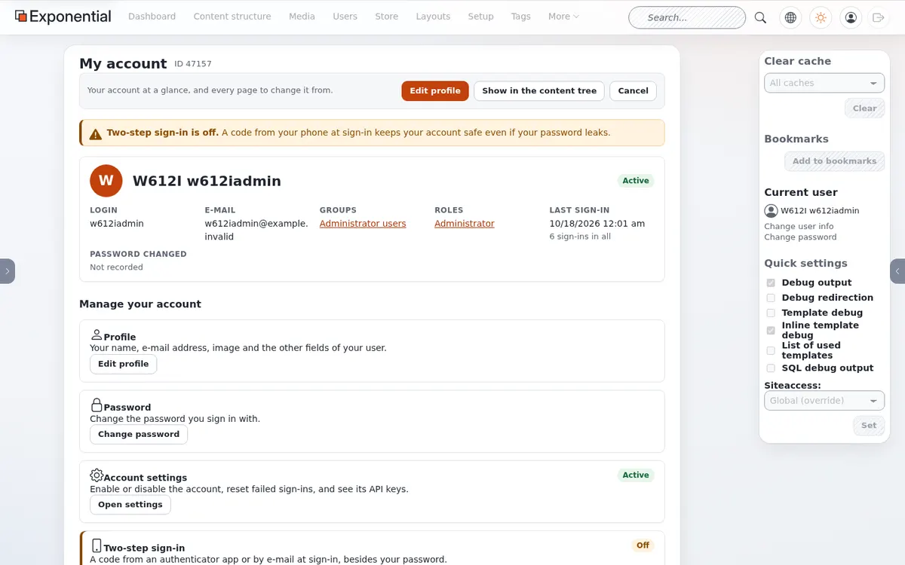
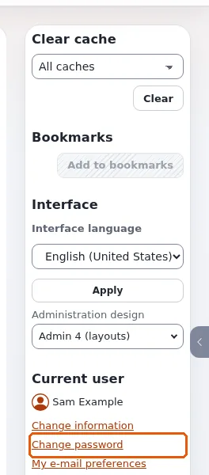
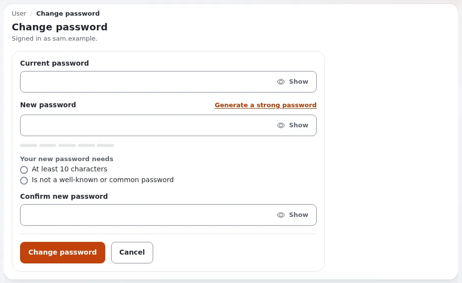
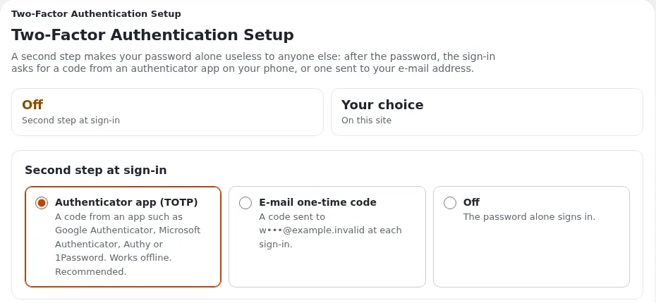
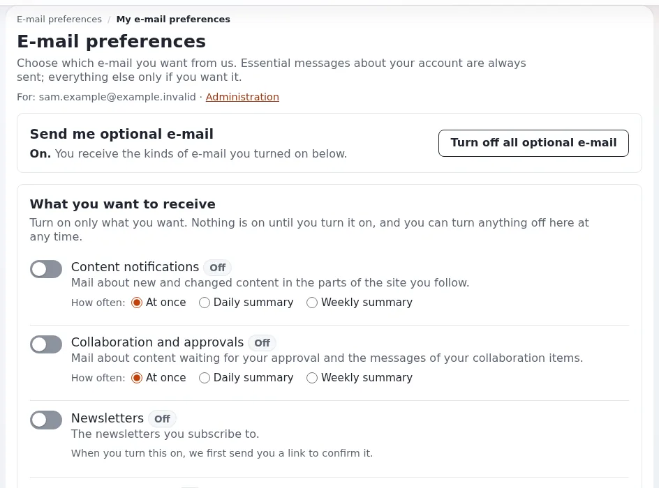

# Your account and signing in

This page is for everyone with an account, on the site or in the administration. It explains how to sign in and out,
what to do when you forgot your password, and how to keep your account safe with two-step sign-in.

## Sign in

Every detail of the sign-in pages: [Logging into the Editor](logging-into-the-editor.md) and
[Logging into the admin](logging-into-the-admin.md).

1. Choose **Login** on the site (often in the user menu of the header), or open the administration's address.
2. Type your **Username** and **Password** and press **Sign in** (**Login** on the site).
3. If two-step sign-in is on for your account, enter the code the next page asks for. See
   [Two-step sign-in](#two-step-sign-in).

Your browser must accept cookies to sign in.

## Sign out

In the administration, use the last button of the header, an arrow leaving a box (**Logout**). On the site, choose
**Logout** in the user menu or on your profile page. Always sign out on a shared computer.

## Register an account

Where a site lets visitors register, the sign-in page has **Sign Up** (or **Register new account**). Fill in your
name, a username, a password and your e-mail address. Under **E-mail from us (optional)** tick only the e-mail you
want; you can change that later. Some sites send a link to confirm your address before the account can be used.

## If you forgot your password

1. On the sign-in page choose **Forgot your password?**.
2. Enter the e-mail address of your account and press the button (**Send me a link** on the site).
3. Follow the instructions in the e-mail you receive. Check your spam folder if nothing arrives within a few minutes.

If you no longer have access to that e-mail address, ask an administrator to reset your password.

## My account

In the administration, **Edit profile** in the dashboard's left column, or your name in the user menu, leads to
**My account**: your account at a glance (login, e-mail, groups, roles, last sign-in) and every page to change it.

| Card | What you can do |
|---|---|
| **Profile** | Change your name, e-mail address, image and the other fields (**Edit profile**). |
| **Password** | **Change password**. |
| **Account settings** | Only for roles that manage accounts: enable or disable the account, reset failed sign-ins. |
| **Two-step sign-in** | Turn the second step on or off. See below. |
| **API keys** | Only for roles that may use them: personal keys for your own scripts and tools. |
| **Bookmarks** | Your bookmarks, in folders. |
| **Notifications** | The content you follow, and how often you hear about changes. |
| **E-mail preferences** | Which e-mail you get, a download of your e-mail data, or stop all optional e-mail. |

On the site, your **User profile** page has the same links: e-mail preferences, two-step sign-in, your drafts, your
pending items and your notification settings.

## Change your password

1. Open **Change password** (user menu, dashboard, or **My account**).
2. Enter your **Current password**, then the **New password** twice. The page shows what the new password needs, for
   example *At least 10 characters*, and checks it as you type. **Generate a strong password** makes one for you;
   **Show** reveals what you typed.
3. Press **Change password**.

Use a password you do not use anywhere else. A password manager remembers it for you.

## Two-step sign-in

With two-step sign-in, your password alone no longer opens your account: after the password, the sign-in asks for
a 6-digit code from an app on your phone or from an e-mail. Someone who learns your password still cannot get in.

### Turn it on

1. Open **My account** and press **Turn on** on the **Two-step sign-in** card (on the site: **Two-step sign-in** on
   your profile page).
2. Under **Second step at sign-in** choose how you confirm it is you:
   - **Authenticator app (TOTP)**: a code from an app such as Google Authenticator, Microsoft Authenticator, Authy
     or 1Password. Works without a network. Recommended.
   - **E-mail one-time code**: a code is sent to your e-mail address at each sign-in.
   - **Off**: the password alone signs in.
3. For the app: in the app, add an account and scan the QR code, or type the key shown below it. Then type the code
   the app shows into **Enter the code the app shows**. Until that code is right, nothing changes.
4. Press **Save settings**. The new setting applies from your next sign-in.

### Signing in with it

After your password, enter the code the app shows for the site (or the one in the e-mail; it is also in the
subject). Each code works once and an app's code changes every 30 seconds. After five wrong codes the sign-in starts
again with the password.

### Change it or turn it off

Switching to e-mail codes, turning it off, or resetting it asks for a current code from the app first, so that
nobody at a computer you left signed in can weaken your account.

### Lost your phone?

Ask an administrator. They can switch your account to e-mail codes or turn the second step off; you then sign in and
set up the app again on your new phone.

Some sites require two-step sign-in for everyone. You are then asked to set it up right after your password at your
first sign-in.

## E-mail and notifications

- **My e-mail preferences** chooses which e-mail you get from the site: content notifications, approvals,
  newsletters and others. Every optional e-mail can be stopped there.
- **My notification settings** lists the items you follow. You get an e-mail when something is published below
  them. To follow an item, choose **Add to my notifications** in its menu, or **Add items** on the settings page. A
  **digest** collects the messages into one e-mail per day, week or month instead of one per change.

## Learn more

- [Two-step sign-in](../guides/two-factor-login.md), for administrators who set it up.
- [Getting started](getting-started.md)
