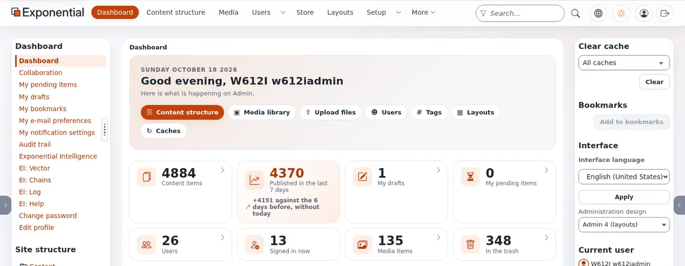
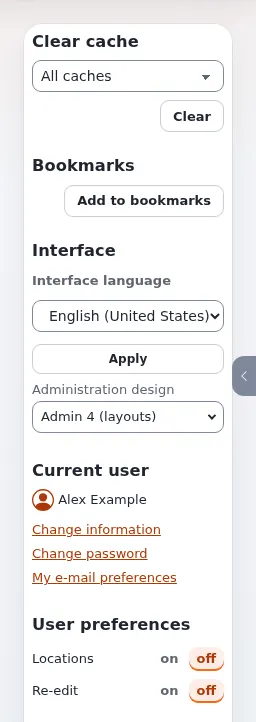

# A tour of the administration

This page walks once around the screen of the administration, so you know where things are. It shows the **Admin 4**
design. What you see depends on your role: an editor may see only **Dashboard**, **Content structure** and **Media**
in the top menu, an administrator sees more.

## The header

From left to right:

| Part | What it does |
|---|---|
| **Exponential** logo | Back to the dashboard, or to the top of the content when your role has no dashboard. |
| The tabs | **Dashboard**, **Content structure**, **Media**, **Users**, **Layouts**, **Setup** and more, depending on your role and the extensions of the site. Tabs that do not fit move under **More**. A small arrow next to a tab opens its menu of sub-pages. |
| **Search...** | Searches all content. The funnel button in the field (**Search scope**) limits the search to a section or to the current place in the tree, and leads to the **Advanced search**. Press `/` anywhere to jump to this field. See [Searching](searching.md). |
| Globe button | **Open the site or another siteaccess**: opens the public site, or another part of the installation, in the same way the site's visitors see it. |
| Sun button | **Color mode**: switches between light, dark and the mode of your computer's system. Each press moves to the next mode; the choice is remembered for your account. |
| Person button | **User menu**: your name (opens your own user item), **Change information**, **Change password**, **My e-mail preferences**. |
| Arrow leaving a box | **Logout**. |

On a narrow screen (a phone, or a window made small) the tabs and the search move into a menu behind the button with
three lines.

## The left column

The left column changes with the tab:

- In **Content structure** and **Media** it holds the **tree**: click the small triangle to open a folder, click a
  name to open the item. Click the icon in front of a name to open the item's **menu** (edit, copy, move, remove,
  create here, add to bookmarks and more). **Trash** is at the bottom of the tree.
- Below the tree, the **Content finder** opens an item from its number (ID), its path or its address on the site:
  type it and press **Find**.
- On the dashboard it lists your own pages: **My pending items**, **My drafts**, **My bookmarks**,
  **My e-mail preferences**, **My notification settings**, **Change password**, **Edit profile** and more.

## The right column

The right column holds small tools for you:

- **Clear cache**: for administrators; editors usually do not need it.
- **Bookmarks**: your bookmarked items, and **Add to bookmarks** for the item you are looking at.
- **Interface**: the **Interface language** of the administration and, when allowed, the **Administration design**.
  See [Languages](languages.md#the-language-of-the-administration).
- **Current user**: your name, with links to change your information and your password.
- **User preferences** and **Quick settings**: switches that change how pages are shown to you. Only some roles see
  them.

## Hiding and resizing the columns

The tabs at the left and right edges of the window (with a small arrow) hide or show the left and right column. In
the left column the handle with three dots can be dragged to make the column wider or narrower; with the keyboard,
focus it and use the arrow keys. The buttons at the bottom of the left column set a small, medium or large width.
The administration remembers your choice.

## The dashboard

The dashboard is the first page after signing in. From the top:

1. **A greeting and quick actions**: buttons to the places you need most, such as **Content structure**,
   **Media library** and **Upload files**.
2. **Numbers**: content items, items published in the last seven days, **My drafts**, **My pending items**, and more
   for administrators. Click a number to open its list.
3. **Publishing, last 14 days**: a small chart; **Show the numbers** shows it as a table.
4. **My pending items**, **My drafts**, **All latest content** and **My latest content**: short lists that lead to
   the items.

Administrators also see blocks about the system, updates and security events.

## An item's page

When you open an item, its page shows:

- the **path** to it at the top (click a part to go up), its name, its type (such as *Folder* or *Article*) and
  whether it is visible on the site;
- the **buttons**: a language list and **Edit**, **Upload**, **Move**, **Copy**, **Remove**, and three round
  buttons: **View on site**, **Preview** and **Manage versions**;
- a line with when it was changed, by whom, its version and its numbers (Node, Object);
- **tabs** with more about the item: **View** (its content), **Details**, **Translations**, **Locations**,
  **Relations** and others. The **Tabs** switch turns the tabs into one long page and back;
- **Sub items**: the items below it, with buttons to **Create new**, select, sort and act on several at once.

## Next steps

- [Creating and editing content](editing-content.md)
- [Searching](searching.md)
- [Keyboard shortcuts](keyboard-shortcuts.md)
