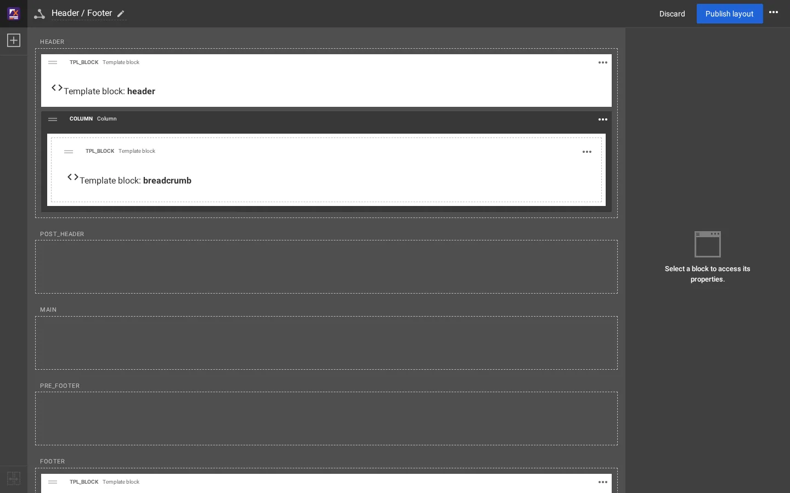

# Add a header menu item

This page answers one question: **how do I put another page into the header menu?** It was worked out on the real
Fit & Healthy site that ships with Exponential 6.0.15+ (the media site theme, extension `sevenx_themes_media`).
Every screenshot was taken on a throwaway copy of that installation.

## Contents

1. [The short answer](#the-short-answer)
2. [Why the Layouts editor does not show the menu items](#why-the-layouts-editor-does-not-show-the-menu-items)
3. [The three ways](#the-three-ways)
4. [After the change](#after-the-change)

## The short answer

The header menu is a **list of node IDs** in the setting `[SiteInfo] MainMenuID[]` of `menu.ini`, for the siteaccess
`site`. Each ID is one menu item; the item's text is the node's name and its link is the node's URL. To add a page:

1. Find the node ID of the page ([Find a node ID](find-a-node-id.md)).
2. Add it to `MainMenuID[]`:
   - in the administration: **Setup > Ini settings**, file `menu.ini`, siteaccess `site`, **Edit** on `MainMenuID[]`
     ([step by step](header-menu-in-the-admin.md)), or
   - in a terminal: `./console exp:ini add menu.ini/SiteInfo/MainMenuID[] 192 siteaccess:site`
     ([step by step](header-menu-by-cli.md)).
3. Clear the **Template & content** caches (the compiled menu template holds the list).

That is all. Adding "Showcase" (node 192) took ten actions in the administration (clicks, choices and one typed line) and
two commands in the console ([Measured steps and times](measured-steps-and-times.md)).

## Why the Layouts editor does not show the menu items

Open **Layouts > Shared layouts > Header / Footer** and you see blocks, not menu items: the header zone holds a
**Template block** whose template name is `header`.

A template block is a placeholder: it tells the page "render the template called `header` here". The menu inside that
template is not stored in the layout. It comes from `menu.ini`. So:

| You want to | Where |
|---|---|
| Add, remove or reorder header menu items | `menu.ini [SiteInfo] MainMenuID[]` (administration: Setup > Ini settings; console: `exp:ini`) |
| Rename a menu item | Rename the page (node) in the content tree; the item shows the node's name |
| Change the header's markup (logo, search, user menu) | The templates, see [How the header is built](how-the-header-is-built.md) |
| Put blocks above or below the header on every page | The Layouts editor, shared layout **Header / Footer**, zone `header` or `post_header` |

The full chain from the layout block to the menu template is on [How the header is built](how-the-header-is-built.md).

## The three ways

| Way | Tool | Who | Page |
|---|---|---|---|
| Administration | Setup > Ini settings | admin, website creator | [Header menu in the administration](header-menu-in-the-admin.md) |
| Command line | `./console exp:ini` | admin, developer, hosting | [Header menu by command line](header-menu-by-cli.md) |
| Content tree | Rename, move or replace the page whose ID is listed | editor | [Header menu and the content tree](header-menu-and-the-content-tree.md) |

The order of the items is the order of the IDs. To move or take out an item, see
[Reorder or remove header menu items](reorder-or-remove-header-menu-items.md).

## After the change

The menu template is compiled with the list of IDs in it, so a changed `MainMenuID[]` shows only after the template
cache is cleared. In the administration choose **Template & content** in the **Clear cache** box and press **Clear**; in
a terminal run `./console exp:cache clear --tag=template,content --allow-root-user`. That also clears the page caches.
If the item still does not appear, work through [Header menu troubleshooting](header-menu-troubleshooting.md).

## Related pages

- [How the header is built](how-the-header-is-built.md)
- [Footer menu items](footer-menu-items.md)
- [Two ways to build](two-ways-to-build.md)
- [The layouts editor](../layouts-editor.md)
- [Free documentation](../free-documentation.md): this page is free to copy, translate and improve under the GNU FDL 1.3.
