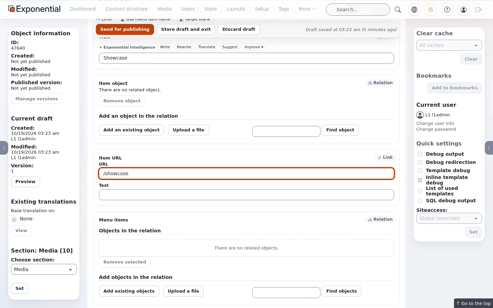
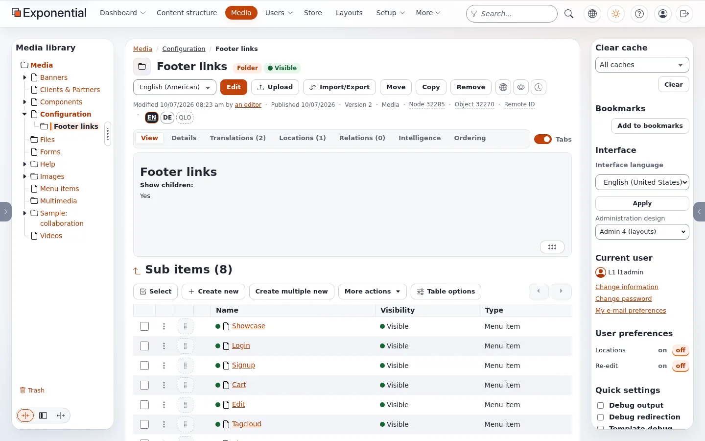

# Footer links from the content tree

The second line of the Fit & Healthy footer is built from content: every **Menu item** in the folder **Footer links**
is one link. This is the one menu of the theme that editors change entirely in the content tree.

## Contents

1. [Open the folder](#1-open-the-folder)
2. [Create a menu item](#2-create-a-menu-item)
3. [Fill in title and URL](#3-fill-in-title-and-url)
4. [Publish and check](#4-publish-and-check)
5. [Order, hide, remove](#order-hide-remove)
6. [Special URLs](#special-urls)
7. [Where the folder is set](#where-the-folder-is-set)

## 1. Open the folder

In the administration open **Media**, then **Configuration > Footer links**. It is a folder sorted by priority and
holds seven menu items on the Fit & Healthy site: Login, Signup, Cart, Edit, Tagcloud, Sitemap and Forgot Password.

## 2. Create a menu item

Press **Create new** above the list of sub items and choose **Menu item** (group *Netgen*). Choose the language
(English (American) is preselected) and press **OK**.

## 3. Fill in title and URL

| Field | Enter | Used by the footer |
|---|---|---|
| Title (required) | The link text, for example `Showcase` | yes, the link text |
| Item URL > URL | The address: a path of the site (`/showcase`) or a full URL (`https://...`) | yes, the link |
| Target blank | Tick to open the link in a new window (`target="_blank" rel="noopener noreferrer"`) | yes |
| Item object, Menu items, Parent node, Class filter, Max depth, Limit, Use menu item name | other uses of the class | not by this footer |

A menu item without a URL is skipped by the footer.

## 4. Publish and check

Press **Send for publishing**. The folder now lists the new item.

On the test copy no cache had to be cleared: the next page already showed the link, first in the second line,
because a new item gets priority 0 and the others have 10 to 70.

## Order, hide, remove

- **Order**: the folder sorts by priority. Change the numbers in the **Priority** column of the sub items list (or on
  the **Ordering** tab) and save: lower numbers come first.
- **Hide**: hide the menu item (its menu in the list, or the visibility button). The footer lists only what the
  visitor may see.
- **Remove**: move it to the trash.

## Special URLs

The footer rewrites three URLs so the same items work on every site:

| URL in the item | The footer links to |
|---|---|
| `/content/edit` | the edit form of the page being viewed; for anonymous visitors the sign-in page |
| `/content/view/sitemap` | the site map of the siteaccess' home node (`[SiteSettings] IndexPage`) |
| `/content/view/tagcloud` | the tag cloud of the home node |

## Where the folder is set

The footer finds the folder by its remote ID: `menu.ini [SiteInfo] FooterLinksRemoteID`, default
`media-o-footer-links`. To use another folder (for example one per site), give that folder's remote ID in the
siteaccess' `menu.ini`. Only children of the class `ng_menu_item` are shown.

## Related pages

- [Footer menu items](footer-menu-items.md)
- [How the footer is built](how-the-footer-is-built.md)
- [Free documentation](../free-documentation.md): this page is free to copy, translate and improve under the GNU FDL 1.3.
