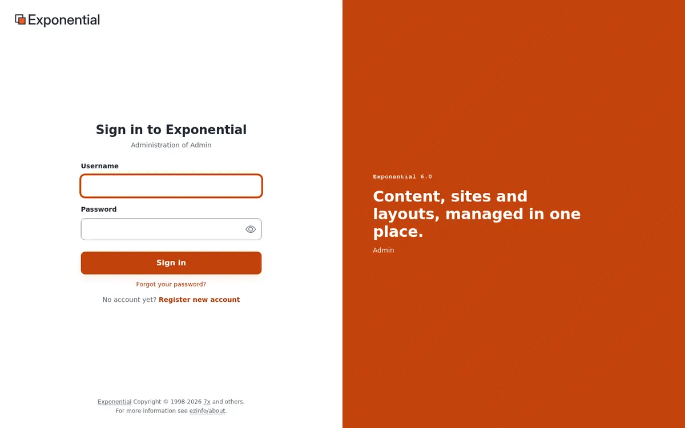

# Getting started

This page is for anyone who has just been given an account: an editor who writes for a site, or a user who wants to
know their way around. In ten minutes you sign in, find your way to the content you work on, make a first change and
know where to look when you are stuck.

## What Exponential is

Exponential is the content management system behind your site. Everything on the site, from a page or a news
article to an image, a file or a user account, is a **content item** (also called an object). Items are arranged in
a tree, like folders on a computer: a folder holds articles, an article can hold images, and so on. You write and
change items in the **administration**, and visitors see them on the **site**.

A change is never visible at once: you work on a **draft**, and the site shows it only when you **publish** it. The
earlier version is kept, so you can always go back. [Publishing, versions and the trash](publishing-and-versions.md)
explains how.

## 1. Sign in

1. Open the address of the administration that you were given. On many sites it is the site's address followed by
   `/admin`, for example `https://www.example.com/admin`. Some sites have a separate address for editors.
2. Type your **Username** and **Password** and press **Sign in**. The eye button in the password field shows what
   you typed.
3. If your account uses two-step sign-in, the next page asks for a code from your phone or your e-mail. See
   [Your account and signing in](accounts-and-sign-in.md#two-step-sign-in).

Forgot your password? Choose **Forgot your password?** below the button. See
[Your account and signing in](accounts-and-sign-in.md#if-you-forgot-your-password).

## 2. Look around

After signing in you see the **Dashboard**: a greeting, quick links, a few numbers (your drafts, your pending items,
content published lately) and lists of recent content. The tabs at the top lead to the main areas:

- **Content structure**: the pages of the site, as a tree.
- **Media**: the media library, with images, files and videos.
- **Users**, **Layouts**, **Setup** and others, when your role allows them.

[A tour of the administration](admin-tour.md) explains every part of the screen.

## 3. Find the item you want to change

- Click **Content structure** and open the folders in the tree in the left column, or
- type a word into the **Search...** field at the top and press Enter. [Searching](searching.md) has more ways.

Click an item's name to open it. Its page shows the item's content and the buttons for what you can do with it:
**Edit**, **Move**, **Copy**, **Remove** and more.

## 4. Make a first change

1. On the item's page, press **Edit**.
2. Change a field, for example the title.
3. Press **Send for publishing**. The change is now on the site.

Not ready yet? Press **Store draft and exit** and come back later: the draft waits under **My drafts** on the
dashboard. Changed your mind? **Discard draft** throws the draft away and leaves the published item as it was.
[Creating and editing content](editing-content.md) explains the form in detail.

## 5. Sign out

Use the last button at the right end of the header, an arrow leaving a box; pointing at it shows **Logout** and
your username. While an item is open for editing the button is grayed out: finish or leave the edit first. On a
shared computer, always sign out.

## Getting help

- The help pages are under **Help** in the administration. The dashboard of the help lists every page by audience
  and topic, and its search finds any page in a second.
- Many pages of the administration explain themselves in a sentence or two under the title; buttons explain
  themselves when you point at them.
- If something looks broken, see [When something goes wrong](when-something-goes-wrong.md).

## Next steps

- [A tour of the administration](admin-tour.md)
- [Creating and editing content](editing-content.md)
- [Keyboard shortcuts](keyboard-shortcuts.md)
