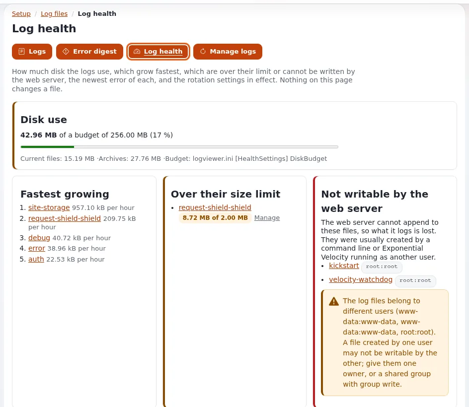

# Log viewer and rotation

This page is for support staff who read customer logs and for system administrators who keep log files from filling
disks. It answers: where the logs of a site are read, who may read them and what is masked, how to find the lines of
one failed request, and how rotation, compression and pruning work on a host where several users write the same logs.

The full references are [The log viewer](../../../features/6.0/log-viewer.md) and
[Log rotation and pruning](../../../features/6.0/log-rotation.md).

## Contents

1. [Setup > Log files](#setup--log-files)
2. [Who may read logs](#who-may-read-logs)
3. [Finding the lines of one request](#finding-the-lines-of-one-request)
4. [The web server's logs in the viewer](#the-web-servers-logs-in-the-viewer)
5. [The same from a shell](#the-same-from-a-shell)
6. [How the kernel rotates its logs](#how-the-kernel-rotates-its-logs)
7. [Pruning and compressing](#pruning-and-compressing)
8. [With the system's logrotate](#with-the-systems-logrotate)
9. [Checklist](#checklist)

## Setup > Log files

**Setup > Log files** (`/setup/logs`) shows every log of the installation: `error.log`, `warning.log`, `notice.log`,
`debug.log`, `deprecated.log`, `auth.log`, the request logs `404.log` and `security.log`, the cronjob logs, the logs of
each site and of extensions, and their rotations (`.gz` read only). A navigator groups them as **Kernel**, **Site**,
**Extensions**, **Web server** and **Rotated archives**, with size, last write and lines a minute.



- Each view has a **permalink** without a query string, such as `/setup/logs/view/error`, safe to paste into a ticket.
- A file is **followed live** with short requests; nothing holds a server process open.
- **Search** covers a file, every kernel log or every file, optionally with rotations, by text or bounded regular
  expression, level, time range, siteaccess, request, client or error reference.
- **Log health** (`/setup/logshealth`) shows disk use against `[HealthSettings] DiskBudget` (shipped 256 MB, a warning
  from 80 %), the fastest-growing logs, files the web server cannot write and mixed owners.
- **Error digest** (`/setup/logsdigest`) lists the distinct errors and warnings of the last 24 hours, grouped and
  counted.

## Who may read logs

Three policies of the `setup` module, held by the Administrator role only in a new installation:

| Policy | Allows |
|---|---|
| `setup/logs` | open the viewer, follow and search, download a range |
| `setup/managelogs` | rotate, empty, remove an archive, each only when switched on in `[ActionSettings]` |
| `setup/unmasklogs` | show e-mail addresses, IP addresses and secrets as written, for this viewer only |

Privacy is on by default: e-mail addresses, IP addresses (`[RedactionSettings] MaskIPs=enabled`), passwords, tokens,
keys, session ids and cookies are masked, and "the values of secret settings are never shown". The viewer is
**read-only by default**: in `settings/logviewer.ini [ActionSettings]` only `Download=enabled` ships on; `Rotate`,
`Truncate`, `DeleteArchives` and `Compress` ship `disabled`. Every view and action is audited.

> **Tip**
> When a customer's own administrator asks for log access, give `setup/logs` to a role of theirs and keep
> `setup/unmasklogs` and `setup/managelogs` with your support staff. Logs of other customers are never visible: each
> installation shows only its own files.

## Finding the lines of one request

An error page shows a reference such as `ERR-0123456789`, and the same reference is in `error.log`
([Finding an error by its reference](../../../guides/finding-an-error-by-its-reference.md)):


1. Ask the customer for the reference and roughly when it happened.
2. **Setup > Log files**, field **Error reference**, **Search**; or open
   `/setup/logs/view/error/(reference)/ERR-0123456789/(scope)/kernel/(rotations)/1`.
3. The entry is shown with **Same request**: the warnings, notices and debug lines of that request, and a link to the
   audit records of the same minute.

Not found? The log may have rotated away, or the request was served by another node: "each server keeps its own
`var/log`".

## The web server's logs in the viewer

The web server's access and error logs can be shown in the same viewer. They are "off by default and never guessed":
name them by key in `settings/override/logviewer.ini.append.php`:

```ini
[LogViewerSettings]
LogList[]=webserver-access
LogList[]=webserver-error
LogPath[webserver-access]=/var/www/vhosts/<domain>/logs/access_ssl_log
LogPath[webserver-error]=/var/www/vhosts/<domain>/logs/error_log
```

The paths above are those of a Plesk server; use your panel's or your virtual host's paths. Logs configured this way
are never rotated or pruned by Exponential: "the program that writes them owns their rotation". Velocity writes its
own access and error logs under `var/vc/qbix/log/` and rotates them by date
([8.3.12 Logs](../../../install/08-serving-the-site.md#8312-logs)).

## The same from a shell

`./console exp:logs` (`bin/php/explogs.php`) uses the same settings, files, masking and limits:

```bash
./console exp:logs --list                                   # files by group, size, time, lines a minute
./console exp:logs --tail=var/log/error.log --lines=50      # the last 50 entries
./console exp:logs --tail=var/log/error.log --follow        # follow it (Ctrl-C ends)
./console exp:logs --search=timeout --file=var/log/error.log --rotations --level=error,warning
./console exp:logs --reference=ERR-0123456789               # the reference and its request
```

## How the kernel rotates its logs

One rotation serves the whole kernel (`expLogRotator`): when a log outgrows `site.ini [FileSettings] LogFileMaxSize`,
the next write rotates it to `.1`, older archives move up, and archives beyond `LogFileRotateCount` are removed.

| Setting (`site.ini [FileSettings]`) | Shipped | Meaning |
|---|---|---|
| `LogFileMaxSize` | `2097152` (2 MB) | size at which the next write rotates the log |
| `LogFileRotateCount` | `3` | archives kept; `0` switches rotation by size off |
| `LogFileCompress` | `disabled` | `enabled` compresses archives from `.2` on (`.1` never: a request may still write to it) |
| `LogFileMaxAge` | `0` | days after which a prune removes an archive; `0` is no age limit |
| `LogFilePermissions` | `0666` | mode of a newly created log |

The constants `EZPUBLISH_LOG_MAX_FILE_SIZE`, `CUSTOM_LOG_MAX_FILE_SIZE`, `EZPUBLISH_LOG_ROTATE_FILES` and
`CUSTOM_LOG_ROTATE_FILES` in `config.php` win over these settings.

**Safe with two writers.** "On a host where Velocity runs as root and PHP-FPM as the site's user, both write the same
logs." A rotation takes an exclusive lock, checks the size again under it, and creates the new log "with the owner,
group and mode of the old one", so neither user ends up with a log the other cannot write.

Limits per log go in `settings/logviewer.ini [RotationSettings]` by the log's key (`MaxSize[debug]`, `Keep[debug]`,
`Compress[error]`, `MaxAgeDays[error]`); a log without an entry uses the `site.ini` values.

## Pruning and compressing

```bash
./console exp:logs --archives                    # each log, its archives, sizes and limits
./console exp:logs --rotate-all --dry-run        # what would be rotated
./console exp:logs --prune --dry-run             # archives beyond the limits
./console exp:logs --prune                       # remove them
./console exp:logs --compress                    # compress plain archives from .2 on
```

Exit codes: `0` done, `1` nothing to do, `2` an unknown name or a failure. Rotations and prunes are recorded in the
audit trail (`system.log.rotate`, `system.log.delete`). For a nightly job, schedule the cronjob part `logs`, which is in
no default part:

```text
15 3 * * * cd /path/to/installation && php runcronjobs.php -q logs
```

## With the system's logrotate

If the system's `logrotate` manages `var/log` instead, set `LogFileRotateCount=0` so the kernel does not rotate as
well, and use `copytruncate` or `create <mode> <owner> <group>` there. Your own cron output files (`cron-*.log`) always
need logrotate, since the kernel does not write them ([10.10](../../../install/10-after-installing.md#1010-logs-and-log-rotation)).

> **Warning**
> Never leave `[DebugSettings] DebugOutput=enabled` on in production: it shows internals to visitors and writes a lot.

## Checklist

- [ ] Support staff have `setup/logs`; `setup/unmasklogs` and `setup/managelogs` are limited to those who need them.
- [ ] The rotation limits fit the disk: with the shipped values a log takes at most about 8 MB with its archives.
- [ ] Either the kernel or logrotate rotates `var/log`, not both.
- [ ] The cronjob part `logs` or a scheduled `exp:logs --prune` enforces age limits.
- [ ] Log health shows no files the web server cannot write.
- [ ] Web server logs are configured in the viewer where support staff need them.

## Related pages

- [Request logs](request-logs.md), [Security log](security-log.md)
- [Monitoring overview](monitoring-overview.md)
- [Disk full](../runbooks/disk-full.md) (runbook)
- [Log and data retention](../security/log-and-data-retention.md)
- [The log viewer](../../../features/6.0/log-viewer.md) (feature reference)
- [Free documentation](../../free-documentation.md): this page is free to copy, translate and improve under the GNU FDL 1.3.
