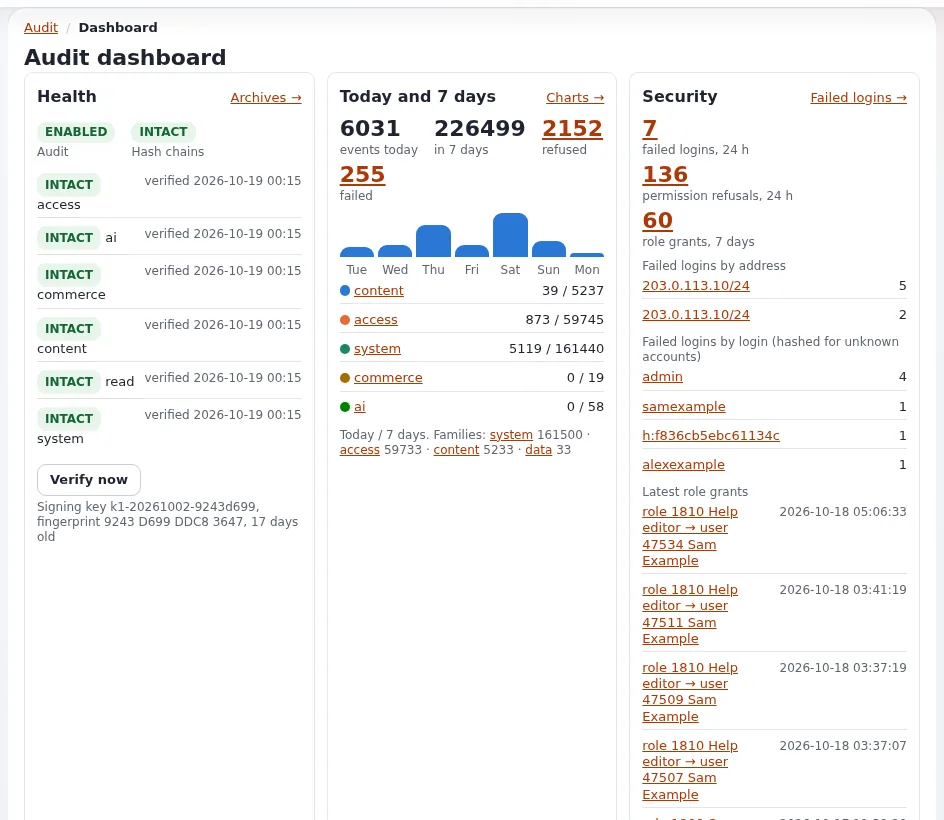
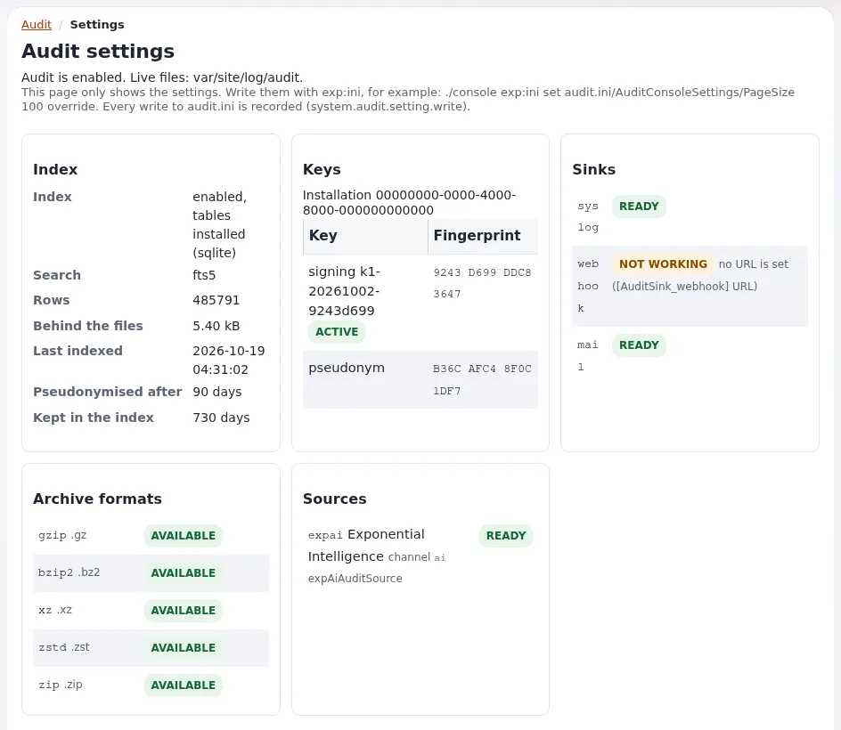

# Audit trail

This page is for system administrators and security staff at a host. Every Exponential 6 site keeps a tamper-evident
record of who did what: sign-ins and failures, role and setting changes, content removed, commands run, orders. It is
on by default and needs no setup, but a host has three jobs: keep its cronjob running, get its alerts to a person, and
keep a copy off the machine. The short reference is [The audit trail](../../../features/6.0/audit-trail.md); the full
guide is [Audit](../../../bc/6.0/audit.md).

## Contents

1. [What is recorded](#what-is-recorded)
2. [The commands a host uses](#the-commands-a-host-uses)
3. [The cronjob](#the-cronjob)
4. [Verifying the chain](#verifying-the-chain)
5. [Alerts](#alerts)
6. [Forwarding off the machine](#forwarding-off-the-machine)
7. [Keys](#keys)
8. [Disk, write failures and clusters](#disk-write-failures-and-clusters)
9. [Checklist](#checklist)

## What is recorded

Each record is a line of JSON in a file per channel and day, `var/<site>/log/audit/<channel>-<YYYY-MM-DD>.jsonl`, and
each line carries the hash of the line before it, so a changed, removed or inserted line shows.



| Channel | Examples | Live / archived (days) |
|---|---|---|
| `content` | publish, move, remove, hide, trash, versions, classes | 90 / 730 |
| `access` | sign-in, failed sign-in, refused view, account lock, role assignment, password reset | 90 / 730 |
| `system` | settings writes, cache clears, cronjob runs, commands, package installs, maintenance, deploys | 90 / 730 |
| `commerce` | orders, payments (never card data), VAT, currencies | 90 / 730 |
| `read` | sampled views, searches, downloads; only when reads are switched on | 30 / 90 |

Privacy by default: addresses truncated to /24 and /48, sessions hashed, user agents shortened, passwords, tokens and
secrets never recorded. Retention and privacy settings: [Log and data retention](log-and-data-retention.md) and
[Compliance and GDPR](compliance-and-gdpr.md).

Who may read it inside the site: the policies `audit/read` and `audit/manage`, held only by Administrator in a new
installation. The administration's **Audit** tab is `/audit/dashboard`.

## The commands a host uses

```bash
./console exp:audit status --allow-root-user                       # enabled, directory, key, each channel intact or broken
./console exp:audit verify --allow-root-user                       # exit 0 intact, 1 broken, 2 error
./console exp:audit verify --archives --allow-root-user            # the archives as well
./console exp:audit tail --channel=access --lines=20 --allow-root-user
./console exp:audit alerts recipients --allow-root-user            # who receives alert mail, and why
./console exp:audit sinks list --allow-root-user
```

`exp:audit` also has `channels`, `show`, `checkpoint`, `search` (`--query=<text>`), `rotate`, `archive`, `restore`,
`purge`, `reindex`, `pseudonymise`, `export`, `import`, `key`, `alerts` and `cron`
([From the command line](../../../features/6.0/audit-trail.md#from-the-command-line)).

## The cronjob

The cronjob part `audit` is in the `frequent` group of `settings/cronjob.ini`. Every run indexes, delivers sink spools
and evaluates alert rules; once a day (after `RotateAfter`, 00:15 site time) it closes day files, verifies every
channel, archives what is older than `LiveDays`, purges what is older than `ArchiveDays`, pseudonymizes old index rows
and writes a signed checkpoint ([4.1 Cron](../../../bc/6.0/audit.md#41-cron)).

```text
*/5 * * * * cd /var/www/vhosts/<domain>/<installation> && php runcronjobs.php -q frequent
```

Run it as the site's user. A run takes a lock, so runs never overlap. The audit dashboard warns when the part has not
run for an hour. Scheduling per customer: [Cron jobs](../operations/cron-jobs.md).

## Verifying the chain

`exp:audit verify` exits with 0 (intact), 1 (broken) or 2 (error), so it fits any monitoring system:



```bash
./console exp:audit verify -q --allow-root-user || <your alert command>
```

When a chain is **BROKEN**: do not edit or remove anything. Note the file, line and kind, copy the directory somewhere
safe, and compare with what left the server (syslog copies, webhook receiver, checkpoints, archives)
([4.4 Verify and restore](../../../bc/6.0/audit.md#44-verify-and-restore)). Then follow
[Compromised site](../runbooks/compromised-site.md).

## Alerts

Shipped rules include `brute_force` (20 failures from one network in 5 minutes), `brute_force_user` (10 for one
account in 15 minutes) and `admin_role_granted`. Mail goes to the rule's `Recipients[]`, else
`[AuditAlertSettings] Recipients[]`, else `[AuditSink_mail] Receivers[]`, else the site's `AdminEmail`
([4.5 Alerts](../../../bc/6.0/audit.md#45-alerts-and-their-recipients)).

Decide with each customer who receives alerts: the customer's administrator, the host's security mailbox, or both.
Recipients can be addresses, named groups, users, user groups or roles:

```ini
# settings/override/audit.ini.append.php
[AuditAlertSettings]
Recipients[]
Recipients[]=admin
Recipients[]=address:security@example.com
```

Mail is sent by the cronjob only, at most one per rule and recipient within `[AuditSink_mail] Throttle` (900 s).

## Forwarding off the machine

A sink sends records off the server, "so a compromised machine cannot quietly rewrite its own history"
([Security hardening](../../security-hardening.md#watching-logs-the-request-classifier-and-the-audit-trail)).

| Sink | Transport |
|---|---|
| `[AuditSink_syslog]` | `Transport=local` (journald's native socket, else `/dev/log`; `journalctl -t exponential`), `journald`, `devlog`, `udp`, `tcp`, `tls` (`Host`, `Port`) |
| `[AuditSink_webhook]` | a signed HTTPS POST (HMAC-SHA-256 over timestamp and body), spooled with retries |
| `[AuditSink_mail]` | mail on critical events |

```ini
# settings/override/audit.ini.append.php: every channel to a central collector
[AuditSink_syslog]
Transport=tcp
Host=logs.example.com
Port=514

[AuditChannel_content]
Sinks[]=syslog

[AuditChannel_commerce]
Sinks[]=syslog
```

Network transports go through the spool and are sent by the cronjob part. A host that runs a central log platform can
offer this to every customer; see [Security log](../operations/security-log.md) for the other security sources.

## Keys

`settings/override/audit.ini.append.php` holds an installation id, the signing keys and the pseudonym key, generated
on the first event (mode `0640`, never committed). Back it up as a secret with the rest of `settings/override/`:
without the signing keys, archives and checkpoints signed with them can no longer be verified. Rotate the signing key
yearly or at once if it may have been read (`exp:audit key rotate`; restart Velocity afterwards if a worker keeps the
old one) ([4.6 Keys](../../../bc/6.0/audit.md#46-keys)). Keys from a secrets store: `[AuditKeySettings]
GenerateKeys=disabled` and the keys provided in settings/override yourself.

## Disk, write failures and clusters

- **Disk.** The live files and archives grow with activity; archives are compressed (gzip by default). `ArchiveDir` is
  best on another file system, or a mount the web server can add files to but not change.
- **Write failures.** `[AuditSettings] OnWriteFailure=continue` (default): a full disk does not take the site down; the
  failure is in `error.log` as `AUDIT-UNWRITTEN`. `refuse`: security-relevant actions (admin POSTs to sensitive views,
  settings writes) are refused with 503 while their channel cannot be written
  ([When the audit cannot write](../../../features/6.0/audit-trail.md#when-the-audit-cannot-write-onwritefailure)).
  Watch disk space either way ([Disk full](../runbooks/disk-full.md)).
- **Several web servers.** One shared `LogDir` on a file system with POSIX locks across servers (NFSv4, CephFS,
  GlusterFS), one key file shared by every server, keys generated once before the other servers record
  ([6.3 Cluster](../../../bc/6.0/audit.md#63-cluster)).
- **Existing installations** upgraded to 6.0.15 create the index tables with
  `php update/common/scripts/6.0/createaudittables.php`.

## Checklist

- [ ] `frequent` cronjob group runs every few minutes as the site's user.
- [ ] `exp:audit verify` in monitoring, alerting on a non-zero exit.
- [ ] Alert recipients agreed with the customer and checked with `exp:audit alerts recipients`.
- [ ] A sink forwards at least `access` and `system` off the machine.
- [ ] `audit.ini.append.php` backed up as a secret; key rotation scheduled.
- [ ] `audit/read` held only by the roles that need it.
- [ ] Disk space for live files and archives monitored; `OnWriteFailure` decided.

## Related pages

- [Security for hosts: overview](README.md)
- [The audit trail (feature)](../../../features/6.0/audit-trail.md)
- [Audit (full guide)](../../../bc/6.0/audit.md)
- [13.14 The audit log](../../../install/13-security-hardening.md#1314-the-audit-log)
- [Security log](../operations/security-log.md)
- [Free documentation](../../free-documentation.md): this page is free to copy, translate and improve under the GNU FDL 1.3.
