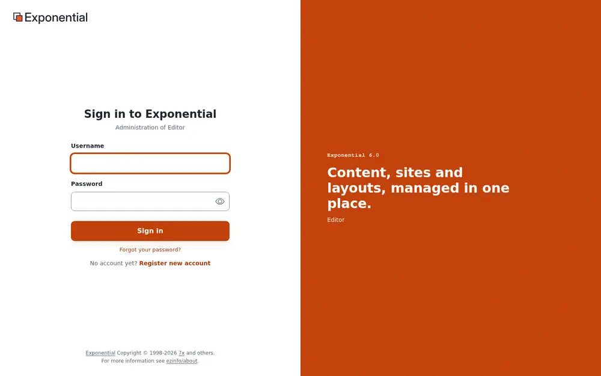
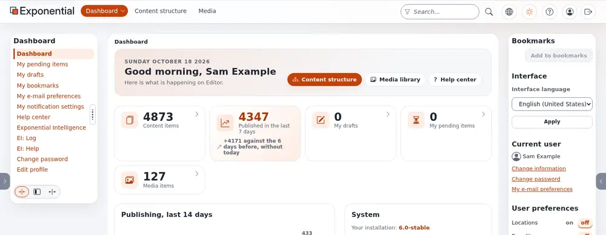
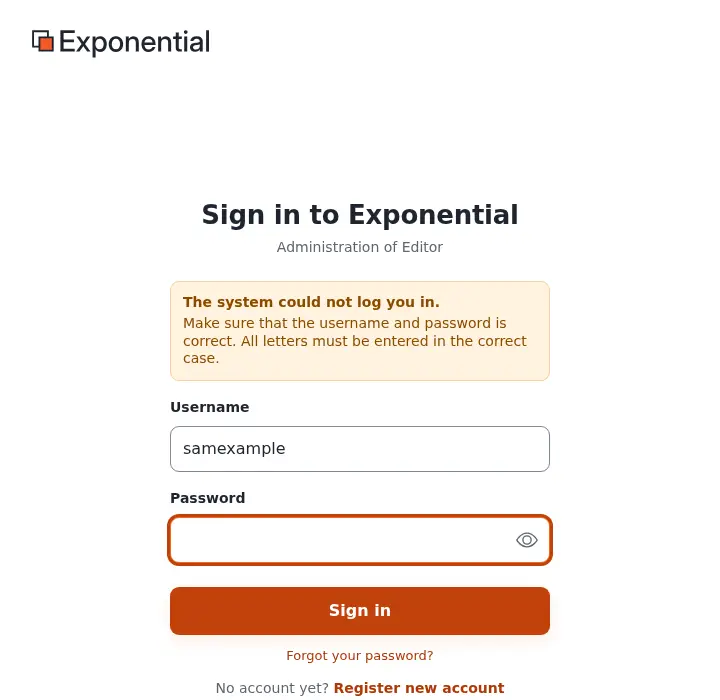

# Logging into the Editor

This page is for editors: people who write, edit and publish content. Many installations give them the **Editor**,
an interface of its own that looks like the administration but shows only what writing and publishing need:
the dashboard, the content and the media library. Administrators use [the administration](logging-into-the-admin.md)
instead; both are parts of the same installation and work on the same content.

## The address

The Editor has its own address. Which one depends on how your site is set up; your administrator tells you. The
usual forms are:

| Form | Example |
|---|---|
| A path after the site's address | `https://www.example.com/editor` |
| A host name of its own | `https://edit.example.com` |

Every page of the Editor needs a signed-in user: whatever address of it you open, you see the sign-in form first.

Bookmark the address in your browser, so you never have to look for it again.

## Sign in

1. Type your **Username**. Most sites also accept the **e-mail address** of your account in this field.
2. Type your **Password**. The eye button in the field shows what you typed, to check it; press it again to hide it.
3. Press **Sign in** (or Enter).

The line under the title names the part of the installation you are signing in to, for example *Administration of
Editor*.

If your account uses **two-step sign-in**, a second page follows: **Confirm it is you**. Enter the 6-digit code
from your authenticator app (or from the e-mail the site sent; the code is also in its subject line) and press
**Verify and sign in**. Spaces in the code are fine; each code works once. After too many wrong codes the sign-in
ends, and you start again with your password. Setting it up is explained in
[Your account and signing in](accounts-and-sign-in.md#two-step-sign-in).

## After signing in

The Editor opens on its **Dashboard**: a greeting with your name, buttons to **Content structure** and the **Media
library**, your numbers (drafts, pending items) and the latest content.

From here everything in [A tour of the administration](admin-tour.md) applies: the tree, the item pages, the edit
form. What you may open and change is decided by your **role** (usually *Editor*): an editor sees fewer tabs and
buttons than an administrator, and pages for settings, users and the system are not there.

In the right column, **Interface language** chooses the language of the menus and buttons for you; see
[Languages](languages.md#the-language-of-the-administration).

## When signing in does not work

| What you see | What to do |
|---|---|
| *The system could not log you in. Make sure that the username and password is correct.* | Check the spelling and the caps lock key: letters must be entered in the correct case. Try your e-mail address instead of the username. |
| *... is not allowed to log in because failed login attempts by this user exceeded allowable number of failed login attempts!* | The site locks an account after a number of wrong passwords. Ask an administrator to reset the failed sign-ins of your account. |
| *Access denied! You do not have permission to access ...* | Your account is right, but your role may not use this part of the installation. Ask an administrator. |
| The page asks for a user name and password in a small browser window, before the site appears | Some test and staging servers are protected by an extra browser password. It is not your Exponential account; ask whoever gave you the address. |
| You are sent back to the sign-in form after signing in | Your browser blocks cookies for the site. Allow cookies for it (signing in needs one), or try a private window to rule out an extension. |

## Forgot your password?

1. On the sign-in page, choose **Forgot your password?**.
2. Enter the **e-mail address** of your account and press **Generate new password**.
3. Open the mail you receive and follow its link. The link works **once** and, by default, for **one hour**; the mail
   says how long. Opening it gives your account a new password, which a second mail sends you.
4. Sign in with it and change it at once under **Change password**.

The page answers the same whether or not an account has that address. No mail after a few minutes? Check the spam
folder, and make sure you used the address of your account. A link opened too late says *This link has expired.*;
ask for a new one.

## Staying signed in and signing out

You stay signed in while you work. A sign-in belongs to one browser and to this part of the installation: being
signed in to the Editor does not sign you in to the administration or the public site, and the other way round.
A session that is not used for a long time (three days with the shipped settings) ends, and you sign in again.

To sign out, press the last button of the header, an arrow leaving a box (**Logout**). While an item is open for
editing it is grayed out: store or discard your draft first. Always sign out on a shared computer.

## Keep your account safe

- Use your **own** account, never a shared one, so that your work carries your name and the version history and the
  audit trail tell who did what.
- Use a long password that you use nowhere else; a password manager remembers it for you. The site refuses short
  and well-known passwords.
- Turn on **two-step sign-in**: your password alone is then useless to anyone else. See
  [Your account and signing in](accounts-and-sign-in.md#two-step-sign-in).
- Never send your password by e-mail or chat, not even to an administrator; nobody needs it.

## Learn more

- [Getting started](getting-started.md)
- [Your account and signing in](accounts-and-sign-in.md)
- [Logging into the admin](logging-into-the-admin.md), for administrators
