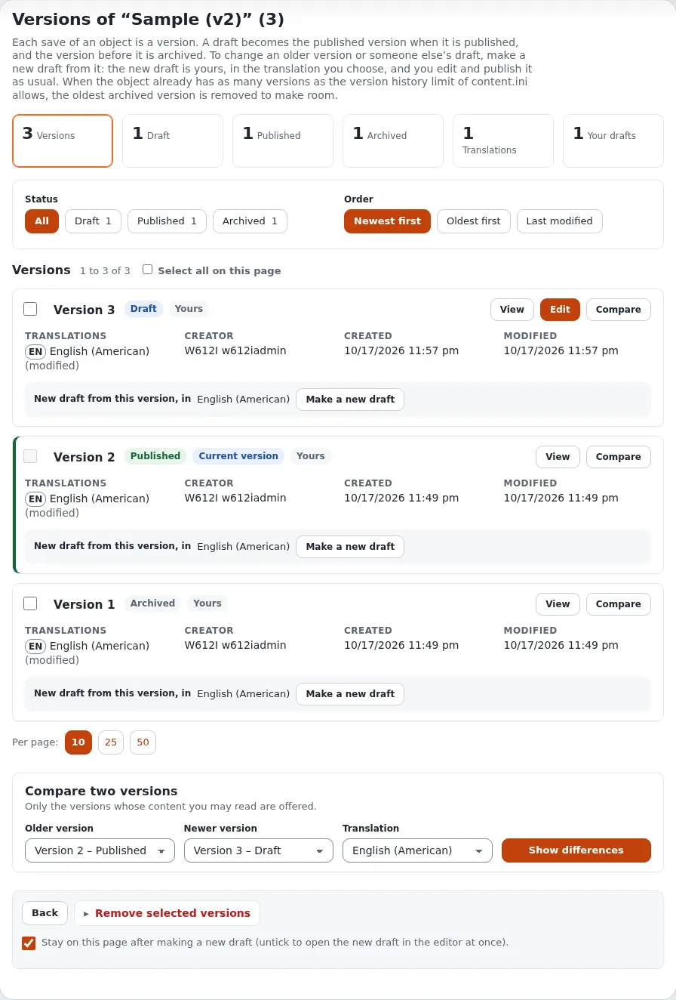

# Publishing, versions and the trash

This page is for editors. It explains what happens between pressing **Edit** and a change being on the site, how to
go back to an earlier version, how to hide an item without removing it, and how to get a removed item back.

## Drafts and versions

Every save of an item is a **version**. When you press **Edit**, a new version is made as a **draft**: only you see
it, and the site keeps showing the published version until you publish.

| State | What it means |
|---|---|
| **Draft** | Being written. Only its creator sees and edits it. |
| **Pending** | Sent for publishing, but a workflow holds it, usually an approval. |
| **Published** | The version the site shows. An item has one published version at a time. |
| **Archived** | An earlier published version. It is kept so you can go back to it. |

When a draft is published, the version that was published before becomes archived. A site keeps a limited number of
versions per item; when the limit is reached, the oldest archived version is removed to make room.

## Publish

In the edit form, press **Send for publishing**. On most sites the change is on the site at once. If your site uses
an **approval** for your role or that part of the site, the version becomes **pending** instead and is published when
someone approves it.

To stop without publishing:

- **Store draft and exit** keeps the draft for later;
- **Discard draft** throws it away, after a confirmation.

### My drafts

**My drafts** (on the dashboard and in the left column of the dashboard) lists the drafts you started and have not
published. Open one to continue it, or remove the ones you no longer need. Removing the draft of a new item also
removes that new item, which was never published.

### My pending items

**My pending items** lists the versions you sent for publishing that a workflow still holds and, if you approve
content, the versions waiting for your approval. Open the approval to read its comments or to approve.

See [My drafts and my pending items](../guides/drafts-and-pending.md) for every detail.

## Go back to an earlier version

On the item's page press **Manage versions** (the round button with a clock), or choose **Manage versions** in the
edit form's left column. The versions page opens:

- **Overview**: how many versions there are, published, archived and your drafts.
- **Filter and order**: show all versions or only one status, newest or oldest first.
- Each version has **View** (see its content), **Compare** and **Make a new draft**.
- **Compare two versions**: choose an older and a newer version and a translation, then press
  **Show differences**. Changes are marked field by field.

To bring an older text back, choose its translation under **New draft from this version, in** and press
**Make a new draft**. A new draft is made from that version; check it and publish it as usual. The current version
is not changed until you publish. The same works for someone else's draft: the new draft is yours.

Versions you no longer need can be selected and removed with **Remove selected versions**. The published version can
never be removed this way.

See [Versions of an object](../guides/content-history.md) for every detail.

## Hide an item

A hidden item stays in the administration but is not shown on the site, and nor is anything below it. Use it for
content that is not ready, or not needed for a while.

- In the tree, open the item's menu and choose **Advanced** > **Hide / unhide**.
- In a **Sub items** list, tick items and choose **More actions** > **Hide selected** or **Unhide selected**.

Hidden items are marked in the tree and in lists, and the badge next to the type on the item's page shows its visibility.

## Remove and restore

**Remove** on an item's page (or in its menu, or **Remove selected** for several items) asks for a confirmation and
then moves the item, with everything below it, to the **trash**. Items in the trash are not on the site.

When an item has more than one location, removing one location keeps the item in its other places; it goes to the
trash only when its last location is removed.

### The trash

**Trash** is at the bottom of the tree in the left column. It lists the removed items with who removed them, when,
and where they were. Filters narrow the list by who removed them, their type and the date.

- **Restore** puts an item back. If its original place still exists, it goes back there; if that place is in the
  trash too, restore the parent first; otherwise you choose a new place.
- **Remove selected** deletes items for good. **Empty trash** deletes everything in it. Neither can be undone.

Your role decides whether you may restore or delete from the trash.

## Learn more

- [Creating and editing content](editing-content.md)
- [Versions of an object](../guides/content-history.md)
- [My drafts and my pending items](../guides/drafts-and-pending.md)
