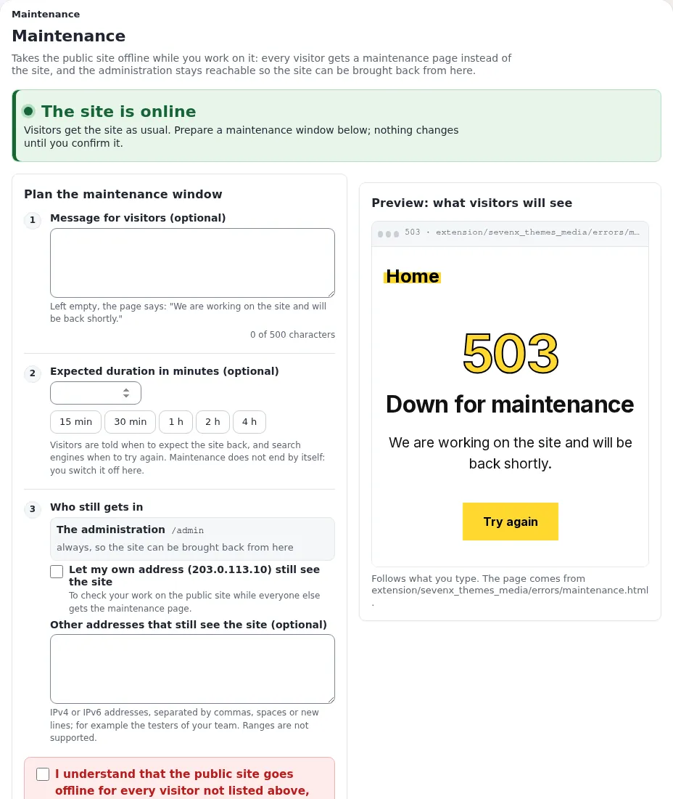
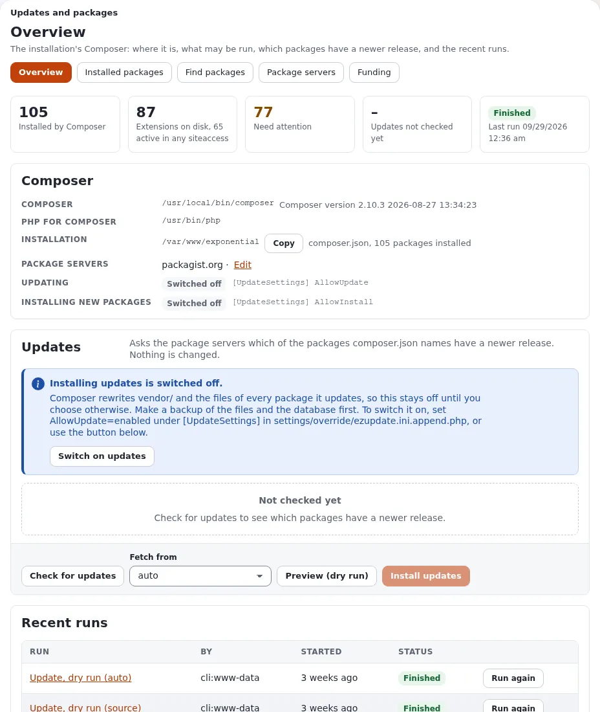
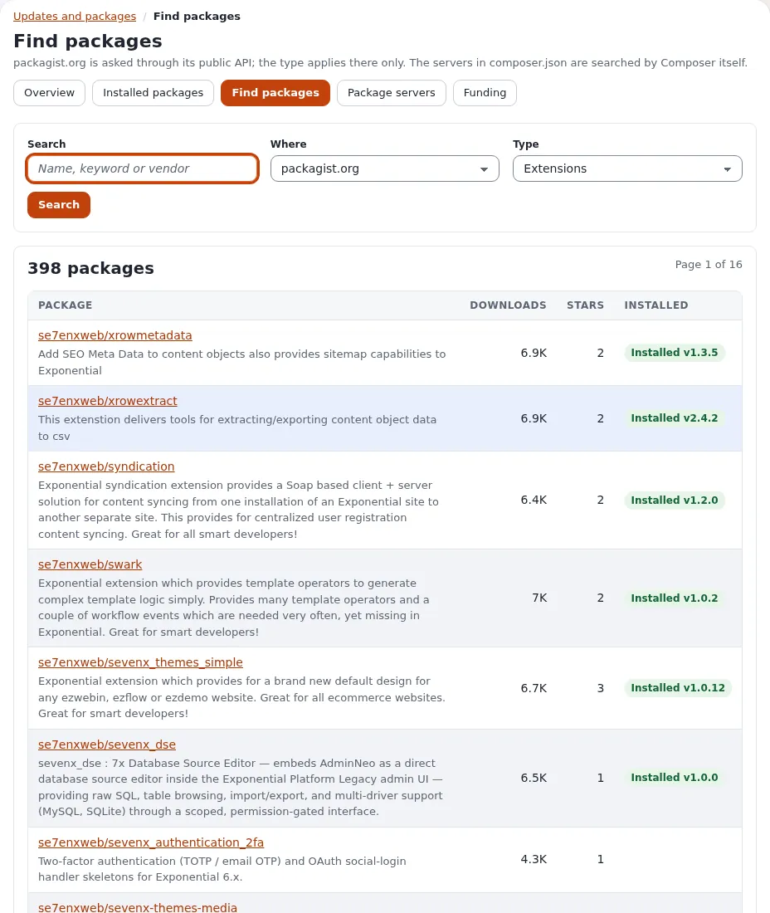
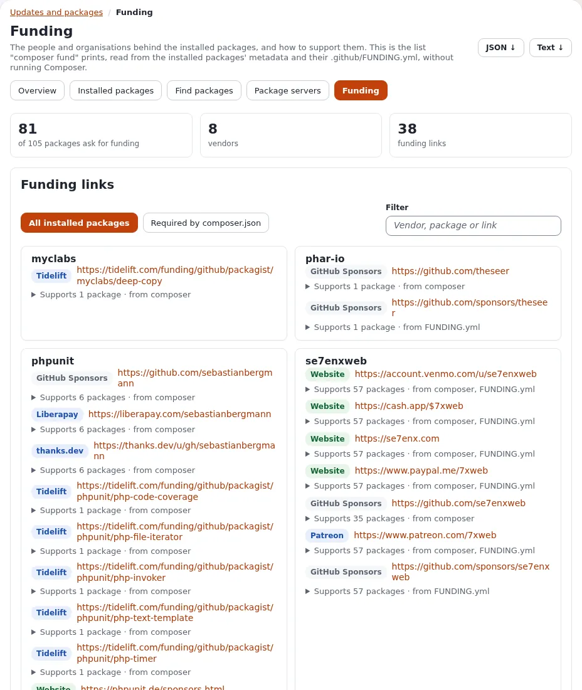

# Update with Git: stay in sync with GitHub

Once your site is made of Git clones ([Develop with Git](develop-with-git.md)), updating is two moves: bring the
kernel up to date with Git, then let Composer bring every extension up to date to match. This page shows both, for
the schedule that suits you, how to see what changed, how to stay safe, and how to let the computer do it for you.
Without a shell, the same update can be done in the administration during a maintenance window:
[Update in the administration](#update-in-the-administration-a-maintenance-window) goes through it page by page, with a
checklist.

Every command here was run on a fresh installation first: a kernel clone on a branch `my-site` made from release
`v6.0.13`, updated to the release `v6.0.14` and then to the development line `main`.

## Choose how closely you follow

| You want | Follow | Good for |
|---|---|---|
| every change as soon as it is pushed | `main`, the development line: check **hourly** or **daily** | development machines, staging sites, people who test and contribute |
| changes in batches | `main`, checked **weekly** or **monthly** | sites that change often but want quiet weeks |
| only finished, tested versions | the newest **release tag** (`v6.0.14`, ...) | live sites |

Following `main` gets fixes the day they land; a release gets them later, after they have been tested together.
Release tags are on the history of `main`, so you can start with releases and move to `main` later (or the other way
round, once the next release has caught up).

## The update, step by step

Run these in the root of the installation, as the user that owns the files (not as root).

### 1. See what is waiting

```bash
git status
git fetch origin --tags
git log --oneline HEAD..origin/main
git tag -l 'v6.*' --sort=version:refname | tail -3
composer outdated 'se7enxweb/*'
```

`git status` should report no changes of your own that are not committed. `git log HEAD..origin/main` lists the
commits on GitHub that your site does not have yet; the tag list shows the newest releases, the newest last (always
sort by version: by name, `v6.0.10` comes before `v6.0.8`). `composer outdated` names the extensions with a newer
release than the one installed.

### 2. Bring the kernel up to date

Following the development line:

```bash
git merge origin/main
```

Following releases only, to the newest release tag:

```bash
git merge "$(git tag -l 'v6.*' --sort=version:refname | tail -1)"
```

`git merge` keeps your own commits on `my-site` and adds the new ones. If your branch has no commits of its own, the
merge simply moves forward. When one of your commits and an update change the same lines, Git stops with
`CONFLICT` and leaves the choice to you; `git merge --abort` puts everything back as it was.

If you work on a clone without a branch of your own (`git status` says `HEAD detached at v6.0.14`), switch to the new
release instead:

```bash
git switch --detach "$(git tag -l 'v6.*' --sort=version:refname | tail -1)"
```

Start a branch (`git switch -c my-site`) before you change anything.

### 3. Bring the extensions up to date

```bash
composer update
```

`composer.json` in the kernel names the extensions and their versions, and it changes as the kernel moves on: on the
way from `v6.0.14` to `main` it added 39 packages and updated 11. `composer update` reads the new `composer.json`,
clones the new extensions (each with its history, thanks to the setting of
[Develop with Git](develop-with-git.md#step-1-tell-composer-to-prefer-clones)), moves the existing clones to their
new release tags, and regenerates the class maps at the end. Use `composer update`, not `composer install`: the
lock file is your own (it is not part of the kernel's repository), so after the kernel moved it is out of date.

**About `--prefer-source`.** Composer chooses between a clone and an archive when it **first installs** a package.
An update keeps that choice: a clone stays a clone, an archive stays an archive, and `composer update --prefer-source`
does not turn archives into clones. With the `preferred-install` setting, every new `se7enxweb/*` package arrives as
a clone anyway. To turn an existing archive into a clone, use `composer reinstall <package>`
([Develop with Git](develop-with-git.md#the-extensions)).

Composer never overwrites your work in a clone. When an extension has changes you did not commit, or commits on a
branch that exists only on your machine, it stops with a message instead; [When Composer
refuses](develop-with-git.md#when-composer-refuses) says what to do. Fix the cause and run `composer update` again
to finish.

### 4. Finish

```bash
php bin/php/ezcache.php --clear-all
```

On a site served by Exponential Velocity, `php bin/php/console exp:velocity deploy` does everything a code change
needs instead (class maps, caches, PHP-FPM, a restart of Velocity, in the right order); see
[Velocity engines](../bc/6.0/velocity-engines.md). A release can also need a **database update**: read
[Upgrading](../install/11-upgrading.md#step-2-apply-the-database-update) for the release you moved to, before the
site goes back to work.

### 5. See what changed

```bash
git log --oneline ORIG_HEAD..HEAD
git -C extension/eztags log --oneline -5
```

After a merge, `ORIG_HEAD` is where you were before it, so the first command lists every commit the update brought.
Composer's own output lists each extension it moved (`Upgrading se7enxweb/eztags (v2.4.20 => v2.4.21)`), and the
second command shows the latest changes of one of them.

In the administration:

- **Help** > **Recently updated** on the help dashboard lists the documentation pages that changed most recently,
  with their commit message.
- With the [git_manager](../features/6.0/extensions/git_manager.md) extension, its **git dashboard** (**Setup**)
  shows where the installation stands against GitHub, the commits it is missing, and a commit log you can filter by
  author and date.
- **Setup** > **Upgrade check** compares every file with the release's checksums and the database with the
  schema; see [The upgrade check](../guides/upgrade-check.md).

## Stay safe

- **Back up first**: the database and the folder, or a [git_manager](../features/6.0/extensions/git_manager.md)
  backup ("DB + Files caption").
- **Try it on a copy first.** Run the update on a staging copy of the site, look around, run the
  [upgrade check](../guides/upgrade-check.md), and only then update the live site, ideally to the same commit
  (`git merge <the commit you tested>`).
- **Read before a release**: the [changelog](../changelogs/6.0/6.0.15.md) of the version you move to, and
  [Upgrading](../install/11-upgrading.md) for its database and settings steps.
- **Going back**: `git reset --hard ORIG_HEAD` right after a merge returns the kernel to where it was, and
  `composer update` then moves the extensions back with it (from `main` back to `v6.0.14` it removed the 39 packages
  `main` had added and moved 11 back). Restore the database from your backup if a database
  update already ran.

## Update in the administration: a maintenance window

Everything above can also be done from the administration, without a shell, in a short maintenance window: the public
site shows a maintenance page, you update and check, and the site comes back when everything passes. What follows
is what the pages show; the screenshots are of the **Admin 4** design with a test administrator. Each step names the
policy a role needs for it (`module/function`); the Administrator role has them all.

| Step | Page | Policy |
|---|---|---|
| Start the window | **Setup** > **Maintenance** (`setup/maintenance`) | `setup/administrate` |
| Update the kernel | **Setup** > **Git Manager** (`git_manager/dashboard`) | `git_manager/git_manager` (`git_manager/push` to push, `git_manager/backup` for backups) |
| Update the extensions | **Setup** > **Updates and packages** (`update/dashboard`) | `update/ezupdate` to look, check and preview; `update/manage` to install, switch updating on and change servers |
| Check files and database | **Setup** > **Upgrade check** (`setup/systemupgrade`) | `setup/setup` |
| Apply a database update | **Setup** > **DS Editor** (`dse/dashboard`) | `dse/dse` |
| Clear the caches | **Setup** > **Cache management** (`setup/cache`) | `setup/managecache` |
| Read the logs | **Setup** > **Log files** (`setup/logs`) | `setup/logs` |

Git Manager, Updates and packages and the DS Editor are extensions (`git_manager`, `ezupdate`, `sevenx_dse`); they
appear in the menu when they are active.

### 1. Start the window

Make a backup first: **Setup** > **Backup** (`git_manager/backup`), type **DB + Files caption**.

Then open **Setup** > **Maintenance**. While the site is online, the page shows a green **The site is online** banner
and a plan in three steps:

1. **Message for visitors** (optional; left empty, the page says "We are working on the site and will be back
   shortly.").
2. **Expected duration**: type the minutes or choose **15 min**, **30 min**, **1 h**, **2 h** or **4 h**. Visitors and
   search engines are told when to come back. Maintenance does not end by itself.
3. **Who still gets in**: the administration under `/admin` always; tick **Let my own address still see the site** to
   check your work on the public site while everyone else gets the maintenance page, and add other addresses (your
   testers) if you like.

Tick **I understand that the public site goes offline for every visitor not listed above, until I switch maintenance
off again.** and press **Take the site offline**. This also empties the caches that answer ahead of the site. A
**Preview** further down shows the page visitors get, and **From a shell** has the same switch as a command
(`php bin/php/maintenance.php on|off|status`).



### 2. Update the kernel with Git Manager

Open **Setup** > **Git Manager**. The **Upstream (origin)** card at the top compares the installation with the
remote: the remote's address, the branch it is compared with, the last fetch, **AHEAD / BEHIND** (local commits /
commits to get), the files not committed, and two lists: **Missing in this installation** (the commits on GitHub you
do not have yet, each with its author and a link) and **Only in this installation**.

1. Press **Fetch now**. It runs `git fetch --prune` and nothing else, so the card shows the remote as it is now.
2. Read **Missing in this installation**: these are the commits the update brings.
3. Check **NOT COMMITTED**. Files you changed and did not commit can make the next step fail; commit them from a
   shell first.
4. Under **Local branch**, choose the branch the site runs on (the one shown after **HEAD**, for example `main` or
   `my-site`), tick **Regenerate autoloads**, and press **Checkout**. Git Manager checks out that branch and runs
   `git pull origin <branch>`, which fetches the branch of the same name on the remote and merges it, then
   regenerates the class maps. The output of Git is shown on the page.
5. The badge now says **Up to date** and **AHEAD / BEHIND** shows `0 / 0`.

The **Commits log** further down lists the history, 50 commits to a page, with a filter by author and date; each
commit opens with its changes, and a commit can be checked out by its hash. Git Manager follows branches: to update
only to a release tag, use the command line ([step 2 above](#2-bring-the-kernel-up-to-date)).


### 3. Update the extensions with Updates and packages

The kernel's `composer.json` names the extensions and their versions, so after the kernel moved, Composer has to
follow. **Setup** > **Updates and packages** runs Composer for you. It has five tabs.

**Overview** (`update/dashboard`) shows the counts (installed by Composer, extensions on disk, those that need
attention), where Composer and its PHP are, and two switches: **UPDATING** (`[UpdateSettings] AllowUpdate`) and
**INSTALLING NEW PACKAGES** (`AllowInstall`). Both are **Switched off** until you choose otherwise, because Composer
rewrites `vendor/` and the files of every package it updates. Then:

1. **Check for updates** asks the package servers which packages have a newer release. Nothing is changed.
2. **Fetch from**: `auto`, `dist (archives)` or `source (git, with history)`. A package keeps the way it was first
   installed (see [step 3 above](#3-bring-the-extensions-up-to-date)); `source` makes new packages Git clones.
3. **Preview (dry run)** shows what Composer would change. Each package is marked *Can be installed* or *Blocked by
   composer.json*.
4. To install, updating must be on: **Switch on updates** (it writes `AllowUpdate=enabled` into
   `settings/override/ezupdate.ini.append.php`). With a backup made, tick the packages and press **Install updates**.
   The run goes on in the background and the page follows its output; afterwards the class maps are regenerated and
   the INI, template and content caches cleared. A notice at the top says *The installation is up to date!* when
   there was nothing to do, or what changed.
5. **Recent runs** lists every run with **Run again**. Switch updating off again when you are done.



**Installed packages** (`update/installed`) puts side by side what `composer.json` requires, what `composer.lock`
resolved, what is on disk and which extensions are switched on. For each package it shows the versions (the branch
and commit when it is a Git clone) and a status. Filter with **Needs attention** to see what does not agree (an
extension on disk that Composer does not know, a version that differs from the lock file), and with **Git clones** to
see which packages are clones. **JSON** and **CSV** download the table.


**Find packages** (`update/browse`) searches packagist.org (Extensions, Kernel, Libraries or Any type) or every server
in `composer.json`, and marks what is installed. A package's page shows its versions and requirements and installs it
(with **INSTALLING NEW PACKAGES** switched on).



**Package servers** (`update/servers`) lists the **Composer servers** (the `repositories` of `composer.json`;
packagist.org can be switched off) and the **Exponential package servers** of `.ezpkg` packages that the setup wizard
reads. Check here that Composer asks the servers you expect before an update.


**Funding** (`update/fund`) lists who is behind the installed packages and how to support them: the list
`composer fund` prints, read from the packages' metadata and their `.github/FUNDING.yml`.



### 4. Check, update the database, clear the caches

**Setup** > **Upgrade check** has two checks. Both only read.

- **Check file consistency** compares every file of the installation with the checksums of the release (and of each
  extension that ships its own list). After an update from Git, every file should match; a file listed as modified is
  one you changed, or one the update did not reach.
- **Check database consistency** compares the tables with the schema of the new code and shows the SQL that would
  bring the database in line. **Download SQL** saves it. Nothing is run.


A release can need a **database update**: [Upgrading](../install/11-upgrading.md#step-2-apply-the-database-update)
names the file for each release (`update/database/<engine>/6.0/...`). Without a shell, **Setup** > **DS Editor** opens
the site's database in AdminNeo after a warning page you confirm (**I have taken a full backup and accept full
responsibility.**, **Proceed to the database**). There you can run SQL statements, or import an SQL file you upload, which
is how the release's update file is applied. It works on the live data directly, past every check of the
administration, so use it only with the backup in hand. Apply the release's file once, whole, in order. Run **Check database consistency** again afterwards.

Then **Setup** > **Cache management**: **Clear all caches…** and confirm. On a site served by Exponential Velocity,
also press **Clear Velocity's response cache** on the same page (in the group **Pages, queries and the server**).


### 5. Check the site

- Open the **front page** and a few typical pages of the public site (with **Let my own address still see the site**
  ticked you see the site, everyone else the maintenance page). Sign in to the administration again and open a
  content item.
- **Setup** > **Log files**: **Error digest** lists the distinct errors and warnings of the last 24 hours, most frequent
  first; **Log health** shows the disk the logs use, the fastest growing logs, the files the web server cannot write
  and the newest error of each log. New errors since the update are the ones to look at.
- **Setup** > **Upgrade check** once more, if you changed anything.


### 6. Leave the window

Only when everything above passes: **Setup** > **Maintenance** > **Bring the site back online**. If something does
not pass and cannot be fixed now, go back to the state before the update (in Git Manager, check out the commit the
site ran before from the **Commits log**, or from a shell `git reset --hard ORIG_HEAD` and `composer update`; restore
the database from the backup if a database update already ran), then bring the site back.

**Checklist**

- [ ] Backup made (**Setup** > **Backup**)
- [ ] Maintenance on (**Setup** > **Maintenance** > **Take the site offline**)
- [ ] Kernel updated (**Git Manager**: **Fetch now**, **Checkout** of the site's branch with **Regenerate autoloads**; badge **Up to date**)
- [ ] Extensions updated (**Updates and packages**: **Check for updates**, **Preview (dry run)**, **Install updates**; switched off again)
- [ ] **Upgrade check**: files and database consistent; the release's database update applied
- [ ] Caches cleared (**Cache management** > **Clear all caches…**; Velocity's response cache too)
- [ ] Front page, a few pages and the administration work
- [ ] **Log files** > **Error digest**: no new errors
- [ ] Maintenance off (**Bring the site back online**)

## Let it update itself

When you have done the update by hand a few times and trust it, a small script can do it on your schedule. Test it by
hand on a staging copy first, and keep the live site on releases. An automatic update never runs database updates,
and it stops instead of guessing when something needs a person.

Save this as `/usr/local/bin/exp-update` and make it executable (`chmod +x /usr/local/bin/exp-update`):

```sh
#!/bin/sh
# exp-update: bring an Exponential installation made of Git clones up to date.
#   exp-update release   the newest release tag of the 6.x line (v6.*)
#   exp-update main      the development line, origin/main
# Stops without changing anything when the kernel has uncommitted changes or the merge needs a hand.
set -eu
SITE=${EXP_SITE:-/var/www/exponential}
MODE=${1:-release}
cd "$SITE"
if [ -n "$(git status --porcelain --untracked-files=no)" ]; then
    echo "exp-update: the kernel has uncommitted changes; commit or stash them first" >&2
    exit 1
fi
git fetch --quiet origin --tags
if [ "$MODE" = main ]; then
    TARGET=origin/main
else
    TARGET=$(git tag -l 'v6.*' --sort=version:refname | tail -1)
fi
if git merge-base --is-ancestor "$TARGET" HEAD; then
    echo "exp-update: already up to date with $TARGET"
    exit 0
fi
if ! git merge --no-edit "$TARGET"; then
    git merge --abort
    echo "exp-update: merging $TARGET needs a hand; nothing was changed" >&2
    exit 1
fi
composer update --no-interaction --no-progress
php bin/php/ezcache.php --clear-all
echo "exp-update: now at $(git describe --tags --always)"
```

Set `EXP_SITE` to your installation's folder. What it does, as tested:

| Situation | What `exp-update` does |
|---|---|
| nothing new | prints `already up to date with v6.0.14` (or `origin/main`) and stops |
| something new | merges it, runs `composer update` and clears the caches, then prints `now at ...` |
| the kernel has uncommitted changes | changes nothing and exits with an error |
| a merge conflict with your own commits | aborts the merge, changes nothing and exits with an error |
| Composer refuses an extension (local changes, unpushed commits) | stops with Composer's message; run `composer update` by hand once the cause is fixed |

On a site served by Velocity, replace the `ezcache.php` line with `php bin/php/console exp:velocity deploy`.

### With cron

Edit the crontab of the user that owns the files (`crontab -e`) and add **one** of these lines:

```text
# every hour, the development line
5 * * * *   EXP_SITE=/var/www/exponential /usr/local/bin/exp-update main >> $HOME/exp-update.log 2>&1
# every day at 04:15, the development line
15 4 * * *  EXP_SITE=/var/www/exponential /usr/local/bin/exp-update main >> $HOME/exp-update.log 2>&1
# every Monday at 04:15, the development line
15 4 * * 1  EXP_SITE=/var/www/exponential /usr/local/bin/exp-update main >> $HOME/exp-update.log 2>&1
# on the first of every month at 04:15, the development line
15 4 1 * *  EXP_SITE=/var/www/exponential /usr/local/bin/exp-update main >> $HOME/exp-update.log 2>&1
# every day at 04:15, but only when a new release has been published
15 4 * * *  EXP_SITE=/var/www/exponential /usr/local/bin/exp-update release >> $HOME/exp-update.log 2>&1
```

Checking daily in `release` mode updates only on the day a new release appears; on every other day it prints
`already up to date`.

### With a systemd timer

Two files in `/etc/systemd/system/`. `exp-update.service`:

```ini
[Unit]
Description=Update the Exponential installation from GitHub
Wants=network-online.target
After=network-online.target

[Service]
Type=oneshot
User=www-data
Environment=EXP_SITE=/var/www/exponential
ExecStart=/usr/local/bin/exp-update release
```

and `exp-update.timer`:

```ini
[Unit]
Description=Update the Exponential installation from GitHub, daily

[Timer]
OnCalendar=daily
RandomizedDelaySec=30min
Persistent=true

[Install]
WantedBy=timers.target
```

Use the user that owns your files in `User=`, and `main` in `ExecStart=` to follow the development line.
`OnCalendar=` takes `hourly`, `daily`, `weekly` (Mondays), `monthly` (the first of the month) or a time such as
`*-*-* 04:15:00`; `systemd-analyze calendar weekly` shows when it would run. Then:

```bash
systemctl daemon-reload
systemctl enable --now exp-update.timer
systemctl list-timers exp-update.timer
journalctl -u exp-update.service
```

The last two show when it runs next and what it said last time.

## Where to go next

- [Develop with Git](develop-with-git.md): installing as clones, working on a branch, sending fixes back.
- [Upgrading](../install/11-upgrading.md): the database and settings steps of each release.
- [The upgrade check](../guides/upgrade-check.md) and [git_manager](../features/6.0/extensions/git_manager.md).
- The project on GitHub: [se7enxweb/exponential](https://github.com/se7enxweb/exponential) and its
  [releases](https://github.com/se7enxweb/exponential/releases).
